# PRAYER Admin Dashboard — Low-Fidelity Design

Prepared: 24 September 2026.

Simple screen-by-screen image wireframes for review before visual design. These are layout proposals, not final UI or implemented screens. They follow [FEATURE.md](FEATURE.md) and the existing page catalogue in [SPEC.md](SPEC.md).

## How to Read

- Each image shows the actual page arrangement: sidebar, header, content, forms, tables and buttons.
- These are static grayscale wireframes, not interactive screens. Buttons and sample rows illustrate placement only.
- All names, messages, dates and figures are sample content. They are not live customer data.
- Images are stored in the adjacent `design-assets` folder and displayed directly in this document. Keep that folder with this file when sharing.
- Open an image at full size to inspect small text. Related tab images appear together under the same screen.
- Forms labeled create/edit reuse one layout. Side panels and confirmation dialogs illustrate alternate states rather than new pages.
- Fields marked as proposals or pending decisions still require confirmation. Layout approval does not add scope.

## Shared Layout

| Role context | Navigation shown when authorized |
|---|---|
| Church staff | Overview, Church Profile, Prayers, Events, Announcements, Requests, Donations, Activity |
| Central staff | Platform Overview, Churches, Staff, Roles, Pastors, Organization, Countries, Languages, Voices, Notifications |
| Regional staff | Regional Overview for their assigned scope |
| Pastor self-service | My Voice; other church menus only when separately granted |

Do not show every menu to everyone. A central role does not automatically grant private-request access. Scope switches must use assigned scopes only. Server authorization must also enforce access when someone opens a URL directly.

Use the template’s standard tables, forms, tabs, drawers and confirmation dialogs. Keep the desktop layout clear; on narrower screens collapse navigation, stack form fields and allow tables to scroll without hiding important actions.

## Screen Index

The earlier simplified prompt grouped several areas together. This catalogue separates the existing required views for clarity, including church selection, basic analytics and central oversight. It adds no new feature modules.

| ID | Screen / view | Who uses it | Feature |
|---|---|---|---|
| S01 | Login | All staff | F1 |
| S02 | Choose Church | Staff with church access | F1 |
| S03 | Church Dashboard | Authorized church staff | F2 |
| S04 | Church Profile and Service Schedule | Authorized church editors | F3 |
| S05 | Prayer List and Archive | Authorized content staff | F4 |
| S06 | Prayer Editor | Authorized content staff | F4 |
| S07 | Prayer Audio Review and Publication | Staff with the relevant generation/approval/publication grants | F4 |
| S08 | Events and Event Editor | Authorized content staff | F5 |
| S09 | Announcements and Announcement Editor | Authorized content staff | F5 |
| S10 | Prayer and Pastoral Request List | Church staff with explicit request access | F6 |
| S11 | Request Detail | Church staff with explicit sensitive-data access | F6 |
| S12 | Donation Reporting | Authorized church finance viewers | F7 |
| S13 | Attendance and Basic Analytics | Authorized church analytics viewers | F10 |
| S14 | Central Overview | Authorized central administrators | F8 |
| S15 | Church Administration List | Authorized central administrators | F8 |
| S16 | Church Setup and Lifecycle | Authorized central administrators | F8 |
| S17 | Staff List | Authorized central staff administrators | F8 |
| S18 | Staff Create and Edit | Authorized central staff administrators | F8 |
| S19 | Supported Roles and Permission Detail | Authorized central role viewers | F1 / F8 |
| S20 | Pastor Profiles and Church Assignments | Authorized central administrators | F8 |
| S21 | Organization Structure | Authorized central administrators | F8 |
| S22 | Countries | Authorized central administrators | F8 |
| S23 | Languages | Authorized central administrators | F8 |
| S24 | Voice Submission Review | Authorized voice-review administrators | F4 / F8 |
| S25 | Notification Settings | Authorized central notification administrators | F11 |
| S26 | Regional Dashboard | Authorized country/diocese/deanery viewers | F9 |
| S27 | My Voice — Pastor Submission | Linked pastor, own sample only | F4 |

## Screen Wireframes

### S01 — Login

**Expected:** Sign in and land on the dashboard allowed by the account.

**Access:** All staff. **Scope:** F1.

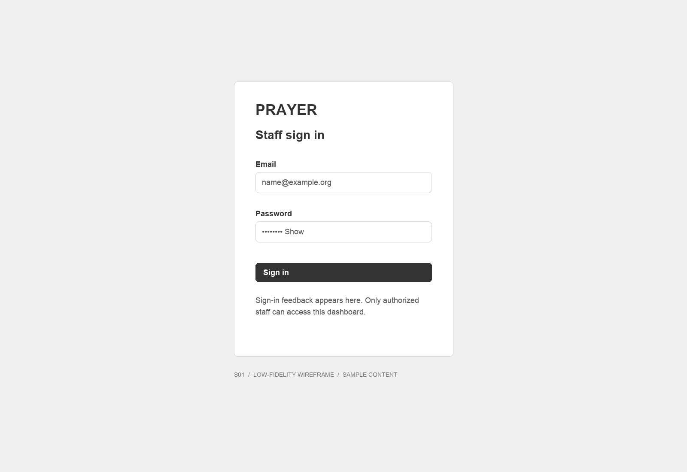

No public staff registration or recovery screen is added. After session expiry, return here without exposing the previous page’s private data.

**Page mapping:** `/login`.

### S02 — Choose Church

**Expected:** Select an assigned church before managing its information.

**Access:** Staff with church access. **Scope:** F1.

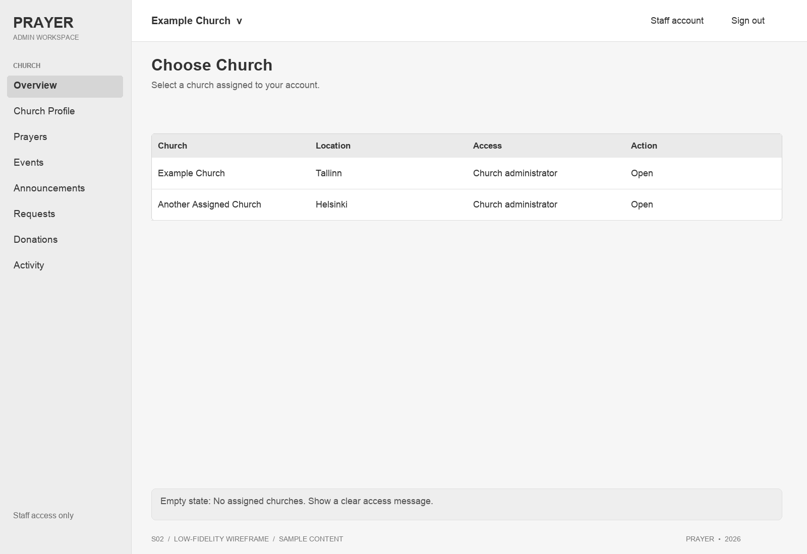

Show assigned churches only. With one church, direct entry may skip this selector. The header switcher uses the same authorized list.

**Page mapping:** `/dashboard/churches`.

### S03 — Church Dashboard

**Expected:** Understand the church’s current content and activity at a glance.

**Access:** Authorized church staff. **Scope:** F2.

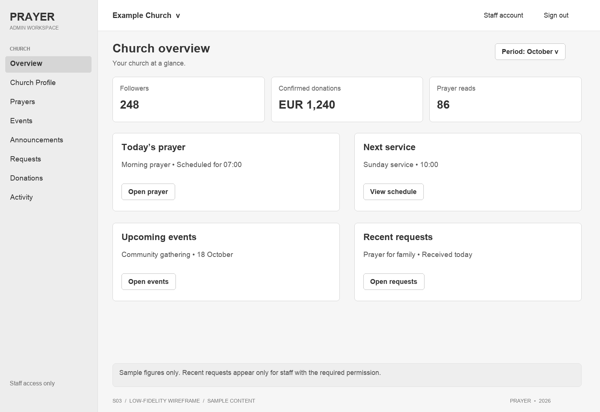

Hide request summaries entirely without the required access. Period and metric definitions need confirmation. Never combine currencies into one total.

**Page mapping:** `/dashboard/churches/:churchId`.

### S04 — Church Profile and Service Schedule

**Expected:** Update the church information displayed in the mobile app.

**Access:** Authorized church editors. **Scope:** F3.

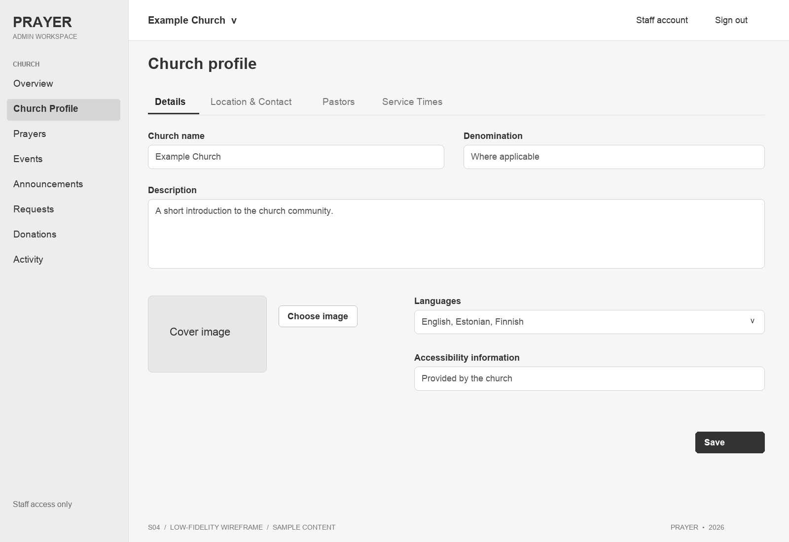

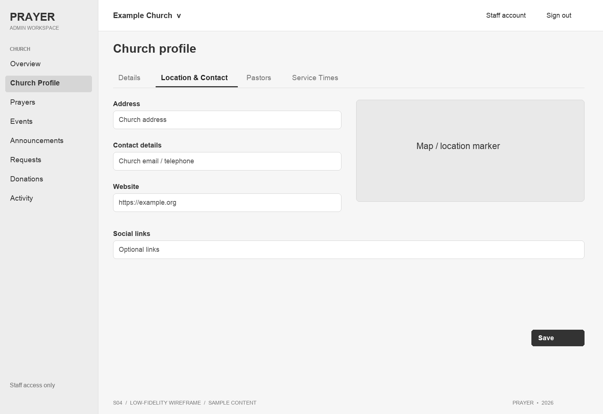

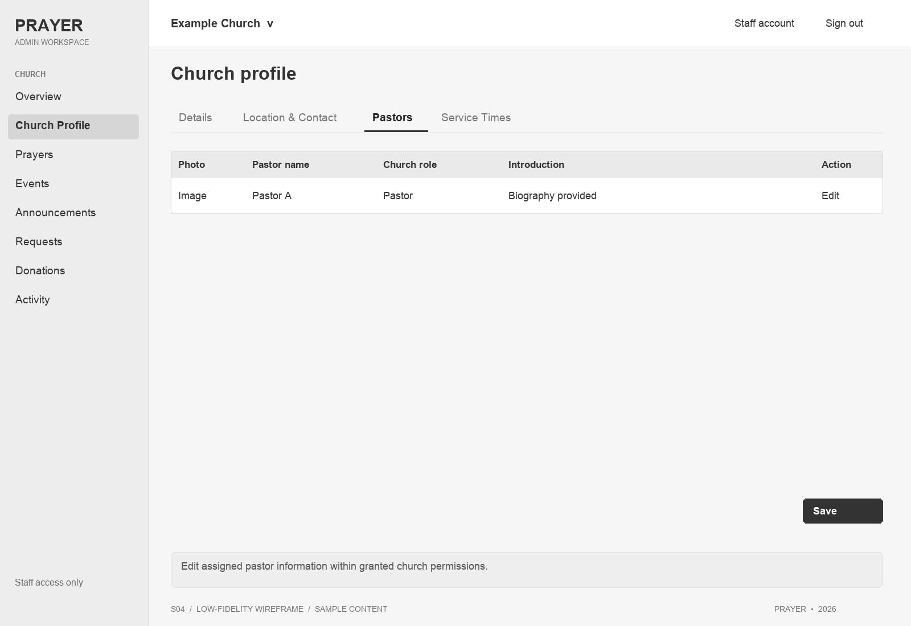

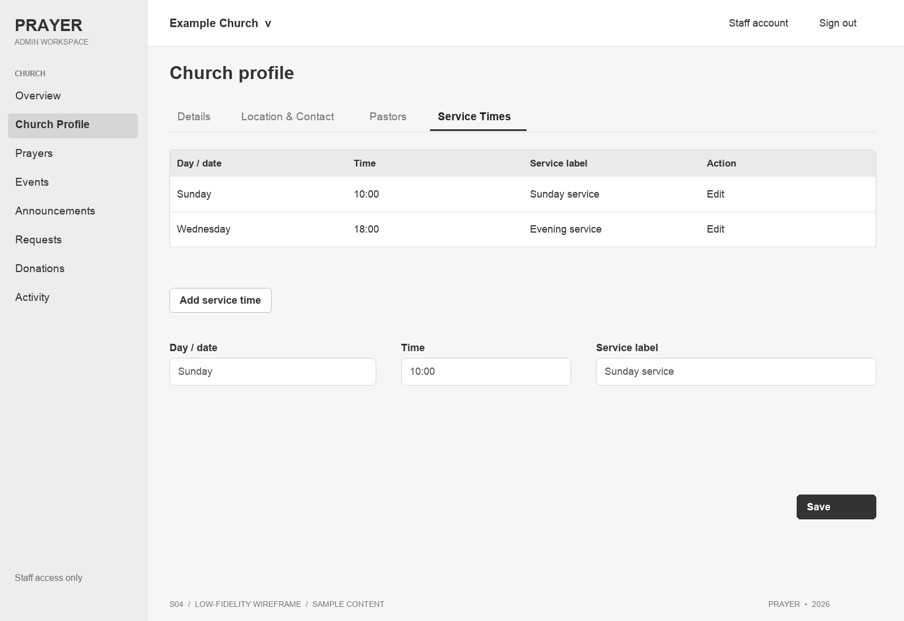

Tabs are shown together here to describe their contents; display one tab at a time. Optional profile information remains optional. Service editor fields and repetition rules require confirmation; do not add recurring-event automation.

**Page mapping:** `/dashboard/churches/:churchId/profile`.

### S05 — Prayer List and Archive

**Expected:** Find current and historical prayers or start a new prayer.

**Access:** Authorized content staff. **Scope:** F4.

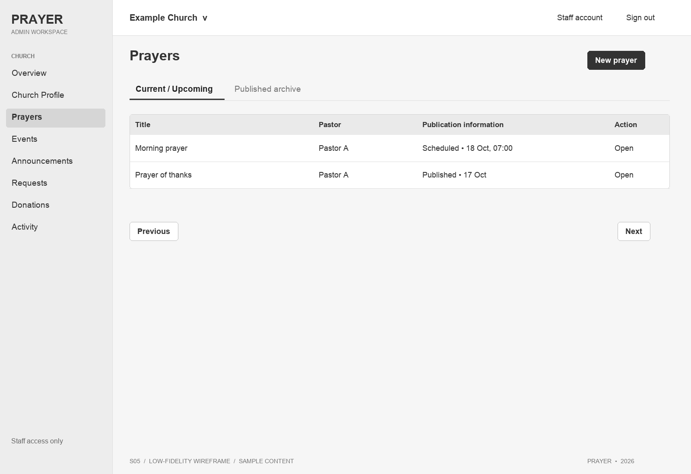

Publication information reflects the real workflow. This is not a separate editorial review queue or version-history screen.

**Page mapping:** `/dashboard/churches/:churchId/prayers`.

### S06 — Prayer Editor

**Expected:** Write or upload prayer text, choose the pastor and review the exact text before generation.

**Access:** Authorized content staff. **Scope:** F4.

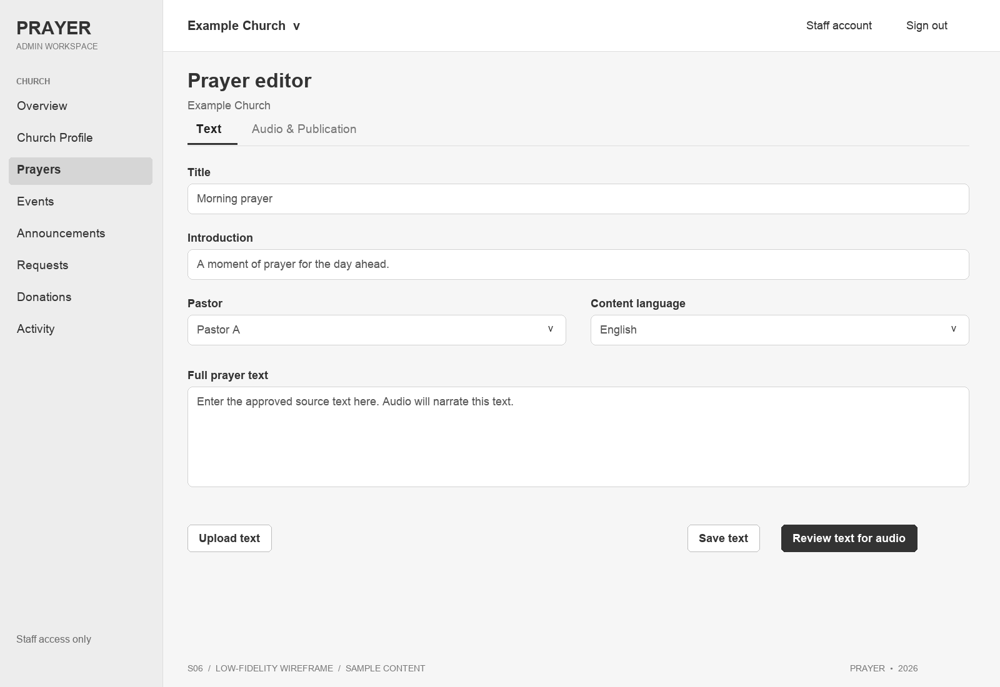

Create and edit share this layout. Show a read-only review of the saved text before confirming it for audio. Text changes invalidate approval of mismatched audio. Editing already-published content is a pending policy decision.

**Page mapping:** `/dashboard/churches/:churchId/prayers/new and /dashboard/churches/:churchId/prayers/:prayerId`.

### S07 — Prayer Audio Review and Publication

**Expected:** Generate from reviewed text, listen, approve and publish the matching prayer/audio.

**Access:** Staff with the relevant generation/approval/publication grants. **Scope:** F4.

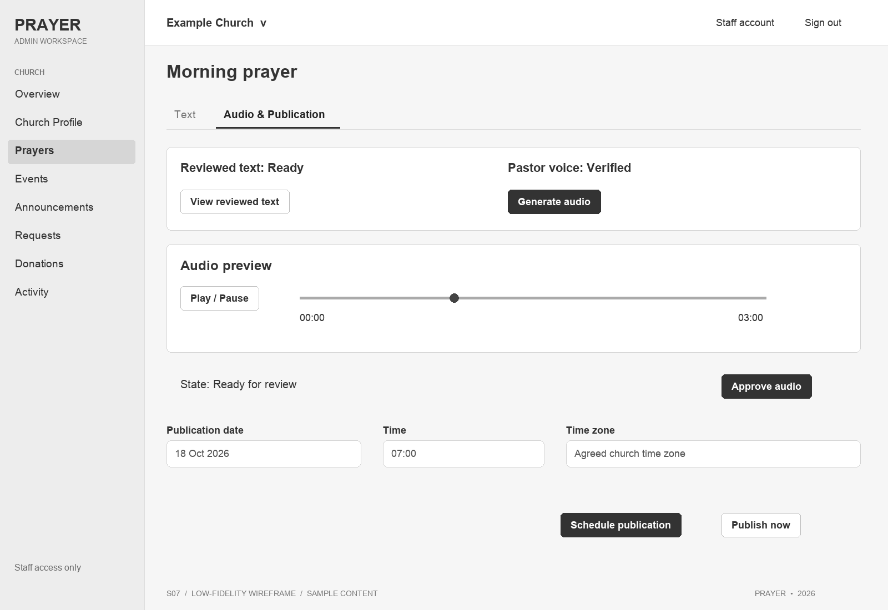

Generation is blocked until reviewed text and authorized voice are ready. Publication respects the agreed audio approval policy. Display disabled actions with reasons. Text-only publication and the scheduling time zone must be confirmed. On text edits, explain that audio must be regenerated/reapproved.

**Page mapping:** `Audio & Publication tab of the prayer editor`.

### S08 — Events and Event Editor

**Expected:** Create and update services or church activities and their mobile details.

**Access:** Authorized content staff. **Scope:** F5.

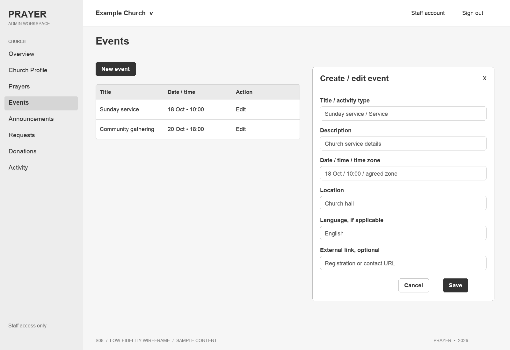

One editor handles the agreed activity categories. No internal ticketing, RSVP tracking or calendar sync. Regular service times are also available in Church Profile.

**Page mapping:** `/dashboard/churches/:churchId/events`.

### S09 — Announcements and Announcement Editor

**Expected:** Create and update church news shown to mobile users.

**Access:** Authorized content staff. **Scope:** F5.

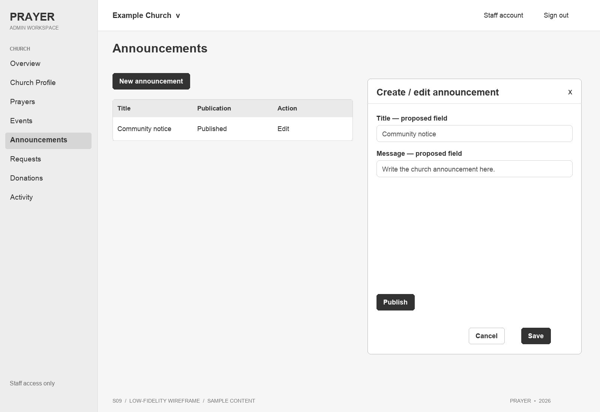

Title/message and the presentation of publication actions are proposed minimum UX fields. Announcement fields and publication rules need confirmation; this does not authorize additional scheduling or campaign features.

**Page mapping:** `/dashboard/churches/:churchId/announcements`.

### S10 — Prayer and Pastoral Request List

**Expected:** See requests that the staff member is permitted to handle.

**Access:** Church staff with explicit request access. **Scope:** F6.

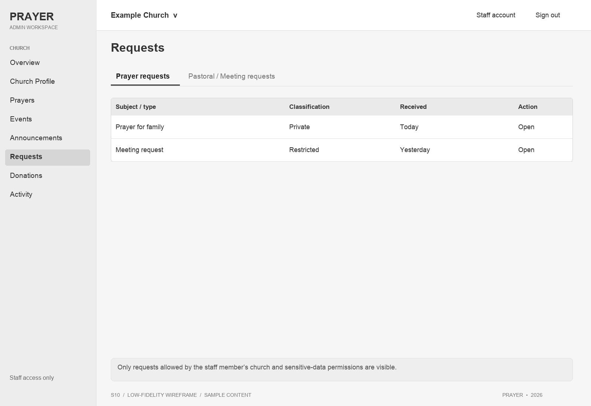

Classification is not a workflow status. No assignment, status filter or request content is shown to unauthorized staff. A request’s privacy designation never means it is public.

**Page mapping:** `/dashboard/churches/:churchId/requests`.

### S11 — Request Detail

**Expected:** Read the submitted request and use the sender’s supplied contact preferences.

**Access:** Church staff with explicit sensitive-data access. **Scope:** F6.

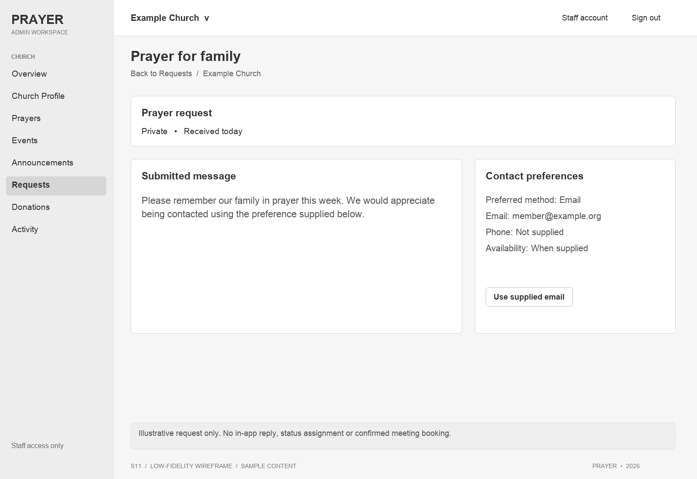

The contact action opens the appropriate external phone/email tool only where relevant. No in-app reply or confirmed meeting booking. Staff management actions beyond viewing/contacting remain unresolved; this view alone does not complete the unspecified management requirement.

**Page mapping:** `/dashboard/churches/:churchId/requests/:requestId`.

### S12 — Donation Reporting

**Expected:** Review provider-confirmed transactions, recurring donations and monthly totals.

**Access:** Authorized church finance viewers. **Scope:** F7.

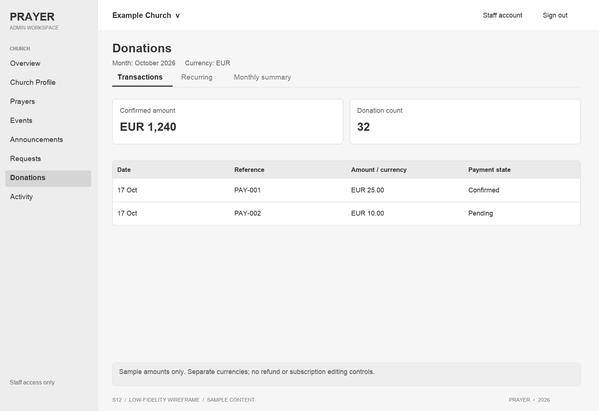

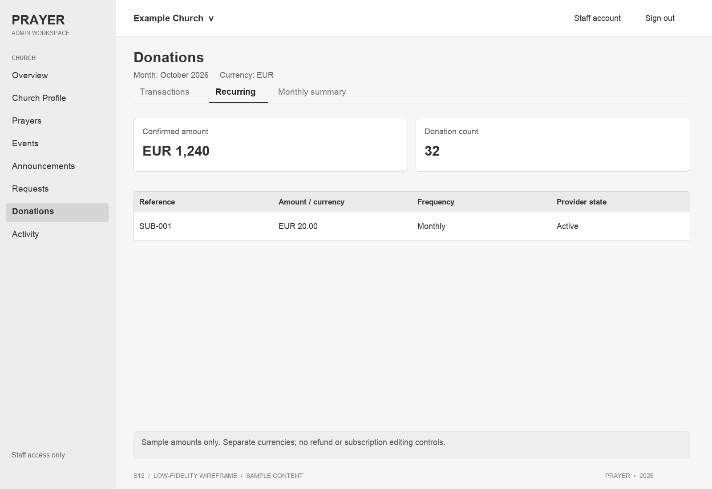

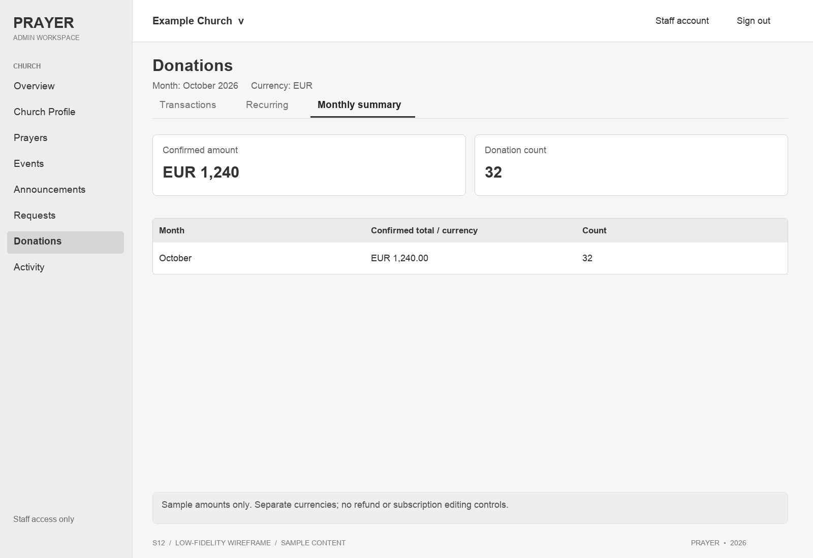

Tabs are alternate views. Keep currencies separate and show pending/failed states accurately. No refund, subscription editor, donor directory or custom payment-account onboarding screen.

**Page mapping:** `/dashboard/churches/:churchId/donations`.

### S13 — Attendance and Basic Analytics

**Expected:** Understand basic church participation and engagement using aggregate figures.

**Access:** Authorized church analytics viewers. **Scope:** F10.

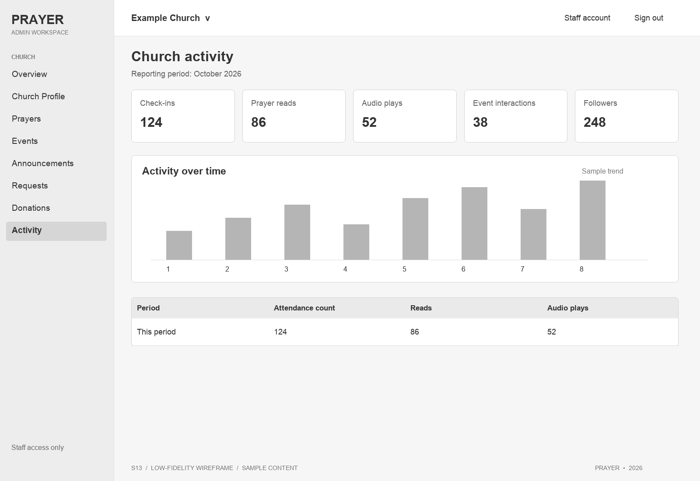

Chart is a placeholder for a simple trend, not sample factual data. Confirm metric definitions and reporting period. No named attendance histories, personal behavior profiles or advanced BI.

**Page mapping:** `/dashboard/churches/:churchId/analytics`.

### S14 — Central Overview

**Expected:** Review platform-wide activity, user counts and basic donation statistics.

**Access:** Authorized central administrators. **Scope:** F8.

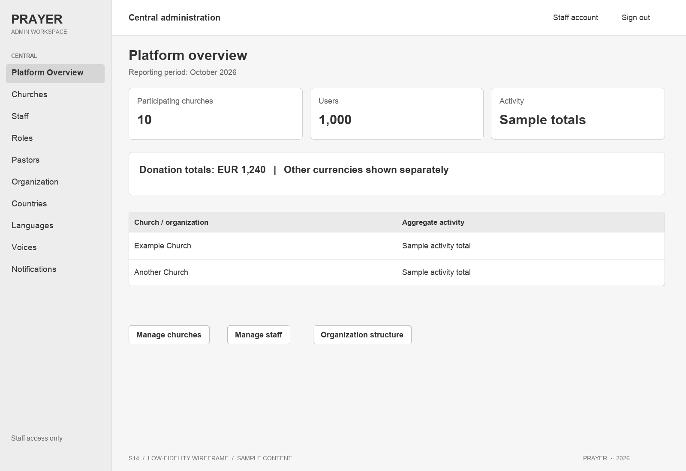

Only authorized platform aggregates. Central access does not automatically permit raw donation details or private requests. This is the central landing page, not an additional general-settings console.

**Page mapping:** `/dashboard/central`.

### S15 — Church Administration List

**Expected:** Find a church, create its setup or open lifecycle controls.

**Access:** Authorized central administrators. **Scope:** F8.

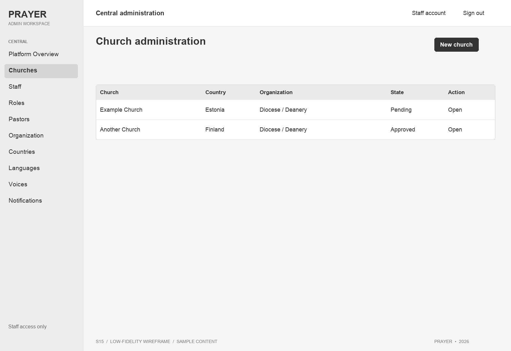

Pending churches remain hidden from public discovery. Church suspension/archive effects must be agreed before enabling those actions.

**Page mapping:** `/dashboard/central/churches`.

### S16 — Church Setup and Lifecycle

**Expected:** Create church setup, place it in the hierarchy and control approval.

**Access:** Authorized central administrators. **Scope:** F8.

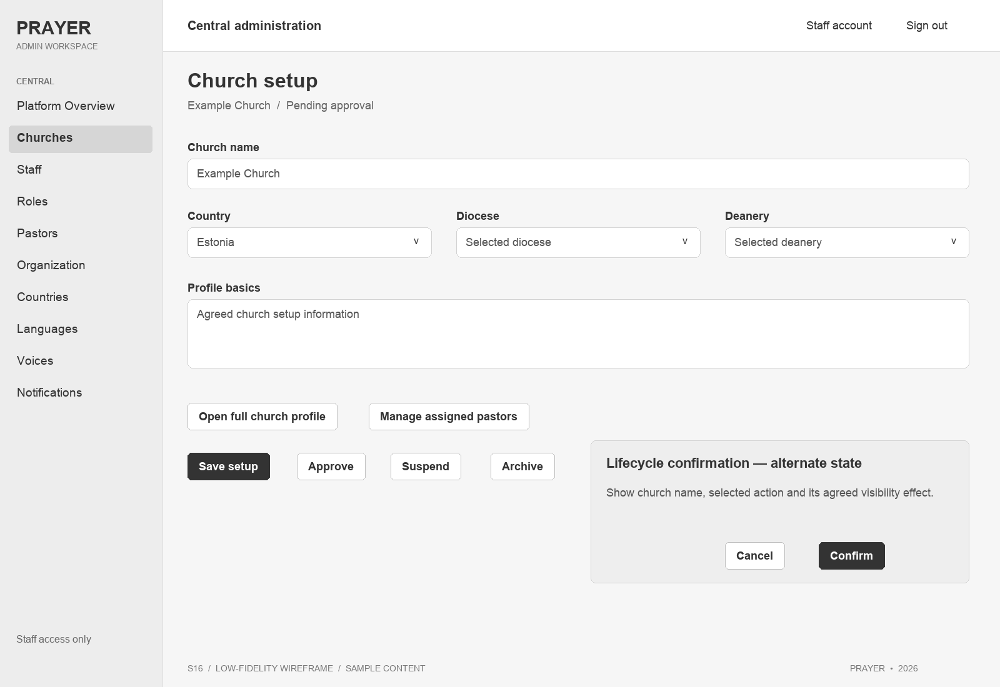

Show lifecycle actions only when applicable and permitted. New church creation reuses this form without existing-record actions. Archive is not hard deletion. Exact creation fields and suspension/archive effects remain decision points.

**Page mapping:** `/dashboard/central/churches/:churchId; creation panel on church list`.

### S17 — Staff List

**Expected:** Find staff accounts and open their scoped access assignments.

**Access:** Authorized central staff administrators. **Scope:** F8.

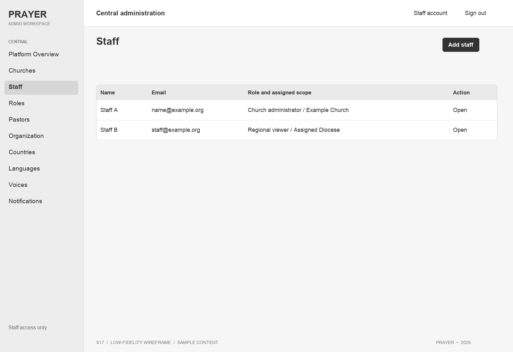

Staff is distinct from pastor biography records. Show church/region scope alongside role when space allows. No hard-delete action or public registration.

**Page mapping:** `/dashboard/user-management/user`.

### S18 — Staff Create and Edit

**Expected:** Create staff credentials and assign or revoke supported roles in the correct scope.

**Access:** Authorized central staff administrators. **Scope:** F8.

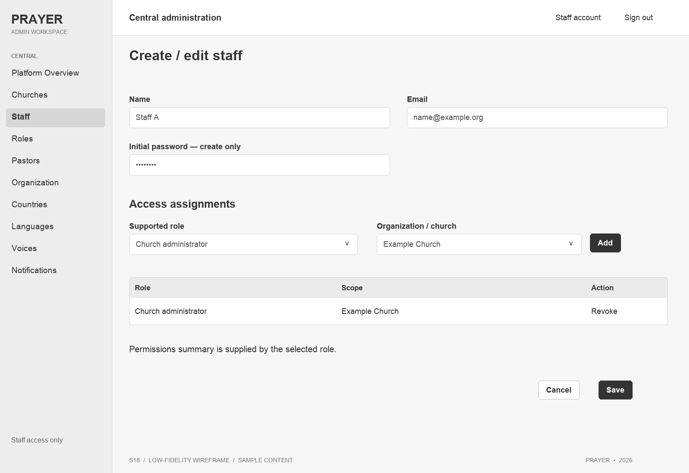

Password is never returned or shown on edit. This reflects the existing credential template, not a new invitation/reset flow. Only grant assignments within the operator’s authority; confirm revocation and apply it server-side.

**Page mapping:** `/dashboard/user-management/user/create and /dashboard/user-management/user/:id`.

### S19 — Supported Roles and Permission Detail

**Expected:** Understand the supported roles and their permissions before assigning access.

**Access:** Authorized central role viewers. **Scope:** F1 / F8.

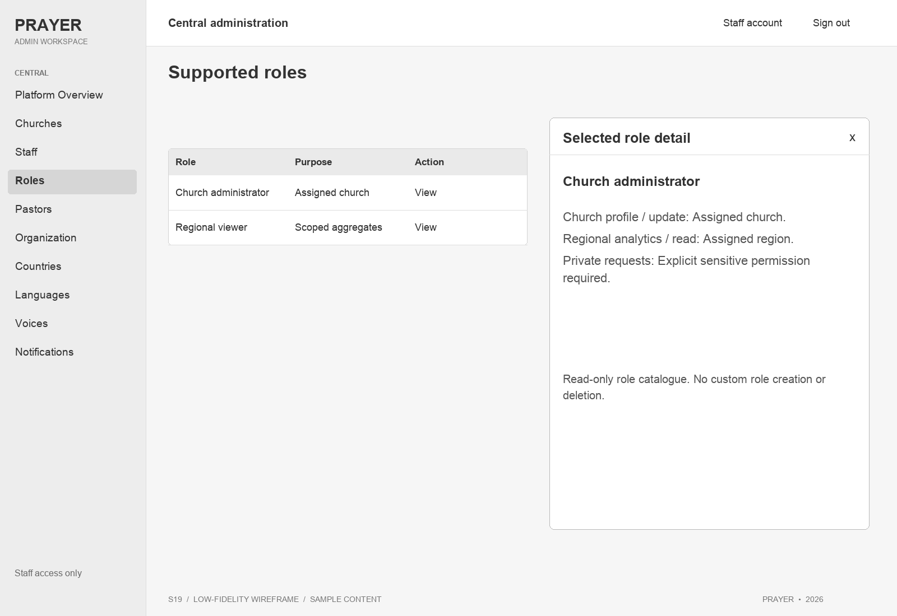

Read-only baseline. Role labels are illustrative until the role matrix is approved. Bounded permission editing is conditional on approval in SPEC; no custom role designer, Create Role or Delete Role controls.

**Page mapping:** `/dashboard/user-management/role and /dashboard/user-management/role/:id`.

### S20 — Pastor Profiles and Church Assignments

**Expected:** Maintain pastor biographies and their church relationships.

**Access:** Authorized central administrators. **Scope:** F8.

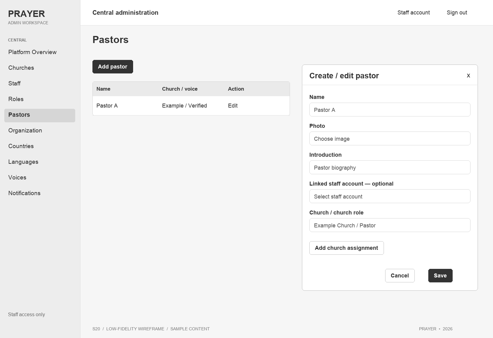

A pastor biography does not automatically create a staff login or grant permissions. Preserve historical prayer attribution when relationships change.

**Page mapping:** `/dashboard/central/pastors`.

### S21 — Organization Structure

**Expected:** Arrange countries, dioceses, deaneries and churches in the agreed hierarchy.

**Access:** Authorized central administrators. **Scope:** F8.

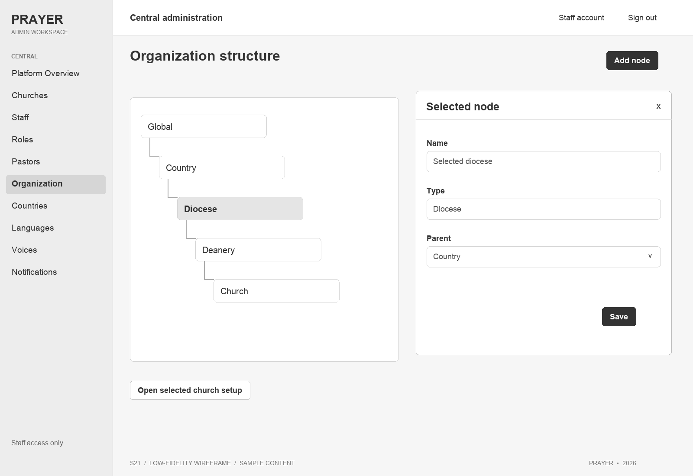

New-node panel uses supported type/name/parent fields. Prevent invalid parent types and cycles. Hierarchy changes affect authorized reporting scope; show confirmation before moving a node. No automatic access to private requests.

**Page mapping:** `/dashboard/central/hierarchy`.

### S22 — Countries

**Expected:** Maintain the supported country registry.

**Access:** Authorized central administrators. **Scope:** F8.

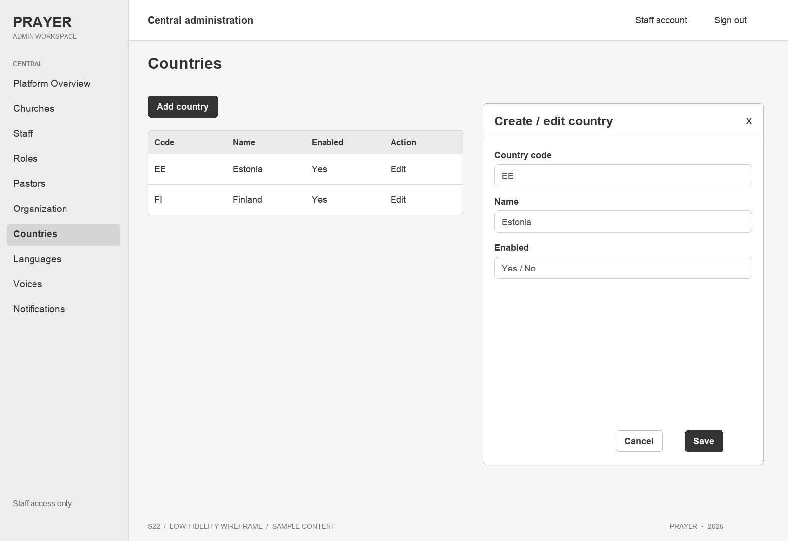

Examples are placeholders. Do not remove referenced countries destructively. Country choice must not force a user’s interface language.

**Page mapping:** `/dashboard/central/countries`.

### S23 — Languages

**Expected:** Manage the supported language registry and availability.

**Access:** Authorized central administrators. **Scope:** F8.

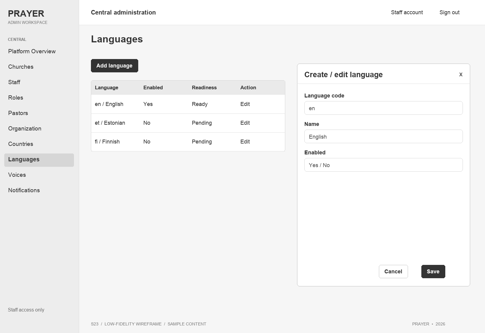

English, Estonian and Finnish are the delivery baseline. Other registry entries do not commit new translations. Readiness is a validation message/indicator, not a translation management tool. Block enabling a language before required resources are ready.

**Page mapping:** `/dashboard/central/languages`.

### S24 — Voice Submission Review

**Expected:** Admin previews the pastor’s submitted sample and offline consent evidence, then approves or rejects the exact revision. Approval automatically starts registration with ElevenLabs Instant Voice Cloning.

**Access:** Authorized voice-review administrators; no self-approval. **Scope:** F4 / F8.

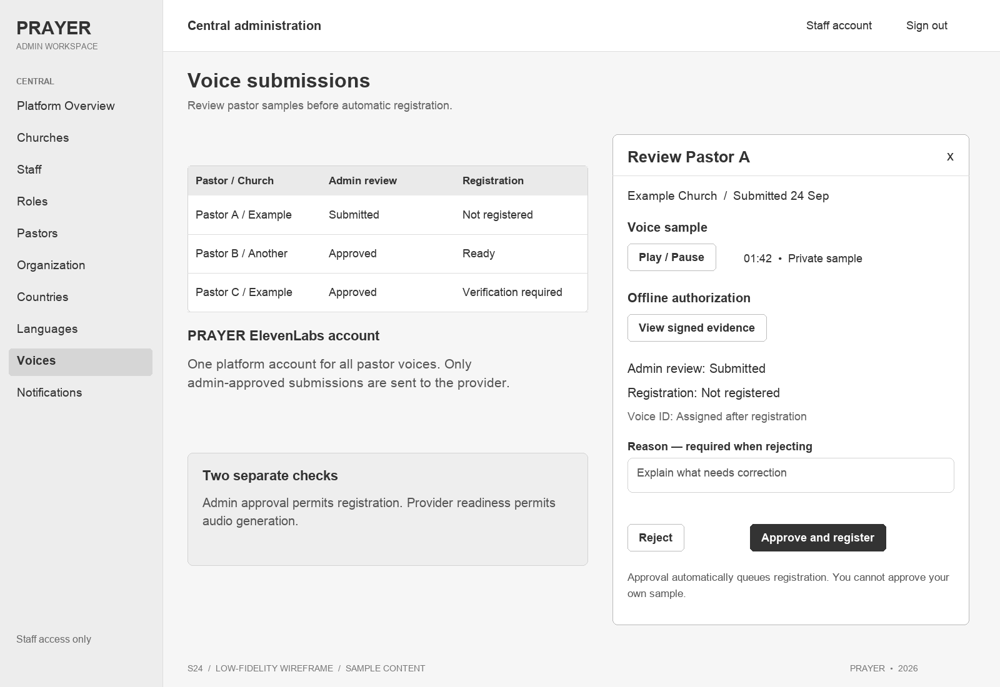

List columns show pastor/church, submitted date, review state and provider registration state. Review panel shows the submitted sample player, authorization evidence and read-only Voice ID when available. Approve and Reject appear only for pending submissions; rejection requires a reason. The approval button says “Approve and register”. Registration status is read-only: Queued, Registering, Verification required, Ready, Failed or Check registration result. An approved submission is not automatically a provider-ready voice.

No manual provider Voice ID entry, personal ElevenLabs account or sharing link. All registrations use the single PRAYER ElevenLabs account. A provider verification requirement keeps generation blocked until the supported path is completed. Submitted material is immutable; changed material requires a new review. Disabling a ready voice blocks new generation.

**Page mapping:** `/dashboard/central/voice-profiles`.

### S25 — Notification Settings

**Expected:** Configure only the agreed notification types while preserving user preferences.

**Access:** Authorized central notification administrators. **Scope:** F11.

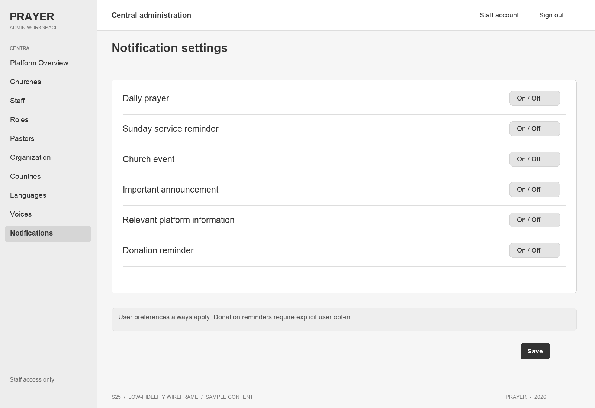

Type switches are a proposed minimal configuration. Confirm exact fields, timing and platform-information trigger behavior before final design. No campaign composer, audience builder, arbitrary scheduler or delivery dashboard.

**Page mapping:** `/dashboard/central/notifications`.

### S26 — Regional Dashboard

**Expected:** Review aggregate participation and donations for the assigned region.

**Access:** Authorized country/diocese/deanery viewers. **Scope:** F9.

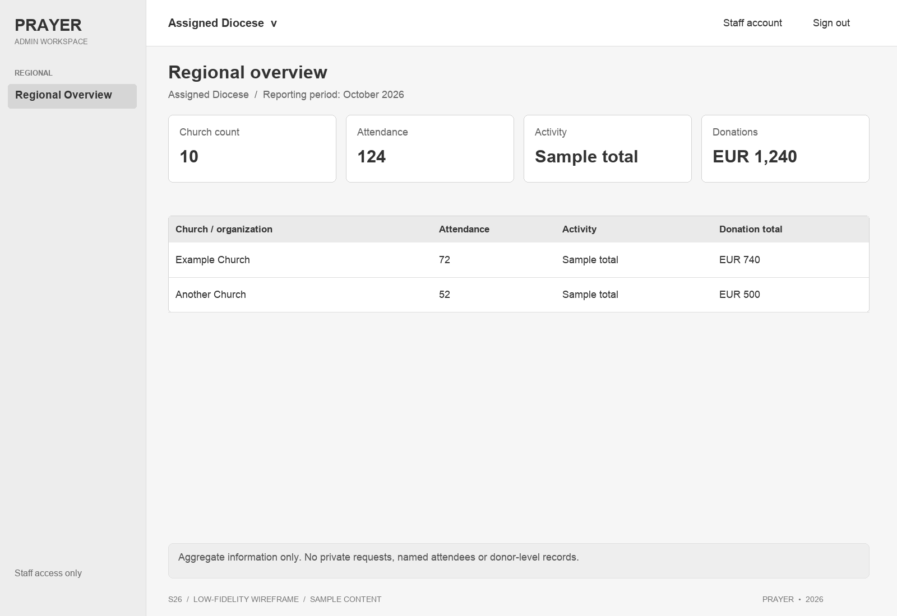

Country, diocese and deanery use this same layout with the authorized scope. No private-request cards, named attendees or donor-level records. Do not add a separate dashboard per country.

**Page mapping:** `/dashboard/regions/:regionId`.

### S27 — My Voice — Pastor Submission

**Expected:** Pastor uploads their own voice sample and offline approval evidence, submits it for admin review, and follows the result without leaving PRAYER for account registration.

**Access:** PRAYER staff user linked to the pastor with own-submission permission. **Scope:** F4.

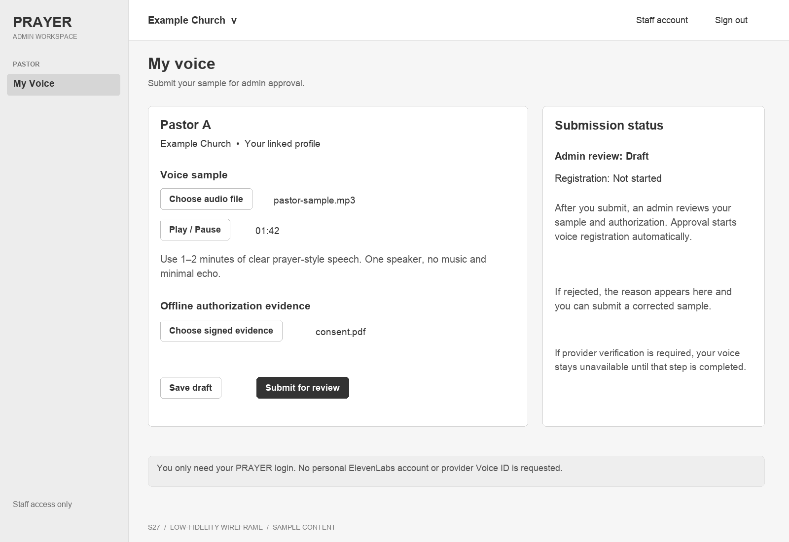

Pastor identity is taken from the signed-in account and cannot be changed to another pastor. Show the assigned church context, sample file picker/player, recording guidance, private authorization-evidence upload/reference, Save draft and Submit for review. Recommend 1–2 minutes of clear single-speaker speech in the intended prayer style. A submitted record becomes read-only. Show the review reason after rejection and allow a revised submission; each revision needs admin approval.

Show review status separately from registration status. Explain that approval automatically starts provider registration. If provider verification is required, show that the voice is not ready, with supported next steps only after the pilot establishes that path. Do not invent a verification-complete button. No ElevenLabs signup, provider key or Voice ID entry is shown. This is a pastor/staff web screen, not an end-customer mobile feature.

**Page mapping:** `/dashboard/my-voice`.

## Shared States and Interactions

Apply these small states to the relevant screens; they do not need separate navigation items.

| State | What the user sees / expects |
|---|---|
| Loading | A loading placeholder; do not display fabricated totals or stale private content from another scope. |
| Empty | “No prayers yet” or equivalent; show a create action only when the user can create that item. |
| Invalid form | Keep input and show an explanation beside the affected field. |
| Saving | Disable repeat submission and show progress; confirm success only after server acceptance. |
| Network / provider error | Explain the failure, preserve safe unsaved work and allow a safe retry where applicable. |
| Stale edit | Explain that the record changed; let the user reload rather than overwrite silently. |
| Unsaved changes | Ask whether to stay or discard changes before navigation. |
| Access denied / unavailable | Show a neutral message and return action without revealing hidden church/request information. |
| Session expired | Return to sign-in; clear sensitive page state. |
| Sensitive action | Identify the record, action and confirmed consequences before approval. |
| Invalid upload | Explain accepted format/size and allow replacement; never show an unvalidated file as ready. |

Forms need visible labels and keyboard focus; do not rely on color alone for meaning. Date/time inputs must show their time zone. Donation values must include currency. Request and voice evidence pages must not expose sensitive content in general notifications or summaries.

## Decisions Needed Before High-Fidelity Design

| Area | Decision |
|---|---|
| Staff / permissions | Confirm role names, grant matrix, credential onboarding and whether any bounded role editing is approved. |
| Church setup | Confirm required creation fields and effects of suspension/archive. |
| Requests | Define any staff management actions beyond reading and contacting; no invented status or assignment workflow. |
| Prayer publication | Confirm published-edit behavior, text-only publication policy, time zone and text-upload constraints. |
| Events / announcements | Confirm announcement fields, publication controls and service schedule fields. |
| Reporting | Confirm reporting periods and metric definitions; always separate donation currencies. |
| Notifications | Confirm configuration fields and allowed triggers/timing. |
| Voice onboarding | Pastor self-upload, admin approval, automatic Instant clone registration and one PRAYER account are confirmed. Validate accepted evidence/file limits, voice quality and provider-required verification completion before launch. |

## Future Approach — Not Designed Here

Chat, case assignment/status workflows, appointment booking, custom roles, advanced analytics, named attendance histories, refund/subscription management, custom payment onboarding, campaign tools, AI-cost/job dashboards, and dedicated audit/privacy consoles remain outside these wireframes. Required underlying security, privacy, audit, backup and payment-confirmation behavior still applies.
