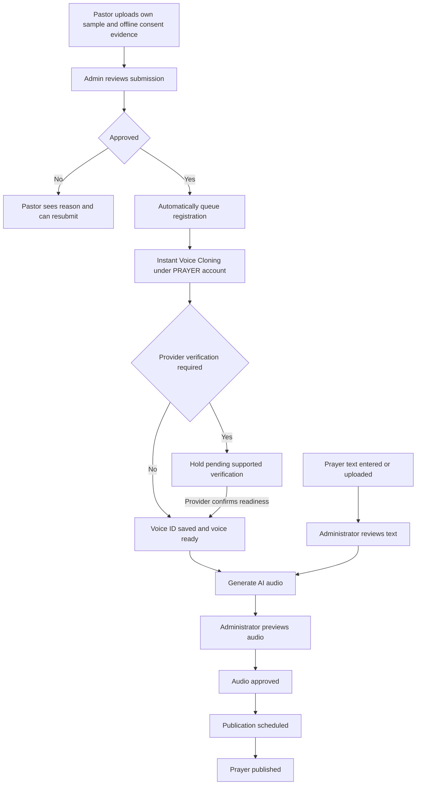

# PRAYER Admin Feature Breakdown

## Scope

This document breaks down the current admin requirements in **PRAYER — APPLICATION & PLATFORM DEVELOPMENT BRIEF**, using its numbered sections as references. It covers church administration, central administration, regional dashboards, and the shared backend responsibilities needed to support them.

The dashboard and shared backend belong to `prayer-admin-dashboard` and use Next.js + TypeScript, as agreed for this project. See `OVERVIEW.md` for the technology direction.

Only the current-scope sections below form the feature baseline. The pastor self-submission, admin approval and automatic Instant Voice Cloning flow reflects the user-confirmed clarification on 24 September 2026, rather than a verbatim PDF requirement. **Future Approach is excluded from current delivery, estimates, and acceptance criteria unless separately approved.** An unspecified field, status, screen, or workflow is not an implied requirement.

## Feature Table

Current-scope summary. Optional items and unresolved rules retain the limits stated in the detailed sections. Future Approach items are excluded.

| # | Feature | Included scope | PDF sections |
| --- | --- | --- | --- |
| 1 | [Staff Login and Permissions](#1-staff-login-and-permissions) | Secure staff access, assigned churches and restricted private-data permissions. | 1, 12, 14, 20 |
| 2 | [Church Dashboard](#2-church-dashboard) | Followers, prayer status, services, events, authorized requests, donations and engagement. | 12 |
| 3 | [Church Profile Management](#3-church-profile-management) | Church details, images, pastor information, contacts, languages and service schedules. | 9, 12 |
| 4 | [Prayer Publishing and AI Audio](#4-prayer-publishing-and-ai-audio) | Pastor sample submission, admin approval and automatic Instant clone registration; create/edit prayers, review text, generate/approve audio and publish. | 6–7, 12–13, 20 |
| 5 | [Services, Events, and Announcements](#5-services-events-and-announcements) | Create/update services, events and church news with optional external registration links. | 12, 17 |
| 6 | [Prayer and Pastoral Requests](#6-prayer-and-pastoral-requests) | View/manage authorized prayer, pastoral-contact and meeting requests; handling actions remain to confirm. | 10, 12, 20 |
| 7 | [Donation Reporting](#7-donation-reporting) | Church donation activity, available transactions, recurring donations and basic monthly summaries. | 11–13 |
| 8 | [Central Administration](#8-central-administration) | Church lifecycle, staff/pastors, countries, languages, hierarchy, permissions and platform configuration. | 13 |
| 9 | [Regional Dashboards](#9-regional-dashboards) | Aggregate activity, attendance and donation statistics within the assigned hierarchy. | 1, 14 |
| 10 | [Attendance and Analytics Foundation](#10-attendance-and-analytics-foundation) | Voluntary attendance counts and basic activity data supporting church/regional summaries. | 15–16 |
| 11 | [Notifications](#11-notifications) | Configure the specified notification types and respect user preferences, including donation opt-in. | 6, 13, 18 |

Supporting technical/delivery requirements are documented separately below; they do not add user-facing modules.

## 1. Staff Login and Permissions

**Source:** PDF sections 1, 12, 14, 20.

**Purpose:** Give staff secure access to the churches and information they are authorized to manage.

**Users:** Church administrators/pastors, PRAYER central administrators, and authorized country/diocese/deanery administrators.

**Required behavior:**
- Provide secure staff login and role-based permissions.
- Restrict church staff to their assigned church or churches.
- Support the underlying Global → Country → Diocese → Deanery → Church → Pastor / Church Administrator → User structure.
- Restrict private prayer and pastoral information by role and data type.
- Give regional leadership aggregate operational information without automatic access to private requests.

**Acceptance criteria:**
- Staff can access authorized church data and cannot access another church's private data without explicit authorization.
- Restrictions are enforced by the backend, including direct API requests.
- A higher position in the hierarchy alone does not grant private-request access.

**Unspecified:** Authentication method and detailed permission matrix. The brief does not define a separate country-administration feature set.

## 2. Church Dashboard

**Source:** PDF section 12.

**Purpose:** Show a concise operational overview of the assigned church.

**Users:** Authorized pastors and church administrators.

**Required information:**
- Followers.
- Today's prayer status.
- Upcoming service and events.
- Recent prayer requests, subject to access restrictions.
- Donation activity.
- Basic engagement/activity data.

**Acceptance criteria:**
- The overview shows the listed information for the authorized church context.
- Private-request visibility follows the permissions in feature 1.
- Displayed figures correspond to the underlying church data.

**Unspecified:** Exact layout, reporting periods, and engagement definitions.

## 3. Church Profile Management

**Source:** PDF sections 9, 12.

**Purpose:** Maintain the church information presented in the mobile app.

**Users:** Authorized church staff; central administrators within granted permissions.

**Required profile information:**
- Church name, cover image, description, and category/denomination where applicable.
- Address/location, map, contact details, website, and social links.
- Languages and accessibility information where provided.
- Pastor image, name, pastoral role, and introduction.
- Sunday/service schedule.
- Associated events, daily prayers, announcements, contact actions, and donation access.

**Required actions:** Update church descriptions, images, pastor information, contacts, location, languages, service times, and announcements. Related content is managed through its corresponding features below.

**Acceptance criteria:**
- Authorized edits are reflected in the church's mobile profile.
- Staff cannot edit unassigned churches.
- Information marked optional or conditional in the brief remains optional or conditional.

**Unspecified:** Field validation limits and the exact division of editing rights between central and church staff.

## 4. Prayer Publishing and AI Audio

**Source:** PDF sections 6–7, 12–13, 20.

**Purpose:** Publish approved prayer text and pastor-voice audio.

**Users:** Pastors submit their own voice samples through PRAYER staff accounts. Authorized voice-review administrators approve or reject submissions. Authorized church staff use ready voices for prayer audio.

**Prayer information:** Title, introduction, full text, church attribution, pastor attribution, audio, and scheduled publication information.

**Required actions:**
- Create and edit prayers; select the pastor.
- Enter/upload prayer text and review it before audio generation.
- Pastor uploads their own voice sample and provides offline authorization evidence through My Voice in the admin web workspace.
- An authorized admin previews the sample and reviews the evidence, then approves or rejects it with a reason. No self-approval.
- Admin approval automatically queues registration using ElevenLabs Instant Voice Cloning under the single PRAYER ElevenLabs account; save the returned Voice ID and registration state. No personal ElevenLabs account or manually entered provider Voice ID.
- Generate AI audio, preview it, and approve it before publication.
- Schedule and publish prayers.
- View historical prayers and preserve the mobile prayer archive.

**Rules:**
- AI narrates approved source text only; it must not invent teachings or messages in a pastor's identity.
- Keep the AI provider replaceable without rebuilding the mobile app.
- Use Instant Voice Cloning under one PRAYER ElevenLabs account. Admin approval authorizes submission to ElevenLabs; it is not provider verification. If ElevenLabs returns `requires_verification=true`, keep the voice blocked in `verification_required`. Validate a supported in-PRAYER completion path during the pilot. Do not bypass verification or silently require a personal ElevenLabs account; unresolved provider requirements are a launch blocker for that voice.

**Acceptance criteria:**
- Authorized staff can complete the required text/audio approval and publication workflow.
- Scheduled prayers become available at the intended publication time.
- Published prayers retain their church/pastor attribution and remain available in the archive.
- Audio generation uses authorized voice access and approved text.
- Only the linked pastor can submit their own sample; they cannot approve it or access another pastor’s sample.
- No sample is sent to ElevenLabs before admin approval. Duplicate approvals/jobs cannot intentionally create duplicate clones. Rejected or verification-pending submissions cannot generate audio.
- Sample or consent changes after review require a new submission and approval; preserve any previous ready voice until an approved replacement is ready, unless consent is revoked.

**Unspecified:** Editing behavior after publication, scheduling time-zone convention, and provider-required verification completion, sample validation limits and voice readiness trial results. The pastor-submission/admin-approval/single-account flow is confirmed. Separate draft/review status systems are not specified beyond the workflow above.

## 5. Services, Events, and Announcements

**Source:** PDF sections 12, 17.

**Purpose:** Keep church activities and news current in the app.

**Users:** Authorized church staff.

**Required actions:**
- Create/edit services, special events, Bible studies, community events, and other church activities.
- Create/update church announcements or news for the mobile experience.

**Event information:** Title, description, date, time, location, church, optional registration/contact link, and language where applicable.

**Acceptance criteria:**
- Authorized staff can create and update the listed event information.
- Events and announcements appear under the correct church in the mobile app.
- Registration/contact links remain optional; an internal registration system is not required.

**Unspecified:** Announcement fields and any recurring-event automation. Neither should be expanded into additional scope without agreement.

## 6. Prayer and Pastoral Requests

**Source:** PDF sections 10, 12, 20.

**Purpose:** Allow authorized church staff to view and manage requests submitted through the mobile app.

**Users:** Church staff explicitly authorized to access the relevant requests.

| Request type | Information supplied |
| --- | --- |
| Prayer request | Subject, message, private/standard classification where appropriate, preferred contact method, optional telephone, optional email. |
| Pastoral request | Request type, message, availability, preferred contact method. |
| Meeting request | View/manage meeting requests as part of pastoral contact; no additional booking fields are specified. |

**Required behavior:** View/manage prayer requests, pastor-contact requests, and meeting requests while protecting private information.

**Acceptance criteria:**
- Submitted requests and their supplied information are available to authorized staff for the relevant church.
- Unauthorized staff and regional roles cannot retrieve private request details.
- Users' provided contact preferences remain visible to authorized handlers.

**Unspecified:** The exact meaning of request management, including any status changes. No assignment, internal replies, calendar booking, case-management system, or live chat is committed by this document.

## 7. Donation Reporting

**Source:** PDF sections 11–13.

**Purpose:** Show basic donation activity for churches and the platform.

**Users:** Authorized church administrators; central administrators for basic platform statistics; regional roles for authorized aggregate totals.

**Required information:**
- Donation activity.
- Transaction history where provided by the payment infrastructure.
- Recurring donations.
- Basic monthly reporting.
- Basic central donation statistics and regional donation totals.

**Supporting payment scope:** The shared backend supports the mobile app's one-time and monthly donations, predefined/custom amounts, and payment methods where supported. Payments should reach the relevant church payment account through the approved provider. Raw card data must not be stored in PRAYER.

**Acceptance criteria:**
- Church staff see available donation information for their assigned churches.
- Monthly summaries reflect provider-confirmed donation data.
- Central/regional summaries respect permissions and organizational scope.

**Unspecified:** Reporting definitions and payment-account setup procedure. A custom onboarding dashboard, refund management, subscription editing, accounting suite, or commission system is not required by the brief.

## 8. Central Administration

**Source:** PDF section 13.

**Purpose:** Control participating churches and the platform's organizational setup.

**Users:** Authorized PRAYER central administrators.

**Required actions:**
- Create, approve, suspend, and archive churches.
- Create church administrators and manage pastors.
- Manage countries and languages.
- Manage the institutional hierarchy and assign Diocese / Deanery / Church relationships.
- Manage relevant permissions.
- Review platform activity and aggregated user statistics.
- View basic donation statistics.
- Configure notifications and manage AI voice profiles.

**Acceptance criteria:**
- A new church is not publicly visible before manual approval.
- Authorized central administrators can perform the listed management actions.
- Assigned organizational relationships support the relevant access boundaries and aggregate reporting.

**Unspecified:** Detailed suspension/archive effects, reactivation rules, and church onboarding fields. These need definition without assuming additional workflows.

## 9. Regional Dashboards

**Source:** PDF sections 1, 14.

**Purpose:** Give regional leadership a basic view of churches under their responsibility.

**Users:** Authorized higher-level administrators within their assigned hierarchy.

**Aggregate measures listed in the brief:** Church count, registered users by church, active users, prayers read/listened to, event activity, church engagement, attendance/check-in statistics, donation totals, and basic growth/decline indicators.

**Acceptance criteria:**
- Summaries include only churches within the administrator's authorized organizational scope.
- Private prayer requests and pastoral communications are not automatically exposed.
- Reporting remains basic operational reporting rather than advanced BI.

**Unspecified:** Metric formulas, comparison periods, and visualization formats. The brief presents the measures as examples; exact definitions need confirmation.

## 10. Attendance and Analytics Foundation

**Source:** PDF sections 15–16.

**Purpose:** Record simple voluntary attendance and collect consistent platform activity data.

**Users:** Church staff and regional leadership view authorized summaries; the shared backend records mobile activity.

**Required behavior:**
- Record the mobile user's voluntary church check-in.
- Show the church attendance count and provide appropriate regional aggregate statistics.
- Prepare data for registrations, active users, main-church selections, followed churches, prayer reads/audio plays, event interactions, check-ins, donations, church activity, engagement trends, and growth by church/region.
- Keep the data structure extensible for future attendance methods without implementing them now.

**Acceptance criteria:**
- A successful voluntary check-in contributes to the relevant church attendance count.
- Required activity data can support church and regional summaries.
- No permanent background user tracking is introduced.

**Unspecified:** Duplicate check-in handling, metric definitions, and reporting intervals. Individual attendance browsing is not requested.

## 11. Notifications

**Source:** PDF sections 6, 13, 18.

**Purpose:** Deliver relevant church/platform updates while respecting user preferences.

**Users:** Central administrators configure notifications; mobile users configure their own preferences.

**Required notification types:** Daily prayer, Sunday service reminder, church events, important church announcements, relevant platform information, and donation reminders only where explicitly enabled.

**Required backend support:** Push delivery and a transactional-email-ready architecture.

**Acceptance criteria:**
- Supported notifications respect the user's configured preferences.
- Donation reminders require explicit enablement.
- Notifications use the relevant church/platform context.
- The backend is prepared for transactional email; a full email campaign system is not included.

**Unspecified:** Trigger timing, configuration fields, and church-staff notification controls. An audience builder, delivery dashboard, and general-purpose notification scheduler are not specified.

## Technical and Delivery Requirements

These are required platform capabilities, not commitments to separate admin screens.

| Requirement | Required support | PDF sections |
| --- | --- | --- |
| Security | Encrypted communication, secure authentication/password handling, restricted database access, secure media storage, strict church-data separation, and restricted private-request access. | 20 |
| Privacy | Data minimization, consent records including voice authorization, account/personal-data deletion, controlled access, retention, export where required, and access logging. Legal text is supplied separately. | 20–21 |
| Audit | Record administrative activity. A dedicated audit-log browsing screen is not specified. | 20 |
| Languages | Prepare English, Estonian, and Finnish; interface language must be independent of church country. | 19 |
| Backup and ownership | Backup strategy and production infrastructure under PRAYER / Rellex control where possible, including monitoring accounts. | 20, 22 |
| Shared backend | Support the specified mobile/admin features, permissions, scheduled publication, provider integrations, and analytics collection. Background processing is an implementation responsibility, not a new product module. | 1–20 |
| Testing | Functional, user-flow, dashboard, API, payment, map, AI voice, notification, permissions, check-in, performance, security-oriented, regression testing, and bug fixing; coordinate iOS/Android testing. | 24 |
| Handover | Admin/backend source, database schema, relevant API documentation, configuration, deployment instructions, service inventory, architecture notes, and necessary access information. | 23 |

Completion requires the relevant workflows and permissions to pass testing and the specified handover material to be available. Privacy support here is a technical scope statement, not a legal-compliance certification.

## Future Approach

**The following ideas are not part of current scope.** They are recorded for later discussion only and must not be included in current estimates or acceptance criteria without separate approval.

### Additional Ideas from the Earlier Feature Plan

| Idea | Possible future use |
| --- | --- |
| Staff account-recovery interface | Provide a dedicated recovery flow; current scope specifies secure authentication without defining this screen. |
| Extended editorial states | Introduce draft/review queues or version history beyond the specified approval/publication workflow and historical prayer archive. |
| AI usage dashboard | Track generation volumes and spending by church or pastor. |
| Retry and operations screens | Let administrators inspect failed jobs/integrations and manually retry them; backend reliability does not require these screens. |
| Notification audience builder | Create custom recipient segments beyond the specified church/platform context. |
| General notification scheduler | Schedule custom campaigns beyond the required prayer/service/event notifications. |
| Notification delivery dashboard | Inspect delivery status and campaign results. |
| Individual attendance browsing | Inspect named attendance histories instead of the requested counts and aggregate statistics. |
| Custom payment-account onboarding screen | Manage church payment setup inside PRAYER rather than relying on provider setup. |
| Request statuses and assignments | Add defined case states, staff ownership, routing, or internal handling workflows. |
| Dedicated privacy/audit administration screens | Provide interfaces for logs, consent, export, retention, and deletion; underlying technical support remains required now. |
| General platform-settings console | Add settings beyond the expressly required country, language, hierarchy, permission, notification, and voice-profile management. |
| Staff-uploaded finished audio | Offer manual prayer-audio upload as a fallback; previously suggested in the overview, but not explicitly requested in the brief. |

### Extensions Explicitly Deferred by the PDF

**Source:** PDF sections 15, 26.

- QR-code, event-specific QR, geolocation-confirmed, and other expanded attendance methods.
- Full live user-to-pastor chat, internal social network, community feeds, user posts/comments, complex social groups, and advanced moderation.
- Complete church CRM.
- Advanced passive GPS attendance and continuous background tracking.
- Advanced nationwide BI, complex cross-country reporting, and predictive analytics.
- 24/7 pastoral routing and crisis-response infrastructure.
- Automatic AI translation and AI user matching.
- Complex commission/payment systems.

Listing an idea here is not a recommendation to build it. Evaluate it only against a confirmed business need and separately agreed scope.
