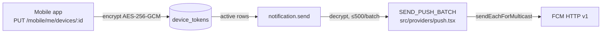
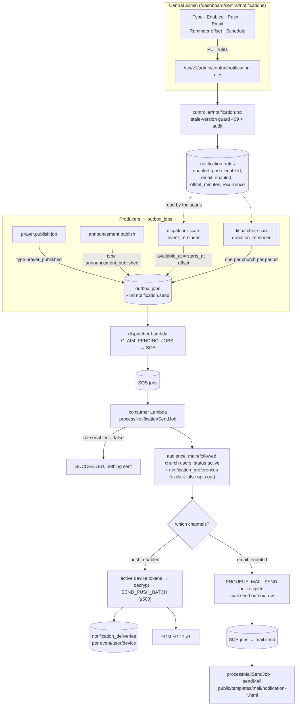

# FIREBASE — push notifications (FCM)

| Field      | Value                                                             |
| ---------- | ----------------------------------------------------------------- |
| Document   | FIREBASE — credentials, environment and worker deployment         |
| Applies to | `src/providers/push.tsx`, `notification.send` worker, `infra/`    |
| Related    | `docs/admin/INFRA-DEPLOY.md` (AWS), `docs/admin/TASK.md` (F11/12) |

Push reaches devices through **Firebase Cloud Messaging HTTP v1** via `firebase-admin`. There is no APNs
credential in this repository: iOS also goes through FCM, so the Apple key lives in the Firebase project,
not in `.env` and not in Secrets Manager.

## 1. Who sends, and where it runs



| Runtime                                    | Handles                                                                                                                                     |
| ------------------------------------------ | ------------------------------------------------------------------------------------------------------------------------------------------- |
| Vercel (Next)                              | device registration only — encrypts and stores the token. **Never loads `firebase-admin`**: `providers/push` is imported only by the worker |
| Consumer Lambda (`src/lambda/consumer.ts`) | claims `notification.send` rows from SQS and sends the push                                                                                 |
| Local (`bun run worker:notification-send`) | same controller, poll loop instead of SQS                                                                                                   |

The dispatcher Lambda (`EventBridge`, `rate(1 minute)`) only enqueues references; it never touches FCM.

The full pipeline — admin rule, producers, both delivery legs and their failure semantics — is §2.

## 2. End-to-end flow: admin rule → device

The central screen is the only place a notification type is configured: one row per trigger, and the
`enabled` / `push` / `email` switches decide which legs run. Producers never choose a channel — they enqueue a
trigger, and the consumer reads the switches at send time.



### 2.1 Stages, with the code that owns each one

| #   | Stage             | Code                                                                                                                              | Notes                                                                                                                   |
| --- | ----------------- | --------------------------------------------------------------------------------------------------------------------------------- | ----------------------------------------------------------------------------------------------------------------------- |
| 1   | Admin edits a row | `src/contents/central/notifications/index.tsx` → `src/hooks/data/notification.tsx`                                                | Sends only changed fields, with the row `version`                                                                       |
| 2   | Rule write        | `src/app/api/v1/admin/central/notification-rules/route.ts` → `src/controller/notification.tsx` → `src/providers/notification.tsx` | `requiredScope(central, prayer_notification_rule)`, 409 on stale version, one audit row per type, `version` incremented |
| 3   | Producer enqueues | `ENQUEUE_NOTIFICATION` calls in `prayer-publish-job.tsx`, `providers/announcement.tsx`, `controller/notification-schedule.ts`     | `kind: 'notification.send'`, dedupe key `notification.send:<type>:<suffix>`                                             |
| 4   | Dispatch          | `src/controller/job-dispatch.ts` (`runDispatcher`, EventBridge every minute)                                                      | Before claiming `notification.send` it also runs the two calendar sweeps                                                |
| 5   | Consume           | `src/lambda/consumer.ts` → `src/controller/notification-send-job.tsx`                                                             | Requires `state = RUNNING`; a replayed message with any other state is skipped                                          |
| 6   | Push leg          | `SEND_PUSH_BATCH` (`src/providers/push.tsx`)                                                                                      | Batches of 500, per-token result, delivery row per device                                                               |
| 7   | Email leg         | `ENQUEUE_MAIL_SEND` → `mail.send` → `processMailSendJob` → `sendMail`                                                             | One row per recipient, template per trigger                                                                             |
| 8   | Delivery record   | `notification_deliveries`                                                                                                         | Unique `(event_key, user_id, device_token_id)`; `sent` rows are filtered out before a retry, so no double push          |

### 2.2 Trigger → what the worker needs

| Rule type                | Preference key      | Email template              | Producer                                             |
| ------------------------ | ------------------- | --------------------------- | ---------------------------------------------------- |
| `prayer_published`       | `daily_prayer`      | `notification-prayer`       | `prayer.publish` job                                 |
| `announcement_published` | `announcements`     | `notification-announcement` | announcement publish                                 |
| `event_reminder`         | `church_events`     | `notification-event`        | dispatcher scan, `offset_minutes` before `starts_at` |
| `donation_reminder`      | `donation_reminder` | `notification-donation`     | dispatcher scan, `recurrence` = weekly/monthly       |

`offset_minutes` and `recurrence` only steer the two scans; they are irrelevant to the other two triggers,
which fire from the business transaction itself. `recurrence` is rejected for every type except
`donation_reminder` (422 at the API).

### 2.3 Failure semantics of one job

| Situation                       | Outcome                                                                    |
| ------------------------------- | -------------------------------------------------------------------------- |
| `enabled = false`               | `SUCCEEDED` — the type is off, the job is consumed and gone                |
| both channels off               | `SUCCEEDED` — nothing to do                                                |
| trigger not in the sender's map | `FAILED` `UNSUPPORTED_NOTIFICATION`                                        |
| published content missing       | `FAILED` `MISSING_CONTENT`                                                 |
| rule row missing                | `FAILED` `MISSING_RULE` (seed drift)                                       |
| FCM transient error             | `PENDING` + `PUSH_TRANSIENT`, backoff `30s × 2^attempts`, `FAILED` after 3 |
| FCM says token is dead          | token soft-disabled, job continues with the other devices                  |
| email enqueue throws            | same requeue/backoff path as push                                          |

Email rows carry their own retry budget (`processMailSendJob`, 3 attempts) — the notification job succeeds
once the rows are queued, because the mail pipeline owns delivery from there.

---

## 3. The two credentials

| Variable                   | Where it is used                               | Storage                                                              |
| -------------------------- | ---------------------------------------------- | -------------------------------------------------------------------- |
| `FIREBASE_SERVICE_ACCOUNT` | worker only — `cert(JSON.parse(...))`          | Secrets Manager `/prayer365/<env>/firebase-service-account`          |
| `DEVICE_TOKEN_KEY`         | **both** — web route encrypts, worker decrypts | Secrets Manager `/prayer365/<env>/device-token-key` + Vercel env var |

`FIREBASE_SERVICE_ACCOUNT` must not be added to Vercel: nothing on the web side reads it, and it would put a
private key in a third place.

## 4. Get the service-account key

1. Firebase console → **Project settings → Service accounts** (panel _Firebase Admin SDK_) → **Generate
   new private key**. This yields a key for `firebase-adminsdk-xxxxx@<project>.iam.gserviceaccount.com`,
   which already carries _Firebase Admin SDK Administrator Service Agent_ / Cloud Messaging admin.
2. Firebase console → **Cloud Messaging** → confirm **Cloud Messaging API (V1)** is enabled. A valid key
   still fails auth when the API is off.
3. Store the downloaded JSON outside the repository (it is a credential, and `*.json` service-account files
   are **not** in `.gitignore`):

   ```bash
   mkdir -p ~/.secrets && mv ~/Downloads/prayer365-firebase-adminsdk-*.json ~/.secrets/prayer365-firebase.json
   chmod 600 ~/.secrets/prayer365-firebase.json
   ```

4. Verify it is the shape this code accepts and belongs to the right project:

   ```bash
   jq -r '.project_id, .client_email' ~/.secrets/prayer365-firebase.json
   ```

   `isServiceAccount()` (`infra/scripts/seed-secrets-rules.ts`) requires exactly `project_id`,
   `client_email` and `private_key`. `project_id` must match the mobile app's `google-services.json` /
   `GoogleService-Info.plist`; a key from another project sends nothing back but
   `messaging/registration-token-not-registered`, and the worker then retires the device.

Do **not** use the _General → Your apps_ config files (client IDs, no private key), the _Cloud Messaging →
Web Push certificates_ VAPID pair (browser push, unused here), or an access token from `gcloud`.

## 5. Generate the device-token key

```bash
bunx tsx infra/scripts/seed-secrets.ts --print-device-key   # base64, 32 bytes
# or
openssl rand -base64 32
```

AES-256-GCM key for `device_tokens.token_ciphertext`. `src/utils/device-token.ts` rejects a missing key
(`DEVICE_TOKEN_KEY_MISSING`) or a wrong length (`DEVICE_TOKEN_KEY_INVALID`).

**Vercel and the Lambda must hold the same value.** Vercel encrypts at registration, the worker decrypts
before sending; two different keys give `unable to authenticate data` on a row that looks perfectly valid.
Rotating it invalidates every stored ciphertext — devices must register again, so treat it as a planned
event, not a casual change.

## 6. Local environment

`.env` (gitignored, loaded by `dotenv/config` through `src/utils/db-connection.ts`):

```bash
DATABASE_URL="postgresql://..."

# point at the JSON rather than pasting it; the seeding CLI resolves this path too
FIREBASE_SERVICE_ACCOUNT_FILE=/home/<user>/.secrets/prayer365-firebase.json
DEVICE_TOKEN_KEY="<base64 32 bytes>"
```

`src/providers/push.tsx` reads the **inline value first**, then the file:

1. `FIREBASE_SERVICE_ACCOUNT` — raw JSON (base64 is accepted only by the seeding CLI, not at runtime)
2. `FIREBASE_SERVICE_ACCOUNT_FILE` — path to the downloaded `.json`, read with `fs.readFileSync`

So leave `FIREBASE_SERVICE_ACCOUNT` **empty** when you use the file form; a stray value shadows the file and
the worker fails with `FIREBASE_SERVICE_ACCOUNT_INVALID` (not JSON). Blank it for one run with
`FIREBASE_SERVICE_ACCOUNT= bun run …`, where dotenv will not override the empty shell value.

## 7. Deploy

### 7.1 AWS — secrets first, then the workers

CloudFormation resolves secret **names** at deploy time
(`{{resolve:secretsmanager:/prayer365/<env>/firebase-service-account:SecretString::}}`,
`infra/lib/worker-stack.ts`), so the values must exist before the stack deploys.

```bash
# 1. write the two secrets (dry-run first, read the diff, then drop --dry-run)
bunx tsx infra/scripts/seed-secrets.ts --env catatia --only device-token-key,firebase-service-account --dry-run
bunx tsx infra/scripts/seed-secrets.ts --env catatia --only device-token-key,firebase-service-account

# 2. deploy the worker stack
cd infra
export PRAYER365_ENV=catatia
bun run deploy:workers          # dispatcher + consumer + SQS + schedule + alarms

# 3. confirm nothing is left as a CDK placeholder
bun run deploy:check            # = scripts/deploy.sh --check
```

`--env` picks the default file (`.env` for `catatia`, `.env.prod` for `prayer-365`) and the AWS profile;
`--file` with a non-default path needs `--allow-file`. The script masks values, never rewrites an unchanged
secret, and stops before writing anything if a secret cannot be built from the file.

The consumer Lambda receives both values through `SECRET_ENV` (`infra/lib/worker-stack.ts`), not as literal
env vars — that is what keeps the private key out of the CloudFormation template and lets it rotate without
a redeploy.

### 7.2 Vercel — one variable, then redeploy

Only `DEVICE_TOKEN_KEY` belongs there.

```bash
bun run env:sync -- --dry-run --target production --file .env
bun run env:sync -- --target production --file .env --yes
```

`env:sync` diffs a local file against the `prayer-365-dashboard` project with `vercel env pull`, masks
values, and never deletes host-only keys. Because it mirrors the **whole** file, keep the Firebase key out of
the file you sync (see `.env.secrets` below) or the private key lands on Vercel unused.

Environment variables are baked at build time: **redeploy after adding one**, or the running deployment keeps
failing with `DEVICE_TOKEN_KEY_MISSING`.

### 7.3 Keeping the files apart

```bash
# .env.secrets — seeding only, never synced
FIREBASE_SERVICE_ACCOUNT_FILE=/home/<user>/.secrets/prayer365-firebase.json
DEVICE_TOKEN_KEY=<base64 32 bytes>

# .env — the file env:sync reads
DATABASE_URL=...
BASE_URL=https://...
MAIL_FROM=...
```

```bash
bunx tsx infra/scripts/seed-secrets.ts --env catatia --file .env.secrets --allow-file
bun run env:sync -- --target production --file .env --yes
```

## 8. Verify

### 8.1 Credentials only, no device needed

Send one push to a **synthetic** token. The error code tells you what is wrong:

```bash
cat > /tmp/fcm-probe.ts <<'EOF'
import 'dotenv/config'
import { SEND_PUSH_BATCH } from '@/providers/push'
const r = await SEND_PUSH_BATCH([
  { token: 'fcm-probe-invalid-token', title: 'probe', body: 'probe', data: { type: 'probe' } },
])
console.log(JSON.stringify(r))
EOF
bun /tmp/fcm-probe.ts
```

| Result                                                                     | Meaning                                                                       |
| -------------------------------------------------------------------------- | ----------------------------------------------------------------------------- |
| `messaging/invalid-argument` or `messaging/invalid-registration-token`     | credentials, API enablement and role are **correct** — only the token is fake |
| `FIREBASE_SERVICE_ACCOUNT_INVALID`                                         | the inline variable holds a path or truncated JSON; blank it (see §6)         |
| `messaging/mismatched-credential`, `SERVICE_DISABLED`, `PERMISSION_DENIED` | key from another project, Cloud Messaging API (V1) off, or role missing       |

### 8.2 Full worker, with a real device

Needs a token minted by the same Firebase project (run the mobile app, or register one through
`PUT /api/v1/mobile/me/devices/:id` with a mobile Bearer token), a rule with `push_enabled: true`, and
`DEVICE_TOKEN_KEY` set locally.

```bash
bun run worker:notification-send -- --once
```

Expect `{"claimed":1,"succeeded":1,...}` plus a `notification_deliveries` row with `status: 'sent'`.

Deployed:

```bash
aws logs tail /aws/lambda/prayer365-catatia-consumer --follow   # look for notification_send_tick
```

```sql
-- landed pushes, newest first
select event_key, status, created_at from notification_deliveries order by created_at desc limit 20;
```

A device that FCM rejects with `messaging/registration-token-not-registered` or
`messaging/invalid-registration-token` is soft-disabled (`disabled_at` set) rather than retried.

## 9. Failure modes

| Symptom                                                             | Cause                                                                    | Fix                                                                     |
| ------------------------------------------------------------------- | ------------------------------------------------------------------------ | ----------------------------------------------------------------------- |
| `FIREBASE_SERVICE_ACCOUNT_MISSING` (job `failed`)                   | env var absent in the runtime                                            | secret not seeded, or the stack deployed before seeding                 |
| `DEVICE_TOKEN_KEY_MISSING` / `_INVALID` (422/500 on `PUT /devices`) | key absent or not 32 bytes on Vercel                                     | `env:sync`, then redeploy                                               |
| `unable to authenticate data` in the worker                         | Vercel and Lambda hold different `DEVICE_TOKEN_KEY` values               | seed both from one source, re-register devices                          |
| `PUSH_TRANSIENT` on every attempt                                   | Cloud Messaging API (V1) disabled, wrong project, or role missing        | enable the API; check `project_id` and the service account              |
| job `succeeded`, no delivery row                                    | rule `push_enabled` false, all recipients opted out, or no active device | check `notification_rules`, `notification_preferences`, `device_tokens` |
| deliveries `status: 'failed'`, devices disabled                     | tokens minted by another Firebase project                                | ship the app with the matching `google-services.json`                   |

Email has its own transport and variables (`MAIL_FROM`, `BASE_URL`) — see `docs/admin/INFRA-DEPLOY.md`.

## 10. Rotate

| Credential          | Procedure                                                                                                                                                                         |
| ------------------- | --------------------------------------------------------------------------------------------------------------------------------------------------------------------------------- |
| Service account key | New key in Firebase → seed `firebase-service-account` → no redeploy needed (the dynamic reference re-reads Secrets Manager). Keep the old key enabled until one send is confirmed |
| `DEVICE_TOKEN_KEY`  | New key → seed AWS **and** update Vercel **in the same window** → expect every device to re-register; old ciphertext is undecryptable by design                                   |

Never commit either value, never paste the JSON into a ticket or a chat, and never add
`FIREBASE_SERVICE_ACCOUNT` to Vercel "just in case".
