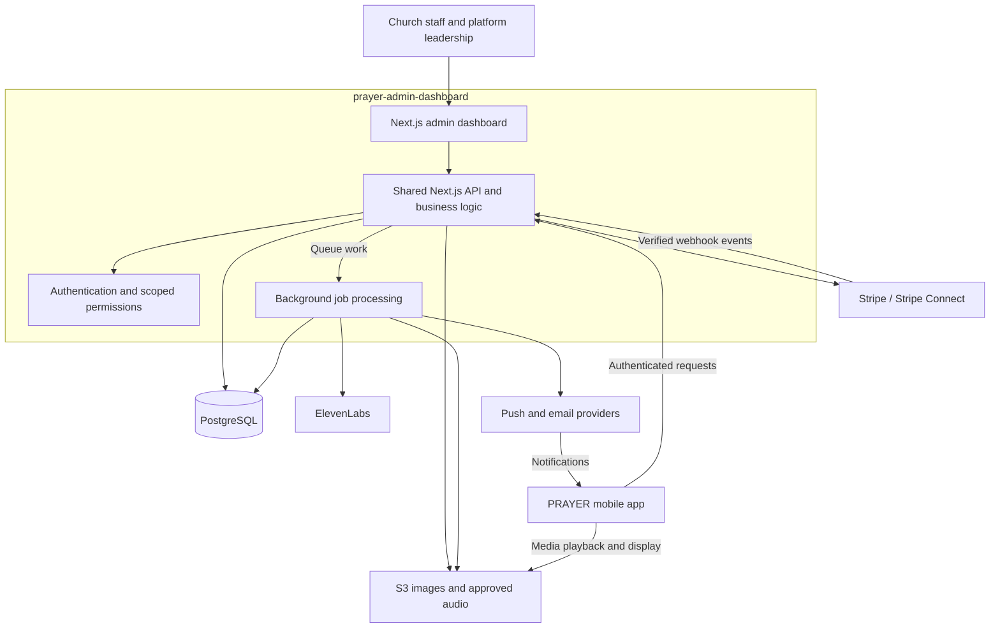

# PRAYER Admin Platform Overview

## Purpose

The PRAYER admin platform helps church staff publish content, manage requests, and understand church activity. It also gives PRAYER administrators control over participating churches and provides regional leadership with aggregate reporting.

This project contains both the **Next.js admin dashboard and the shared backend API** used by the PRAYER mobile app. It owns the platform's business rules, permissions, data, and service integrations.

## Users and Access

| Role                          | Main responsibility                                                                              |
| ----------------------------- | ------------------------------------------------------------------------------------------------ |
| PRAYER global administration  | Manage the platform, churches, administrators, countries, languages, hierarchy, and permissions. |
| Country administration        | Oversee the assigned country within explicitly granted permissions.                              |
| Diocese / Bishop              | View aggregate activity for churches within the assigned diocese.                                |
| Deanery / Dean                | View aggregate activity for churches within the assigned deanery.                                |
| Pastor / Church administrator | Manage content and authorized operations for assigned churches.                                  |

The underlying structure is **Global → Country → Diocese → Deanery → Church → Pastor / Church administrator → User**. A church is an organizational unit, not a login role. Staff may be assigned to multiple churches.

Hierarchy does not automatically grant access to private prayer or pastoral requests. Access must be determined by both role and data type. Mobile users have no administrative access by default.

## Core Features

| Area                     | Administration experience                                                                                                                                   |
| ------------------------ | ----------------------------------------------------------------------------------------------------------------------------------------------------------- |
| Church overview          | Followers, prayer publication status, upcoming services/events, recent authorized requests, donation activity, and basic engagement.                        |
| Church profiles          | Manage descriptions, images, pastors, addresses, contacts, languages, accessibility details, and service schedules.                                         |
| Prayer publishing        | Create and edit prayers, assign pastors, approve text, generate and preview audio, schedule publication, and browse history.                                |
| Events and announcements | Publish services, Bible studies, community events, news, and optional registration/contact links.                                                           |
| Requests                 | View and manage prayer, pastoral-contact, and meeting requests with restricted access.                                                                      |
| Donations                | View provider-reported transactions, recurring donations, and basic monthly reporting for assigned churches.                                                |
| Attendance and analytics | View voluntary check-in counts, registrations, active users, prayer reads/audio plays, event activity, and engagement trends.                               |
| Central administration   | Create, approve, suspend/archive churches; manage administrators, pastors, countries, languages, hierarchy, permissions, notifications, and voice profiles. |
| Regional dashboards      | Show aggregate church, user, engagement, attendance, and donation statistics within the administrator's assigned region.                                    |

New churches require manual approval before public visibility. These features reflect the requested scope; any phased release or deferral must be agreed separately.

## Technology Stack

| Component                 | Direction                                                                                                                                        |
| ------------------------- | ------------------------------------------------------------------------------------------------------------------------------------------------ |
| Dashboard and shared API  | Next.js + TypeScript within `prayer-admin-dashboard`. No separate NestJS application.                                                            |
| Mobile client             | React Native + TypeScript in the sibling `prayer-mobile-app` project.                                                                            |
| Database                  | PostgreSQL for church relationships, permissions, content, requests, and reporting data.                                                         |
| Hosting and files         | AWS; S3 for images and prayer audio. Exact deployment services remain to be selected.                                                            |
| AI voice                  | ElevenLabs Instant Voice Cloning and Text-to-Speech APIs using one PRAYER-owned account; subject to voice/language and verification-path trials. |
| Donations                 | Stripe / Stripe Connect, subject to launch-country and church-account availability.                                                              |
| Maps                      | Google Maps for church location features.                                                                                                        |
| Push notifications        | Firebase Cloud Messaging and Apple Push Notification Service.                                                                                    |
| Background jobs and email | Required for generation, scheduled publishing, notifications, and transactional email; tooling/providers remain to be selected.                  |

Next.js and TypeScript are agreed directions. Service choices remain subject to account setup and integration validation. Authentication implementation and database tooling still need selection.

## Platform Architecture

The backend enforces permissions on every protected operation. The mobile app never accesses the database or provider secrets directly. Background-job code belongs to this project's backend; its execution environment may be deployed separately to support long-running and scheduled tasks.

## Prayer and AI Audio Workflow

1. Pastor uploads their sample and supplies offline authorization evidence through their own PRAYER web account. An authorized admin approves it; approval automatically registers the voice through the Instant Voice Cloning API on the single PRAYER ElevenLabs account. Only provider-ready voices can be used.
2. Staff prepare the prayer text and approve it for narration.
3. A background job generates audio using the approved text and authorized voice.
4. Staff preview and approve the audio.
5. Staff publish immediately or schedule publication.
6. The mobile app receives the published prayer and stored audio.

Generate once per approved version and reuse the audio for all listeners. If the source text changes, regenerate and reapprove the matching audio before publishing. AI must not invent teachings or messages in a pastor's identity.

Instant Voice Cloning is the selected onboarding method. Pastors need only their PRAYER staff login; no personal ElevenLabs account or shared-voice link is part of this flow. Request about 1–2 minutes of clean speech and validate the selected TTS model for English, Estonian and Finnish. Admin approval authorizes submission to ElevenLabs; it is not provider verification. If ElevenLabs returns `requires_verification=true`, keep the voice blocked in `verification_required`. Validate a supported in-PRAYER completion path during the pilot. Do not bypass verification or silently require a personal ElevenLabs account; unresolved provider requirements are a launch blocker for that voice.

Keep the provider integration replaceable. Resemble AI is a potential alternative, subject to language and account verification. Manual upload of finished prayer audio remains outside current scope. Pastor sample upload is part of voice registration, not publication of a finished prayer recording.

## Shared Backend Responsibilities

- Serve authenticated APIs for accounts, church discovery/following, content, requests, donations, check-ins, and preferences.
- Maintain church and regional relationships, scoped staff assignments, and server-enforced permissions.
- Run reliable publishing and notification schedules, with clear time-zone handling and retries.
- Handle verified payment webhooks without double-counting repeated events; use provider-confirmed status for donation reporting.
- Record analytics events consistently and provide basic church and regional summaries.
- Respect notification preferences; donation reminders require explicit opt-in.
- Support consent records, account/data deletion, retention rules, and data export workflows.

## Security, Languages, and Reliability

- Separate church data and restrict private requests to explicitly authorized staff. Regional reporting uses aggregate data.
- Use encrypted communication, secure authentication, protected secrets/media, and administrative activity logs.
- Do not store raw card details. Route donations through the payment provider to the relevant church account.
- Prepare English, Estonian, and Finnish language support; keep interface language independent of church country. Automatic content translation is excluded.
- Store voluntary attendance only; continuous background tracking is excluded.
- Monitor failed jobs and integrations, maintain backups, and test recovery.
- Test dashboard flows, APIs, cross-church access restrictions, payment events, publishing, AI approval, notifications, and reporting.

## Dependencies and Launch Readiness

Delivery depends on approved UX, church data and translations, the institutional hierarchy, a role/access matrix, provider accounts, church payment onboarding, pastor consent, and coordinated mobile integration.

Production accounts and source code should remain under PRAYER / Rellex control. Handover includes the source code, database schema, API documentation, configuration/deployment instructions, service inventory, and operational access.

Before release, complete end-to-end testing with the mobile app, client acceptance, security and performance checks, production monitoring, backups, and operational documentation. Estimate delivery jointly with the mobile scope; this overview does not commit a delivery date.

## Outside the Initial Scope

Full church CRM, live user-to-pastor chat, social feeds and moderation, advanced nationwide BI, complex cross-country reporting, predictive analytics, continuous tracking, automatic AI translation, crisis-response infrastructure, and complex commission systems.

## Decisions Still Required

- Launch countries, participating churches, and initial hierarchy.
- Detailed permissions for country/regional staff and private-request handlers.
- Full-scope launch versus an agreed phased release.
- Authentication, database tooling, AWS deployment, background jobs, and email provider.
- Instant clone quality/language trials, provider verification handling, voice-slot limits and shared-account usage budget.
- Payment eligibility, church onboarding responsibilities, and reporting definitions.
- Approved translations, retention rules, and legal text supplied by the project owner.

## References

- Project scope: PRAYER — APPLICATION & PLATFORM DEVELOPMENT BRIEF.
- Related project document: `prayer-mobile-app/OVERVIEW.md`.
- [ElevenLabs models and supported languages](https://elevenlabs.io/docs/overview/models)
- [ElevenLabs Instant Voice Cloning API](https://elevenlabs.io/docs/api-reference/voices/ivc/create)
- [Resemble AI voice creation](https://www.resemble.ai/products/voice-creation)

Provider information was reviewed during project planning and must be rechecked during integration.
