# PRAYER Admin Technical Specification

**Status:** Template-aligned implementation specification. Template capabilities were inspected in source; Prayer-specific changes remain proposed and are not implemented or deployed.

## 1. Scope and Decision Status

This specification implements the current scope of `FEATURE.md`, using `OVERVIEW.md` for the agreed platform direction. The source brief is **PRAYER — APPLICATION & PLATFORM DEVELOPMENT BRIEF**. Feature references such as F4 mean the numbered feature in `FEATURE.md`.

- **Agreed direction:** Next.js + TypeScript for the admin dashboard and shared backend, hosted in `prayer-admin-dashboard`; React Native + TypeScript mobile client; PostgreSQL relational storage.
- **Template foundation:** Reuse the supplied Catatia Next.js dashboard structure, NextAuth credentials authentication, Prisma, Ant Design, TanStack Query/Axios, `GeneralError`, and `accesscontrol`. Extend these for Prayer rather than introducing a parallel architecture.
- **Preferred integrations:** AWS/S3, ElevenLabs Instant Voice Cloning and TTS through one PRAYER-owned account, Stripe/Stripe Connect, Google Maps, FCM/APNs, subject to account and integration validation. The template documents Vercel deployment; section 10 separates this documented default from verified code and unresolved hosting choices.
- **Proposed implementation:** Every schema, route, internal state, infrastructure service, and algorithm below is a technical design proposal. It does not create additional product features.
- **To confirm:** Business rules or service choices that are not defined in the brief are listed explicitly. Do not silently implement them as approved requirements.

The Future Approach items in `FEATURE.md` remain excluded. In particular, do not build operational retry screens, AI usage dashboards, notification campaign tools, named attendance history, custom payment onboarding, request assignment/status systems, or dedicated audit/privacy consoles.

## 2. Application Architecture

### 2.0 Verified Template Baseline

**Inspected source:** `/Users/yosarama/Documents/PROJECT/CATATIA/template-dashboard-nextjs/`.

This inspection covered source files, Prisma schema/migrations, package manifests/locks, `AGENT.md`, and `template-dashboard-spec.md`. It did not install dependencies, run the app, test login, or prove production readiness. Source code takes precedence over conflicting template documentation when describing what exists.

| Area               | Verified template implementation                                                  | Prayer adaptation                                                                                                                                            |
| ------------------ | --------------------------------------------------------------------------------- | ------------------------------------------------------------------------------------------------------------------------------------------------------------ |
| Framework          | Next.js App Router, TypeScript; manifest requests Next `^15.3.4`, React `^19.1.0` | Preserve framework and thin route/page wrappers. Pin compatible supported versions during setup; these observed versions are not a freshness recommendation. |
| UI                 | Ant Design 5, theme/config, Tailwind 3, SCSS, shared dashboard shell              | Reuse shell, forms, tables, feedback, and upload components; Prayer feature UI lives in `contents/`.                                                         |
| Data fetching      | TanStack Query 5 and Axios in `hooks/data/`                                       | Preserve hooks; add scope and user identity to cache keys.                                                                                                   |
| Database           | Prisma 6/PostgreSQL; `User`, `Role`, `Permission` models                          | Extend the schema and providers with church hierarchy and Prayer entities. Users bind to a single role (`role_id`).                                          |
| Authentication     | NextAuth v5 beta credentials provider, JWT sessions, bcrypt password verification | Retain admin login baseline; harden active-user/session checks against the user's single role. Mobile token design remains separate work.                    |
| RBAC               | `accesscontrol`, `requiredAuth`, role-to-grant transformers, role/permission UI   | Preserve resource/action checks using the user's single role; enforce the resource's tenant boundary in providers.                                           |
| API conventions    | `/api/v1/`, `GeneralError`, `success/message/result`, paginated `total`           | Keep template-compatible envelopes and page-based admin lists.                                                                                               |
| S3                 | Presigned POST controller and upload-box                                          | Add authorization, tenant ownership, size/type limits, completion checks and private access.                                                                 |
| Email              | Nodemailer/Handlebars; source implements Mailtrap and Mailgun branches            | Reuse templating; SES is documented but not implemented in this source. Production transport needs confirmation.                                             |
| Deployment/logging | Template document names Vercel and Winston                                        | No deployment was verified; Winston is absent from inspected dependencies/source. Treat hosting/logging as setup work.                                       |

**Dependency reconciliation is required:** `bun.lock` records Next 15.3.5, React 19.1.0, NextAuth 5.0.0-beta.29, Prisma/client 6.11.1, TanStack Query 5.81.5 and accesscontrol 2.2.1. `package-lock.json` instead records Next 14.2.5/React 18.3.1 and lacks several declared packages. Prefer the template's Bun workflow as the starting point, choose one lockfile, audit compatibility/security and reproduce a clean build before implementation. React type declarations currently target 18 despite React 19 in the manifest. This spec does not prescribe deploying the old locked versions unchanged.

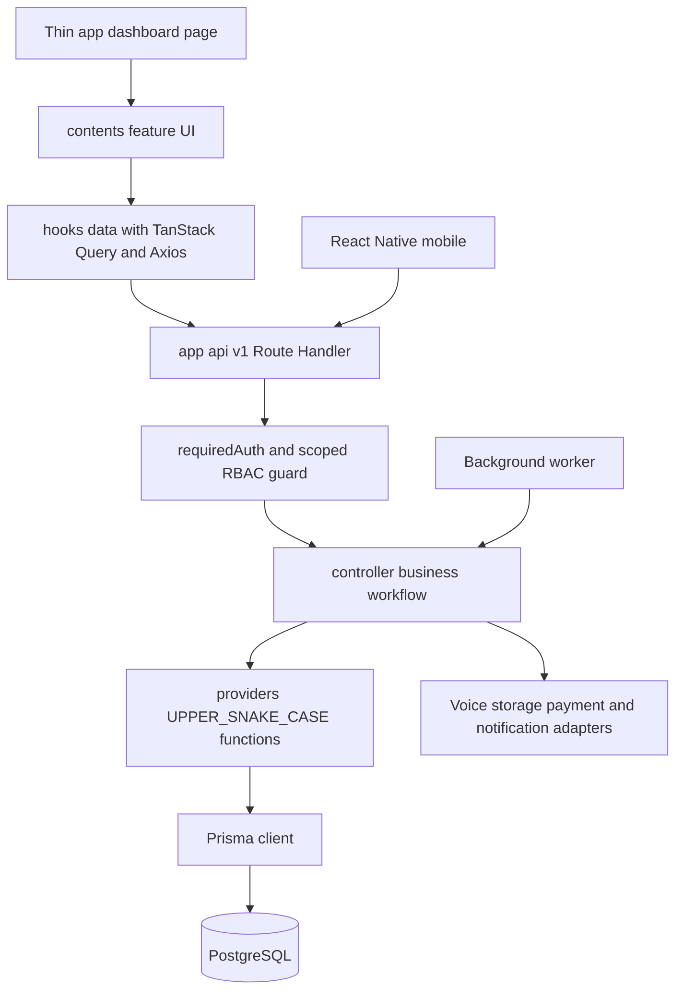

Protected routes call the guard before a controller/provider. Providers must require an authorized scope for protected queries; route-level checks alone are insufficient. Client UI data fetching uses the template hooks; do not introduce server-rendered feature data calls that bypass this pattern. Server-side layout authentication and worker execution are separate concerns.

### 2.1 Template-Aligned Project Structure

```text
src/
  app/
    login/page.tsx
    dashboard/
      layout.tsx                        # Existing protected dashboard shell
      page.tsx                          # Authorized entry/overview
      user-management/user/             # Reuse staff management UI
      user-management/role/             # Reuse supported role/permission UI
      churches/[churchId]/...            # Prayer church features
      central/...                       # Prayer central features
      regions/[regionId]/...            # Aggregate regional reporting
    api/
      [...nextauth]/route.ts             # Existing location; auth base path needs verification
      v1/users/...                      # Retained, hardened staff contracts
      v1/roles/...                      # Retained role catalogue contracts
      v1/permissions/route.ts            # Retained permission catalogue
      v1/admin/...                      # New scoped Prayer administration
      v1/mobile/...                     # Shared mobile API
      v1/webhooks/stripe/route.ts
  auth.ts                               # Existing NextAuth credentials configuration
  contents/<feature>/                   # Page-level UI
  components/common/                    # Reusable forms/tables/upload/feedback
  components/container/                 # Dashboard and global providers
  controller/<feature>.tsx              # Business workflows and integration orchestration
  providers/<feature>.tsx               # Prisma operations; UPPER_SNAKE_CASE exports
  hooks/data/<feature>.tsx              # Queries and mutations
  hooks/ui/                             # Template feedback/dialog hooks
  models/<feature>.tsx                  # DTO/payload types and validation contracts
  utils/required-auth.ts                # Authentication extended for active users
  utils/required-scope.ts               # Church/region tenancy scope guard (role_assignments + org nodes)
  utils/access-permission.ts            # Existing accesscontrol builder
  utils/role-to-access-control.ts       # Existing grant transformation
  utils/general-error.ts                # Existing expected-error contract
  utils/db-connection.ts                # Existing Prisma singleton
  data/sidebar-data.tsx                 # Scope-aware menu items
  config/antdTheme.tsx
  styles/
  jobs/                                 # Proposed durable handlers, reusing controllers/providers
  i18n/                                 # Proposed translations
prisma/
  schema.prisma
  migrations/
  seeds/
  seed.ts
workers/                                # Proposed external worker entry point
tests/                                  # Proposed implementation tests
```

All feature UI belongs in `contents/`; `app/` page wrappers only import/render it, consistent with the actual template wrappers. No direct Prisma calls in API routes. Models and providers precede routes/hooks/UI when implementing a feature. Use `GeneralError` for expected errors and `useMainNotification` for UI feedback. Keep existing `.tsx` module conventions where used; new Route Handlers can use `route.ts`.

Prisma, Ant Design, TanStack Query and Axios are now selected by the template. Runtime validation and testing tools still need selection; TypeScript types alone do not validate API input. The Next.js [Route Handler interface](https://nextjs.org/docs/app/getting-started/route-handlers) remains the HTTP entry point.

**Client caching:** Use keys such as `['prayers', userId, churchId, filters, page, limit]`. Scope entity-detail keys too. Invalidate matching list/detail/summary keys after mutations; clear protected caches on logout/account switch. Keep one stable QueryClient per mounted provider rather than recreating it on every render. Client permission state drives presentation only.

### 2.2 Request Lifecycle

1. Verify identity and resolve the application user.
2. Validate parameters and request body with an allowlist schema.
3. Resolve resource ownership from the database, not from client claims alone.
4. Check action permission, organization scope, church status, and sensitive-data rules.
5. Execute the workflow in its controller and scoped Prisma provider transaction.
6. Write required audit/outbox records within the transaction.
7. Return an explicit DTO with only authorized fields.

Return private responses with `Cache-Control: private, no-store`. Never share authenticated page/API caches across users or churches. Published content may be cached only with publication and church-visibility checks and appropriate invalidation.

## 3. Identity, Roles, and Organization Scope

### 3.1 Authentication: Retain and Harden NextAuth

The template already chooses **NextAuth credentials authentication with JWT sessions** for the admin web app. A managed identity provider is no longer the default proposal for admin.

Verified flow: `src/auth.ts` → `controller/authentication.tsx` → `providers/user.tsx` → bcrypt verification through `utils/hash.ts`. The current session includes `user_id` and one role ID/name; the callback looks up the user by email. The session role is the user's single `Role` (identity layer); church/region tenancy additionally uses `role_assignments`.

- Keep browser authentication through secure HttpOnly cookies and CSRF/origin checks for mutations. Verify actual cookie/base-path settings during integration.
- Resolve active user state from immutable user ID after initial login. Reject disabled, deleted, missing users and revoked sessions, not just missing cookies.
- Add `auth_version` on User, record it in the JWT, and compare against the database at authorization boundaries. Increment on password change/account disable. Load the user's single role and its permissions on protected requests, or use explicit permission-version invalidation with a defined revocation bound.
- Passwords remain bcrypt hashes in the template `User.password` field, never plaintext and never response fields. Use generic login failures and rate limits instead of the template's distinguishable account-existence errors.
- Do not assume `auth()` refresh alone enforces church access or soft-deletion status. Server Actions must use the same checks as Route Handlers.
- The template's handler file is `src/app/api/[...nextauth]/route.ts`, while auth configuration has no explicit `basePath`. Confirm and align the handler route, client provider and deployed auth URL. Do not invent a working URL from the template documentation or assume `/api/auth/*` already exists.

**Mobile auth (resolved, plan 002):** NextAuth browser credentials sessions are not
automatically a bearer-token API for React Native. The token contract is implemented at
`/api/v1/mobile/auth/login` (short-lived access JWT 15 min w/ `auth_version` claim), `refresh`
(single-use opaque hashed refresh token; rotation + family reuse-revocation), and `logout`
(device-session revocation). Access tokens carry `auth_version` and required-auth re-validates
it + active-user status at every authorization boundary. Admin session JWT is never reused as a
public bearer. Secure device storage of the refresh token is a client-side (RN) requirement.

### 3.2 RBAC Model

Authorization is a **hybrid of two layers** (confirmed model, option 1):

**Layer 1 — Identity & staff/role/permission management (single-role):**

1. **User has exactly one Role** via `User.role_id` (nullable for end-users/customers who have no admin role).
2. **Role** is a named bundle of permissions. Roles are **seeded by the system** (`prayer_*` templates, type `SYSTEM`) and can also be **created by an admin** (type `USER`) through the role UI.
3. **Role ↔ Permission** many-to-many via Prisma's implicit `_role_permission` join.
4. **Permission** defines capability:
   - **Permission title** = an entity/subject (e.g. `prayer_church`, `prayer_prayer`, `prayer_role`).
   - **Actions** = `READ, CREATE, UPDATE, DELETE`.
   - **Scope** = `OWN` (only resources owned by the acting user) or `ANY`.
5. `getAccessPermission()` / `TransformRolesToAccessControl()` build accesscontrol grants from the role's permission rows; `requiredAuth()` returns `{ session, permission }`; `useAccessPermission()` drives sidebar/action visibility. The server re-checks every request.
6. **Permission configuration is per-role.** The global admin edits a role's permission set (role detail → "Role Access Control"); every user bound to that role is affected. The permission catalogue registers **every entity** with its full CRUD × OWN/ANY set so roles are freely reconfigurable.

**Layer 2 — Church/region tenancy (org-hierarchy scoping, retained):**

- The 74 church/region/central content routes enforce tenant boundaries through `role_assignments` + org nodes via `requiredScope()`. A user's assignments resolve the org-node subtree they may operate on (Global → Country → Diocese → Deanery → Church), and providers filter count+row queries by the resulting church set.
- This layer is **data boundary only** — it does not replace the identity role. A staff user holds BOTH a single `User.role_id` (identity/RBAC for staff/user/role/permission screens) AND one or more `role_assignments` (church/region data scope).

**Ownership semantics:** `OWN` means the acting user owns the resource (e.g. a pastor's own voice submission; own profile edits). It must never be treated as "church membership." `ANY` authorizes the action within the resource's tenant boundary enforced by Layer 2.

**No staff-by-profile:** pastor profiles and mobile main/followed-church relationships confer no admin access. Capabilities come from the role; data scope comes from assignments.

### 3.3 Proposed Role Templates

Reuse the existing role UI and permission catalogue. Seed the system role templates below; an admin may also create custom roles (type `USER`) as needed. Deleting a seeded/SYSTEM role must be protected (cannot remove references or the last admin). The inherited permission editor configures each role's capability; updates affect every user bound to that role.

Each user binds to **one** role via `User.role_id` for identity/RBAC (staff/user/role/permission screens). Church/region data scope additionally comes from `role_assignments` (Layer 2); the role grants apply wherever the user is an authorized scope.

| Role template                   | Scope | Intended permission boundary                                                                                                                                            |
| ------------------------------- | ----- | ----------------------------------------------------------------------------------------------------------------------------------------------------------------------- |
| `prayer_global_admin`           | ANY   | Church lifecycle, staff/organization setup, notification and voice configuration, aggregate reporting, permission management. No default private-request access.        |
| `prayer_country_admin`          | ANY   | Descendant aggregate reporting only initially; additional country powers remain D8.                                                                                     |
| `prayer_diocese_admin`          | ANY   | Descendant aggregate reporting.                                                                                                                                         |
| `prayer_deanery_admin`          | ANY   | Descendant aggregate reporting.                                                                                                                                         |
| `prayer_church_admin`           | ANY   | Church overview/profile/content, publication and permitted donation/analytics summaries. Request access must be granted explicitly.                                     |
| `prayer_pastor`                 | OWN   | Own voice-sample upload/submission and status only; no self-approval. Other content/publishing permissions as confirmed. Profile identity alone grants no admin access. |
| `prayer_request_reader`         | ANY   | Standard request access only.                                                                                                                                           |
| `prayer_private_request_reader` | ANY   | Explicit sensitive request access, including private prayer/pastoral/meeting requests.                                                                                  |
| `prayer_user`                   | OWN   | End-user / mobile customer role. No admin grants by default.                                                                                                            |

These are proposed permission bundles, not additional product user types. Final pastor/church administrative powers must be confirmed. End-users (mobile customers) may bind to `prayer_user` or have no role (role_id null) — a `prayer_user` role exists so customers can share a capability bundle.

### 3.4 Permission Subjects and Checks

Use the template's `<project>_<resource>` convention with `prayer_` prefix. Keep CRUD action vocabulary; represent domain-specific actions with specific subjects, not unsupported accesscontrol verbs such as `publishAny`.

| Subject                                                      | Allowed action checks          | Use                                                                                                                                                                                                       |
| ------------------------------------------------------------ | ------------------------------ | --------------------------------------------------------------------------------------------------------------------------------------------------------------------------------------------------------- |
| `prayer_church`                                              | read/create/update             | Church details and central creation; scope/action policy distinguishes central setup from local editing.                                                                                                  |
| `prayer_church_lifecycle`                                    | update                         | Central approval/suspension/archive only.                                                                                                                                                                 |
| `prayer_pastor`                                              | read/create/update             | Profile/assignment operations within confirmed policy.                                                                                                                                                    |
| `prayer_prayer`                                              | read/create/update             | Prayer text and history.                                                                                                                                                                                  |
| `prayer_prayer_review`                                       | update                         | Approve text/audio; reviewer policy D4.                                                                                                                                                                   |
| `prayer_prayer_publication`                                  | update                         | Schedule and publish approved version.                                                                                                                                                                    |
| `prayer_voice_generation`                                    | create                         | Generate from approved text and authorized voice.                                                                                                                                                         |
| `prayer_voice_submission`                                    | read/create/update OWN         | Linked pastor may create, upload, submit and view only their own profile revision within an assigned church. Server derives pastor identity.                                                              |
| `prayer_voice_profile`                                       | read/update                    | Authorized admin review of voice submissions and consent, approve/reject/disable. Approval is an update subject to a separate reviewer policy and no self-approval. Provider registration is worker-only. |
| `prayer_service_time`, `prayer_event`, `prayer_announcement` | read/create/update as relevant | Required church content. No generic delete granted automatically.                                                                                                                                         |
| `prayer_request`                                             | read                           | Standard requests at assigned church.                                                                                                                                                                     |
| `prayer_private_request`                                     | read                           | Additional explicit church-scoped sensitive grant.                                                                                                                                                        |
| `prayer_donation`                                            | read                           | Church transaction/recurring reports.                                                                                                                                                                     |
| `prayer_analytics`, `prayer_attendance`                      | read                           | Authorized aggregate data only.                                                                                                                                                                           |
| `prayer_platform_statistics`                                 | read                           | Central aggregate statistics, not financial/request detail.                                                                                                                                               |
| `prayer_hierarchy`, `prayer_country`, `prayer_language`      | read/create/update             | Central organizational management.                                                                                                                                                                        |
| `prayer_administrator`                                       | read/create/update             | Central staff management, adapted from template user management.                                                                                                                                          |
| `prayer_role`, `prayer_permission`                           | read; role update              | Supported role catalogue and permission management; admin edits per-role grants.                                                                                                                          |
| `prayer_role_assignment`                                     | read/create/delete             | Central church/region assignment (tenancy layer); deletion means revoke.                                                                                                                                  |
| `prayer_notification_rule`                                   | read/update                    | Required central notification settings.                                                                                                                                                                   |
| `prayer_media`                                               | create/read                    | Scoped upload/preview, plus purpose-specific permission.                                                                                                                                                  |

Add unique `(subject, actions, scope)` and constrain `actions` to supported values (`READ/CREATE/UPDATE/DELETE`). `ANY` grants authorize within the resource's tenant boundary (enforced by routes/providers on the resource's own `church_id`/`org_node`). `OWN` grants require explicit user/resource ownership and payload allowlists; own-profile editing cannot change roles.

Replace template `user_management_*` and demo subjects with this catalogue in hooks, routes, sidebar and seeds together. Never retain old broad endpoints as an authorization bypass. Do not seed global administrators by connecting every permission row: the template seed does that, but Prayer must enumerate grants and omit automatic sensitive access.

### 3.5 Server and Client RBAC Flow

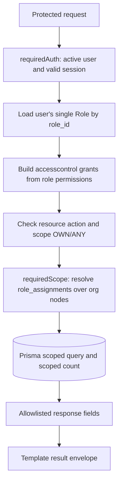

Two guards compose. `requiredAuth()` loads the user's single role and checks the action/scope against its accesscontrol grants. Then `requiredScope()` resolves the user's `role_assignments` against the org-node tree to produce the allowed church set, and providers use it in **both count and row queries**, plus nested relation access. Identity/RBAC is single-role; church/region data boundary is assignment-scoped.

```ts
// Illustrative contract, not existing template code.
const { session, permission } = await requiredAuth()
if (!permission.readAny('prayer_prayer').granted) throw forbidden
const scope = await requiredScope({ userId, churchId, subject: 'prayer_prayer', action: 'read' })
const result = await GET_PRAYERS({ scope, page, limit })
```

`useAccessPermission()` loads the session user's single role and builds its effective actions for sidebar/action controls. Table/form action controls use these effective actions; hiding a UI control never authorizes an endpoint — the server re-checks every request. Clear permission/query caches on user changes and invalidate them when a role's grants are updated.

### 3.6 Migration from Template RBAC

1. Keep physical `user`, `role`, `permission` tables and the implicit `_role_permission` relation, plus `role_assignments`/`org_node` (tenancy layer). Preserve existing user IDs/password hashes where migrating real data.
2. Seed the Prayer role templates, fixed Prayer permission records, and the full per-entity CRUD × OWN/ANY permission catalogue. Assign each existing admin/staff user a single `Role` via `role_id`.
3. Create the corresponding `role_assignments` for each staff user at their org node/openings (church/region data scope). End-users/customers keep `role_id` null (no admin role) and no assignments. Never infer an admin role from a followed church or pastor profile.
4. Make `User.role_id` the authoritative identity binding. Protect seeded/SYSTEM roles and the last admin from deletion.
5. Update NextAuth session types/callbacks, guards, hooks, sidebar, role/user forms and routes together, all keyed on the single identity role. A user with `role_id` null has no admin access. Keep `requiredScope()` as the tenancy guard.
6. Remove obsolete/demo grants and endpoints after compatibility review; run cross-church and privilege-escalation tests before enabling users.

For a fresh Prayer database, apply template migrations + extension migrations and seed explicit grants. Bootstrap the first central administrator through a controlled one-time operation; never grant every permission to every existing template administrator automatically. Do not carry demonstration accounts or broad seed grants into production.

## 4. Database Design and ERD

### 4.1 Conventions

- IDs: UUID-format primary keys unless a natural key is explicitly shown. The template Prisma `String @default(uuid())` IDs are PostgreSQL text, not native uuid columns. Preserve that physical type for the baseline and compatible foreign keys; dictionary `uuid` means UUID-format identifier. A later conversion to native UUID requires an explicit data/type migration, not mixed foreign-key types.
- Timestamps: `timestamptz` in UTC. Display/schedule using the church's IANA time zone; exact DST behavior is in the decision register.
- Preserve Prisma template snake_case fields. Existing staff/role/permission JSON contracts remain snake_case; new Prayer DTOs below use camelCase with explicit model mapping. Never pass raw request objects directly into Prisma. Keep the common template response envelope across both.
- Mutable business records include `created_at`, `updated_at`, and integer `version` for optimistic concurrency unless specified otherwise. Append-only tables have `created_at` only.
- `?` in the dictionary means nullable. All other listed fields are required unless a default is stated.
- Foreign keys are explicit. Tenant-owned references must also match church ownership, using composite constraints where practical and transactional validation otherwise. The ERD/dictionary names `users`, `roles`, `permissions`, and `role_permissions` are logical names mapped respectively to existing `user`, `role`, `permission`, and `_role_permission`; do not create duplicate RBAC tables.
- Monetary values use integer minor units plus an ISO currency code. Never floating-point amounts or cross-currency totals without an approved conversion policy.
- Do not expose rows directly as JSON. Sensitive and provider-only columns stay out of public/admin DTOs where unauthorized.

### 4.2 Organization and Access ERD

```mermaid
erDiagram
    USERS {
        string id PK
        string email UK
        string password "Private bcrypt hash"
        int auth_version
        string role_id FK "single role, nullable"
    }
    ROLES {
        string id PK
        string name UK
        string type SYSTEM or USER
    }
    PERMISSIONS {
        string id PK
        string subject "permission title / entity"
        string actions "READ,CREATE,UPDATE,DELETE"
        string scope "ANY or OWN"
    }
    COUNTRIES ||--o| ORG_NODES : identifies_country_node
    ORG_NODES o|--o{ ORG_NODES : parent_of
    ORG_NODES ||--o| CHURCHES : represents
    USERS }o--o{ ROLE_ASSIGNMENTS : holds
    ROLES ||--o{ ROLE_ASSIGNMENTS : defines
    ORG_NODES ||--o{ ROLE_ASSIGNMENTS : scopes
    ROLES ||--o{ ROLE_PERMISSIONS : has
    PERMISSIONS ||--o{ ROLE_PERMISSIONS : grants
    USERS ||--o{ USER_CHURCHES : follows_or_selects
    CHURCHES ||--o{ USER_CHURCHES : attracts
    CHURCHES ||--o{ CHURCH_LANGUAGES : supports
    LANGUAGES ||--o{ CHURCH_LANGUAGES : identifies
    PASTORS ||--o{ CHURCH_PASTORS : serves
    CHURCHES ||--o{ CHURCH_PASTORS : assigns
    USERS o|--o{ PASTORS : optionally_links
```

### 4.3 Content, Voice, and Requests ERD

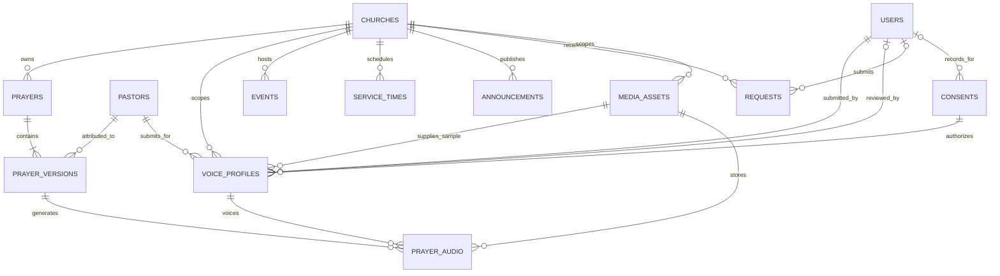

`prayer_versions` are internal immutable text snapshots for matching approvals and audio; they do not create an editorial version-history UI. A prayer's published pointer selects the mobile-visible version independently from an unpublished edit.

### 4.4 Payments and Operational Data ERD

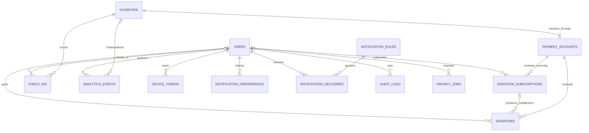

Independent technical tables `outbox_jobs`, `webhook_receipts`, and `idempotency_records` are described below. ERDs show principal relationships; dictionaries define additional references and constraints.

## 5. Data Dictionary

### 5.1 Identity and Organization

| Table              | Main columns and types                                                                                                                                                                                                                                                                                                                                                     | Constraints / notes                                                                                                                                                                                                                                                                                         |
| ------------------ | -------------------------------------------------------------------------------------------------------------------------------------------------------------------------------------------------------------------------------------------------------------------------------------------------------------------------------------------------------------------------- | ----------------------------------------------------------------------------------------------------------------------------------------------------------------------------------------------------------------------------------------------------------------------------------------------------------- |
| `users`            | Existing User: `id`, `email UNIQUE`, `name`, `password?` (bcrypt hash), `created_at`, `updated_at?`, `deleted_at?`. Add `locale FK languages`, `status`, `auth_version int DEFAULT 1`, `version int DEFAULT 1`; `role_id?` FK role (nullable for end-users, single binding otherwise).                                                                                     | Physical `user`. Each user binds to one `role`; the role's permissions define capability. Public displayName maps from name; identity_subject is not needed. Never select password for response DTOs. Resolve deleted-user email anonymization/retention under D10.                                         |
| `countries`        | `code char(2) PK`, `name text`, `enabled boolean`                                                                                                                                                                                                                                                                                                                          | Country registry; disabling must not break existing references.                                                                                                                                                                                                                                             |
| `languages`        | `code text PK`, `name text`, `enabled boolean`                                                                                                                                                                                                                                                                                                                             | BCP-47 identifiers; seed `en`, `et`, `fi`. No automatic translations.                                                                                                                                                                                                                                       |
| `org_nodes`        | `id uuid`, `parent_id uuid? FK org_nodes`, `kind text`, `name text`, `country_code char(2)? FK countries`                                                                                                                                                                                                                                                                  | Kind `global/country/diocese/deanery/church`; one global root; unique country code when set. Only country nodes set country code. Proposed strict parent chain; confirm treatment of independent churches.                                                                                                  |
| `churches`         | `id uuid`, `org_node_id uuid UNIQUE`, `name text`, `status text`, `timezone text`, `description text?`, `denomination text?`, `cover_asset_id uuid? FK media_assets`, `address jsonb`, `latitude numeric?`, `longitude numeric?`, `contacts jsonb`, `website text?`, `social_links jsonb`, `accessibility text?`, `approved_by uuid? FK users`, `approved_at timestamptz?` | Status `pending/approved/suspended/archived`. Coordinates both present or both null; validate ranges. Public visibility requires approved status. JSON structures are allowlisted below.                                                                                                                    |
| `church_languages` | `church_id uuid FK`, `language_code text FK`                                                                                                                                                                                                                                                                                                                               | Composite PK; no country-language coupling.                                                                                                                                                                                                                                                                 |
| `roles`            | Existing `id`, `name UNIQUE`, `type SYSTEM/USER`, timestamps, `deleted_at?`; add `version int DEFAULT 1`                                                                                                                                                                                                                                                                   | Physical `role`; name holds the seeded role key. Type is metadata, not global authorization. Soft-deleted roles cannot grant access; protect referenced/seeded roles from deletion.                                                                                                                         |
| `permissions`      | Existing `id`, `subject text`, `actions text`, `scope ANY/OWN`, timestamps, `deleted_at?`                                                                                                                                                                                                                                                                                  | Physical `permission`; add unique subject/action/scope and allowed-action checks. CRUD action uses template singular `actions` column name.                                                                                                                                                                 |
| `role_permissions` | Existing Prisma implicit join: `A` references Permission ID, `B` references Role ID                                                                                                                                                                                                                                                                                        | Physical `_role_permission`; composite PK from template migration. Retain implicit relation instead of creating an incompatible explicit key-based join.                                                                                                                                                    |
| `role_assignments` | `id uuid`, `user_id uuid FK`, `role_id uuid FK`, `org_node_id uuid FK`, `granted_by uuid FK users`, `revoked_at timestamptz?`                                                                                                                                                                                                                                              | Church/region TENANCY layer (option-1 hybrid): scopes a staff user's data access to org nodes. Distinct from the identity role (`user.role_id`). Only authorized central administrators grant/revoke.                                                                                                       |
| `user_churches`    | `user_id uuid FK`, `church_id uuid FK`, `is_main boolean`, `is_followed boolean`                                                                                                                                                                                                                                                                                           | Composite PK; partial unique index on user where is_main; require at least one flag. Changing main church is transactional.                                                                                                                                                                                 |
| `pastors`          | `id uuid`, `user_id uuid? FK users`, `name text`, `introduction text?`, `image_asset_id uuid? FK media_assets`, `version int`                                                                                                                                                                                                                                              | Profile may exist without a staff account; My Voice requires a linked PRAYER staff user and explicit pastor assignment. Enforce one linked pastor identity per participating staff user. The image is the canonical profile image and must be a ready image owned by one of the pastor's assigned churches. |
| `church_pastors`   | `church_id uuid FK`, `pastor_id uuid FK`, `pastoral_role text`, `image_asset_id uuid? FK media_assets`, `active_voice_profile_id uuid? FK voice_profiles`                                                                                                                                                                                                                  | Composite PK. Active voice must belong to this pastor/church and satisfy approved/ready/consent guards. Prayer attribution must match an assigned pastor. The optional church image overrides the canonical Pastor image only for that church; otherwise use the Pastor image, then the default avatar.     |

### 5.2 Content and Sensitive Requests

| Table             | Main columns and types                                                                                                                                                                                                                                                                                                                                                                                                                                                                                                                                                       | Constraints / notes                                                                                                                                                                                                                                                                                                                                      |
| ----------------- | ---------------------------------------------------------------------------------------------------------------------------------------------------------------------------------------------------------------------------------------------------------------------------------------------------------------------------------------------------------------------------------------------------------------------------------------------------------------------------------------------------------------------------------------------------------------------------- | -------------------------------------------------------------------------------------------------------------------------------------------------------------------------------------------------------------------------------------------------------------------------------------------------------------------------------------------------------- |
| `service_times`   | `id uuid`, `church_id uuid FK`, `weekday smallint`, `local_time time`, `label text?`, `language_code text? FK`                                                                                                                                                                                                                                                                                                                                                                                                                                                               | Proposed representation of weekly service times, not a recurring-event engine. Weekday 1–7; time zone comes from church.                                                                                                                                                                                                                                 |
| `prayers`         | `id uuid`, `church_id uuid FK`, `current_version_id uuid?`, `published_version_id uuid?`, `scheduled_version_id uuid?`, `scheduled_at timestamptz?`, `published_at timestamptz?`, `created_by uuid FK users`                                                                                                                                                                                                                                                                                                                                                                 | All version pointers must reference this prayer. Create initial version and pointer in one transaction. Scheduled version/time both present or both absent.                                                                                                                                                                                              |
| `prayer_versions` | `id uuid`, `prayer_id uuid FK`, `version_number int`, `pastor_id uuid FK`, `title text`, `introduction text?`, `body text`, `language_code text FK`, `text_hash text`, `approved_by uuid? FK users`, `approved_at timestamptz?`, `selected_audio_id uuid?`                                                                                                                                                                                                                                                                                                                   | Unique prayer/version number; immutable text payload. Approval metadata is controlled by domain actions. Selected audio must belong to this exact version and be approved.                                                                                                                                                                               |
| `voice_profiles`  | `id uuid`, `pastor_id uuid FK`, `church_id uuid FK`, `submitted_by uuid FK users`, `version int`, `replaces_profile_id uuid? FK voice_profiles`, `provider text`, `cloning_method text`, `provider_voice_id text?`, `consent_id uuid FK`, `sample_asset_id uuid FK media_assets`, `submitted_at timestamptz?`, `review_state text`, `reviewed_by uuid? FK users`, `reviewed_at timestamptz?`, `review_reason text?`, `approved_sample_checksum text?`, `registration_state text`, `requires_verification boolean?`, `registration_attempt_id uuid?`, `last_error_code text?` | One immutable submitted sample/consent revision per record. Method is `instant`; provider credentials belong only to PRAYER. Review and provider registration states are separate; section 9.3.1 defines guards. Returned Voice ID is server-managed and not editable by a pastor/admin. Historical prayer audio retains its original profile reference. |
| `consents`        | `id uuid`, `user_id uuid? FK`, `pastor_id uuid? FK`, `purpose text`, `terms_version text`, `recorded_at timestamptz`, `recorded_by uuid? FK users`, `evidence_asset_id uuid? FK media_assets`, `revoked_at timestamptz?`                                                                                                                                                                                                                                                                                                                                                     | Exactly one subject: user or pastor. Voice-profile consent must identify that pastor and voice purpose, with private evidence of offline authorization. Admin review checks this evidence; it does not substitute for provider verification. Evidence is private. Retention policy to confirm.                                                           |
| `prayer_audio`    | `id uuid`, `prayer_version_id uuid FK`, `voice_profile_id uuid FK`, `status text`, `asset_id uuid? FK media_assets`, `provider_request_id text?`, `approved_by uuid? FK users`, `approved_at timestamptz?`, `error_code text?`                                                                                                                                                                                                                                                                                                                                               | Internal states `queued/generating/ready/approved/failed`. Asset required for ready/approved. Audio version and voice consent are checked again at publication.                                                                                                                                                                                          |
| `media_assets`    | `id uuid`, `church_id uuid FK`, `object_key text UNIQUE`, `purpose text`, `mime_type text`, `byte_size bigint`, `checksum text?`, `status text`, `uploaded_by uuid? FK users`                                                                                                                                                                                                                                                                                                                                                                                                | Purpose allowlist: image, voice sample, consent evidence, generated audio. Proposed status `pending/ready/rejected`. No arbitrary public bucket access.                                                                                                                                                                                                  |
| `events`          | `id uuid`, `church_id uuid FK`, `category text`, `title text`, `description text`, `starts_at timestamptz`, `location text`, `registration_url text?`, `language_code text? FK`                                                                                                                                                                                                                                                                                                                                                                                              | Category reflects service/special/Bible study/community/other. Date/time are stored as one timestamp. No internal registration/booking system.                                                                                                                                                                                                           |
| `announcements`   | `id uuid`, `church_id uuid FK`, `title text`, `body text`, `published_at timestamptz?`                                                                                                                                                                                                                                                                                                                                                                                                                                                                                       | Title/body and immediate publish are proposed minimum fields; confirm because brief does not enumerate announcement fields. No scheduled campaign feature.                                                                                                                                                                                               |
| `requests`        | `id uuid`, `church_id uuid FK`, `user_id uuid? FK`, `kind text`, `subject text?`, `message text`, `classification text?`, `contact_method text`, `phone text?`, `email text?`, `availability text?`                                                                                                                                                                                                                                                                                                                                                                          | Kind prayer/pastoral/meeting. Prayer subject required; classification private/standard where applicable. No assignment, case status, staff reply, or booking columns. Treat pastoral/meeting messages as restricted.                                                                                                                                     |

### 5.3 Payments, Analytics, and Delivery

| Table                      | Main columns and types                                                                                                                                                                                                                                          | Constraints / notes                                                                                                                                                               |
| -------------------------- | --------------------------------------------------------------------------------------------------------------------------------------------------------------------------------------------------------------------------------------------------------------- | --------------------------------------------------------------------------------------------------------------------------------------------------------------------------------- |
| `payment_accounts`         | `id uuid`, `church_id uuid UNIQUE FK`, `provider text`, `provider_account_id text UNIQUE`, `status text`                                                                                                                                                        | Verified operational setup using provider tooling; no custom onboarding page. Payment eligibility status synchronized from provider.                                              |
| `donation_subscriptions`   | `id uuid`, `payment_account_id uuid FK`, `user_id uuid? FK`, `provider_subscription_id text`, `amount_minor bigint`, `currency char(3)`, `provider_status text`                                                                                                 | Unique provider account/subscription ID; monthly only. Backend mirror, not admin subscription-editing feature.                                                                    |
| `donations`                | `id uuid`, `payment_account_id uuid FK`, `user_id uuid? FK`, `subscription_id uuid? FK donation_subscriptions`, `provider_payment_id text`, `amount_minor bigint`, `currency char(3)`, `status text`, `paid_at timestamptz?`, `refunded_minor bigint DEFAULT 0` | Unique account/payment ID. Subscription must use same account. Mirror each recurring installment separately. Refund amount supports accurate provider reporting, not a refund UI. |
| `check_ins`                | `id uuid`, `church_id uuid FK`, `user_id uuid? FK`, `occurred_at timestamptz`, `local_date date`, `dedupe_key text UNIQUE`                                                                                                                                      | No coordinates, background tracking, or QR fields. Date derived server-side from church time zone. Named histories not exposed to administrators.                                 |
| `analytics_events`         | `id uuid`, `event_key text UNIQUE`, `church_id uuid? FK`, `user_id uuid? FK`, `event_type text`, `occurred_at timestamptz`, `received_at timestamptz`, `resource_id uuid?`                                                                                      | Allowlist events and validate resource ownership; no arbitrary payload or private request text. Primary financial/check-in counts come from source tables, not client events.     |
| `device_tokens`            | `id uuid`, `user_id uuid FK`, `installation_id text`, `platform text`, `token_ciphertext text`, `token_hash text UNIQUE`, `disabled_at timestamptz?`                                                                                                            | Rotate/reassign installation ownership on login/logout; redact tokens in logs. Provider routing selected during mobile integration.                                               |
| `notification_preferences` | `user_id uuid FK`, `type text`, `enabled boolean`                                                                                                                                                                                                               | Composite PK; missing donation-reminder preference means false. Other defaults require confirmation.                                                                              |
| `notification_rules`       | `id uuid`, `type text UNIQUE`, `enabled boolean`, `offset_minutes int?`                                                                                                                                                                                         | Only specified notification types; timing/configuration fields proposed. No arbitrary audiences or general scheduling.                                                            |
| `notification_deliveries`  | `id uuid`, `rule_id uuid FK`, `user_id uuid FK`, `device_token_id uuid? FK`, `event_key text`, `status text`, `provider_message_id text?`, `attempts int`                                                                                                       | Unique event/user/device key for push. Technical queued/sent/failed/skipped states; no delivery dashboard. Provider acceptance is not proof of device display.                    |

### 5.4 Technical Tables

| Table                 | Fields / purpose                                                                                                                                                                               | Integrity rule                                                                                                                                                    |
| --------------------- | ---------------------------------------------------------------------------------------------------------------------------------------------------------------------------------------------- | ----------------------------------------------------------------------------------------------------------------------------------------------------------------- |
| `outbox_jobs`         | `id uuid`, `kind text`, `dedupe_key text`, `resource_id uuid?`, `payload jsonb`, `available_at timestamptz`, `state text`, `attempts int`, `lease_until timestamptz?`, `last_error_code text?` | Unique dedupe key. Payload contains references/minimum routing data, not private request bodies. Written transactionally with business change.                    |
| `webhook_receipts`    | `id uuid`, `provider text`, `account_id text`, `event_id text`, `event_type text`, `object_id text`, `received_at timestamptz`, `processed_at timestamptz?`, `state text`                      | Unique provider/account/event. Persist after signature validation; dispatch processing durably. Do not keep full payment payload indefinitely.                    |
| `idempotency_records` | `id uuid`, `actor_key text`, `operation text`, `key text`, `request_hash text`, `resource_id uuid?`, `state text`, `expires_at timestamptz`                                                    | Unique actor/operation/key. Same key with a different body returns conflict. Do not store payment secrets in cached responses.                                    |
| `audit_logs`          | `id uuid`, `actor_id uuid? FK users`, `church_id uuid? FK`, `action text`, `resource_type text`, `resource_id uuid?`, `outcome text`, `request_id text`, `created_at timestamptz`              | Append-only; privileged retention/deletion process only. No passwords, tokens, voice samples, request messages, or full before/after sensitive payloads.          |
| `privacy_jobs`        | `id uuid`, `user_id uuid FK`, `kind text`, `state text`, `requested_at timestamptz`, `completed_at timestamptz?`, `result_object_key text?`, `result_expires_at timestamptz?`                  | Export/deletion processing only; access is authenticated subject or authorized operator. Export results are private, expiring storage objects, not public assets. |

### 5.5 Constraints and Indexes

- Index `org_nodes(parent_id)`, active `role_assignments(user_id, org_node_id)`, and every high-use foreign key.
- Content lists: `(church_id, created_at, id)`; events `(church_id, starts_at, id)`; published prayers `(church_id, published_at, id)`.
- Requests: `(church_id, created_at, id)` with sensitive filtering applied before pagination/counting.
- Donations: `(payment_account_id, paid_at)` and unique external IDs; subscriptions `(payment_account_id, provider_status)`.
- Analytics/check-ins: `(church_id, occurred_at)` and approved distinct-user aggregation indexes only where needed.
- Jobs: `(state, available_at)`; deliveries `(status, created_at)`; webhook uniqueness as above.
- Reject cross-church version/audio/media references. Shared pastors require church assignment checks rather than assuming ownership from pastor ID alone.
- Use transactions for approval/publishing pointers, hierarchy changes, grant changes, check-in insertion, and webhook updates.
- Do not use blanket cascading deletes across financial, audit, consent, and publication records. Apply the approved deletion policy per table.

## 6. API Contracts and Validation

### 6.1 URL and Response Conventions

Business APIs start with `/api/v1`. Retain template `/users`, `/roles`, `/permissions` paths with the hardened contracts in section 8.3. New scoped admin/mobile routes use `/admin` and `/mobile`. NextAuth owns its separately configured handler path; do not treat its responses as business API envelopes.

Retain the template success envelope so TanStack hooks can read `response.data.result`:

```json
{
  "success": true,
  "message": "Prayer updated",
  "result": { "id": "resource-uuid", "version": 3 },
  "request_id": "trace-id"
}
```

Admin lists return `{ success, message, result: [], total, page, limit, request_id }`. Keep `page`, `limit`, `search`, `order_by`, `order_direction` conventions. Proposed defaults: page 1, limit 25, maximum 100. Validate positive integer values and an endpoint-specific ordering allowlist; add ID as stable sort tie-breaker. Never trust arbitrary `order_by` or permit unlimited `ALL` extraction of sensitive records. Count and list use the same scoped filter within a Prisma transaction. Strong snapshot consistency, if required, uses an appropriate transaction isolation level rather than assuming default read-committed queries are identical snapshots.

Mobile lists may use `next_cursor` within the same `result` envelope where appropriate; specify that per mobile endpoint. Do not silently change inherited admin hooks to cursor pagination.

Preserve `GeneralError` fields and add only safe optional metadata:

```json
{
  "code": 422,
  "error": "VALIDATION_ERROR",
  "error_code": "PRAYER_TITLE_REQUIRED",
  "details": "Please provide a title.",
  "fields": { "title": "Required" },
  "request_id": "trace-id"
}
```

Extend the serializer/type for optional fields/request_id centrally. Unknown failures return generic 500 text and a request ID; never return the template's raw Error object, stack, Prisma detail or provider response. Keep parsing/validation inside try/catch and authenticate before expensive processing.

| HTTP status     | Use                                                                            |
| --------------- | ------------------------------------------------------------------------------ |
| 200 / 201 / 204 | Read/update, created resource, successful action without body                  |
| 202             | Durable asynchronous work accepted; return resource identifier/state in result |
| 400 / 422       | Malformed request / invalid field or business rule                             |
| 401 / 403       | Missing identity / denied action within visible scope                          |
| 404             | Missing resource or resource outside caller visibility                         |
| 409             | Stale version, idempotency payload conflict, invalid state                     |
| 429 / 503       | Rate limit / temporarily unavailable integration                               |

Use `Idempotency-Key` for generation, donation initiation, request submission and check-ins. Scope keys by actor/action and validate request hashes. Mutable writes submit the last known version. Existing template users/roles use PUT and remain PUT; new Prayer APIs may use PATCH for partial edits, with dedicated hooks using the documented method. Never change an inherited method without updating its callers.

### 6.2 Principal DTOs

These are proposed minimum structures; validation limits such as text lengths and upload sizes must be selected before implementation.

```ts
type UUID = string
type ISODateTime = string
type LanguageCode = string

type ChurchProfileInput = {
  version: number
  name: string
  description?: string | null
  denomination?: string | null
  address: { line1: string; line2?: string; city: string; postalCode?: string; countryCode: string }
  coordinates?: { latitude: number; longitude: number } | null
  timezone: string
  contacts: { email?: string; phone?: string }
  website?: string | null
  socialLinks: Array<{ label: string; url: string }>
  languageCodes: LanguageCode[]
  accessibility?: string | null
  coverAssetId?: UUID | null
}

type PrayerInput = {
  version?: number // Required for edit, omitted on creation.
  title: string
  introduction?: string | null
  body: string
  pastorId: UUID
  languageCode: LanguageCode
}

type PrayerActionInput = {
  version: number // Prayer concurrency version.
  prayerVersionId: UUID // Exact immutable text snapshot.
}

type EventInput = {
  version?: number
  category: 'service' | 'special' | 'bible_study' | 'community' | 'other'
  title: string
  description: string
  startsAt: ISODateTime
  location: string
  registrationUrl?: string | null
  languageCode?: LanguageCode | null
}

type RequestInput = {
  kind: 'prayer' | 'pastoral' | 'meeting'
  subject?: string // Required for prayer requests.
  message: string
  classification?: 'private' | 'standard'
  contactMethod: string // Allowed vocabulary to confirm.
  phone?: string
  email?: string
  availability?: string
}

type DonationInput = {
  amountMinor: number // Positive safe integer; validate currency limits server-side.
  currency: string
  frequency: 'one_time' | 'monthly'
}
```

The URL determines church ownership; inputs cannot override it. Validate asset ownership/readiness, pastor assignment, language availability, allowed HTTPS links, time zones, and date/time formats. Sanitize rendered text/links; do not execute supplied HTML. Do not require optional phone/email merely because a request exists; confirm conditional contact requirements first.

## 7. Admin Page URL Structure

Preserve the template `/dashboard` layout and existing user-management URLs. `/` remains the template public entry; no public marketing-site work is added. New URLs extend the required features. Editors may use drawers within these pages; separate pages are not required just because a resource has an API.

| Page URL                                            | Purpose                                                          | Access / feature                                |
| --------------------------------------------------- | ---------------------------------------------------------------- | ----------------------------------------------- |
| `/login`                                            | Staff sign-in entry                                              | Public entry; F1                                |
| `/dashboard`                                        | Redirect/show authorized church, central, or regional home       | Authenticated staff; F1                         |
| `/dashboard/churches`                               | Select from assigned churches                                    | Staff with church scope; F1                     |
| `/dashboard/churches/:churchId`                     | Church overview                                                  | Church read; F2                                 |
| `/dashboard/churches/:churchId/profile`             | Church details, assigned pastor information, service times       | Church edit; F3                                 |
| `/dashboard/churches/:churchId/prayers`             | Current/historical prayers                                       | Content access; F4                              |
| `/dashboard/churches/:churchId/prayers/new`         | Create prayer                                                    | Content manage; F4                              |
| `/dashboard/churches/:churchId/prayers/:prayerId`   | Edit, review, audio, schedule, publish                           | Appropriate content/publication permissions; F4 |
| `/dashboard/churches/:churchId/events`              | Event list and create/edit form                                  | Content manage; F5                              |
| `/dashboard/churches/:churchId/announcements`       | News list and create/edit/publish form                           | Content manage; F5                              |
| `/dashboard/churches/:churchId/requests`            | Authorized request list                                          | Request permission; F6                          |
| `/dashboard/churches/:churchId/requests/:requestId` | Authorized request details/contact preferences                   | Sensitive rules also apply; F6                  |
| `/dashboard/churches/:churchId/donations`           | Activity, recurring and monthly reporting tabs                   | Donation read; F7                               |
| `/dashboard/churches/:churchId/analytics`           | Basic activity and attendance aggregates                         | Analytics read; F10                             |
| `/dashboard/central`                                | Platform activity, user/donation summaries                       | Platform management; F8                         |
| `/dashboard/central/churches`                       | Church creation, approval, suspension/archive                    | Platform management; F8                         |
| `/dashboard/central/churches/:churchId`             | Church setup and lifecycle actions                               | Platform management; F8                         |
| `/dashboard/user-management/user`                   | Create staff and bind a single role                              | Platform management; F8                         |
| `/dashboard/user-management/user/create`            | Existing staff creation form, binds a single role                | Central staff management; F8                    |
| `/dashboard/user-management/user/:id`               | Existing staff editor, binds a single role                       | Central staff management; F8                    |
| `/dashboard/user-management/role`                   | Supported role catalogue using template UI                       | Central role read; F8                           |
| `/dashboard/user-management/role/:id`               | Role details + per-role permission editing (Role Access Control) | Central role permission; F8                     |
| `/dashboard/customer`                               | End-user/customer list (mobile users, no admin role)             | Central `prayer_administrator` read; F8         |
| `/dashboard/central/pastors`                        | Pastor records, canonical images and church relationships        | Platform management; F8                         |

Pastor details include name, introduction, canonical image, optional staff-account identity association and church relationships. The Central list shows the canonical image. The linked account identifies the staff user; role and access remain managed separately through the role and permission system. My Church shows these shared identity fields read-only and edits only the church relationship fields. The displayed image resolves church override, then canonical Pastor image, then the default avatar.

| `/dashboard/central/hierarchy` | Organizational relationships | Platform management; F8 |
| `/dashboard/central/countries` | Country registry | Platform management; F8 |
| `/dashboard/central/languages` | Language registry | Platform management; F8 |
| `/dashboard/my-voice` | Pastor uploads own sample/evidence, submits for admin review and views status/rejection reason | Linked pastor and own-submission grant; F4 |
| `/dashboard/central/voice-profiles` | Admin previews submissions, approves/rejects and sees automatic registration state | Voice review; F4/F8; no self-approval |
| `/dashboard/central/notifications` | Required notification configuration only | Notification configure; F11 |
| `/dashboard/regions/:regionId` | Scoped regional aggregates | Regional analytics grant; F9 |

No page for job queues, AI costs, notification delivery, named attendance, refunds, custom payment onboarding, or privacy/audit consoles.

The template role-create page is not enabled by default: custom roles remain excluded. Demo brand/color pages and menu entries are not Prayer features. Direct URL/API access must also be removed or denied, not only hidden from navigation.

## 8. Endpoint URL Structure

### 8.1 Shared Rules

`C` below abbreviates `/api/v1/admin/churches/:churchId`; `A` means `/api/v1/admin`; `M` means `/api/v1/mobile`. These are documentation abbreviations, not literal route names.

Every nested resource must belong to the church in its URL. Every write produces an audit record without sensitive payloads. Role keys map to the permission checks in section 3; hiding a UI control does not authorize an endpoint.

### 8.2 Staff, Church, and Content Endpoints

| Method and path                                   | Input → result                                                                     | Authorization / rule                                                                                                                                        |
| ------------------------------------------------- | ---------------------------------------------------------------------------------- | ----------------------------------------------------------------------------------------------------------------------------------------------------------- |
| `GET /api/v1/admin/me`                            | None → safe user identity and accessible scopes                                    | NextAuth session for admin; no password or tokens                                                                                                           |
| `GET /api/v1/admin/access`                        | churchId or regionId → caller's effective scoped subjects/actions                  | Authenticated staff; guard validates requested scope; no central catalogue grant needed                                                                     |
| `GET A/churches`                                  | Page/limit → assigned/authorized church summaries                                  | Scope-filtered staff                                                                                                                                        |
| `GET C/overview`                                  | Optional reporting dates → F2 overview DTO                                         | Church read; omit unauthorized request data                                                                                                                 |
| `GET C/profile`                                   | None → editable profile DTO                                                        | Church read                                                                                                                                                 |
| `PATCH C/profile`                                 | ChurchProfileInput → updated profile                                               | Church edit; server-owned approval/payment fields rejected                                                                                                  |
| `GET C/pastors`                                   | None → assigned pastor summaries with shared profile fields and resolved image IDs | Church content/profile access; shared fields are read-only locally; image resolves church override then canonical Pastor image                              |
| `PATCH C/pastors/:pastorId`                       | Version, church role/image → updated assignment                                    | Church edit; only church-specific fields                                                                                                                    |
| `GET C/service-times`                             | None → weekly schedule                                                             | Church read                                                                                                                                                 |
| `PUT C/service-times`                             | Version and validated schedule entries → schedule                                  | Church edit; compare/increment church version and transactionally replace this church's schedule                                                            |
| `GET C/prayers`                                   | Page/limit, publication filter → prayers                                           | Content access; historical means published archive                                                                                                          |
| `POST C/prayers`                                  | PrayerInput → prayer and initial version                                           | Content manage                                                                                                                                              |
| `GET C/prayers/:prayerId`                         | None → editor DTO, current/publication/audio state                                 | Content access                                                                                                                                              |
| `PATCH C/prayers/:prayerId`                       | PrayerInput + version → new internal text version                                  | Content manage; never overwrite approved snapshot                                                                                                           |
| `POST C/prayers/:prayerId/approve-text`           | PrayerActionInput → approved snapshot                                              | Authorized text reviewer; mapping to confirm                                                                                                                |
| `POST C/prayers/:prayerId/audio`                  | PrayerActionInput, voiceProfileId → audio ID/state, 202                            | Voice use; approved text and active consent; idempotent                                                                                                     |
| `GET C/prayers/:prayerId/audio/:audioId`          | None → generation state and authorized preview URL                                 | Content access; no general job endpoint                                                                                                                     |
| `POST C/prayers/:prayerId/audio/:audioId/approve` | PrayerActionInput → approved selected audio                                        | Authorized audio reviewer; same text snapshot                                                                                                               |
| `PUT C/prayers/:prayerId/schedule`                | PrayerActionInput, scheduledAt → schedule                                          | Prayer publish; publication preconditions checked                                                                                                           |
| `POST C/prayers/:prayerId/publish`                | PrayerActionInput → published prayer                                               | Prayer publish; same publication checks as scheduler                                                                                                        |
| `GET / POST C/events`                             | List query / EventInput → list / created event                                     | Church content read/manage                                                                                                                                  |
| `PATCH C/events/:eventId`                         | EventInput + version → updated event                                               | Content manage; same church                                                                                                                                 |
| `GET / POST C/announcements`                      | Query / title, body → list / saved announcement                                    | Content read/manage; proposed field contract                                                                                                                |
| `PATCH C/announcements/:announcementId`           | Version, title, body → saved announcement                                          | Content manage                                                                                                                                              |
| `POST C/announcements/:announcementId/publish`    | Version → published announcement                                                   | Content manage; no arbitrary schedule                                                                                                                       |
| `GET C/requests`                                  | Page/limit, allowed kind → authorized summaries                                    | Requests read; filter private rows before pagination                                                                                                        |
| `GET C/requests/:requestId`                       | None → authorized request details                                                  | Requests read plus sensitive permission as needed                                                                                                           |
| `GET C/donations`                                 | Page/limit, from, to → transaction summaries                                       | Donations read; omit unrelated donor personal data                                                                                                          |
| `GET C/donation-subscriptions`                    | Page/limit → recurring summaries                                                   | Donations read; no editing                                                                                                                                  |
| `GET C/donation-summary`                          | Month → per-currency totals                                                        | Donations read                                                                                                                                              |
| `GET C/analytics`                                 | From, to → basic metrics                                                           | Analytics read; no named attendance                                                                                                                         |
| `GET C/attendance-summary`                        | From, to → counts by local date                                                    | Analytics read; no person records                                                                                                                           |
| `POST C/media/uploads`                            | Purpose, MIME, byteSize → asset ID and short-lived upload URL                      | Profile/content permission or own voice-submission/voice-review grant appropriate to purpose; sample ownership and assigned church required                 |
| `POST C/media/:assetId/complete`                  | Checksum → validated asset state                                                   | Same upload scope; server checks object metadata/content                                                                                                    |
| `GET C/media/:assetId/access`                     | None → short-lived preview URL                                                     | Purpose-specific access; consent evidence and voice samples require linked subject ownership with own-submission grant, or explicit voice-review permission |

**Request management gap:** The PDF requires view/manage but does not define a mutation. Do not invent a status/assignment endpoint. Viewing and contacting through supplied details can be specified now; completion of the broader management requirement is blocked on decision D3. Read-only implementation alone must not be presented as full request-management completion.

### 8.3 Central and Regional Endpoints

| Method and path                                   | Input → result                                                                                       | Rule                                                                                                                                                                              |
| ------------------------------------------------- | ---------------------------------------------------------------------------------------------------- | --------------------------------------------------------------------------------------------------------------------------------------------------------------------------------- |
| `GET A/central/overview`                          | Reporting dates → platform aggregates                                                                | Platform management; no private request content                                                                                                                                   |
| `GET / POST A/central/churches`                   | Query / name, hierarchy placement, profile basics → list / pending church                            | Platform management                                                                                                                                                               |
| `GET / PATCH A/central/churches/:churchId`        | None / validated setup changes + version → church setup                                              | Platform management; no automatic private-data grant                                                                                                                              |
| `POST A/central/churches/:churchId/approve`       | Version → approved church                                                                            | Manual approval; required setup validation                                                                                                                                        |
| `POST A/central/churches/:churchId/suspend`       | Version → suspended church                                                                           | Effects subject to D2                                                                                                                                                             |
| `POST A/central/churches/:churchId/archive`       | Version → archived church                                                                            | Effects subject to D2; not hard delete                                                                                                                                            |
| `GET / POST /api/v1/users`                        | Paginated query / name, email, password and single role_id → safe staff list / created staff         | Central `prayer_administrator` read/create; hash password, never return it; users with role_id null are end-users/customers                                                       |
| `GET / PUT /api/v1/users/:id`                     | None / allowlisted fields and version → safe staff DTO                                               | Central staff management in current Prayer UI; no unrestricted self-service role change                                                                                           |
| `GET /api/v1/roles`, `GET /api/v1/roles/:id`      | Query / ID → supported role catalogue/detail                                                         | Central `prayer_role` read                                                                                                                                                        |
| `PUT /api/v1/roles/:id`                           | permission_list and version → safe role DTO                                                          | Central role permission management; validate grant ceiling and invalidate permission caches                                                                                       |
| `GET /api/v1/permissions`                         | None → fixed Prayer permission catalogue                                                             | Central `prayer_permission` read                                                                                                                                                  |
| `GET / POST A/central/role-assignments`           | Query / userId, roleKey, orgNodeId → church/region assignments / assignment                          | Platform management; tenancy layer (option 1); prevent escalation                                                                                                                 |
| `DELETE A/central/role-assignments/:assignmentId` | None → revoked, 204                                                                                  | Platform management; audit and invalidate cached scope                                                                                                                            |
| `GET /api/v1/customers`                           | Paginated query → safe end-user/customer list (role_id null)                                         | Central `prayer_administrator` read                                                                                                                                               |
| `GET / POST A/central/pastors`                    | Query / name, introduction, canonical image, optional linked user → profiles / profile               | Platform management; canonical image must be a ready image belonging to an assigned church                                                                                        |
| `PATCH A/central/pastors/:pastorId`               | Version and shared profile fields, including canonical image → updated pastor                        | Platform management; global profile authority                                                                                                                                     |
| `PUT A/central/churches/:churchId/pastors`        | Assigned pastor IDs and church roles/images → assignments                                            | Platform management; preserve referenced historical attribution                                                                                                                   |
| `GET / POST A/central/hierarchy`                  | None / kind, parentId, name, countryCode if applicable → tree / node                                 | Platform management; enforce parent types                                                                                                                                         |
| `PATCH A/central/hierarchy/:nodeId`               | Version, name/parentId → node                                                                        | Reject cycles; audit reassignment; report semantics D8                                                                                                                            |
| `GET / POST A/central/countries`                  | None / code, name, enabled → registry / country                                                      | Platform management                                                                                                                                                               |
| `PATCH A/central/countries/:code`                 | Version, name, enabled → country                                                                     | No destructive removal of referenced country                                                                                                                                      |
| `GET / POST A/central/languages`                  | None / code, name, enabled → registry / language                                                     | Platform management; does not generate translations                                                                                                                               |
| `PATCH A/central/languages/:code`                 | Version, name, enabled → language                                                                    | Translation readiness required before enabling                                                                                                                                    |
| `POST A/me/voice-consents`                        | evidenceAssetId, termsVersion → consentId                                                            | Own-submission grant; derive pastor subject from linked user; validate private evidence ownership and church scope; record voice-cloning purpose and immutable evidence reference |
| `GET / POST A/me/voice-submissions`               | List own revisions / sampleAssetId, consentId, assigned churchId, optional replacesProfileId → draft | Own-submission grant; derive pastorId from linked user; validate sample/evidence ownership and church assignment; no provider call                                                |
| `PATCH A/me/voice-submissions/:id`                | Version and own draft sample/consent fields → draft                                                  | Draft only; server forbids approval/provider fields                                                                                                                               |
| `POST A/me/voice-submissions/:id/submit`          | Version → submitted revision                                                                         | Freeze sample checksum and consent reference; no provider call                                                                                                                    |
| `GET A/central/voice-profiles`                    | Query → authorized review list with registration states                                              | Voice-review permission                                                                                                                                                           |
| `GET A/central/voice-profiles/:voiceId`           | None → submission and protected preview/evidence access                                              | Voice-review permission; never expose provider secrets                                                                                                                            |
| `POST A/central/voice-profiles/:voiceId/approve`  | Version → approved and queued, 202                                                                   | Admin reviewer only, not linked pastor/submitter; atomic review update plus unique registration outbox job                                                                        |
| `POST A/central/voice-profiles/:voiceId/reject`   | Version, reason → rejected                                                                           | Admin reviewer only; no provider call; pastor can create a revised submission                                                                                                     |
| `PATCH A/central/voice-profiles/:voiceId`         | Version, disable action → disabled                                                                   | Voice-review permission; no direct provider ID/readiness mutation                                                                                                                 |
| `GET / PUT A/central/notification-rules`          | None / allowed types, enabled, approved timing values → rules                                        | Notifications configure; no segments/campaign schema                                                                                                                              |
| `GET A/regions/:regionId/summary`                 | From, to → scoped aggregate metrics                                                                  | Analytics grant covering this node; descendant church set resolved server-side                                                                                                    |

Keep inherited POST/DELETE role operations disabled and reject hard user deletion until it is routed through the approved deletion policy. Do not retain old role_id mutation or generic mail/upload/PDF endpoints as alternate paths around new guards. The role UI can reuse existing components without enabling every inherited action.

The approved product flow is pastor self-submission inside PRAYER followed by admin approval and automatic Instant Voice Cloning via the backend. Provider creation uses `POST https://api.elevenlabs.io/v1/voices/add` with the PRAYER API key. Provider-required verification remains a pilot gate; no undocumented verification endpoint or personal-account redirect is assumed. See section 9.3.1.

### 8.4 Mobile-Facing Shared Backend Contracts

These exist in the admin backend to support the mobile scope. Detailed mobile screen behavior belongs to the mobile specification.

| Method and path                                                             | Responsibility                                       | Access                                                                        |
| --------------------------------------------------------------------------- | ---------------------------------------------------- | ----------------------------------------------------------------------------- |
| `POST M/auth/login`, `POST M/auth/refresh`, `POST M/auth/logout`            | Issue / rotate / revoke mobile bearer (plan 002)     | Public (login); login+refresh return access+refresh pair, logout revokes      |
| `GET M/churches`, `GET M/churches/:churchId`                                | Search/nearby approved churches, public profile      | Public or authenticated discovery policy to confirm; never private fields     |
| `GET M/home`                                                                | Selected/followed church content and shortcuts       | Authenticated user                                                            |
| `GET / PATCH M/me`                                                          | Profile, locale, main church, profile picture        | Subject only; main-church update transactional; `profilePicture` nullable URL |
| `POST M/me/avatar`                                                          | Sign a user-scoped avatar upload (S3 presigned POST) | Subject only; image-only (jpeg/png/webp/heic) ≤8MB; no media_asset row        |
| `GET M/me/churches`, `PUT / DELETE M/me/follows/:churchId`                  | Main/followed church relationships                   | Subject only                                                                  |
| `GET M/churches/:churchId/prayers`, `GET M/prayers/:prayerId`               | Published text/archive and approved audio URL        | Public-content policy; active church/publication checks                       |
| `GET M/churches/:churchId/events`, `GET M/churches/:churchId/announcements` | Published church activity/news                       | Public-content policy                                                         |
| `POST M/churches/:churchId/requests`                                        | RequestInput → accepted request ID                   | Authenticated subject; idempotent; no private payload in logs                 |
| `POST M/churches/:churchId/donations`                                       | DonationInput → provider session/payment parameters  | Authenticated subject; server determines church account; idempotent           |
| `POST M/churches/:churchId/check-ins`                                       | Empty/minimal body → check-in acknowledgement        | Authenticated; server time; deduplication D7                                  |
| `POST M/analytics-events`                                                   | Allowlisted event and resource IDs → accepted        | Authenticated; bounded batch/rate, deduplicated                               |
| `GET / PUT M/me/notification-preferences`                                   | Required type settings                               | Subject only; donation opt-in defaults false                                  |
| `PUT / DELETE M/me/devices/:installationId`                                 | Register/remove push destination                     | Subject only; token ownership binding                                         |
| `POST M/me/data-exports`, `GET M/me/data-exports/:jobId`                    | Request export / obtain private result when ready    | Reauthenticated subject; no admin privacy screen                              |
| `DELETE M/me`                                                               | Begin durable account/data deletion, 202             | Reauthenticated subject; deletion policy D10                                  |

Admin authentication uses the template NextAuth credentials flow. Mobile credentials reuse the
User identity model + password verification (no second password DB). Mobile token contract
(issue/refresh/revocation) is implemented at `/api/v1/mobile/auth/{login,refresh,logout}` (plan 002 / X-07).

### 8.5 Provider Endpoint

`POST /api/v1/webhooks/stripe`: read the raw request body, verify the configured signing secret and signature, persist a deduplicated receipt and job, then return success after durable acceptance. Unknown accounts cannot affect church records. Invalid signatures return 400. Internal schedulers and workers use IAM/service credentials rather than public unauthenticated cron endpoints.

## 9. Feature Implementation and Data Flows

### 9.1 F1 — Login and Scoped Access

- **Pages/endpoints:** Template login/dashboard shell, church selector, admin/me, retained user/role/permission routes, central staff creation, `role_assignments` tenancy.
- **Data:** Extended template User/Role/Permission models, implicit role-permission join, single role per user (`user.role_id`), org nodes + role_assignments for tenancy.
- **Processing:** Verify identity → load the user's single role → build effective actions → resolve scope via role_assignments over org nodes → invoke permission-aware service.
- **Failure handling:** Expired identity returns 401; hidden resource returns 404; prohibited action returns 403. Fail closed when permissions or scope cannot be resolved.
- **Verification:** Direct requests with another church ID, forged role fields, and central/regional attempts to read private requests must fail.

### 9.2 F2/F3/F8 — Church Overview, Profiles, and Central Setup

- **Pages/endpoints:** Church overview/profile/service times; central church/staff/pastor/country/language/hierarchy pages.
- **Data:** Church profile tables and content summaries.
- **Processing:** Create organizational church node and pending church transactionally. Approval sets actor/time. Discovery queries require approved status; administrative queries use staff scope. Profile edits invalidate public profile caches.
- **Overview:** Assemble scoped aggregates; exclude recent-request section entirely if user lacks request access. Do not count hidden private requests in a way that reveals them.
- **Failure handling:** Invalid hierarchy or referenced language returns validation error; stale edit returns conflict; rejected upload cannot become a cover/pastor image.
- **Verification:** Pending churches stay hidden; authorized edits appear on mobile; repeated approvals do not duplicate side effects; hierarchy cannot cycle.

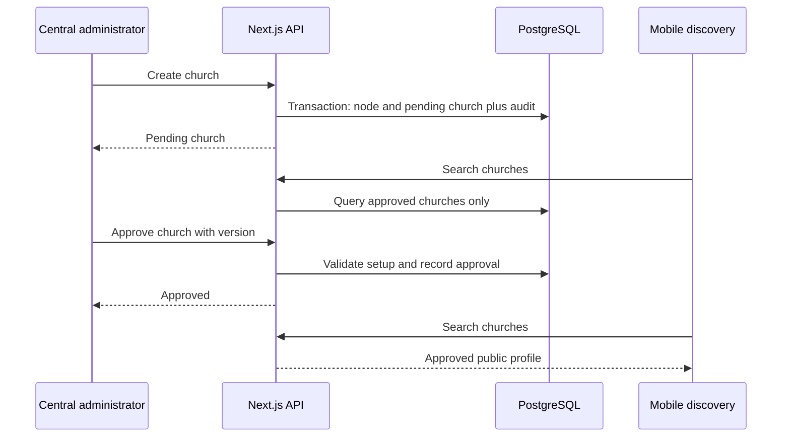

Suspension/archive policy D2 must define existing-user access, scheduled content, notifications, and donations. Proposed minimum: hide from discovery and block new publication/new donation initiation; keep provider webhook processing and required records. Existing recurring donations must not be silently cancelled or assumed stopped by hiding a church.

### 9.3 F4 — Prayer Text, Audio, and Publication

- **Pages/endpoints:** Prayer editor, text approval, audio generation/preview/approval, schedule/publish; central voice profiles.
- **Data:** Prayers, internal text versions, voice profiles/consents, audio, media, jobs, audit.
- **Processing:** Save immutable text snapshot; approve the exact snapshot; queue audio against its ID/hash and a ready voice profile. Store generated audio privately for staff preview. Approval selects that audio for that version. Publishing updates the mobile-visible pointer in one transaction.
- **Safety of edits:** An unpublished new version cannot inherit old audio approval. Proposed post-publication behavior: keep the current published version visible while a new version is prepared; publish replacement only after required approvals. This behavior needs D4 confirmation.
- **Text-only question:** The brief includes audio but does not explicitly define whether every prayer needs audio. Proposed default for the audio workflow is approved text plus approved selected audio; D4 must resolve whether text-only publishing is allowed.
- **Failure handling:** Failed generation remains unpublished; stale generation results never attach to another text version. Recheck consent/readiness on job execution and publication. Do not blindly resubmit a timed-out paid generation if completion is uncertain; reconcile provider request state where possible.
- **Verification:** Modified text cannot publish mismatched audio; duplicate queue deliveries cannot duplicate committed output; unapproved preview assets are not mobile-accessible; publication job rechecks church status and scheduled version.

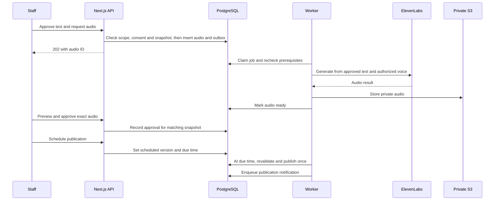

#### 9.3.1 Pastor Submission and Automatic Instant Voice Registration

**Confirmed product decision — 24 September 2026:** Pastor uploads their own sample in the PRAYER admin web workspace → authorized admin reviews the sample and offline consent evidence → approval automatically queues Instant Voice Cloning through the backend → the single PRAYER ElevenLabs account returns a Voice ID → provider readiness is checked before prayer audio generation.

Pastors sign into the **admin web workspace** using their PRAYER staff account; they do not register voices through the end-user mobile app. There is **one PRAYER ElevenLabs account** for all pastor voice profiles. Pastors never supply an ElevenLabs login, API key, share link or Voice ID. PRAYER manages the provider account; each pastor remains the consent subject. There is no transfer-of-voice-rights assumption.

**Submission and review:** Recommend 1–2 minutes of clean, single-speaker prayer-style audio. Backend validates file type, configured size/duration limits, checksum and ownership; documentation does not invent hard vendor limits. Pastor uploads their own sample and attaches or references recorded offline authorization evidence. Uploading saves private PRAYER storage only. Submit locks the sample and consent revision. Finalized sample and evidence objects cannot be overwritten; replacement uploads receive new object keys. Store the submitted checksum and verify the downloaded bytes against the approved checksum before any provider call. An authorized admin listens and reviews evidence, then approves or rejects with a reason. An admin who is also the submitting/linked pastor cannot approve their own submission. Approval of voice registration is separate from approval of prayer text and generated audio.

| State field             | Values                                                                                                                  | Rules                                                                                                                        |
| ----------------------- | ----------------------------------------------------------------------------------------------------------------------- | ---------------------------------------------------------------------------------------------------------------------------- |
| `review_state`          | `draft`, `submitted`, `approved`, `rejected`                                                                            | Only draft is editable. Rejected/replaced material uses a new record linked with `replaces_profile_id` and needs new review. |
| `registration_state`    | `unregistered`, `queued`, `registering`, `verification_required`, `ready`, `failed`, `registration_unknown`, `disabled` | Only approval may enqueue registration. Only a provider-confirmed usable voice with active consent may become ready.         |
| `requires_verification` | null / true / false                                                                                                     | Null before provider response; never inferred from admin approval.                                                           |

**Worker contract:** In one database transaction, approval checks version/state/consent and stores reviewer, timestamp and approved sample checksum, then inserts an outbox job with unique key `voice-register:<profileId>:<version>`. A worker rechecks all prerequisites, locks/leases the job, downloads the approved sample and calls ElevenLabs IVC `POST /v1/voices/add`. Persist `voice_id` and `requires_verification`; check actual voice availability before allowing TTS. Extend `VoiceProvider` with `registerInstantVoice`, `getVoiceReadiness`, `generateSpeech` and result retrieval. Provider IDs stay server-side; a read-only support reference may be visible to permitted admins but never entered manually.

**Retry and concurrency:** Duplicate approval returns the existing registration outcome. Repeated jobs reuse the stored Voice ID. If a timeout leaves provider creation uncertain, mark `registration_unknown` and reconcile using the stored attempt/reference and provider lookup/support before another create call. Do not claim the IVC API has an idempotency parameter or that queue deduplication guarantees exactly-once external creation. Known transient failures may retry within a bounded policy; surface failed/held status in the existing voice screen, without creating an operations dashboard.

**Provider verification:** Admin approval authorizes submission to ElevenLabs; it is not provider verification. If ElevenLabs returns `requires_verification=true`, keep the voice blocked in `verification_required`. Validate a supported in-PRAYER completion path during the pilot. Do not bypass verification or silently require a personal ElevenLabs account; unresolved provider requirements are a launch blocker for that voice. Offline signed authorization is retained as consent evidence, not sent as a substitute for any provider-required challenge. No speculative verification implementation is promised by this specification.

**Readiness and replacement:** Prayer TTS requires approved review, `registration_state=ready`, returned provider Voice ID and unrevoked consent. A new sample never edits a reviewed record in place. Keep the previous ready profile active while a replacement is reviewed/registered unless authorization has been revoked; atomically update `church_pastors.active_voice_profile_id` only after the replacement is ready, retaining historical audio references. On disable/revocation, stop queued registration and new generation; if a provider call is already in flight, store its result as disabled and follow the provider-deletion runbook rather than exposing it. Existing published-audio removal and evidence-retention policy remain D10.

**Account and environments:** Use one client-owned PRAYER ElevenLabs account and restricted server-side credentials. Local tests mock the provider. Staging uses tagged test profiles and dedicated keys within that same account where supported, without reusing production pastor samples or allowing staging to alter production voices. Isolate record namespaces, queues and secrets. Validate account voice-slot capacity and key restrictions during setup.

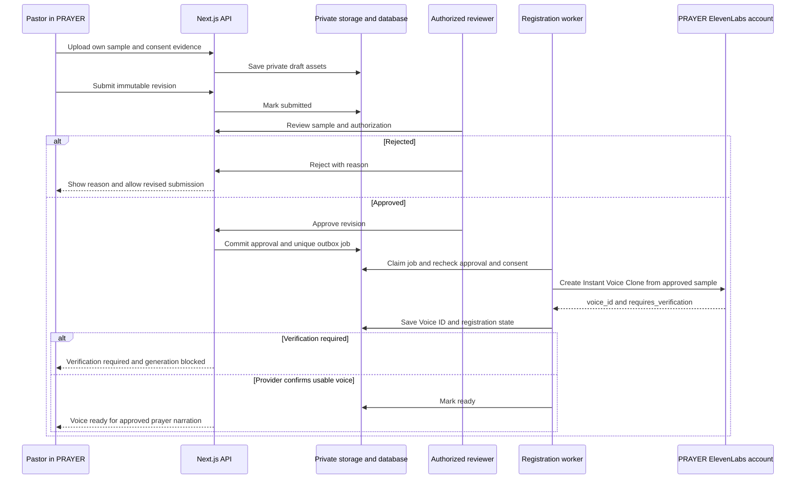

**Required tests:** Other-pastor upload/read denied; self-approval denied; unsubmitted/rejected/stale approval denied; no provider call before approval; consent revocation before/during worker execution; repeated approval/job delivery; ambiguous create timeout without blind duplicate creation; verification-required hold; immutable replacement workflow; all TTS and publication readiness checks. Test representative pastor voices and pronunciation in the launch languages before accepting the integration.

Sources: [Instant Voice Cloning guide](https://elevenlabs.io/docs/eleven-creative/voices/voice-cloning/instant-voice-cloning), [Create IVC voice API](https://elevenlabs.io/docs/api-reference/voices/ivc/create). This is an implementation specification, not evidence that a live integration has passed the pilot. Professional Voice Cloning and pastor-owned provider accounts are not the selected flow.

### 9.4 F5 — Events and Announcements

- **Pages/endpoints:** Church events/announcements and their create/edit/publish contracts.
- **Data:** Events, announcements, weekly service times, notification rules/outbox.
- **Processing:** Validate church ownership; convert explicit local time/time zone to UTC for events; store external registration URLs as links only. Event edits invalidate public content and obsolete reminders. Announcements use agreed minimal fields and immediate publication.
- **Failure handling:** Reject invalid dates/URLs, ambiguous local times without explicit offset, and stale versions. Validate language without inferring it from country.
- **Verification:** Correct church content displays on mobile; edits do not send duplicate reminders; no internal booking or recurrence engine is introduced.

### 9.5 F6 — Sensitive Requests

- **Pages/endpoints:** Church request list/detail; mobile request submission.
- **Data:** Requests and minimal access audit records.
- **Processing:** Derive user from identity and church from route. Validate kind-specific fields, insert once using idempotency key, and expose only to explicit handlers. Mobile receives acknowledgement, not staff or other-user details.
- **Failure handling:** Scope failures return no request contents. Rate-limit submissions. General notification payloads must never contain the message, contact details, or classification.
- **Verification:** Query filters, pagination, detail URLs, logs, exports and dashboards cannot bypass private-request checks.
- **Open boundary:** Request mutation workflow remains D3; no status/assignment transitions are invented here.

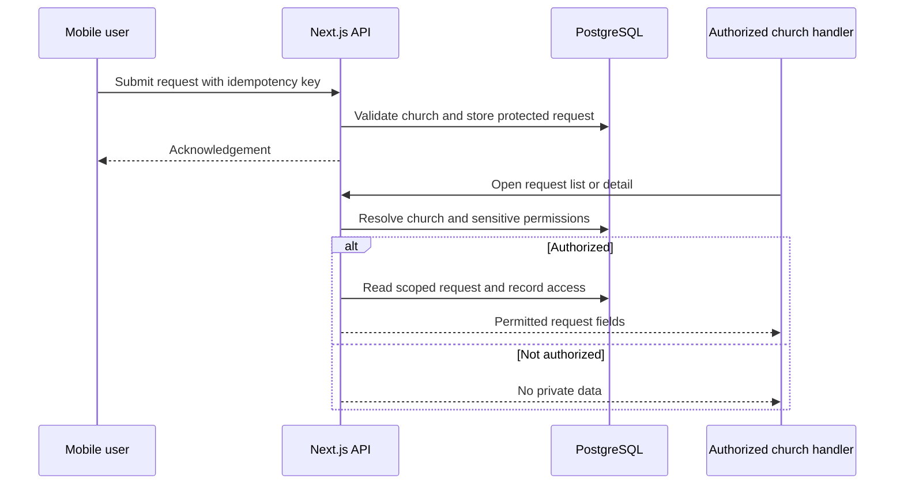

### 9.6 F7 — Donations and Reporting

- **Pages/endpoints:** Read-only church donation tabs, central/regional summaries; mobile donation initiation and Stripe webhook.
- **Data:** Payment accounts, subscriptions, installment donations, webhook receipts/idempotency records.
- **Processing:** Backend determines the church's verified provider account and allowed currency/amount. Provider handles payment details. A browser/mobile success redirect is not proof of successful payment. Synchronize confirmed provider state into local reporting records.
- **Recurring:** One subscription record plus separate payment records for each paid installment. A subscription creation/update event must not count as a paid donation.
- **Failure handling:** Deduplicate events; do not assume arrival order. Retrieve current provider state when needed rather than overwriting a final state with a stale event. Reconcile unprocessed receipts and provider/local discrepancies through backend jobs or operator runbooks, without adding admin screens.
- **Reports:** Proposed monthly totals: gross paid, refunded, and net amounts grouped by currency. Do not treat refund notices as a refund-management feature. Confirm fees, time-zone boundaries, and definitions in D6.
- **Verification:** Test failed payments, repeated/out-of-order webhooks, monthly installments, refunds, wrong connected account, and redirect-before-webhook behavior.

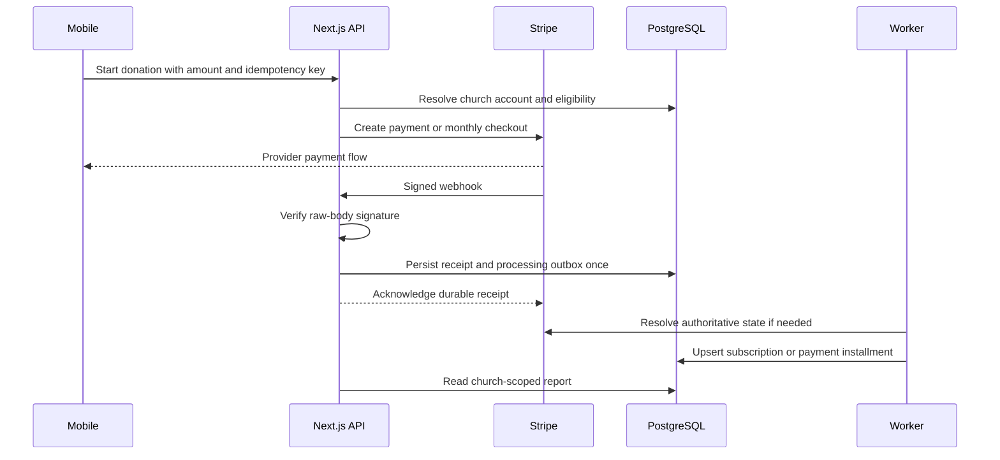

Stripe documents signature verification, duplicate delivery, and event ordering considerations in its [webhook guide](https://docs.stripe.com/webhooks). Exact Connect charge model, checkout mode, and event subscriptions are D6 decisions, not assumed here. Subscription cancellation routes/customer support responsibilities must be resolved before accepting recurring donations; no admin subscription-management page is added by this spec.

### 9.7 F9/F10 — Regional Analytics and Attendance

- **Pages/endpoints:** Church analytics/attendance summary, regional summary, mobile check-in/events.
- **Data:** Organization hierarchy, user-church links, check-ins, analytics events, content and payment records.
- **Processing:** Resolve authorized descendant church IDs before aggregation. Use source records for registrations/follows/check-ins/payments; use deduplicated client events for reading/listening/interactions.
- **Metric proposals:** Active user = distinct authenticated user with an allowed activity event in the selected interval. Prayer reads/audio plays count defined engagement events, not arbitrary page refreshes. Confirm thresholds before reporting these as definitive measures.
- **Check-in proposal:** One count per user/church/local calendar day, enforced by unique dedupe key. This is D7, not an agreed attendance rule. No device location is needed.
- **Privacy:** Aggregate only; no named attendance endpoint. Small-cohort privacy thresholds are a policy decision. Do not derive sensitive religious or pastoral profiles beyond the specified measures.
- **Failure handling:** Bound reporting intervals; reject arbitrary event metadata; use server time or validate bounded client event times. Invalid or repeated events do not inflate financial/attendance source records.
- **Verification:** Correct scope totals, repeat-event deduplication, multi-currency separation, hierarchy reassignment behavior, and no private request data in metrics.

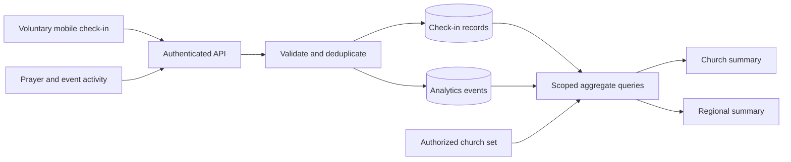

Proposed initial implementation uses indexed SQL aggregates. Add materialized summaries only after profiling demonstrates need; no warehouse or BI platform is included.

### 9.8 F11 — Notifications

- **Pages/endpoints:** Central notification configuration, mobile preferences/device registration; no delivery console.
- **Data:** Rules, preferences, devices, deliveries and outbox.
- **Processing:** Domain events/scheduled reminders enqueue a typed notification. Resolve relevant church followers/main-church users using the confirmed rule; check current preferences and church/content status immediately before sending.
- **Donation reminders:** Missing or false opt-in means do not send.
- **Payload:** Minimal title/body and a content deep link. Never include private prayer/pastoral request text. Platform notices are limited to the required platform-information use case, not a marketing campaign builder.
- **Failure handling:** Backoff transient provider failures, disable invalid tokens, deduplicate by domain event/user/device. Provider acceptance and device display are distinct. Exact-once device delivery cannot be guaranteed; use stable notification IDs and client deduplication where supported.
- **Verification:** Opt-out between enqueue/send is honored; duplicate work does not create intentional duplicate sends; invalid tokens are retired; obsolete event reminders are skipped.

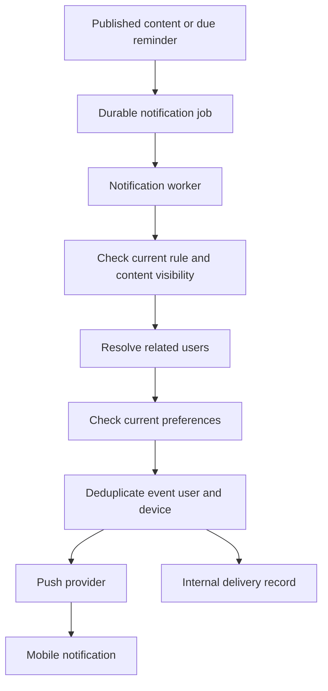

Transactional email reuses the template Nodemailer/Handlebars controller after transport/security validation. It does not imply sending every push by email or building email campaigns. Trigger timing and recipient rules remain D9.

## 10. Infrastructure Design

### 10.1 Template-Aligned Hosting Proposal

The template document names **Vercel** for the Next.js dashboard. This is a documented default, not evidence of a running deployment. Proposed Prayer arrangement: Vercel for Next.js web/API plus AWS for PostgreSQL/storage/background workers. Confirm D11 before provisioning; the earlier all-Fargate web proposal is an alternative if private networking or operational requirements favor it.

| Component        | Direction                                                              | Status / work                                                                                                     |
| ---------------- | ---------------------------------------------------------------------- | ----------------------------------------------------------------------------------------------------------------- |
| Next.js web/API  | Vercel, following template deployment guidance                         | Proposed; validate Prisma/native dependencies, execution limits, auth URLs and DB networking.                     |
| Background jobs  | AWS Fargate worker from same Prayer repository                         | Proposed new runtime for durable audio/publication/notifications; no long-running loop inside web functions.      |
| Database         | RDS PostgreSQL or an approved PostgreSQL host with pooling             | Prisma already present; hosting is unprovisioned. Vercel-to-private-RDS connectivity must be designed and tested. |
| Media            | Private S3                                                             | Existing signing code needs scope/validation hardening.                                                           |
| Queue/scheduling | SQS/DLQ and EventBridge                                                | Proposed job infrastructure, absent from template.                                                                |
| Secrets          | Vercel encrypted server environment and AWS Secrets Manager/task roles | Separate per runtime/environment; never public NEXT_PUBLIC variables.                                             |
| Operations       | Vercel runtime logs plus AWS CloudWatch for workers                    | Configure retention/redaction/alerts; template's Winston claim is not implemented in inspected source.            |
| Email            | Nodemailer and Handlebars                                              | Existing Mailtrap/Mailgun implementation; SES transport would need implementation if selected.                    |
| Admin identity   | NextAuth credentials + Prisma User                                     | Existing source, hardened for Prayer; not a separate mandatory identity service.                                  |

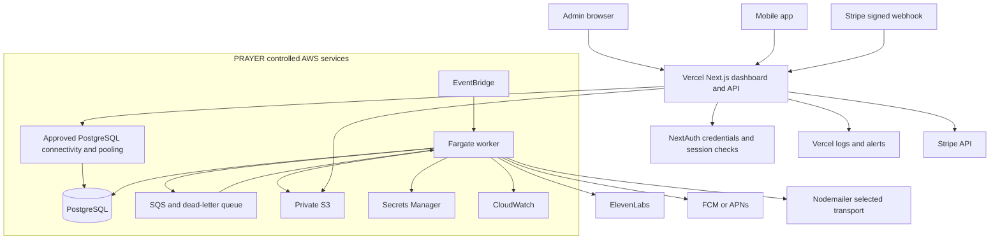

Do not assume a Vercel function can reach a private RDS endpoint. Confirm a supported private connectivity solution and plan, or choose approved secure managed PostgreSQL connectivity, or deploy Next.js alongside workers on AWS. Do not solve this by opening the database to the entire internet. Confirm region, latency, pooling and connection budgets before final selection.

Use Node-compatible runtimes for Prisma/auth/provider controllers. Do not assume the template PDF/Chromium utilities are required; PDF generation is outside Prayer's current product scope. Background work remains external and durable. Account ownership stays with PRAYER / Rellex.

### 10.2 Feature-Specific Infrastructure

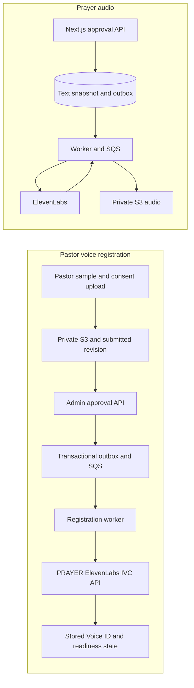

Only server-side workers hold credentials for the single PRAYER ElevenLabs account. Registration never starts before the admin review transaction commits. Samples, evidence, and unapproved audio are private; staff preview requires authorization. Publishing changes application access eligibility, not the bucket's public-access setting.

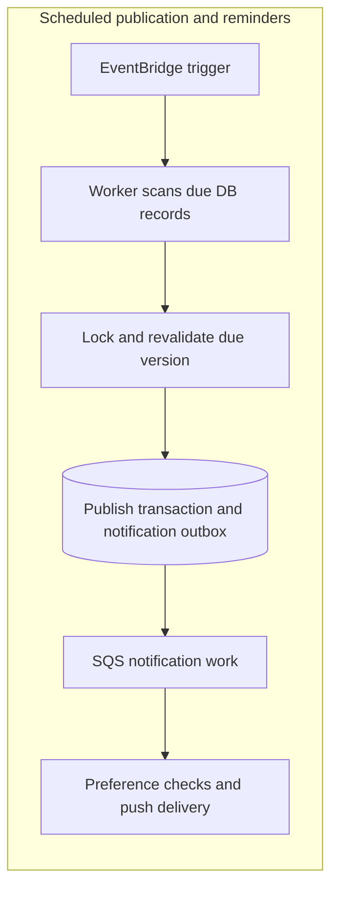

Use UTC due timestamps, row locking, and conditional state updates. A scheduler wake-up is not itself proof a prayer is published. Repeated ticks must be safe; process missed due work after downtime.

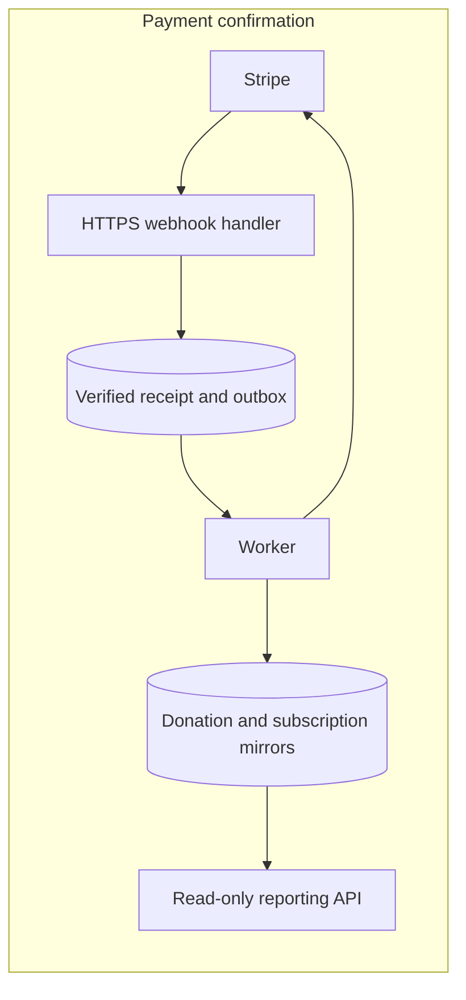

No raw card storage or custom money ledger/commission engine. Technical provider-state reconciliation is required for reliable reports; no operations page is added.

### 10.3 Durable Jobs and Scheduling

Write the business record and outbox entry in one database transaction. The dispatcher claims ready outbox rows, sends references to SQS, and records dispatch. If it crashes after sending, duplicate delivery is expected. Consumers claim/check logical work and commit effects idempotently.

Proposed work kinds: `audio.generate`, `prayer.publish`, `notification.send`, `payment.sync`, `privacy.export`, `privacy.delete`, and required provider reconciliation. Proposed internal state: pending/running/succeeded/failed, plus lease and retry metadata. These are implementation states, not new user workflows.

SQS standard delivery can repeat messages; consumers must be idempotent. See [AWS delivery semantics](https://docs.aws.amazon.com/AWSSimpleQueueService/latest/SQSDeveloperGuide/standard-queues-at-least-once-delivery.html). Align visibility timeout/lease renewal with job duration, cap retries, and alert operators on dead-letter work. Use provider idempotency where available. For uncertain paid AI results, reconcile before resubmitting; queue deduplication alone cannot guarantee exactly-once external billing.

### 10.4 Upload and Media Flow

1. Authorized staff request an upload for an allowed purpose and church.
2. Backend allocates a random object key and short-lived signed upload URL with size/type constraints.
3. Client uploads directly to private storage.
4. Completion handler verifies actual object metadata, file signature, ownership, and required scanning/validation before marking ready.
5. Attach only ready assets to permitted records.
6. Preview/download endpoints issue short-lived access after checking permissions/publication status.

Never accept arbitrary object keys or a client claim that an upload is safe. Unattached uploads expire through a cleanup policy. Signed URL lifetimes and cache invalidation must support suspension/deletion policies; already-issued URLs may remain usable until expiry, which must be documented.

## 11. Security, Privacy, and Operations

### 11.1 Data Protection

- Encrypt transport and storage; keep provider credentials server-side and grant task roles only needed access.
- Enforce church scoping in controllers/providers; use composite database constraints for ownership-sensitive references. Optional row-level security is defense in depth, not a replacement for service authorization.
- Validate every upload, link, filter, and mutation. Limit payload size and request rates; parameterize queries.
- Avoid logging private request text, donor contact data, auth tokens, voice samples, and provider secrets.
- Audit administrative mutations and sensitive reads with actor, resource, scope, outcome, and request ID only.
- Separate development/staging/production data and credentials. For ElevenLabs specifically, use the one PRAYER account with isolated test profiles and restricted environment keys where supported; prefer provider mocks for development. Do not copy live private requests or voice evidence into test fixtures.

### 11.2 Deletion, Export, and Consent

Deletion/export capability is required, but policy details are D10. Implement durable, resumable subject-scoped jobs and verified access to results. No dedicated admin privacy console is included.

A deletion run inventories the credentials-backed User identity, profile, follows, devices/preferences, requests, analytics/check-ins, donations/subscriptions, consents, and storage/provider references. Delete or anonymize according to approved retention rules; do not cascade blindly into church content or required financial records. Disconnect identity access early; record minimal completion evidence. Define how provider-held data and recurring subscriptions are handled before launch.

Backups expire under a documented retention policy; a restoration must reapply deletion records before returning to service. Exports contain only the subject's authorized data, never another person's requests, and use short-lived authenticated download access.

Voice-consent revocation disables new generation immediately once recorded. Policy for already published audio, evidence retention, and provider deletion is unresolved; do not assume disabling a profile removes audio already distributed.

### 11.3 Reliability and Deployment

- Version-control schema migrations; test on representative staging data. Prefer backward-compatible migrations before deploying dependent code.
- Deploy web and worker from compatible builds. Do not run migrations concurrently from every replica.
- Use database connection pooling, bounded concurrency and query timeouts.
- Establish health checks, job-lag/error alerts, payment-sync failure alerts and storage/provider failure visibility through operations tooling.
- Back up the database and required storage; test restoration. Recovery objectives, backup retention and availability tier remain to confirm.
- Rollback application releases only with compatible schema changes; use forward corrections for destructive migrations.
- Handover environment variable names, account ownership, deployment/migration procedures, recovery steps, API schemas and provider inventory. Never commit live credentials.

## 12. Verification Matrix

| Area                 | Required technical evidence                                                                                                                                                                                                            |
| -------------------- | -------------------------------------------------------------------------------------------------------------------------------------------------------------------------------------------------------------------------------------- |
| Identity and roles   | Expired/invalid tokens rejected; revoked grants lose access; forged church/resource IDs cannot bypass scoping.                                                                                                                         |
| Church setup         | Pending churches hidden; approval visible; invalid hierarchy/cycles rejected; suspension behavior matches confirmed policy.                                                                                                            |
| Content editing      | Required/optional fields validated; stale updates conflict; cross-church asset/pastor references rejected.                                                                                                                             |
| Voice onboarding     | Pastor owns submission; admin approval precedes provider calls; no self-approval; immutable sample/evidence revision; duplicate/ambiguous registration handled; provider verification hold; consent revocation and replacement tested. |
| Prayer/audio         | Approval tied to exact snapshot; unapproved audio private; duplicate jobs safe; consent checked; scheduled publication survives retries/downtime.                                                                                      |
| Events/notifications | Time-zone/DST cases tested; edited events suppress stale reminders; opt-outs and donation opt-in respected.                                                                                                                            |
| Requests             | Private list/detail and logs protected; duplicate submission returns same result; D3 management behavior tested once defined.                                                                                                          |
| Payments             | Test provider flow, signatures, account isolation, duplicate/out-of-order events, failed payments, recurring installments and refund reporting.                                                                                        |
| Analytics/check-in   | Correct scoped counts, duplicate rule, bounded dates, no named attendance output, no cross-currency sum.                                                                                                                               |
| Privacy              | Export authorization, resumable deletion, token removal, approved retention exceptions and restore/deletion handling.                                                                                                                  |
| Infrastructure       | Staging integration, worker failure/retry, backup restore, redacted logs, deployment and rollback procedure.                                                                                                                           |
| Mobile integration   | Complete iOS/Android flows against shared APIs, media playback, notifications, map data and payments.                                                                                                                                  |

This document is a design artifact. No runtime, migration, provider, deployment, or performance verification has been performed by writing it. API examples and diagrams require implementation-time contract tests; business blockers below must be resolved before the related feature is declared complete.

## 13. Decision Register

| ID  | Decision                                           | Why it matters / proposed direction                                                                                                                                                                                                                                                                                 |
| --- | -------------------------------------------------- | ------------------------------------------------------------------------------------------------------------------------------------------------------------------------------------------------------------------------------------------------------------------------------------------------------------------- |
| D1  | NextAuth hardening and mobile token contract       | Admin baseline is now NextAuth credentials. Mobile token contract side RESOLVED (plan 002): `/api/v1/mobile/auth/{login,refresh,logout}` issue/rotate/revoke + required-auth `auth_version`/active check; admin handler base-path + session revocation verify still open.                                           |
| D2  | Church suspension/archive and reactivation effects | Confirm existing-user visibility, publishing, staff access, notifications and recurring donations. No reactivation route is committed until defined.                                                                                                                                                                |
| D3  | Meaning of request management                      | Define minimum staff action beyond viewing/contact details. Status, assignment, messaging and booking remain excluded unless explicitly added.                                                                                                                                                                      |
| D4  | Prayer publication rules                           | Confirm text-only publishing, post-publication edits/replacement, reviewer permission mapping, schedule changes and time-zone/DST behavior.                                                                                                                                                                         |
| D5  | Instant voice integration validation               | Onboarding is decided: pastor self-upload, admin approval, automatic IVC registration on one PRAYER account. Validate quality/languages, `requires_verification` completion entirely within the product requirement, voice-slot limits, account controls, revocation and provider data handling.                    |
| D6  | Payment integration and reporting                  | Confirm launch countries, account setup, charge model, currencies, preset amounts, provider events, fees/refunds, month boundaries, recurring cancellation/support and reporting totals.                                                                                                                            |
| D7  | Check-in deduplication                             | Proposed one user/church/local day; no location verification. Confirm before enforcing it.                                                                                                                                                                                                                          |
| D8  | Hierarchy and analytics semantics                  | Confirm independent churches, country-role powers, active/read/listen definitions, date windows, small-group privacy and historical reporting after a church moves regions. Proposed current-hierarchy attribution must be labeled if adopted.                                                                      |
| D9  | Notifications                                      | Confirm recipients, default preferences, trigger offsets, platform notice source and transactional email use; no general campaigns.                                                                                                                                                                                 |
| D10 | Privacy policy                                     | Define retention, deletion/anonymization, consent evidence, export, provider data, backups and financial exceptions with supplied legal text.                                                                                                                                                                       |
| D11 | Hosting and unresolved tooling                     | Prisma/Ant Design/TanStack Query are template selections. Confirm Vercel-to-PostgreSQL connectivity or AWS web fallback, region/budget/availability, worker deployment, production Nodemailer transport, validation/test tooling, dependency reconciliation and recovery objectives.                                |
| D12 | Minimal content contracts                          | Confirm announcement fields, service-time representation, text/upload limits and initial translations. Pastor authority is resolved: Central owns shared name/introduction/canonical image/linked account; My Church displays those fields read-only and edits only church role and optional church image override. |

## 14. Template Adoption Checks

These are required corrections/adaptations to reuse existing code safely within Prayer scope, not added product features. Findings are source-inspection evidence, not runtime exploit verification.

| Observed source evidence                                                                                           | Required Prayer treatment                                                                                                                                                                                                             |
| ------------------------------------------------------------------------------------------------------------------ | ------------------------------------------------------------------------------------------------------------------------------------------------------------------------------------------------------------------------------------- |
| `src/auth.ts`, `utils/required-auth.ts` and `hooks/data/access-permission.tsx` assume one role.                    | Correct for identity: each user has one role (`user.role_id`). Keep the single-role assumption; extend to a role with no admin grants (role_id null = end-user). Church/region tenancy still uses role_assignments via requiredScope. |
| `providers/user.tsx` returns full Prisma rows; user GET/POST/PUT routes return provider/controller results.        | Explicit safe selects/DTOs must exclude password hashes and unnecessary permission internals in all list/detail/create/update responses.                                                                                              |
| `app/api/v1/users/[id]/route.tsx` allows OWN update paths while `controller/user.tsx` and provider accept role_id. | Split safe self fields from privileged role changes. Reject role_id changes on own-profile paths. Test attempted escalation.                                                                                                          |
| `app/actions.ts` calls getUserById without an explicit auth/permission check.                                      | Remove unused action or add identical authorization and safe DTO selection; UI-only hiding is insufficient.                                                                                                                           |
| `app/api/v1/uploads/route.tsx` calls signing controller without requiredAuth.                                      | Disable generic signing or route through authenticated scope/purpose checks; add size limits and post-upload validation.                                                                                                              |
| `app/api/v1/mail/route.ts` exposes sending without an explicit auth check.                                         | Remove/disable generic public mail API; call transport internally for approved transactional purposes only.                                                                                                                           |
| `providers/role.tsx` hard-deletes roles; User relation cascades on role deletion.                                  | Restrict deletion and migrate relation before production. Revoking a role must never delete user accounts.                                                                                                                            |
| Role seed connects all permissions to administrator.                                                               | Replace with explicit Prayer role matrix excluding automatic private-request access. No demo store-admin/master-data grants.                                                                                                          |
| Providers/auth lookups do not consistently filter deleted_at.                                                      | Enforce active user/role/permission filters and denied access after deletion/revocation.                                                                                                                                              |
| Generic catch blocks return raw error.message/details.                                                             | Sanitize responses with GeneralError serializer and safe request IDs.                                                                                                                                                                 |
| Forgot-password route has an empty reset link TODO.                                                                | Do not claim recovery works or expose placeholder flow. Recovery remains outside new custom-feature scope pending D1.                                                                                                                 |
| Email documentation says SES; code implements Mailtrap/Mailgun, with Mailgun certificate verification disabled.    | Select/implement real production transport and enforce TLS certificate validation; validate template files are included in deployment.                                                                                                |
| Package build script executes prisma migrate deploy as part of build.                                              | Move production migrations to a controlled release step; preview builds must not migrate production. Keep prisma generate/style-init in build as needed.                                                                              |
| Multiple lockfiles disagree; some imported packages are not direct dependencies.                                   | Reconcile one package manager/lockfile, declare used packages directly, align React types, run clean install/build and security review.                                                                                               |
| Generic client QueryClient is constructed inside provider render; keys lack tenant context.                        | Stabilize QueryClient and include user/scope in keys, invalidations and logout cleanup.                                                                                                                                               |
| Demo master-data pages, generic PDF and other utilities exist.                                                     | Reuse components only where needed; do not copy inactive endpoints into an exposed production surface.                                                                                                                                |

### 14.1 RBAC Acceptance Cases

- A staff member can edit Church A but only read Church B: the Church A role must not enable writes in Church B.
- A regional administrator sees only descendant aggregates and cannot read individual private requests or raw donor detail.
- A global administrator without a church-local sensitive grant cannot read private requests.
- A user with OWN profile update cannot change their role, grants, church scope or another user's record.
- Count queries, nested resources, previews and server actions apply the same scope as list/detail APIs.
- Revoked grants, deleted roles/users and disabled accounts lose access with the defined revocation behavior; caches do not preserve authorization.
- Changing church/user in the browser cannot show cached data from the previous context.
- Role/permission editing, if enabled for supported roles, cannot grant outside the actor's explicit delegation policy or change protected role definitions. Require explicit confirmation of who may delegate sensitive church permissions; global role membership alone is not that delegation policy.
- Admin list/detail/create/update responses never return password hashes.
- Existing `/api/v1/users`, `/roles`, `/permissions`, upload and server-action paths cannot bypass new guards.

## 15. Scope Guardrail and References

Do not add routes, tables, or screens for `FEATURE.md` Future Approach items unless the user changes scope. Internal snapshot, delivery, audit, and job records above support required correctness; their existence does not authorize new product dashboards.

Document precedence: explicit user decisions (including use of this template) → current scope in `FEATURE.md` → verified template baseline and agreed stack → proposed Prayer extensions here. Earlier `OVERVIEW.md` statements that authentication/database tooling are unselected are superseded by the template findings in this spec; production deployment/mobile authentication still need decisions. If these disagree, resolve the conflict rather than silently broadening scope.

References checked during drafting:

- Project brief: PRAYER — APPLICATION & PLATFORM DEVELOPMENT BRIEF, particularly sections 1, 6–7, 9–24 and 26.
- Project documents: `FEATURE.md` and `OVERVIEW.md` in this admin folder.
- Template: `/Users/yosarama/Documents/PROJECT/CATATIA/template-dashboard-nextjs/`; inspected `package.json`, both lockfiles, `AGENT.md`, `template-dashboard-spec.md`, Prisma schema/migrations/seeds, auth/guards, providers, controllers, route handlers and UI hooks described above. No template file was modified for this specification update.
- [Next.js Route Handlers](https://nextjs.org/docs/app/getting-started/route-handlers).
- [Stripe webhook handling](https://docs.stripe.com/webhooks).
- [AWS SQS at-least-once delivery](https://docs.aws.amazon.com/AWSSimpleQueueService/latest/SQSDeveloperGuide/standard-queues-at-least-once-delivery.html).
- [ElevenLabs Instant Voice Cloning API](https://elevenlabs.io/docs/api-reference/voices/ivc/create).
