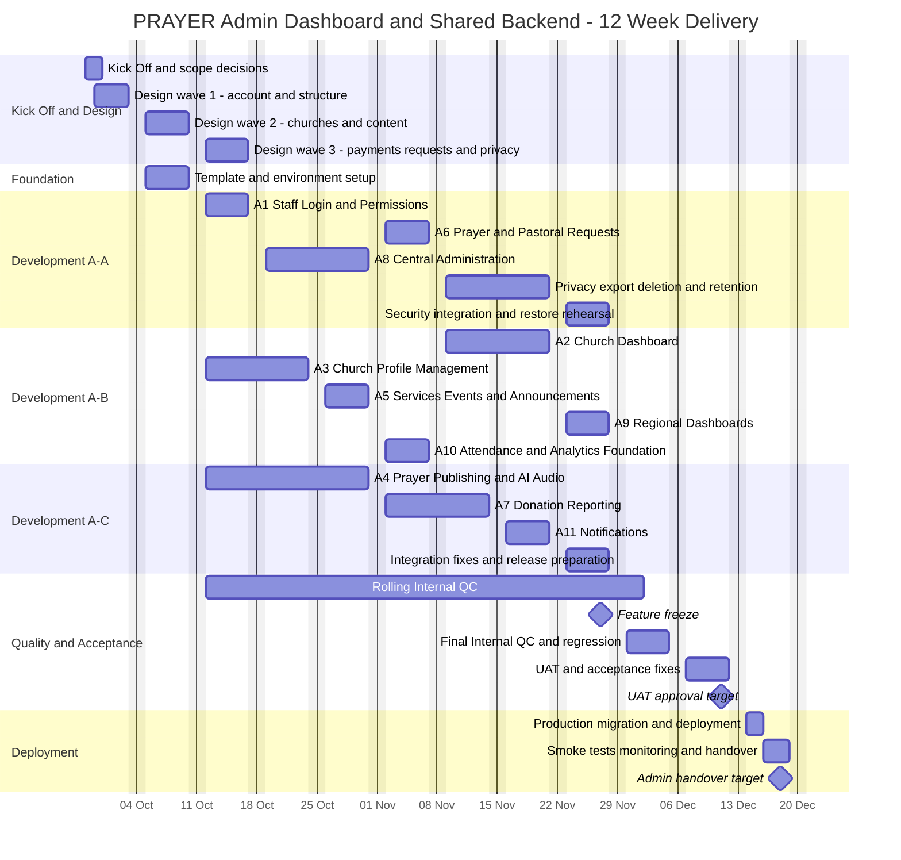

# PRAYER Admin Dashboard and Shared Backend — Timeline

Prepared: 24 September 2026. Proposed 12-week delivery baseline, subject to the capacity and readiness assumptions below.

## 1. Overview

| Item                | Plan                                                                                                   |
| ------------------- | ------------------------------------------------------------------------------------------------------ |
| Kick Off            | Monday, 28 September 2026                                                                              |
| Final working day   | Friday, 18 December 2026                                                                               |
| Duration            | 12 Monday–Friday workweeks; 60 working days per full-time team member                                  |
| Working calendar    | Monday–Friday; Saturday and Sunday are non-working days                                                |
| Indonesian holidays | No published national holiday or collective leave falls within this window.                            |
| Parallel delivery   | Mobile and Admin start together and share the same QC, UAT and release gates.                          |
| Scope               | Current features in [FEATURE.md](FEATURE.md), aligned to [SPEC.md](SPEC.md); Future Approach excluded. |

Calendar checked against [Kemenko PMK's official 2026 holiday list](https://www.kemenkopmk.go.id/node/5862) on 24 September 2026. Christmas collective leave on 24 December and the national holiday on 25 December are outside the plan. Any later government changes or company/local holidays require a calendar update. No weekend work or overtime is assumed. The 12th calendar week ends Sunday, 20 December; work finishes Friday, 18 December.

## 2. Capacity and Delivery Assumptions

This is an accelerated target, not a delivery guarantee. It requires dedicated parallel capacity:

| Role                     | Assumed capacity across both projects                                                                     |
| ------------------------ | --------------------------------------------------------------------------------------------------------- |
| Mobile developers        | 2 full-time lanes: M-A and M-B                                                                            |
| Admin/backend developers | 3 full-time full-stack lanes: A-A, A-B and A-C                                                            |
| Product designer         | 1 full-time shared designer during Weeks 1–3; deliver approved slices in priority order                   |
| QA                       | 2 testers from Week 3 onward, one per project; coordinate end-to-end tests                                |
| Tech Lead / DevOps       | 1 shared lead, approximately half-time; infrastructure, API decisions and release support                 |
| Client product owner     | Decisions/design feedback within 1 working day; named mobile and admin UAT reviewers available in Week 11 |

Development lanes below have no overlapping primary feature assignments. Their time also includes developer tests and normal integration fixes. QC ranges are tester review windows, not additional full-time developer assignments. Cross-feature fixes are prioritized within the lane's current work; major rework consumes the limited stabilization buffer and can move the release date.

- Confirm unresolved SPEC decisions, navigation, auth, private-request rules, metrics and optional launch items by 02 October. Later-wave visual details are approved by their design end dates.
- Client provides design references at kickoff; approved translations, privacy/legal copy and realistic content by 16 October. Language and privacy considerations are built into each feature, with final verification later.
- Obtain publishing accounts, map/push credentials, hosting access, eligible church payment accounts, the single PRAYER ElevenLabs account, pilot pastor sample/consent evidence and successful Instant voice/language/verification-path trials by 09 October. Escalate provider delays immediately.
- Lock shared API contracts and mock responses by 09 October. A frontend can start using mocks, but is not accepted until the real backend path passes integration tests.
- No scope is silently removed to fit 12 weeks. If capacity, prerequisites or acceptance gates slip, revise the date or obtain explicit scope approval.

## 3. Overview Timeline Table

Dates below are inclusive. Durations count working days only. Concurrent rows must not be summed to calculate project duration.

| Phase                               | Start  | Finish | Working days | Outcome                                                                     |
| ----------------------------------- | ------ | ------ | -----------: | --------------------------------------------------------------------------- |
| Kick Off and scope decisions        | 28 Sep | 29 Sep |            2 | Responsibilities, scope, dependencies and acceptance rules                  |
| Design, in approved slices          | 29 Sep | 16 Oct |           14 | Screen flows, shared components and all current-feature designs             |
| Foundation and template setup       | 05 Oct | 09 Oct |            5 | Runnable template, environments, contracts and development setup            |
| Feature development and integration | 12 Oct | 27 Nov |           35 | All current features integrated; mobile navigation starts during foundation |
| Rolling Internal QC                 | 12 Oct | 01 Dec |           37 | Feature-level checks and defect feedback as features arrive                 |
| Final Internal QC and regression    | 30 Nov | 04 Dec |            5 | Complete system, permission, device and integration verification            |
| UAT and acceptance fixes            | 07 Dec | 11 Dec |            5 | Client tests agreed scenarios and accepts the release candidate             |
| Deployment and handover             | 14 Dec | 18 Dec |            5 | Production release work, smoke tests and handover                           |

## 4. Overview Timeline Table per Feature

Each feature has a planned design window, development window and first Internal QC window. All features also participate in final regression on 30 November–04 December, UAT on 07–11 December, and deployment on 14–18 December.

| ID  | Feature                             | Design        | Development   | Dev working days | Internal QC   | Lane | Dependency / deliverable                                                                             |
| --- | ----------------------------------- | ------------- | ------------- | ---------------: | ------------- | ---- | ---------------------------------------------------------------------------------------------------- |
| A1  | Staff Login and Permissions         | 29 Sep–02 Oct | 12 Oct–16 Oct |                5 | 19 Oct–20 Oct | A-A  | Foundation schema and approved permission matrix; includes mobile session/profile/relationship APIs  |
| A2  | Church Dashboard                    | 05 Oct–09 Oct | 09 Nov–20 Nov |               10 | 23 Nov–24 Nov | A-B  | Content/request metrics ready; donation totals join after 13 Nov                                     |
| A3  | Church Profile Management           | 29 Sep–02 Oct | 12 Oct–23 Oct |               10 | 26 Oct–27 Oct | A-B  | Seeded approved churches and schema; minimum directory API by 16 Oct                                 |
| A4  | Prayer Publishing and AI Audio      | 05 Oct–09 Oct | 12 Oct–30 Oct |               15 | 02 Nov–03 Nov | A-C  | Instant voice pilot by 09 Oct; pastor upload, admin review and automatic registration included in A4 |
| A5  | Services, Events, and Announcements | 05 Oct–09 Oct | 26 Oct–30 Oct |                5 | 02 Nov–03 Nov | A-B  | Church context; includes mobile published-content/home endpoints                                     |
| A6  | Prayer and Pastoral Requests        | 12 Oct–16 Oct | 02 Nov–06 Nov |                5 | 09 Nov–10 Nov | A-A  | Church-local sensitive permissions and agreed request fields                                         |
| A7  | Donation Reporting                  | 12 Oct–16 Oct | 02 Nov–13 Nov |               10 | 16 Nov–17 Nov | A-C  | Provider accounts approved; includes checkout, monthly donations and webhook reconciliation          |
| A8  | Central Administration              | 05 Oct–09 Oct | 19 Oct–30 Oct |               10 | 02 Nov–03 Nov | A-A  | A1 scope guards; church lifecycle, hierarchy, staff/pastors and required configuration               |
| A9  | Regional Dashboards                 | 12 Oct–16 Oct | 23 Nov–27 Nov |                5 | 30 Nov–01 Dec | A-B  | Hierarchy, aggregate metrics and donation totals; no private-request visibility                      |
| A10 | Attendance and Analytics Foundation | 12 Oct–16 Oct | 02 Nov–06 Nov |                5 | 09 Nov–10 Nov | A-B  | Event/metric definitions and scoped aggregation; check-in API                                        |
| A11 | Notifications                       | 12 Oct–16 Oct | 16 Nov–20 Nov |                5 | 23 Nov–24 Nov | A-C  | Preferences, device registration and publication triggers; usable delivery by 18 Nov                 |

Feature IDs follow the numbered FEATURE.md sections; M is Mobile and A is Admin. The scopes and optional items retain the limits in that file.

### Supporting backend work within the plan

| Window                 | Owner                                   | Included work                                                                                                                                                                       |
| ---------------------- | --------------------------------------- | ----------------------------------------------------------------------------------------------------------------------------------------------------------------------------------- |
| 05–09 Oct              | A-A + A-B + A-C, supported by Tech Lead | Template hardening, schema/migrations, API conventions, scoped guards, seed data, CI/CD, staging, database networking, storage and worker setup.                                    |
| 12–16 Oct              | A-A within A1                           | Staff auth/RBAC plus mobile sessions, profile/preferences and church-relationship APIs. Seeded churches support mobile work before central administration is complete.              |
| 12–30 Oct              | A-C within A4                           | Pastor My Voice upload, admin approve/reject, approval-triggered Instant clone registration, consent/readiness checks, then approved-text generation, audio review and publication. |
| 26–30 Oct              | A-B within A5                           | Events/services/announcements and the mobile Home read aggregation. Admin dashboard visuals follow under A2.                                                                        |
| 09–20 Nov              | A-A                                     | Deletion/export processing, consent/retention enforcement, audit coverage and sensitive-data tests.                                                                                 |
| 23–27 Nov              | A-A + A-C, supported by Tech Lead       | Integration fixes, security/performance checks, backup/restore rehearsal and deployment documentation; A-B completes A9.                                                            |
| Throughout development | All lanes                               | Server authorization, tenant isolation, validation, idempotency, audit events and developer tests.                                                                                  |

The mobile backend is delivered by this project, not by a separate mobile server team. Privacy, security, backups and handover are required delivery work, not extra product screens.

## 5. Mermaid Gantt Chart

The chart excludes weekends. Task durations are working days; the tables show the inclusive final workday.

## 6. Weekly Overview — Both Projects in Parallel

| Week | Working dates | Mobile focus                                                | Admin/shared backend focus                                      |
| ---- | ------------- | ----------------------------------------------------------- | --------------------------------------------------------------- |
| W1   | 28 Sep–02 Oct | Kick Off, design wave 1                                     | Kick Off, permission rules, design wave 1                       |
| W2   | 05 Oct–09 Oct | Foundation, M1 navigation, design wave 2                    | Foundation, provider trials, API contracts, design wave 2       |
| W3   | 12 Oct–16 Oct | M2 onboarding, native/API setup, design wave 3              | A1 auth, A3 church profiles, A4 prayers/audio, design wave 3    |
| W4   | 19 Oct–23 Oct | M2 onboarding, M4 church relationships                      | A3 church profiles, A4 prayers/audio, A8 central administration |
| W5   | 26 Oct–30 Oct | M3 profile/settings, M7 church profiles                     | A4 prayers/audio, A5 content, A8 central administration         |
| W6   | 02 Nov–06 Nov | M5 Home, M6 discovery/map                                   | A6 requests, A7 donations, A10 attendance/analytics             |
| W7   | 09 Nov–13 Nov | M8 prayers/audio, M10 requests                              | A2 church dashboard, A7 donations, privacy backend              |
| W8   | 16 Nov–20 Nov | M9 events, M12 check-in/notifications                       | A2 church dashboard, A11 notifications, privacy backend         |
| W9   | 23 Nov–27 Nov | M11 donations, M13 privacy/languages, feature freeze        | A9 regional dashboards, hardening, feature freeze               |
| W10  | 30 Nov–04 Dec | Final Internal QC and regression                            | Final Internal QC and regression                                |
| W11  | 07 Dec–11 Dec | UAT and acceptance fixes                                    | UAT and acceptance fixes                                        |
| W12  | 14 Dec–18 Dec | Store submission, review response, release target, handover | Production deployment, smoke tests and handover                 |

## 7. Shared Handoffs and Acceptance Gates

These gates are shared with the [parallel project timeline](../prayer-mobile-app/TIMELINE.md). Backend handoff means a testable staging endpoint with agreed responses and access rules, not only an endpoint design.

| Deadline | Backend / shared gate                                                           | Mobile / delivery result                                          |
| -------- | ------------------------------------------------------------------------------- | ----------------------------------------------------------------- |
| 02 Oct   | Navigation, account flows and permission rules approved                         | First design slice ready for both teams                           |
| 09 Oct   | API contracts, staging, provider trials and hosting decision ready              | Mobile works against agreed mocks while endpoints are implemented |
| 16 Oct   | Authentication, profile/preferences, church relationships and minimum directory | Mobile onboarding and church selection integrate                  |
| 23 Oct   | Church profiles, media and location directory                                   | Mobile church profiles and maps integrate                         |
| 30 Oct   | Published prayers/audio, services, events, announcements and home reads         | Mobile home, prayer/audio and activity screens integrate          |
| 06 Nov   | Protected requests, check-in and analytics intake                               | Mobile request forms and attendance integrate                     |
| 13 Nov   | Donation initiation, recurring flow and authoritative status                    | Mobile payment integration can begin                              |
| 18 Nov   | Device registration and notification delivery                                   | Mobile notification testing completes by 20 Nov                   |
| 20 Nov   | Deletion/export, consent and retention processing                               | Mobile privacy/deletion integration completes in Week 9           |
| 27 Nov   | All current-scope features integrated on staging                                | Feature freeze for both projects                                  |
| 04 Dec   | Internal QC exit                                                                | Both projects ready for UAT                                       |
| 11 Dec   | UAT acceptance and release candidate                                            | Deployment and store submission authorized by client              |
| 18 Dec   | Deployment/handover target                                                      | Admin live; mobile release target subject to store approval       |

Voice acceptance in A4 includes pastor-owned upload, admin review, automatic registration on the single PRAYER account, duplicate-job protection, rejection/resubmission and provider verification holds. Complete these by 30 October within the existing A4 allocation; the 12-week target remains capacity-dependent and must be re-estimated if the provider verification pilot fails. The mobile delivery scope remains playback only.

## 8. Internal QC, UAT and Deployment Criteria

| Stage                  | Required exit condition                                                                                                                                                                                                      |
| ---------------------- | ---------------------------------------------------------------------------------------------------------------------------------------------------------------------------------------------------------------------------- |
| Feature Internal QC    | Agreed feature behavior passes; validation, permission denial, empty/error states and real API integration checked.                                                                                                          |
| Final Internal QC      | No unresolved release-blocking defects; cross-church/private-data isolation, payment retries/webhooks, audio publication, notifications, deletion/export, language flows, representative load and critical regressions pass. |
| Mobile device coverage | Real iOS/Android builds tested for location denial, push permission, audio, payment returns and interrupted networks.                                                                                                        |
| UAT                    | Client church staff, central/regional representatives and mobile reviewers accept documented scenarios; fixes are retested and sign-off recorded by 11 December.                                                             |
| Deployment readiness   | Client-controlled accounts, backups, rollback procedure, migration rehearsal, monitoring and approved production configuration ready.                                                                                        |
| Handover               | Source, schema, relevant API/configuration documentation, service inventory, deployment instructions and access ownership delivered.                                                                                         |

UAT is acceptance of the agreed scope, not a new-feature development phase. Test payments and requests must use appropriate test accounts/data.

## 9. Release Sequence and Schedule Limits

| Date      | Mobile App                                                                  | Admin Dashboard / Backend                                        |
| --------- | --------------------------------------------------------------------------- | ---------------------------------------------------------------- |
| 11 Dec    | UAT-approved release candidate and store assets ready                       | UAT-approved release candidate and migration/rollback plan ready |
| 14 Dec    | Produce signed builds and submit after reviewer-accessible backend is ready | Deploy production-compatible API, migrations and admin release   |
| 15 Dec    | Respond to review issues and verify production configuration                | Complete production verification and deployment checks           |
| 16–18 Dec | Release if approved; smoke tests and handover                               | Monitoring, smoke tests and handover                             |

Apple/Google review duration is external. The controllable commitment is store submission by 14 December and release-ready builds/handover by 18 December. Public mobile availability by 18 December is a target, not a guaranteed review outcome. Keep production APIs backward-compatible and reviewer access functional throughout review.

The plan has one final regression week and a small release window, not a separate full contingency sprint. Provider onboarding delays, failed voice trials, extensive UAT changes, critical defects or missing staff can move dates. If release slips beyond this window, exclude 24–25 December and weekends when replanning; do not assume holiday work.
