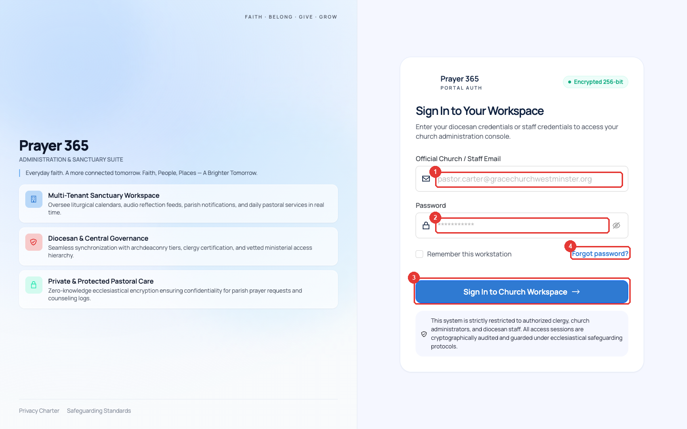
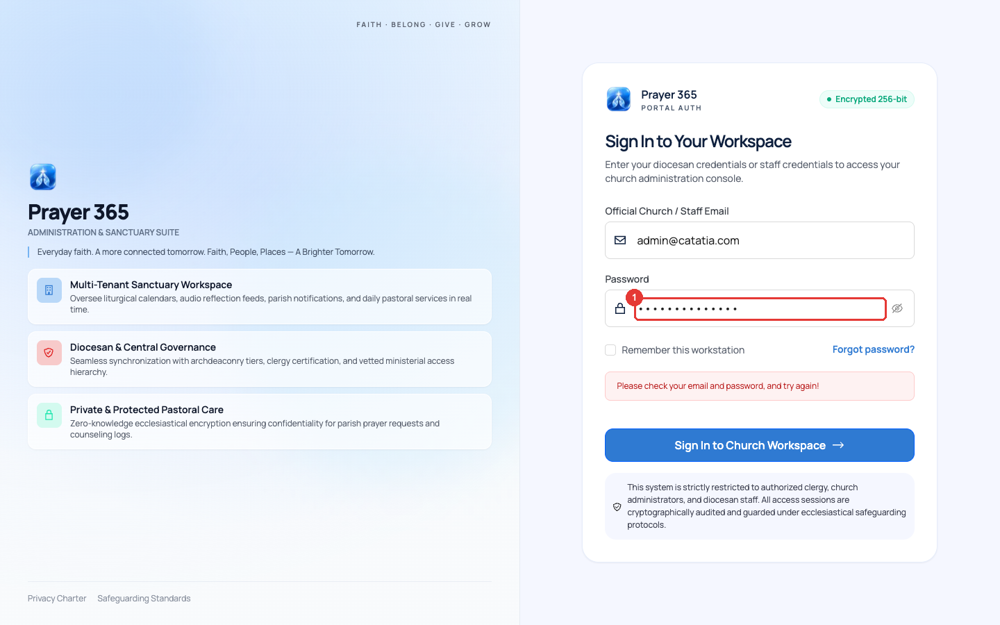
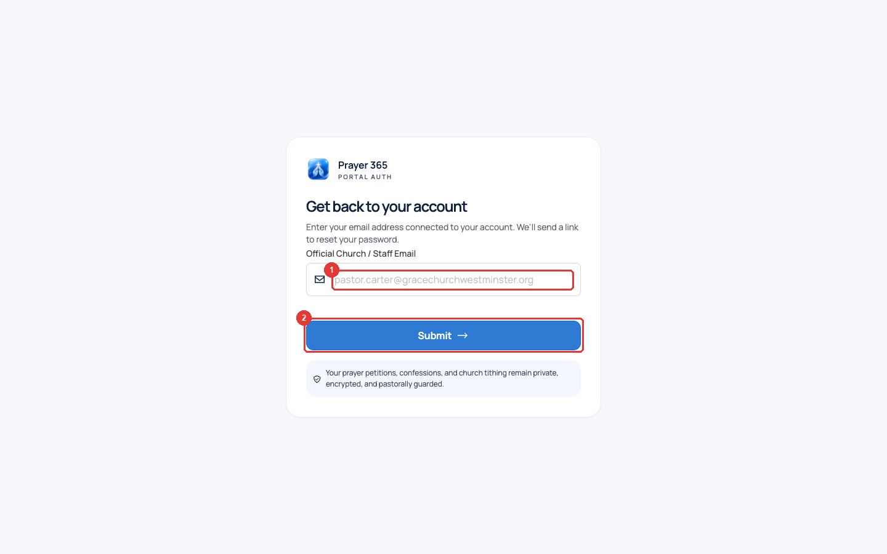
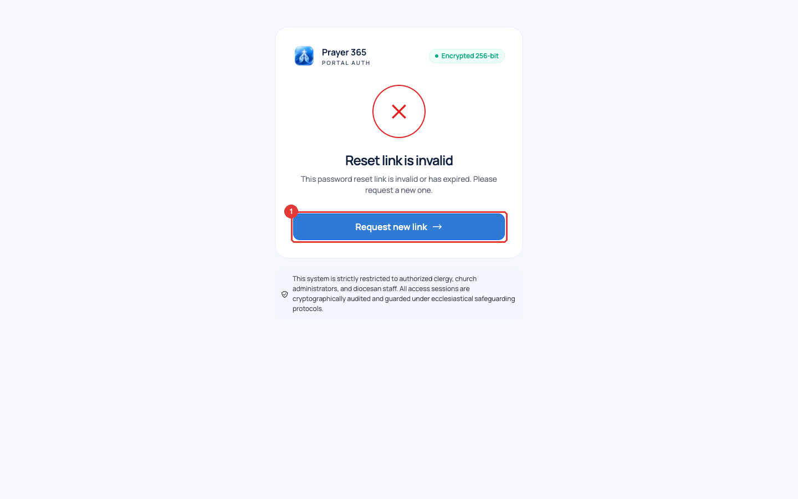
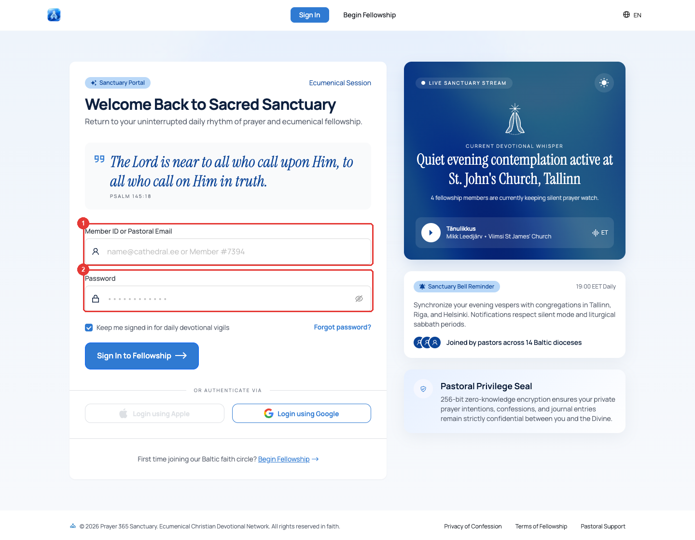
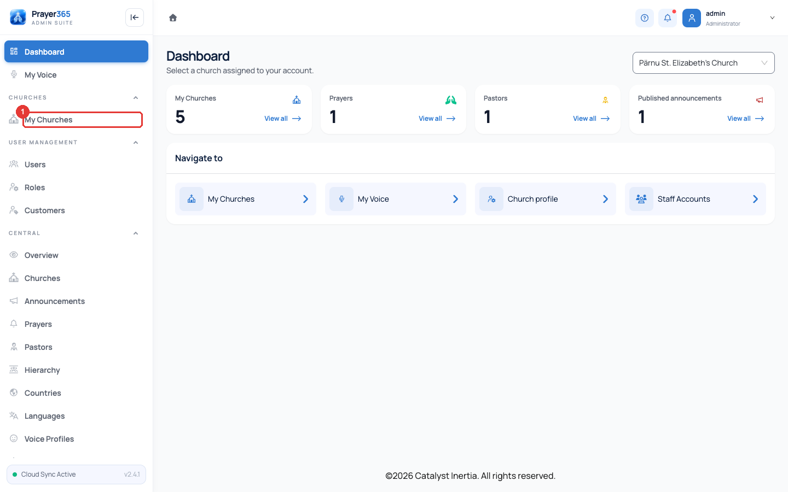
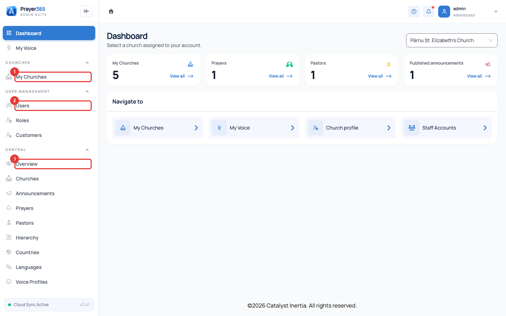

# 01. Getting started

> Part of: Admin Guidebook v1.0

## What this page is for

This chapter gets you from "I have an account" to "I am looking at my church's dashboard". It covers the staff sign-in page, what to do when the password is wrong, and the two different sign-in pages the platform has (one for staff, one for members of the public).

## Who can use it

| Role                                              | Can sign in here                           |
| ------------------------------------------------- | ------------------------------------------ |
| Super admin (`administrator`)                     | Yes                                        |
| Central staff (global, country, diocese, deanery) | Yes                                        |
| Church admin                                      | Yes                                        |
| Pastor                                            | Yes                                        |
| Request reader (standard or private)              | Yes                                        |
| Website / app customer                            | No — customers use the member sign-in page |

## Before you start

- Your account must already exist. A super admin creates staff accounts (chapter 12). You cannot register yourself.
- Use a desktop browser. The dashboard is designed for a 1440-pixel-wide screen.
- Have the staff portal address from your administrator. In this demo it is `http://localhost:3000/admin/login`.

## Step by step

### Step 1 — Open the staff portal

Go to `/admin/login`. This is the staff entrance, not the public one.

1. Type your **Official Church / Staff Email**.
2. Type your **Password**. The characters are hidden; the eye icon shows them.
3. Press **Sign In to Church Workspace**.
4. Tick **Remember this workstation** only on a computer you alone use.

### Step 2 — If the password is wrong

The page stays on the form and shows a red message under the button.

The message is: _"Please check your email and password, and try again."_

1. Re-type the password slowly, or paste it from your password manager.
2. Check that you typed the staff email, not your personal email.

### Step 3 — If you forgot the password

Press **Forgot password?** on the sign-in card.

1. Type the same staff email.
2. Press **Submit**. A reset link is sent to that mailbox.
3. Open the link from your mail. It is valid for a short time only.

### Step 4 — If the reset link is old

Opening an expired or already-used link shows this screen instead of the form.

1. Press **Request new link**.
2. Enter the email again and use the newest mail only.

### Step 5 — Do not use the member sign-in page

The public site has its own sign-in page at `/login`. It looks different and it is for the congregation, not for staff.

| Page           | Address        | Who signs in                                          |
| -------------- | -------------- | ----------------------------------------------------- |
| Staff portal   | `/admin/login` | Church staff, central staff, pastors, request readers |
| Member sign-in | `/login`       | Website and mobile app customers                      |

### Step 6 — Your first screen after sign-in

After a correct sign-in you land on the dashboard.

The screen shows your name in the top-right corner and the church you are allowed to manage. Counters (My Churches, Prayers, Pastors, Published announcements) belong to the selected church. Press **View all** on any counter to open the full list.

### Step 7 — Learn the navigation

The left sidebar is the map of the whole platform. It does not change between roles; what changes is the data inside each page.

| Sidebar group   | What lives there                                          |
| --------------- | --------------------------------------------------------- |
| Dashboard       | Your landing screen                                       |
| My Voice        | A pastor's own voice submission (chapter 11)              |
| Churches        | My Churches list (chapter 03)                             |
| User Management | Staff accounts, roles, customer accounts (chapters 12–14) |
| Central         | Platform-wide pages for central staff (chapters 15–24)    |

## Fields explained

| Field                         | What it means                                        | Required |
| ----------------------------- | ---------------------------------------------------- | -------- |
| Official Church / Staff Email | The address your account was created with            | Yes      |
| Password                      | Your staff password                                  | Yes      |
| Remember this workstation     | Keeps you signed in on this browser after closing it | No       |
| Forgot password?              | Sends a one-time reset link to your mailbox          | No       |

## What changes on the website

Signing in changes nothing for visitors. Two things are worth remembering:

| Action                            | Visible to the public                                                               |
| --------------------------------- | ----------------------------------------------------------------------------------- |
| Staff sign-in at `/admin/login`   | No                                                                                  |
| Member sign-in at `/login`        | Yes — that is the page the congregation uses                                        |
| Any change you make after sign-in | Yes, only when you press the publish or save button of that page (see each chapter) |

## Common problems

| Symptom                                                                      | Cause                                                 | Fix                                                                                           |
| ---------------------------------------------------------------------------- | ----------------------------------------------------- | --------------------------------------------------------------------------------------------- |
| "Please check your email and password, and try again."                       | Wrong password, or the account is not a staff account | Re-type the password; if it still fails, ask a super admin to check the account in chapter 12 |
| The reset email never arrives                                                | Wrong email typed, or the mail is in spam             | Press **Request new link** and type the address exactly as given by your administrator        |
| "Reset link is invalid"                                                      | The link was already used or has expired              | Request a new link and use the newest mail                                                    |
| Signed in, but the dashboard says "Select a church assigned to your account" | Your account has no church, or no church selected yet | Open **Churches → My Churches** and press **Open** on your church                             |
| A menu opens but the table says "No data"                                    | You do not have permission for that data              | This is normal; chapter 02 explains what each role can see                                    |

Next: [02. Roles and what you can see](02-roles-and-what-you-can-see.md)
