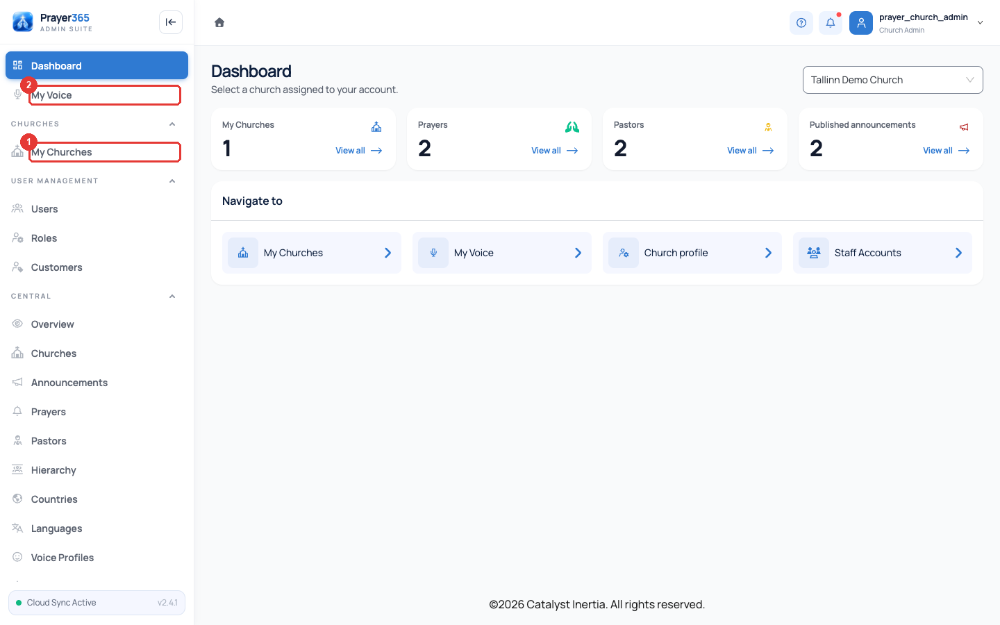
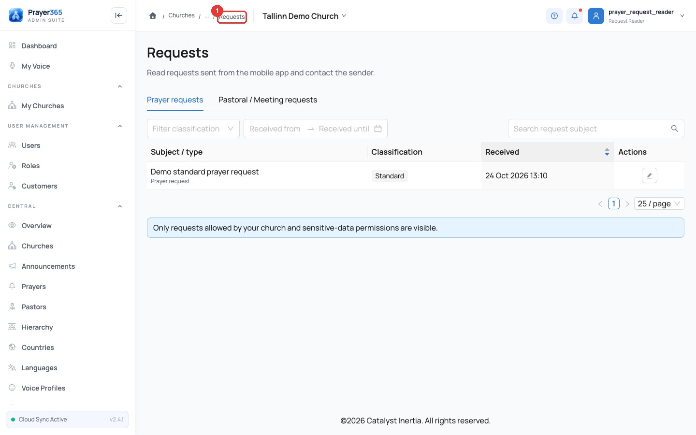
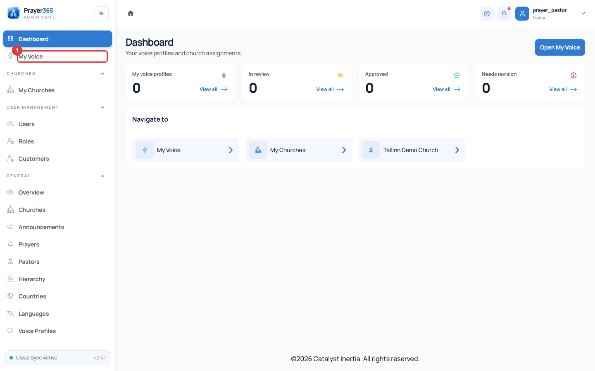

# 02. Roles and what you can see

> Part of: Admin Guidebook v1.0

## What this page is for

Every staff account has one role. The role decides which churches you can open, which data you can read, and which buttons work. This chapter shows the ten roles that ship with the platform and the honest rule behind the empty tables: **the sidebar looks the same for everyone, the data inside it does not.**

## Who can use it

| Role        | Uses this chapter to                                      |
| ----------- | --------------------------------------------------------- |
| All staff   | Understand why a menu is visible but empty                |
| Super admin | Decide which role to give a new staff member (chapter 12) |

## Before you start

- Sign in first (chapter 01).
- Know your own role. It is shown next to your name in the header, for example `Church Admin` or `Administrator`.

## Step by step

### Step 1 — Compare a church admin with a super admin

A church admin sees the same sidebar groups, but the church list contains one church only, and other churches answer _"You don't have access to that church."_

1. Note the sidebar: Dashboard, My Voice, Churches, User Management, Central.
2. Note the header: your account name and your role.
3. The counters belong to the churches your role is bound to.

### Step 2 — Compare a request reader

A request reader can open the Requests page, but sees fewer rows than an administrator on the same church.

1. Same page, same church, fewer rows: the private request is filtered out.
2. The footer explains it: _"Only requests allowed by your church and sensitive-data permissions are visible."_

### Step 3 — Compare a pastor

A pastor mainly uses **My Voice**; church content pages are read-only or blocked depending on the grants.

### Step 4 — Know the ten roles

| Role (system name)              | What it is for                                                               |
| ------------------------------- | ---------------------------------------------------------------------------- |
| `prayer_user`                   | Base role, no admin work                                                     |
| `prayer_request_reader`         | Read standard requests for one church                                        |
| `prayer_private_request_reader` | Read standard **and** private requests                                       |
| `prayer_pastor`                 | Pastor account: My Voice, read church content                                |
| `prayer_church_admin`           | Run one church: profile, prayers, events, announcements, requests, donations |
| `prayer_deanery_admin`          | Aggregate view of a deanery                                                  |
| `prayer_diocese_admin`          | Aggregate view of a diocese                                                  |
| `prayer_country_admin`          | Aggregate view of a country                                                  |
| `prayer_global_admin`           | Global aggregate view                                                        |
| `administrator`                 | Super admin: everything on the platform                                      |

### Step 5 — Read an empty table correctly

| What you see                             | What it means                                                       |
| ---------------------------------------- | ------------------------------------------------------------------- |
| The menu opens, the table says "No data" | You have no records in your scope, or no permission for that data   |
| "You don't have access to that church."  | The church exists, but your role is not bound to it                 |
| A button is missing                      | Your role is not allowed that action                                |
| A page shows only counters with `—`      | No church is selected yet; open one from **Churches → My Churches** |

## Fields explained

| Field                     | What it means                                                                        | Required               |
| ------------------------- | ------------------------------------------------------------------------------------ | ---------------------- |
| Role                      | The single role assigned to a staff account                                          | Yes                    |
| Jurisdiction              | The org node a staff account is bound to (church, deanery, diocese, country, global) | Yes                    |
| Permitted modules         | Per-account toggles on top of the role (chapter 12)                                  | No                     |
| Sensitive-data permission | Extra grant needed to read private requests                                          | Only for request staff |

## What changes on the website

Nothing. Roles only change what **staff** see. A visitor always sees the same public pages.

One indirect effect is worth knowing: when a role has no permission to publish, nothing reaches the website even if the record is saved as a draft. The publish step is always a separate action (chapters 06 and 08).

## Common problems

| Symptom                                    | Cause                                                                   | Fix                                                             |
| ------------------------------------------ | ----------------------------------------------------------------------- | --------------------------------------------------------------- |
| "You don't have access to that church."    | Your role is not bound to that church                                   | Ask a super admin to change your jurisdiction in chapter 12     |
| Private requests are missing from the list | Your role reads standard requests only                                  | A super admin must give the private role or the private grant   |
| Central pages show empty counters          | Your account has no platform-wide scope                                 | Normal for church-level roles                                   |
| You can see a menu you should not use      | The sidebar is shared; permissions are enforced per page and per action | Ignore it; the action will be refused or the list will be empty |

Next: [03. My churches](03-my-churches.md)
