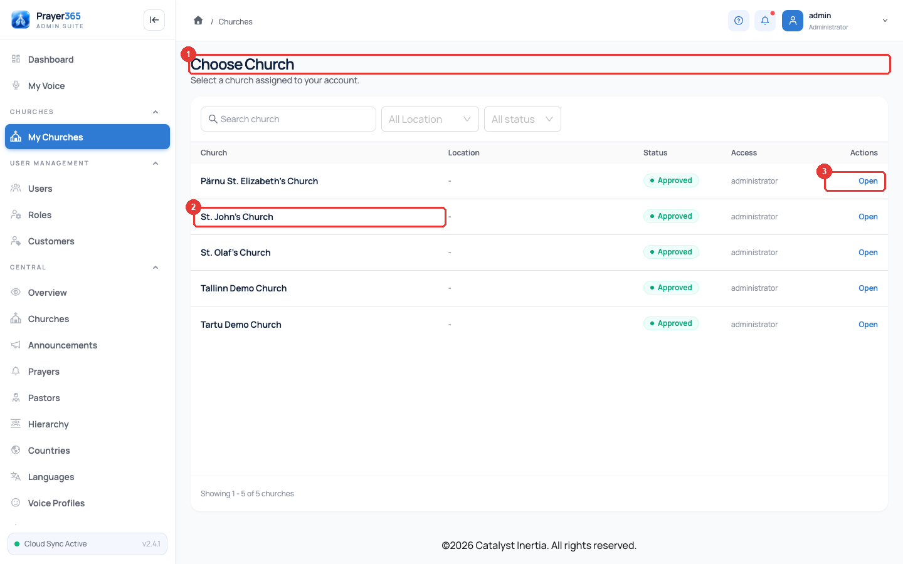

# 03. My churches

> Part of: Admin Guidebook v1.0

## What this page is for

The church list is the door to everything else. A church admin sees the church or churches assigned to them; a super admin sees every church on the platform. From here you open a church and work inside it.

## Who can use it

| Role                  | What the list shows                                  |
| --------------------- | ---------------------------------------------------- |
| Church admin          | Only the churches bound to the account               |
| Pastor                | The assigned church, read-only for most actions      |
| Central / super admin | Every church, with its country and organization node |

## Before you start

- Sign in (chapter 01).
- If you expect more churches than you see, your jurisdiction is narrower than you think (chapter 02).

## Step by step

### Step 1 — Open the church list

Go to **Churches → My Churches**.

1. Read the **Church** column to find the parish.
2. The **Location** column shows the city when the church has an address.
3. The **Status** column shows the church lifecycle state (`Approved` in the demo data).
4. The **Access** column shows what your account can do with that church (`administrator` for a super admin).

### Step 2 — Filter the list

1. Use **All Location** to narrow by place.
2. Use **All status** to show only approved, pending, suspended or archived churches.
3. The footer counts what you are looking at: _"Showing 1 - 5 of 5 churches"_.

### Step 3 — Open a church

Press **Open** on the row. You land on the church overview (chapter 04).

## Fields explained

| Column         | What it means                                                        |
| -------------- | -------------------------------------------------------------------- |
| Church         | The parish name, taken from the church profile                       |
| Location       | City, filled from the profile's Location & Contact tab               |
| Status         | Lifecycle state: Pending, Approved, Suspended, Archived (chapter 16) |
| Access         | Your permission level for that church                                |
| Actions → Open | Enters the church workspace                                          |

## What changes on the website

This page is a staff list, so nothing on it is published. Two columns are mirrors of public data:

| Dashboard column                                              | Public page that shows it                                       |
| ------------------------------------------------------------- | --------------------------------------------------------------- |
| Church name                                                   | Card title on `/churches` and the heading on `/churches/<slug>` |
| Location                                                      | City line under the church name on the public profile           |
| Cover image (in the church card on a church-scoped dashboard) | The card image on `/churches`                                   |

A church whose status is **not** Approved is not listed publicly at all — a visitor gets no card and no page for it.

## Common problems

| Symptom                                 | Cause                                                                        | Fix                                         |
| --------------------------------------- | ---------------------------------------------------------------------------- | ------------------------------------------- |
| List shows fewer churches than expected | Role jurisdiction is narrower than the full platform                         | Ask a super admin to widen the jurisdiction |
| "No data"                               | The account has no church bound to it                                        | Create or bind the account in chapter 12    |
| **Open** does nothing                   | The church row belongs to another organization and your role cannot enter it | Use an account with that jurisdiction       |

Next: [04. Church overview](04-church-overview.md)
