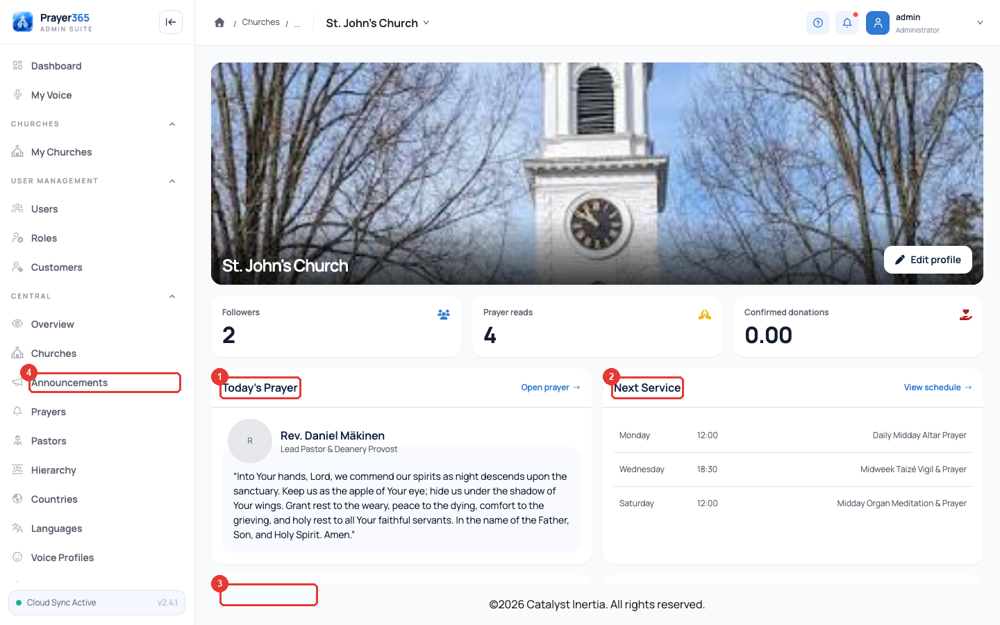

# 04. Church overview

> Part of: Admin Guidebook v1.0

## What this page is for

The church overview is the home screen of one church. It answers four questions at a glance: how many people follow us, what is the prayer for today, when is the next service, and what are we telling people this week.

## Who can use it

| Role                  | Can open it             |
| --------------------- | ----------------------- |
| Church admin          | Yes, for their churches |
| Pastor                | Yes, read-only          |
| Central / super admin | Yes, every church       |

## Before you start

- Open a church from **Churches → My Churches** (chapter 03).
- The counters read from the live database; a brand-new church shows zeros, not errors.

## Step by step

### Step 1 — Read the counters

| Counter             | What it counts                                                        |
| ------------------- | --------------------------------------------------------------------- |
| Followers           | People who set this church as their home parish on the website or app |
| Prayer reads        | Times a published prayer of this church was opened                    |
| Confirmed donations | Money confirmed by the payment provider for this church               |

A dash (`—`) means the number is not available yet for the selected period, not that the church is broken.

### Step 2 — Check today's prayer

The **Today's Prayer** block shows the prayer currently published for today, with the pastor's name and role under it. Press **Open prayer** to edit it (chapter 06).

### Step 3 — Check the service schedule

The **Next Service** block lists the next service times with day, time and service name. Press **View schedule** to edit the full weekly schedule in the profile (chapter 05, Service Times tab).

### Step 4 — Check upcoming events and announcements

Both blocks show the next few items with dates.

1. Press **View events** to open the events page (chapter 07).
2. Press **View schedule** in the announcements block to open the announcements page (chapter 08).

### Step 5 — Edit the profile

Press **Edit profile** at the top of the page to jump to the church profile (chapter 05).

## Fields explained

| Block               | Where the data comes from                                  |
| ------------------- | ---------------------------------------------------------- |
| Followers           | Customer accounts that selected this church as home parish |
| Prayer reads        | Prayer view events recorded by the website and app         |
| Confirmed donations | Payment records with a confirmed provider state            |
| Today's Prayer      | The prayer whose publication date is today                 |
| Next Service        | Service times in the profile, sorted by weekday and time   |
| Upcoming events     | Events whose start date is in the future                   |
| Announcements       | Published announcements for this church                    |

## What changes on the website

The overview is a summary, so it publishes nothing by itself. It mirrors six public blocks on `/churches/<slug>`:

| Overview block        | Public block on the church page                                                                                              |
| --------------------- | ---------------------------------------------------------------------------------------------------------------------------- |
| Church name and cover | Page heading and hero image                                                                                                  |
| Today's Prayer        | Prayer Lists section                                                                                                         |
| Next Service          | Worship Services & Regular Liturgies                                                                                         |
| Followers             | Not shown publicly                                                                                                           |
| Confirmed donations   | Not shown publicly                                                                                                           |
| Events, announcements | Shown in the mobile app; the public church page does not render these blocks in this release (see chapter 07 and chapter 08) |

## Common problems

| Symptom                                 | Cause                                     | Fix                                        |
| --------------------------------------- | ----------------------------------------- | ------------------------------------------ |
| "No prayers published yet."             | No prayer has a publication date of today | Publish a prayer (chapter 06)              |
| "No service times scheduled."           | The profile has no service rows           | Add them in the profile, Service Times tab |
| Counters stay at 0                      | No visitor activity yet on a fresh church | Expected on a new church                   |
| "You don't have access to that church." | The account is not bound to this church   | Check the jurisdiction in chapter 12       |

Next: [05. Church profile](05-church-profile.md)
