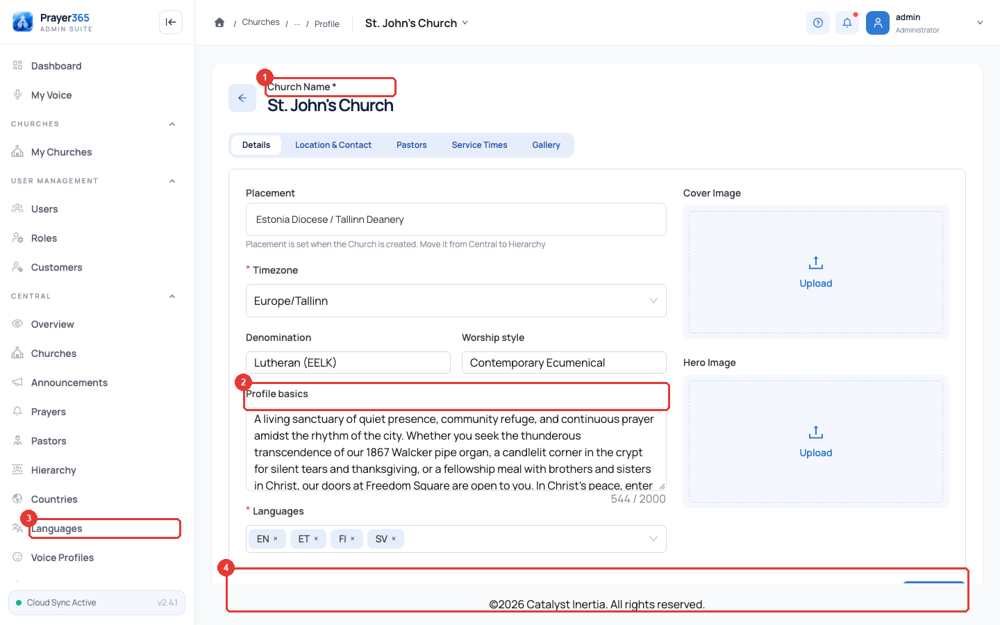
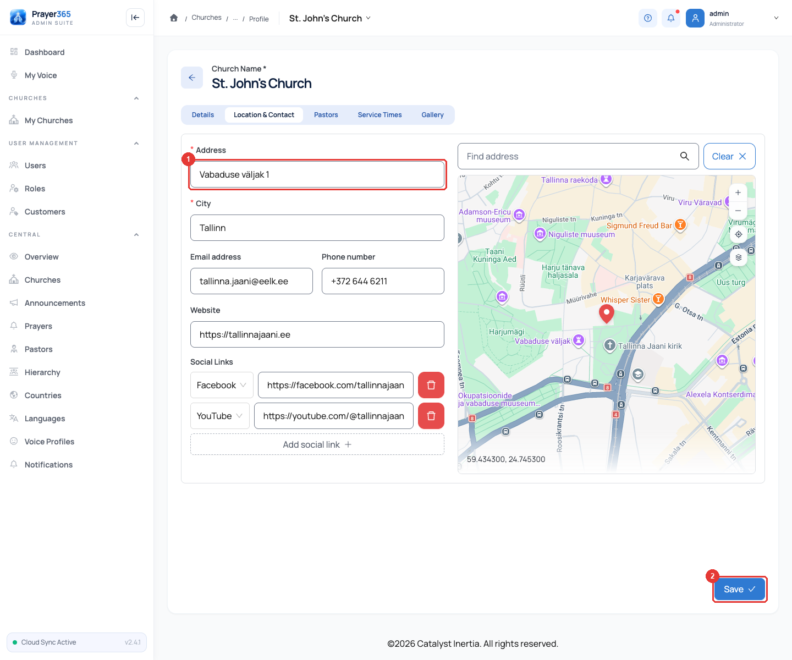
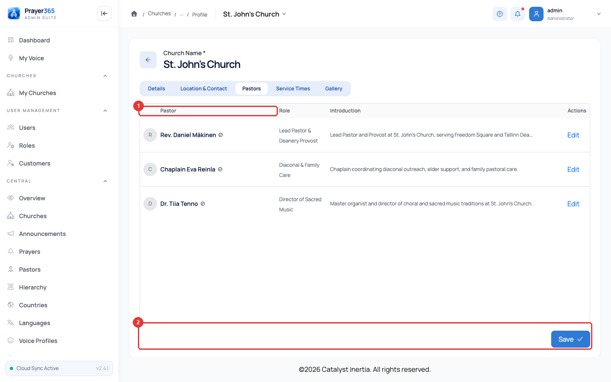
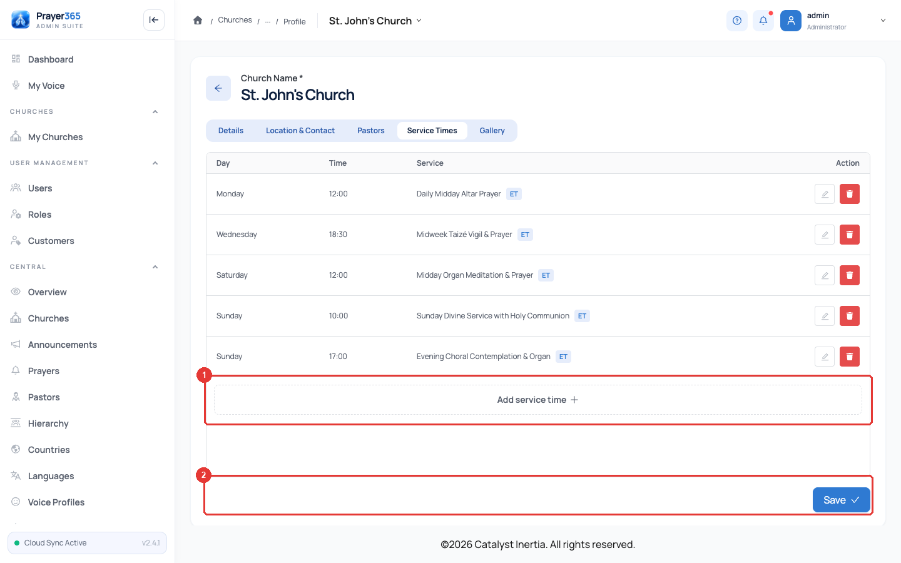
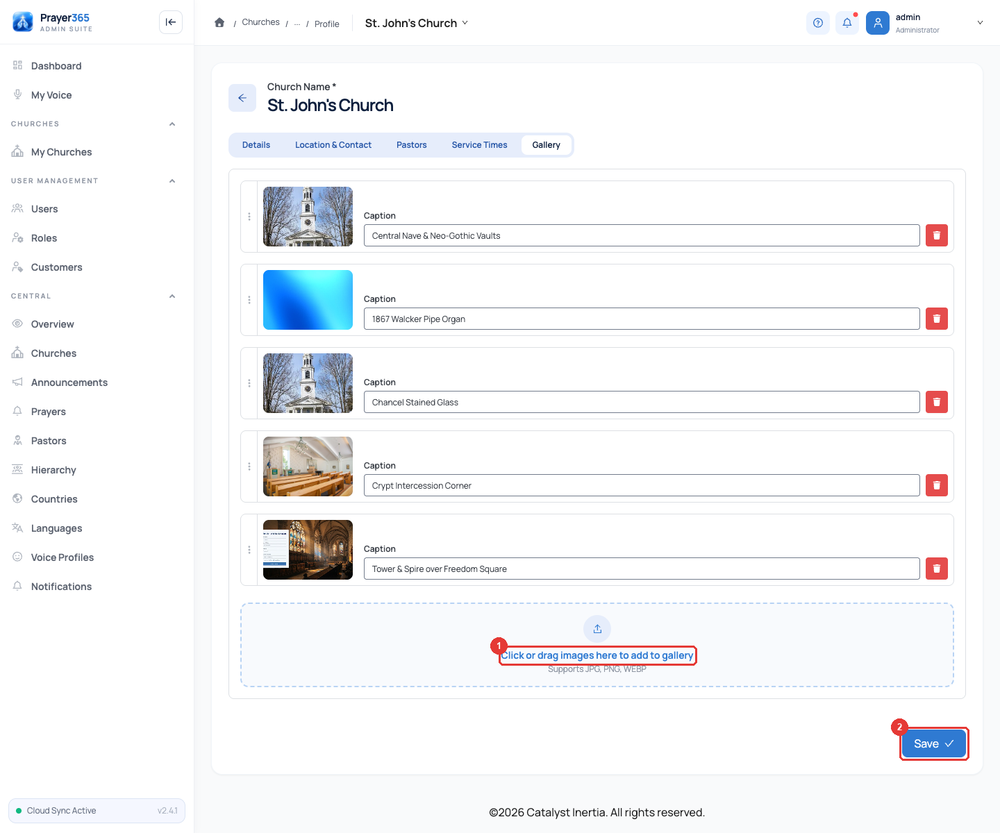

# 05. Church profile

> Part of: Admin Guidebook v1.0

## What this page is for

The church profile is the public identity of a parish. Everything a visitor reads about the church — its description, address, phone, service times, pastoral staff and photo gallery — is edited here and appears on the website church page.

## Who can use it

| Role                  | Can edit                |
| --------------------- | ----------------------- |
| Church admin          | Yes, for their churches |
| Pastor                | Read-only               |
| Central / super admin | Yes, every church       |

## Before you start

- Open the church (chapter 03) and press **Edit profile**, or go to **Churches → My Churches → Open → Edit profile**.
- One field cannot be changed here: **Placement** (country, diocese, deanery). It is set when the church is created and moved from **Central → Hierarchy** (chapter 20).
- Images: JPG, PNG or WEBP.

## Step by step

### Step 1 — Edit the basics

Open the **Details** tab.

1. Check the **Church Name**. It is used everywhere: dashboard lists, website card, prayer pages.
2. Fill **Profile basics** — the short introduction shown on the public page. The counter shows the limit (e.g. `544 / 2000`).
3. Pick the **Languages** the church serves: `EN`, `ET`, `FI`, `SV`. Add one with the dropdown, remove one with the `×`.
4. Upload a **Cover Image** and a **Hero Image**.
5. Press **Save**.

### Step 2 — Edit location and contact

Open the **Location & Contact** tab.

1. Type the **Address** and **City** exactly as they should appear publicly.
2. Add **Email address**, **Phone number** and **Website**.
3. Add social links: **Facebook**, **YouTube**, or **Add social link** for another network.
4. The map pin accepts coordinates (the demo church shows `59.434300, 24.745300`). Press **Clear** to remove it.
5. Press **Save**.

### Step 3 — Manage pastoral staff

Open the **Pastors** tab.

1. Each row is one pastor: name, role and a one-line introduction.
2. Press **Edit** on a row to change the role or the introduction.
3. Press **Save** after the edits.

### Step 4 — Manage the weekly service schedule

Open the **Service Times** tab.

1. Read the columns: **Day**, **Time**, **Service**, **Action**.
2. Press **Add service time** to add a row; press **Edit** to change one; press **Delete** to remove one.
3. Press **Save**. The schedule appears in the overview and on the public page.

### Step 5 — Manage the gallery

Open the **Gallery** tab.

1. Click the upload area or drag images into it. Supported: JPG, PNG, WEBP.
2. Give each image a **Caption** — captions appear under the images on the public page.
3. Press **Save**.

## Fields explained

| Field                             | What it means                                             | Required  |
| --------------------------------- | --------------------------------------------------------- | --------- |
| Church Name                       | The public name of the parish                             | Yes       |
| Placement                         | Country / diocese / deanery; fixed after creation         | Read-only |
| Timezone                          | The church's own clock for services and events            | Yes       |
| Denomination                      | e.g. Lutheran (EELK); shown as a label on the public page | No        |
| Worship style                     | e.g. Contemporary Ecumenical                              | No        |
| Profile basics                    | The public description, up to 2000 characters             | No        |
| Languages                         | Languages the church serves                               | No        |
| Cover Image / Hero Image          | Cards and page header images                              | No        |
| Address, City                     | Public address block                                      | No        |
| Email, Phone, Website             | Public contact block                                      | No        |
| Social links                      | Facebook, YouTube and other networks                      | No        |
| Pastor rows                       | Public staff cards                                        | No        |
| Service rows (Day, Time, Service) | Public worship schedule                                   | No        |
| Gallery images + captions         | Public photo gallery                                      | No        |

## What changes on the website

Everything in this chapter is published on the church page `/churches/<slug>` after **Save** and a page refresh.

| Profile field                       | Public block                                |
| ----------------------------------- | ------------------------------------------- |
| Church Name                         | Page heading and church card title          |
| Profile basics                      | The introduction under the heading          |
| Denomination, Worship style         | Labels next to the church name              |
| Address + map pin                   | **Location** section                        |
| Email, Phone, Website, social links | **Pastoral Care Office** and footer links   |
| Pastors                             | **Pastoral Care Office** staff cards        |
| Service Times                       | **Worship Services & Regular Liturgies**    |
| Gallery                             | **Sanctuary Gallery & Sacred Architecture** |
| Cover / Hero image                  | Hero image at the top of the page           |

There is no publish button on the profile: saving is publishing. Expect the change to be visible after a refresh.

## Common problems

| Symptom                                     | Cause                                    | Fix                                                             |
| ------------------------------------------- | ---------------------------------------- | --------------------------------------------------------------- |
| Cannot change the diocese                   | Placement is fixed at creation           | Move the church in **Central → Hierarchy** (chapter 20)         |
| Upload fails                                | File too large or wrong type             | Use JPG, PNG or WEBP under the upload limit shown in the dialog |
| Gallery image saves but shows no caption    | Caption field left empty                 | Type the caption before pressing **Save**                       |
| Public page still shows the old text        | Browser cache                            | Refresh the page; then hard refresh                             |
| "Full prayer text is required" style errors | A required field in another tab is empty | Fill the field, then save again                                 |

Next: [06. Prayers and audio](06-prayers.md)
