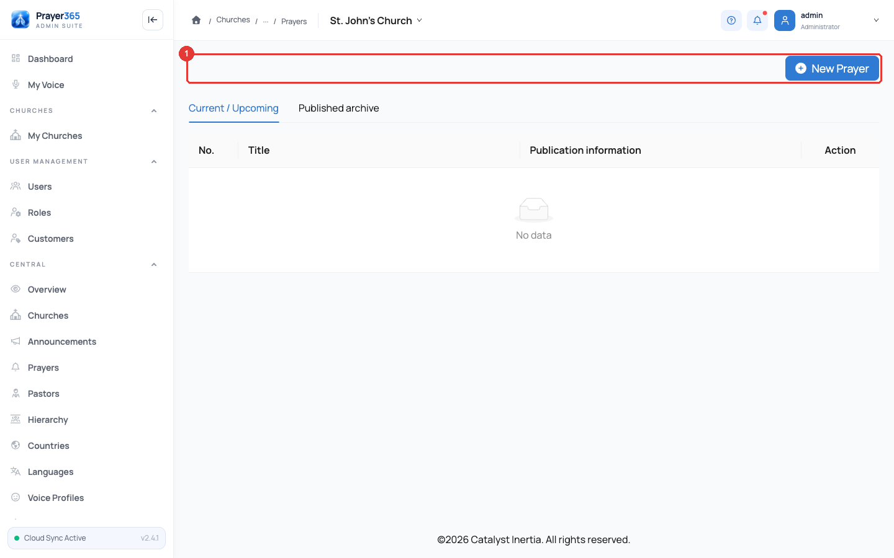
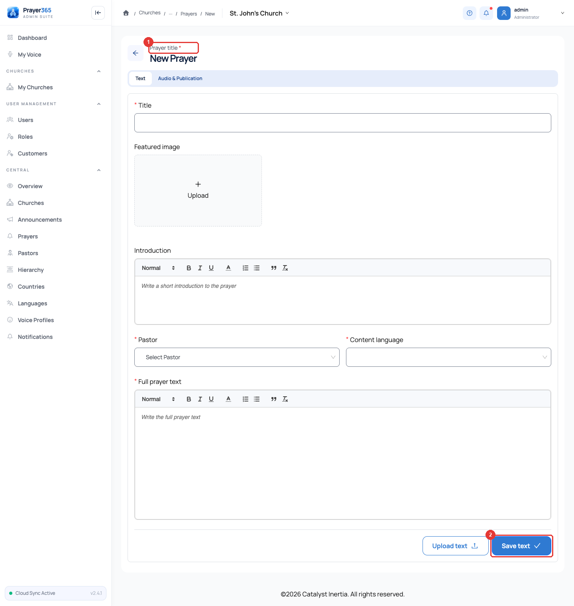
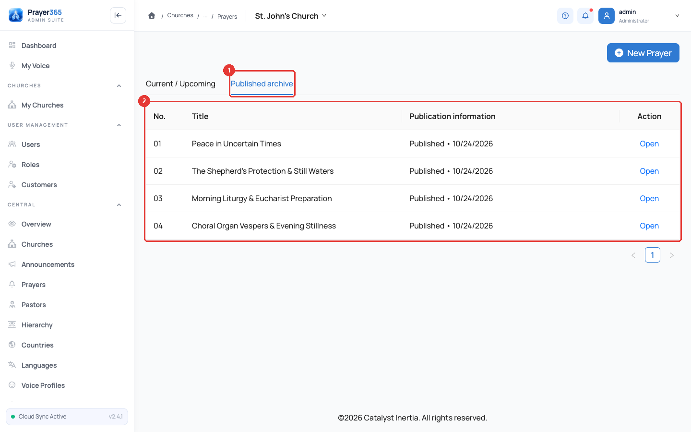
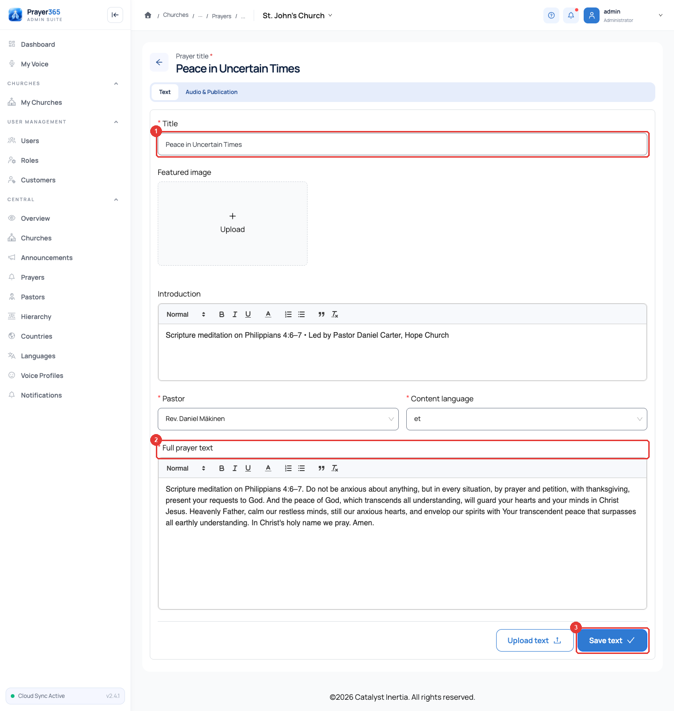
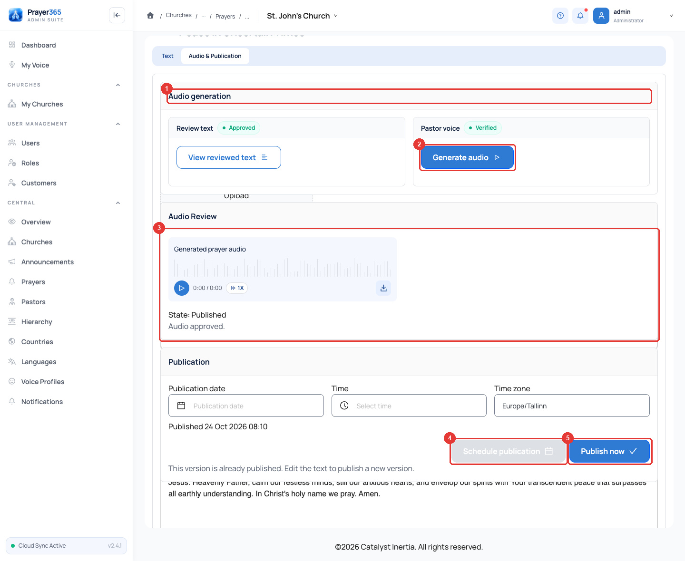

# 06. Prayers and audio

> Part of: Admin Guidebook v1.0

## What this page is for

A prayer is the core content of the product: a title, a text, and an audio recording in the pastor's own voice. This chapter takes one prayer from new to published, including the review and audio-approval steps that must happen before it can be heard.

## Who can use it

| Role                  | Can do                                                   |
| --------------------- | -------------------------------------------------------- |
| Church admin          | Create and edit prayers, request audio, approve, publish |
| Pastor                | Read prayers of the assigned church                      |
| Central / super admin | Same actions, plus the cross-church list (chapter 18)    |

## Before you start

- The church must have a pastor with a **READY** voice profile. Without it the audio step cannot run (chapter 19).
- Open the church, then **Prayers** in the church menu.
- Have the final prayer text ready. The text is reviewed before the audio is generated.

## Step by step

### Step 1 — Open the prayer list

1. **Current / Upcoming** holds prayers that are published today or scheduled for later.
2. **Published archive** holds prayers whose publication date has passed.
3. Press **New Prayer** to start a new one.

### Step 2 — Create the prayer

1. Fill **Title**.
2. Optionally upload a **Featured image**.
3. Write the **Introduction** — one or two lines shown above the prayer.
4. Choose the **Pastor** who will speak the prayer.
5. Choose the **Content language**.
6. Write or paste the **Full prayer text**. The editor keeps the formatting; the field is required before saving.
7. Press **Save text**.

### Step 3 — Find the prayer again

1. Published prayers move to **Published archive** once their date passes.
2. Each row shows number, title, publication information and an **Open** action.
3. Press **Open** to edit.

### Step 4 — Review and correct the text

1. Read the text once more; a typo would be read aloud by the voice model.
2. Change what you need, then press **Save text**.

### Step 5 — Generate and approve the audio

Open the **Audio & Publication** tab.

1. **Audio generation → Review text** must show **Approved**. If it does not, press **View reviewed text** and approve the text first.
2. **Pastor voice** must show **Verified**.
3. Press **Generate audio** and wait for the player to appear under **Audio Review → Generated prayer audio**.
4. Listen once. Approve the audio.
5. Under **Publication**, choose **Publication date** and **Time**, check the **Time zone**, then press **Schedule publication** or **Publish now**.

### Step 6 — Understand the published state

When a prayer is live, the tab shows:

| Label                                                                      | Meaning                                                            |
| -------------------------------------------------------------------------- | ------------------------------------------------------------------ |
| State: Published                                                           | The prayer is visible to visitors                                  |
| Audio approved.                                                            | The audio is the one being served                                  |
| Published 24 Oct 2026 08:10                                                | When it went live, in the church time zone                         |
| This version is already published. Edit the text to publish a new version. | A published version is locked; a text change creates a new version |

## Fields explained

| Field                             | What it means                               | Required       |
| --------------------------------- | ------------------------------------------- | -------------- |
| Title                             | Public prayer title                         | Yes            |
| Featured image                    | Card image on the prayer lists              | No             |
| Introduction                      | Short subtitle above the prayer             | No             |
| Pastor                            | The voice that speaks the prayer            | Yes for audio  |
| Content language                  | Language of the text and the audio          | Yes            |
| Full prayer text                  | The prayer itself; supports rich formatting | Yes            |
| Review text / Approved            | Staff review gate before audio              | Yes for audio  |
| Pastor voice / Verified           | Voice profile state                         | Yes for audio  |
| Publication date, Time, Time zone | When the prayer goes live                   | Yes to publish |
| Schedule publication              | Saves a future publication moment           | No             |
| Publish now                       | Publishes immediately                       | No             |

## What changes on the website

| Action                     | Public result                                                                                             |
| -------------------------- | --------------------------------------------------------------------------------------------------------- |
| Prayer published           | Appears in **Prayer Lists** on `/churches/<slug>`, on `/prayers`, and on its own page `/prayers/<slug>`   |
| Audio approved             | The player on `/prayers/<slug>` plays in the pastor's voice                                               |
| Scheduled prayer           | Appears when the scheduled moment arrives, not before                                                     |
| Text edit after publishing | Creates a new version; the public page keeps serving the published one until the new version is published |
| Unpublished draft          | Nothing public                                                                                            |

Verified on the demo data: the public prayer page shows the audio player with a reachable audio file, and the church page lists the same four prayers.

## Common problems

| Symptom                                             | Cause                                                   | Fix                                                     |
| --------------------------------------------------- | ------------------------------------------------------- | ------------------------------------------------------- |
| **Generate audio** does nothing                     | Voice profile is not READY, or the text is not approved | Finish chapter 19 for the voice; approve the text first |
| Audio player stays at 0:00                          | Audio not approved yet, or still generating             | Wait for the player to load, then approve the audio     |
| "Full prayer text is required."                     | The text field is empty                                 | Paste the text and press **Save text**                  |
| Prayer missing from the website                     | Not published (draft or scheduled)                      | Publish it, or check the scheduled date                 |
| Editing a published prayer changed nothing publicly | A published version is locked                           | Save the new text, then publish the new version         |

Next: [07. Events](07-events.md)
