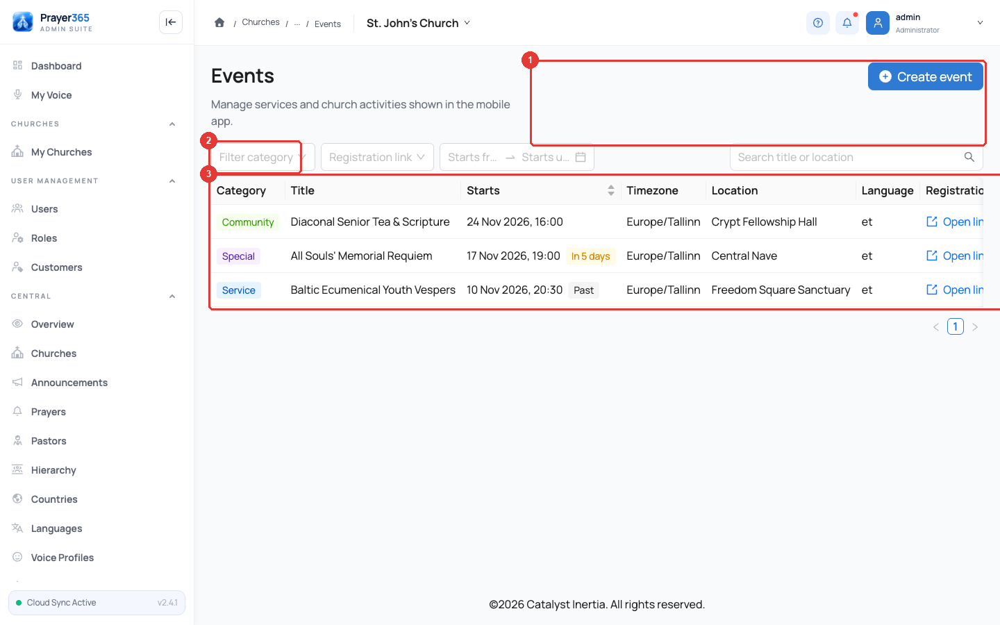
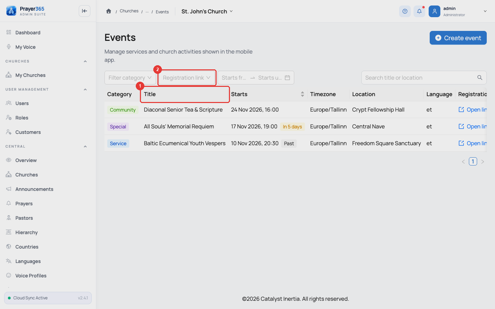

# 07. Events

> Part of: Admin Guidebook v1.0

## What this page is for

Events are dated church activities: services, concerts, study groups, volunteer meetings. This chapter shows how to create one, how the registration link and button label work, and where the event is visible.

## Who can use it

| Role                  | Can do                                       |
| --------------------- | -------------------------------------------- |
| Church admin          | Create, edit and delete events of the church |
| Pastor                | Read                                         |
| Central / super admin | Read every church's events                   |

## Before you start

- Open the church, then **Church → Events**.
- Decide the date, time and place. Times are shown in the church time zone displayed at the top of the form.
- If people must register elsewhere, prepare the registration URL and the button text.

## Step by step

### Step 1 — Open the events list

1. The subtitle explains the purpose: _"Manage services and church activities shown in the mobile app."_
2. **Filter category** narrows the list by event type.
3. **Registration link** shows which events have an external sign-up.
4. The table columns are **Category, Title, Starts, Timezone, Location, Language, Registration, Button Label, Actions**.

### Step 2 — Create an event

Press **Create event**.

1. Choose a **Category** (for example Service, Community, Special, Volunteer Care).
2. Type the **Title**.
3. Write the **Description**. The counter shows the limit (`0 / 8000`).
4. Set **Date and time**. The form shows the church timezone, for example `Europe/Tallinn`.
5. Fill **Location**.
6. Paste a **Registration link** if people must sign up outside the platform.
7. Fill **Action button label (CTA)** — the button text on the public church profile. Examples: `RSVP Fellowship`, `Submit Memorial Name`, `Volunteer Care`. Empty means `Join Service`.
8. Choose a **Language**, or leave **No specific language**.
9. Press **Create event**.

### Step 3 — Check the result in the list

1. The new row shows the category chip, title, start date with a relative hint (`In 5 days`, `Past`), timezone, location and language.
2. Press **Open link** to confirm the registration URL works.
3. Use **Actions** to edit or delete the event.

## Fields explained

| Field                     | What it means                               | Required |
| ------------------------- | ------------------------------------------- | -------- |
| Category                  | Groups the event in lists and filters       | Yes      |
| Title                     | Event name                                  | Yes      |
| Description               | Long text, up to 8000 characters            | No       |
| Date and time             | Start of the event, in the church time zone | Yes      |
| Location                  | Where it happens                            | No       |
| Registration link         | External sign-up URL                        | No       |
| Action button label (CTA) | Button text used with the registration link | No       |
| Language                  | Language of the event content               | No       |
| Timezone                  | Read-only, from the church profile          | —        |

## What changes on the website

This is the one chapter where the public behaviour needs a precise statement:

| Action                                | Where it is visible now                                                                                                                               |
| ------------------------------------- | ----------------------------------------------------------------------------------------------------------------------------------------------------- |
| Event created                         | Mobile app event list for that church                                                                                                                 |
| Registration link + button label      | The action button inside the mobile app event card                                                                                                    |
| Public church page `/churches/<slug>` | **Not rendered in this release** — verified on the demo data: the page shows services, prayers, gallery, location, pastoral care and stewardship only |

The CTA helper text in the form still speaks about the "public church profile" because that is the field's origin. In the current release treat events as app content, and tell your congregation to check the app.

## Common problems

| Symptom                  | Cause                                               | Fix                                                 |
| ------------------------ | --------------------------------------------------- | --------------------------------------------------- |
| Event missing in the app | Start date in the past, or language filter hides it | Check the date and the language                     |
| CTA button not showing   | Registration link empty                             | Paste the URL and set the label                     |
| Wrong time displayed     | Time entered in the wrong zone                      | Enter the time in the church zone shown on the form |
| Cannot delete an event   | Your role is read-only for events                   | Ask a church admin with content rights              |

Next: [08. Announcements](08-announcements.md)
