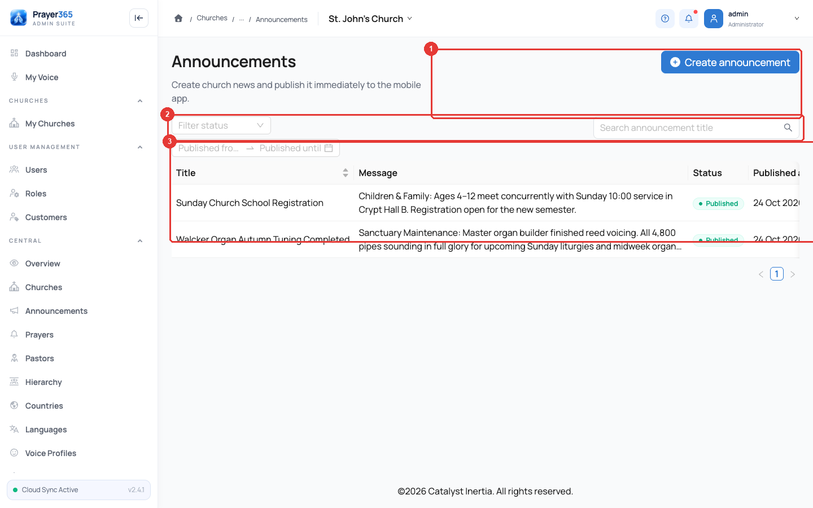
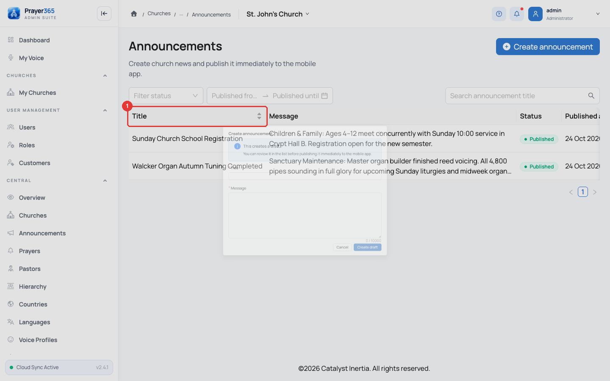

# 08. Announcements

> Part of: Admin Guidebook v1.0

## What this page is for

An announcement is short church news: a schedule change, a registration window, a maintenance notice. Announcements are written as drafts, reviewed in the list, and then published.

## Who can use it

| Role                  | Can do                                            |
| --------------------- | ------------------------------------------------- |
| Church admin          | Create, edit, publish and unpublish announcements |
| Pastor                | Read                                              |
| Central / super admin | Read every church's announcements                 |

## Before you start

- Open the church, then **Church → Announcements**.
- Keep the message short. The field allows 10000 characters, but a phone screen shows about three lines before "read more".

## Step by step

### Step 1 — Open the announcement list

1. The subtitle says the destination: _"Create church news and publish it immediately to the mobile app."_
2. **Filter status** narrows to draft or published rows.
3. The table shows **Title, Message, Status, Published at, Created, Actions**.

### Step 2 — Create the announcement

Press **Create announcement**.

1. Read the note at the top: _"This creates a draft. You can review it in the list before publishing it immediately to the mobile app."_
2. Type the **Title**.
3. Type the **Message**. The counter shows the limit (`0 / 10000`).
4. Press **Create draft**. Nothing is public yet.

### Step 3 — Publish the draft

1. Find the row in the list; its **Status** reads `Draft`.
2. Use the row **Actions** to publish it.
3. **Published at** fills with the moment of publication; **Created** keeps the original draft time.

## Fields explained

| Field        | What it means                     | Required  |
| ------------ | --------------------------------- | --------- |
| Title        | Headline of the announcement      | Yes       |
| Message      | Body text, up to 10000 characters | Yes       |
| Status       | Draft or Published                | Automatic |
| Published at | The moment it went live           | Automatic |
| Created      | The moment the draft was saved    | Automatic |

## What changes on the website

| Action                                | Where it is visible now                                                                                        |
| ------------------------------------- | -------------------------------------------------------------------------------------------------------------- |
| Draft saved                           | Nowhere public                                                                                                 |
| Announcement published                | Mobile app announcement list for that church                                                                   |
| Public church page `/churches/<slug>` | **Not rendered in this release** — verified on the demo data: the church page has no announcements block today |

Two announcements are also visible in the church overview block (chapter 04), which is a staff screen, not a public page.

## Common problems

| Symptom                           | Cause                                                           | Fix                                                                       |
| --------------------------------- | --------------------------------------------------------------- | ------------------------------------------------------------------------- |
| Announcement invisible in the app | It is still a draft                                             | Publish it from the row actions                                           |
| Message cut in the app            | Very long message                                               | Shorten the text; the detail view shows more                              |
| Cannot publish                    | Your role can read announcements only                           | Ask a church admin with content rights                                    |
| Wrong church on the announcement  | Created from a central list with a church selector (chapter 22) | Check the **Church** column (central list) or create it inside the church |

Next: [09. Prayer and pastoral requests](09-requests.md)
