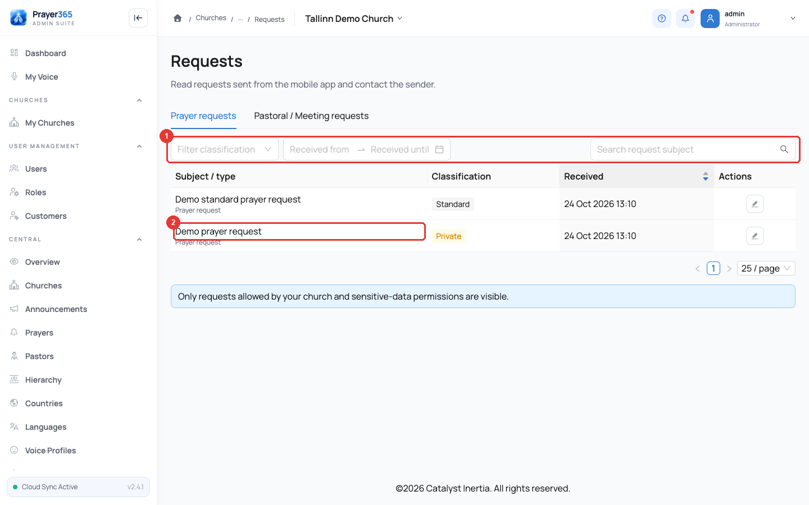
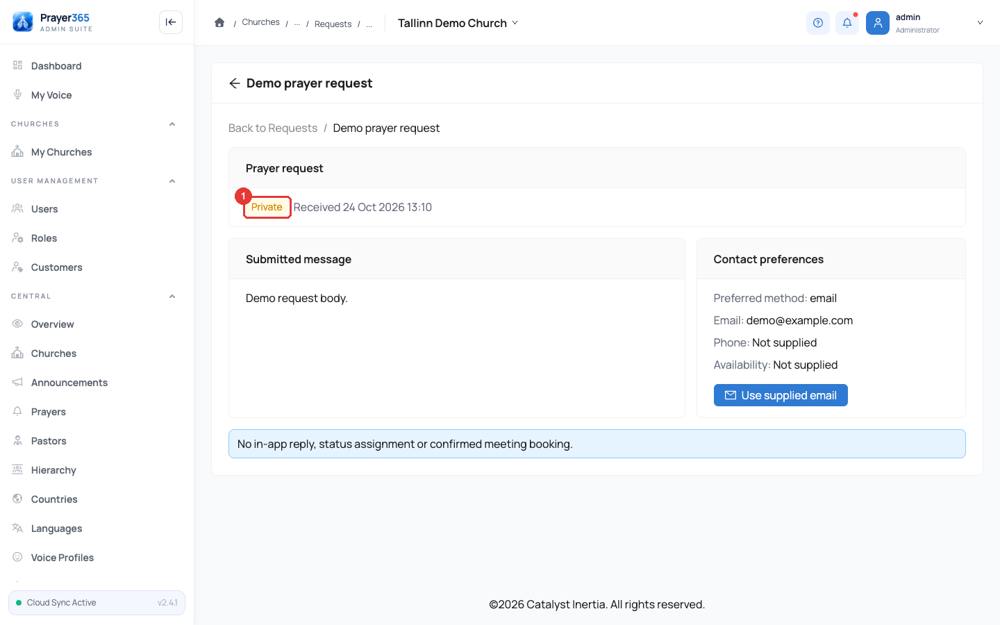

# 09. Prayer and pastoral requests

> Part of: Admin Guidebook v1.0

> **Sensitive data.** Requests can contain private prayer needs and personal contact details. Only read them if your role includes request access, and never copy them out of the platform.

## What this page is for

Visitors can send two kinds of request from the website and the mobile app: a prayer request, or a pastoral or meeting request. This page lets authorised staff read them and contact the sender using the details the person supplied.

## Who can use it

| Role                             | What is visible                                            |
| -------------------------------- | ---------------------------------------------------------- |
| `prayer_request_reader`          | Standard requests only                                     |
| `prayer_private_request_reader`  | Standard **and** private requests                          |
| Church admin with request access | Depends on the grant                                       |
| Central / regional staff         | Aggregate information only, no private requests by default |

## Before you start

- Open the church, then **Church → Requests**.
- The church must have requests. In the demo data only Tallinn Demo Church has any: one standard, one private.

## Step by step

### Step 1 — Open the list

1. Choose the tab: **Prayer requests** or **Pastoral / Meeting requests**.
2. Use **Filter classification** to show **Standard** or **Private**.
3. The columns are **Subject / type, Classification, Received, Actions**.
4. Read the footer: _"Only requests allowed by your church and sensitive-data permissions are visible."_

### Step 2 — Know what the two classifications mean

| Classification | Who can read it                      |
| -------------- | ------------------------------------ |
| Standard       | Request staff without private access |
| Private        | Only accounts with the private grant |

Proof from the demo data: the same church shows two rows for an administrator and one row for a request reader.

### Step 3 — Open a request

Press the row action to open the detail.

1. The header repeats the title and the classification badge (**Private** in this example).
2. **Submitted message** is what the person wrote.
3. **Contact preferences** lists the method and the details: email, phone (or _Not supplied_), availability.
4. Press **Use supplied email** to contact the person with the details they gave.

### Step 4 — Accept the limits of this release

The page states the limits plainly: _"No in-app reply, status assignment or confirmed meeting booking."_

1. There is no reply box and no status to set here.
2. Contact happens outside the platform — email or phone.
3. Nothing you do on this page changes anything for the visitor.

## Fields explained

| Field             | What it means                                         |
| ----------------- | ----------------------------------------------------- |
| Subject / type    | Short summary and the request kind (prayer, pastoral) |
| Classification    | Standard or Private                                   |
| Received          | When the request arrived                              |
| Submitted message | The text written by the person                        |
| Preferred method  | Email, phone or in-app preference                     |
| Email / Phone     | Contact details as supplied, or _Not supplied_        |
| Availability      | Time window the person supplied                       |

## What changes on the website

Nothing. Requests flow **from** the website and app **into** the dashboard; nothing written here goes back to the public pages. There is no public list of requests.

| Direction                 | Behaviour                                |
| ------------------------- | ---------------------------------------- |
| Visitor submits a request | Row appears here within the same session |
| Staff reads a request     | No visible change for the visitor        |
| Staff contacts the person | Outside the platform                     |
| Request deleted           | No public effect                         |

## Common problems

| Symptom                         | Cause                                                          | Fix                                                                      |
| ------------------------------- | -------------------------------------------------------------- | ------------------------------------------------------------------------ |
| Private request not in the list | Your role lacks the private grant                              | A super admin must assign `prayer_private_request_reader` or the grant   |
| "No data"                       | The church has no requests, or your role has no request access | Check the demo church for data, or request access                        |
| Email missing                   | The person chose phone only                                    | Use the phone number; the detail shows _Phone: Not supplied_ when absent |
| You cannot reply from here      | Not part of this release                                       | Use **Use supplied email** and reply from your mailbox                   |

Next: [10. Donations](10-donations.md)
