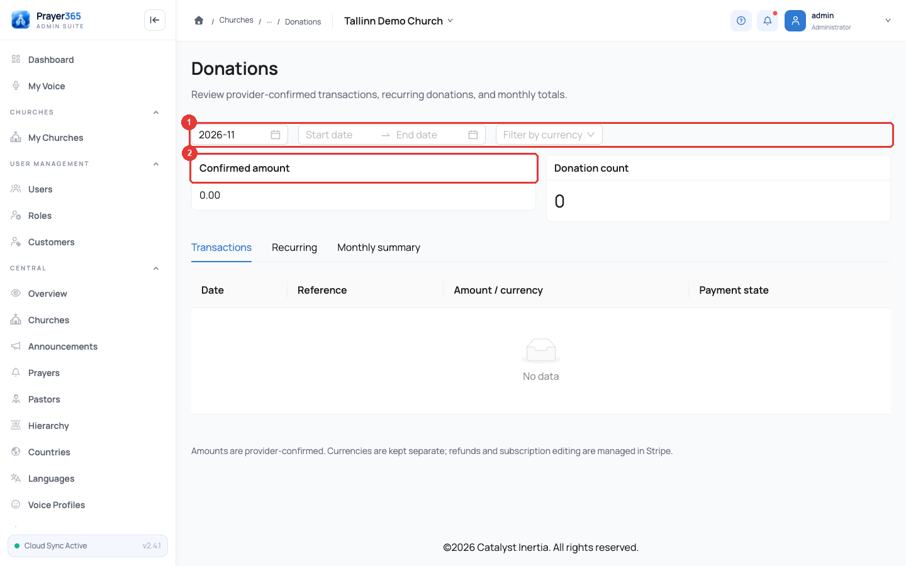
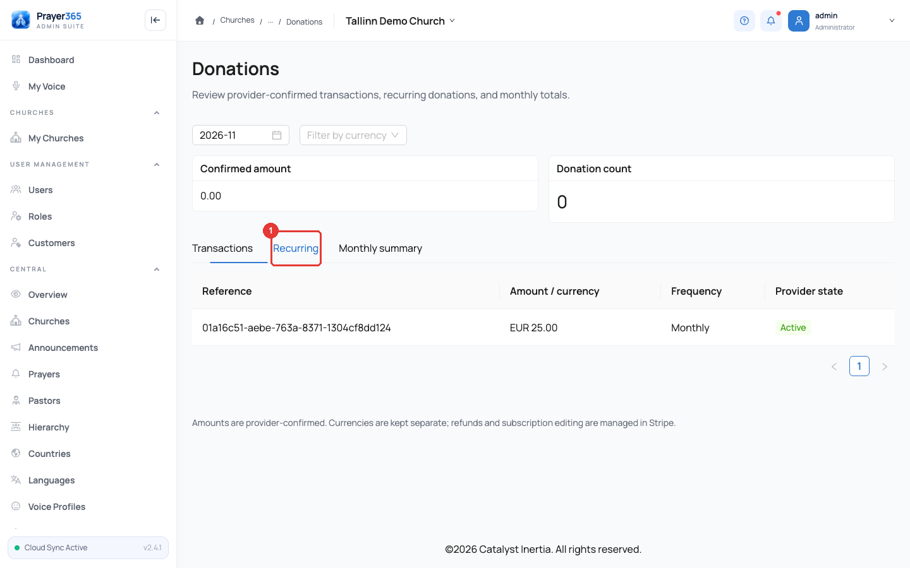
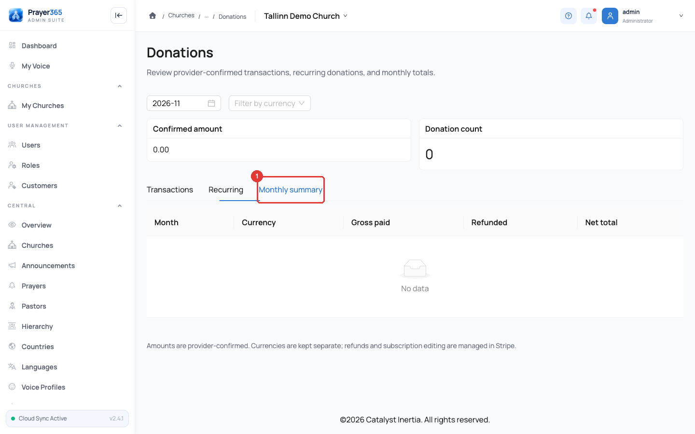

# 10. Donations

> Part of: Admin Guidebook v1.0

## What this page is for

The donations page reports money the payment provider has confirmed for one church: transactions, recurring donations and a monthly summary. It is a reporting screen — money is never edited here.

## Who can use it

| Role                             | Can do                                                                               |
| -------------------------------- | ------------------------------------------------------------------------------------ |
| Church admin with finance rights | Read the church's donations                                                          |
| Central / super admin            | Read any church's donations, and the all-church report under **CENTRAL → Donations** |
| Everyone else                    | No access                                                                            |

## Before you start

- Open the church, then **Church → Donations**. The all-church report is **CENTRAL → Donations** — the same tables, with a Church column and a Type filter.
- Know this rule before reading numbers: **only provider-confirmed amounts count**. In the demo data the seeded donations have no confirmed provider state, so the totals are `0.00` while rows exist in the database. That is correct behaviour, not a bug.
- Filters live in the address bar. Copying the link shares the same tab, month, currency, status and date range.

## Step by step

### Step 1 — Read the header figures

1. **Filter by currency** — amounts in different currencies are never added together.
2. **Confirmed amount** is the sum of confirmed payments in the selected currency.
3. **Donation count** is the number of confirmed payments.

### Step 2 — Read the transactions tab

1. The **Transactions** tab lists **Date, Reference, Amount, Donor, Payment Status** and an action button.
2. **Amount** shows the money on the first line and the currency spelled out under it.
3. **Donor** shows the registered giver's name and email; a gift made without an account shows **Guest**.
4. **Payment Status** is the provider state: Paid, Failed, Refunded or Pending.
5. Use the **status filter** beside the currency filter to narrow the list. The two figures above the table always count confirmed money, so they do not change with it.
6. A row appears only when the provider confirms it.
7. The footer explains where refunds live: _"refunds and subscription editing are managed in Stripe."_

### Step 2b — Open one donation

Click the eye button at the end of a row.

1. The dialog shows the amount, the reference, who gave, the payment date and time (UTC) and the status.
2. **Copy invoice URL** copies the provider's receipt link; it is disabled when the payment has no receipt yet.
3. Close with the X, and nothing is changed.

### Step 3 — Read recurring donations

Open the **Recurring** tab.

1. Columns: **Reference, Amount, Frequency, Provider state** and the same eye button.
2. `Active` means the subscription is running with the provider.
3. Nothing is editable here; changes happen in the provider's dashboard.
4. On the all-church report, the **Type** filter splits Church gifts from Prayer gifts (gifts to the platform itself).

### Step 4 — Read the monthly summary

Open the **Monthly summary** tab.

1. Columns: **Month, Currency, Gross paid, Refunded, Net total**.
2. One row per month per currency.
3. Use it for reporting, not for reconciliation: the provider statement is the source of truth.

## Fields explained

| Field                             | What it means                                    |
| --------------------------------- | ------------------------------------------------ |
| Currency filter                   | Limits all figures to one currency               |
| Status filter                     | Limits the list to Paid, Failed or Refunded rows |
| Confirmed amount                  | Sum of confirmed payments                        |
| Donation count                    | Number of confirmed payments                     |
| Payment state                     | Provider state of the payment                    |
| Donor                             | Registered giver's name and email, or Guest      |
| Invoice URL                       | Provider receipt link for one payment            |
| Frequency                         | One-off or recurring interval                    |
| Gross paid / Refunded / Net total | Monthly totals from the provider                 |

## What changes on the website

Donations are made **on** the website, not published **by** this page. The direction is one-way:

| Where              | What happens                                            |
| ------------------ | ------------------------------------------------------- |
| `/donate` (public) | Visitor chooses an amount and pays through the provider |
| Payment provider   | Confirms the payment and notifies the platform          |
| This page          | Shows the confirmed result                              |

Nothing typed or clicked here reaches a visitor. There is no public donor list and no public amount.

## Common problems

| Symptom                                           | Cause                                  | Fix                                                                     |
| ------------------------------------------------- | -------------------------------------- | ----------------------------------------------------------------------- |
| Totals `0.00` but donations exist in the database | Payments are not provider-confirmed    | Test with a real test-mode payment (chapter 27 links the platform docs) |
| Recurring tab empty                               | No subscription for this church        | Expected on a church with one-off gifts only                            |
| Refund not visible                                | Refunds are managed by the provider    | Refund in Stripe, then wait for the sync                                |
| Currency switch shows different numbers           | Currencies are kept separate by design | Compare per currency, never across                                      |

Next: [11. My Voice](11-my-voice.md)
