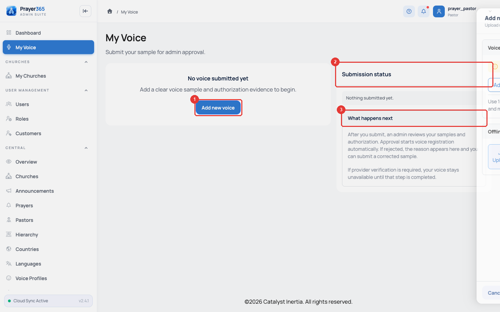
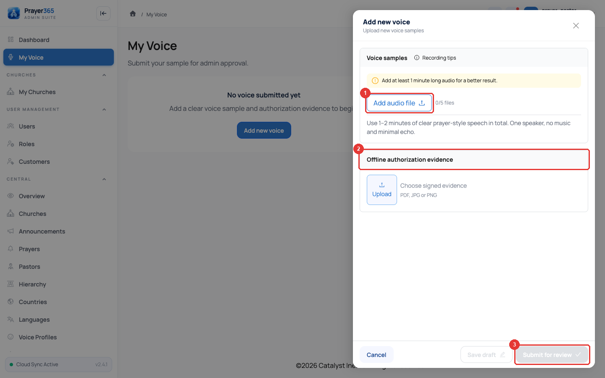

# 11. My Voice

> Part of: Admin Guidebook v1.0

## What this page is for

Prayer audio is generated from a model of the pastor's voice. To create that model the pastor submits voice samples and a signed authorisation. This page is the pastor's own workspace for that submission; a central admin reviews it in chapter 19.

## Who can use it

| Role                     | Can do                                                  |
| ------------------------ | ------------------------------------------------------- |
| Pastor (`prayer_pastor`) | Submit samples, see the status and the rejection reason |
| Church admin             | Cannot submit on behalf of the pastor                   |
| Central admin            | Reviews, does not submit (chapter 19)                   |

## Before you start

- Sign in as the pastor account. The menu item is **My Voice** at the top of the sidebar.
- Prepare: 1–2 minutes of clear prayer-style speech in total, one speaker, no music, minimal echo.
- Prepare the signed consent document as PDF, JPG or PNG.

## Step by step

### Step 1 — Check the current state

1. The header explains the purpose: _"Submit your sample for admin approval."_
2. **No voice submitted yet** means nothing has been sent.
3. **Submission status** stays empty until the first submission.
4. **What happens next** explains the flow: an admin reviews samples and authorisation; approval starts voice registration automatically; a rejection shows the reason here.

### Step 2 — Start a submission

Press **Add new voice**.

1. Read **Recording tips** before recording.
2. Press **Add audio file** and choose your samples. The counter shows the limit (`0/5 files`).
3. Press **Upload** under **Offline authorization evidence** and choose the signed document. Accepted: PDF, JPG, PNG.
4. Press **Save draft** if you want to continue later, or **Submit for review** to send it.

### Step 3 — Follow the review

| Status you see             | What it means                          | What you do                                  |
| -------------------------- | -------------------------------------- | -------------------------------------------- |
| Nothing submitted yet      | No draft or submission exists          | Start a submission                           |
| Submitted / pending review | Waiting for a central admin            | Wait; do not resubmit                        |
| Approved                   | Voice registration started or finished | Nothing                                      |
| Rejected                   | The reason is shown on the page        | Fix the reason and submit a corrected sample |

### Step 4 — Understand the voice states

Voice registration and review states are shown in detail on the central side (chapter 19). For the pastor the important one is **READY**: until the voice is ready, prayers cannot be generated in that voice.

## Fields explained

| Field                          | What it means                                          | Required      |
| ------------------------------ | ------------------------------------------------------ | ------------- |
| Voice samples                  | One to five audio files, 1–2 minutes total recommended | Yes           |
| Offline authorization evidence | Signed consent document (PDF, JPG, PNG)                | Yes           |
| Save draft                     | Keeps the submission private and editable              | No            |
| Submit for review              | Sends the submission to the central queue              | Yes to finish |

## What changes on the website

Nothing directly. The effect appears through prayers:

| Step                                  | Public effect                                         |
| ------------------------------------- | ----------------------------------------------------- |
| Samples submitted                     | None                                                  |
| Admin approves the voice              | Voice registration starts; still nothing public       |
| Voice becomes READY                   | New prayers can now be generated in this voice        |
| A prayer with that audio is published | Visitors hear the pastor's voice on `/prayers/<slug>` |

## Common problems

| Symptom                    | Cause                                           | Fix                                                        |
| -------------------------- | ----------------------------------------------- | ---------------------------------------------------------- |
| Upload refused             | File type not accepted, or too large            | Use MP3/WAV; keep files short                              |
| Submit button does nothing | No consent document attached                    | Attach the signed evidence                                 |
| Status stuck on submitted  | No central admin has reviewed it yet            | Ask the central team to review (chapter 19)                |
| Rejected                   | Quality or consent problem; the reason is shown | Re-record in a quiet room, or replace the consent document |

Next: [12. Staff accounts](12-users.md)
