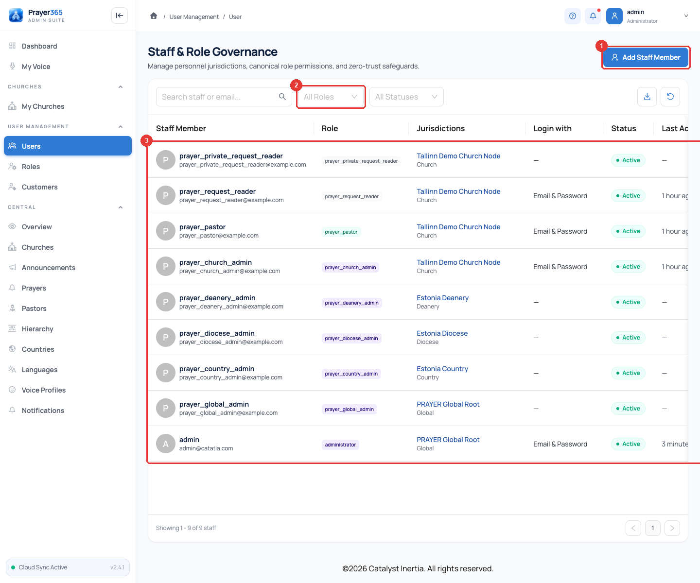
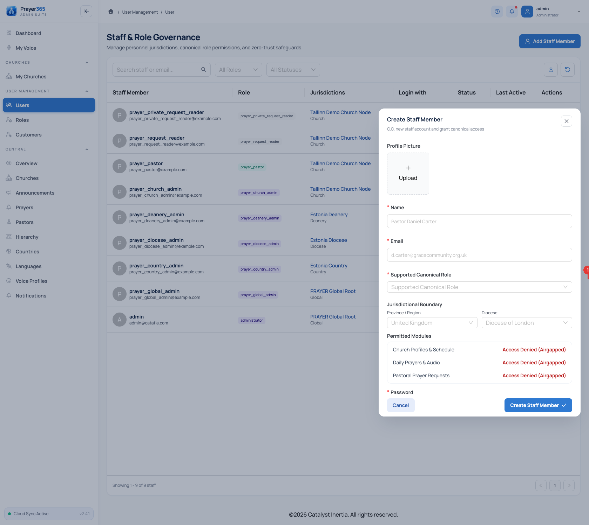

# 12. Staff accounts

> Part of: Admin Guidebook v1.0

## What this page is for

Staff accounts are the people who work inside the dashboard. This page creates them, gives them a role, binds them to a part of the organization, and switches individual modules on or off.

## Who can use it

| Role                          | Can do                               |
| ----------------------------- | ------------------------------------ |
| Super admin (`administrator`) | Create and edit staff accounts       |
| Central staff                 | Read the list for their scope        |
| Church staff                  | No access to other people's accounts |

## Before you start

- Know the person's role before you start (chapter 02). A role is required.
- Know the jurisdiction: a church, a deanery, a diocese, a country, or the global root.
- Have a temporary password ready to hand over. There is no self-registration.

## Step by step

### Step 1 — Open the staff list

Go to **User Management → Users**.

1. The page header explains the purpose: _"Manage personnel jurisdictions, canonical role permissions, and zero-trust safeguards."_
2. Use **All Roles** and **All Statuses** to filter.
3. Columns: **Staff Member, Role, Jurisdictions, Login with, Status, Last Active, Actions**.
4. The footer counts the rows: _"Showing 1 - 9 of 9 staff"_.

### Step 2 — Create a staff member

Press **Add Staff Member**.

1. Upload a **Profile Picture** (optional) and type the **Name**.
2. Type the **Email**. This is the sign-in address, so it must be correct.
3. Choose the **Supported Canonical Role** (chapter 02 lists all ten).
4. Set the **Jurisdictional Boundary**: **Province / Region** and **Diocese** (or the church node, depending on the role).
5. Review **Permitted Modules**: each module shows either a grant or `Access Denied (Airgapped)`. Turn on only what the person needs.
6. Type the **Password** twice.
7. Press **Create Staff Member**.

### Step 3 — Hand over the account

1. Send the email and the temporary password through a separate channel (for example password in person, email address by mail).
2. Ask the person to sign in and change the password immediately.
3. The row shows **Last Active** so you can confirm they got in.

### Step 4 — Edit an existing account

Press **Edit** on a row to change the role, the jurisdiction, the permitted modules, or to deactivate the account.

## Fields explained

| Field                       | What it means                                  | Required  |
| --------------------------- | ---------------------------------------------- | --------- |
| Profile Picture             | Avatar in lists and headers                    | No        |
| Name                        | Display name, also used in the audit trail     | Yes       |
| Email                       | Sign-in address                                | Yes       |
| Supported Canonical Role    | The single role of the account                 | Yes       |
| Jurisdictional Boundary     | Org node the account is bound to               | Yes       |
| Permitted Modules           | Per-account module switches on top of the role | No        |
| Password / Confirm Password | Initial credentials                            | Yes       |
| Status                      | Active or inactive                             | Automatic |

## What changes on the website

Nothing. Staff accounts never appear on the public site. There is no public staff directory, and the people in this list are not customers.

| Confusion to avoid      | Reality                                            |
| ----------------------- | -------------------------------------------------- |
| "Add Staff Member"      | Creates a dashboard login, not a website account   |
| Public customer account | Created by the visitor at `/register` (chapter 14) |

## Common problems

| Symptom                                           | Cause                                                  | Fix                                                        |
| ------------------------------------------------- | ------------------------------------------------------ | ---------------------------------------------------------- |
| The new person can sign in but sees nothing       | Wrong jurisdiction, or no church bound                 | Edit the account and set the right jurisdiction            |
| "Access Denied (Airgapped)" on a module they need | The module switch is off                               | Turn the module on and save                                |
| Email already used                                | An account with that address exists                    | Edit the existing account instead of creating a second one |
| Person cannot sign in at all                      | Account created without a password, or status inactive | Re-open the account, reset the password, set status Active |

Next: [13. Roles and permissions](13-roles-and-permissions.md)
