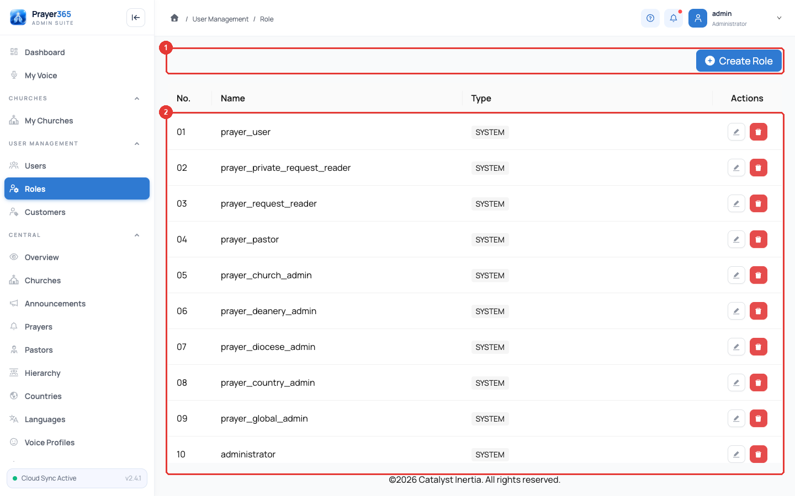
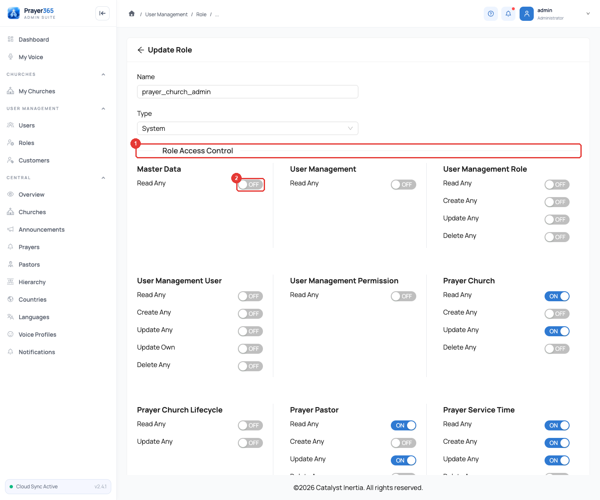
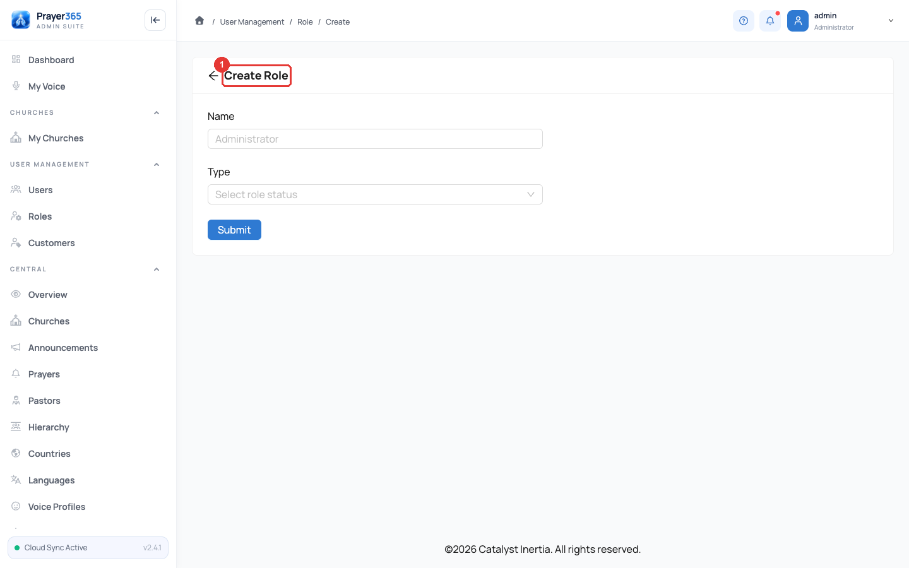

# 13. Roles and permissions

> Part of: Admin Guidebook v1.0

## What this page is for

A role is a named set of permissions. This page lists the roles, shows the full permission tree of one role, and lets a super admin create a new role. The platform ships 88 permissions grouped by subject.

## Who can use it

| Role          | Can do                                                |
| ------------- | ----------------------------------------------------- |
| Super admin   | Read roles, create roles, change a role's permissions |
| Central staff | Read the role list                                    |
| Church staff  | No access                                             |

## Before you start

- Read chapter 02 first: a role is what the staff list assigns to a person.
- Changing a system role affects **every** account that holds it. Prefer a new role over editing a used one.

## Step by step

### Step 1 — Read the role list

Go to **User Management → Roles**.

1. Columns: **No., Name, Type, Actions**.
2. Every listed role has type `SYSTEM`: `prayer_user`, `prayer_private_request_reader`, `prayer_request_reader`, `prayer_pastor`, `prayer_church_admin`, `prayer_deanery_admin`, `prayer_diocese_admin`, `prayer_country_admin`, `prayer_global_admin`, `administrator`.
3. Press **Create Role** to add your own.

### Step 2 — Open one role's permissions

Press a role to open its detail.

1. **Name** and **Type** are shown at the top (`System` for built-in roles).
2. **Role Access Control** lists every subject, for example **Master Data**, **User Management**, **User Management Role**, **User Management User**, **Prayer Church**, **Prayer Church Lifecycle**, **Prayer Pastor**, **Prayer Service Time**, **Prayer Org Node**, **Prayer Prayer**, **Prayer Prayer Review**, **Prayer Prayer Publication**, **Prayer Event**, **Prayer Announcement**.
3. Under each subject you see the actions that exist for it — `Read Any`, `Create Any`, `Update Any`, `Delete Any`, `Update Own` — each with an **ON / OFF** toggle.
4. Change what you need and save.

### Step 3 — Create a role

Press **Create Role** on the list page.

1. Type a **Name** that says what the role is for, for example `prayer_content_editor`.
2. Set the **Type** and the **status** from the dropdowns.
3. Press **Submit**.
4. Open the new role and switch on the permissions it needs.

### Step 4 — Use a role safely

| Situation                             | Recommendation                                                                |
| ------------------------------------- | ----------------------------------------------------------------------------- |
| One person needs one extra permission | Give the module grant on the account (chapter 12) instead of editing the role |
| A whole team needs the same rights    | Create a new role and assign it                                               |
| A role is no longer used              | Leave it; deleting a role changes history for old accounts                    |

## Fields explained

| Field    | What it means                                                                   | Required |
| -------- | ------------------------------------------------------------------------------- | -------- |
| Name     | Machine-readable role name                                                      | Yes      |
| Type     | SYSTEM for built-in roles                                                       | Yes      |
| Status   | Whether the role can be assigned                                                | Yes      |
| Subject  | The area the permission belongs to (`Prayer Prayer`, `User Management User`, …) | —        |
| Action   | `Read Any`, `Create Any`, `Update Any`, `Delete Any`, `Update Own`              | —        |
| ON / OFF | Whether the role holds that permission                                          | —        |

## What changes on the website

Nothing directly. Permissions decide what staff can do, and only approved publishes reach the public pages.

| Permission                               | Visible effect                                                                            |
| ---------------------------------------- | ----------------------------------------------------------------------------------------- |
| `Prayer Prayer Publication → Update Any` | Without it, a staff member cannot publish a prayer, so nothing new appears on the website |
| `Prayer Church → Update Any`             | Without it, the public church profile cannot be edited                                    |
| `User Management → Read Any`             | Only affects the dashboard                                                                |

## Common problems

| Symptom                         | Cause                                            | Fix                                                    |
| ------------------------------- | ------------------------------------------------ | ------------------------------------------------------ |
| A staff member cannot publish   | The role lacks the publication permission        | Add it to the role, or grant the module on the account |
| Toggles reset after reload      | The change was not saved                         | Save the role detail, then reload to confirm           |
| A new role shows no permissions | Roles start empty except for their type defaults | Open the role and switch on what it needs              |
| Cannot edit a system role       | It is a built-in role                            | Create a new role instead                              |

Next: [14. Customers](14-customers.md)
