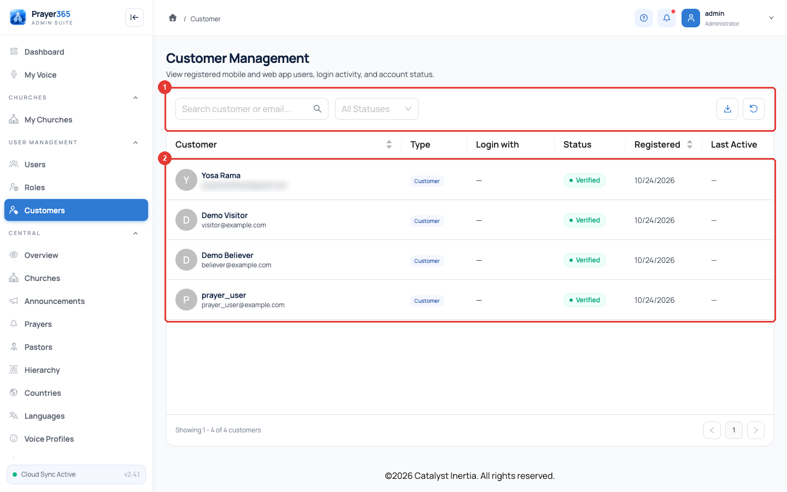

# 14. Customers

> Part of: Admin Guidebook v1.0

## What this page is for

Customers are the people who signed up on the website or in the mobile app. This page shows who they are, how they sign in, and whether their account is verified. It is a read-and-check screen: customers are not staff.

## Who can use it

| Role          | Can do                 |
| ------------- | ---------------------- |
| Super admin   | Read the customer list |
| Central staff | Read for their scope   |
| Church staff  | No access              |

## Before you start

- Sign in as a super admin.
- Keep the two lists apart: **Users** (chapter 12) are staff, **Customers** are the public.

## Step by step

### Step 1 — Open the customer list

Go to **User Management → Customers**.

1. The header explains the scope: _"View registered mobile and web app users, login activity, and account status."_
2. Use **All Statuses** to filter, for example verified only.
3. Columns: **Customer, Type, Login with, Status, Registered, Last Active**.
4. The footer counts the rows.

### Step 2 — Read a row

| Column                   | What it tells you                                                |
| ------------------------ | ---------------------------------------------------------------- |
| Customer                 | Display name and email                                           |
| Type                     | `Customer` for public accounts                                   |
| Login with               | Sign-in method, `—` when it is a social or password-less sign-up |
| Status                   | `Verified` once the email is confirmed                           |
| Registered / Last Active | Dates of sign-up and the last session                            |

### Step 3 — Use the list for support

1. Find the person by email.
2. Check **Status**: an unverified account cannot receive certain notifications.
3. Check **Last Active** to see whether the person really uses the account.

## Fields explained

| Field       | What it means                               |
| ----------- | ------------------------------------------- |
| Customer    | Name and email of the public account        |
| Type        | Account type; `Customer` for the public     |
| Login with  | Sign-in provider recorded for the account   |
| Status      | Verified, or waiting for email confirmation |
| Registered  | Sign-up date                                |
| Last Active | Last successful session                     |

## What changes on the website

Customers are created on the website, not here. This page only reads them.

| Public page     | What the visitor does                                   |
| --------------- | ------------------------------------------------------- |
| `/register`     | Creates the account that appears in this list           |
| `/verify-email` | Confirms the address, which sets **Status** to Verified |
| `/login`        | Member sign-in (chapter 01)                             |
| `/customer`     | The member's own profile area                           |

Editing or deleting a customer is not part of this page in this release. Deactivate or correct an account through the platform administration process, not by editing rows.

## Common problems

| Symptom                                           | Cause                                           | Fix                                                                                |
| ------------------------------------------------- | ----------------------------------------------- | ---------------------------------------------------------------------------------- |
| Person says "I registered but you cannot find me" | Different email, or the sign-up never completed | Search by the exact address, then check `/register` completion                     |
| Status stays unverified                           | The confirmation mail was not opened            | Ask the person to use the link in the mail; resend from the product's support flow |
| A staff member appears in the customer list       | Two accounts with the same address              | Keep them separate: staff accounts are created in chapter 12                       |

Next: [15. Central overview](15-central-overview.md)
