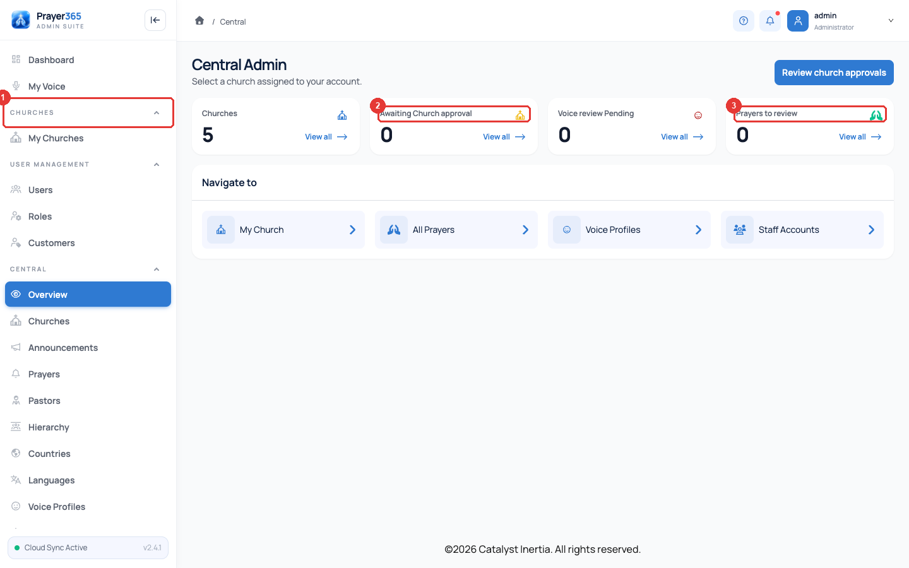

# 15. Central overview

> Part of: Admin Guidebook v1.0

## What this page is for

The central overview is the platform-wide home screen for central staff. It shows how many churches exist, which approvals are waiting, how many voices await review and how many prayers await publication.

## Who can use it

| Role                                       | Can open it                               |
| ------------------------------------------ | ----------------------------------------- |
| Super admin                                | Yes                                       |
| Global / country / diocese / deanery admin | Yes, scoped to their level                |
| Church staff                               | The page opens but shows no platform data |

## Before you start

- Go to **Central → Overview**.
- Understand that these counters are platform-wide, not church-wide. For one church use the church overview (chapter 04).

## Step by step

### Step 1 — Read the counters

| Counter                  | What it counts                           | Where the work happens |
| ------------------------ | ---------------------------------------- | ---------------------- |
| Churches                 | All churches in your scope               | Chapter 16             |
| Awaiting Church approval | Churches created but not approved        | Chapter 16             |
| Voice review Pending     | Voice submissions waiting for a reviewer | Chapter 19             |
| Prayers to review        | Prayers waiting for text or audio review | Chapter 18             |

### Step 2 — Use the shortcuts

The **Navigate to** block links to the four places central staff use most:

| Shortcut       | Opens                                     |
| -------------- | ----------------------------------------- |
| My Church      | The church-scoped dashboard (chapter 04)  |
| All Prayers    | The cross-church prayer list (chapter 18) |
| Voice Profiles | The voice review queue (chapter 19)       |
| Staff Accounts | The staff list (chapter 12)               |

### Step 3 — Decide today's queue

A practical order of work:

1. **Awaiting Church approval** first — a pending church is invisible to the public (chapter 16).
2. **Voice review Pending** next — a prayer cannot get audio until the voice is READY (chapter 19).
3. **Prayers to review** last — them being late only delays publication (chapter 18).

## Fields explained

| Element                  | What it means                                         |
| ------------------------ | ----------------------------------------------------- |
| Churches                 | Total number of churches in your scope                |
| Awaiting Church approval | Churches in Pending state                             |
| Voice review Pending     | Submitted voice profiles not yet approved or rejected |
| Prayers to review        | Prayers with a text or audio step outstanding         |
| View all                 | Opens the full list behind the counter                |
| Navigate to              | Shortcut links, not counters                          |

## What changes on the website

Nothing is published from this page. It is a steering screen: every counter leads to a page that _does_ publish.

| Counter                            | Public effect when you act on it                                 |
| ---------------------------------- | ---------------------------------------------------------------- |
| Awaiting Church approval → approve | The church becomes visible on `/churches` and gets a public page |
| Voice review Pending → approve     | New prayers can be generated in that voice                       |
| Prayers to review → publish        | The prayer appears in the public prayer lists                    |
| Churches                           | No direct effect; it counts what already exists                  |

## Common problems

| Symptom                                     | Cause                                     | Fix                                                         |
| ------------------------------------------- | ----------------------------------------- | ----------------------------------------------------------- |
| Counters show `—`                           | No scope, or still loading                | Reload; if it stays, your role has no platform scope        |
| Counter and list disagree                   | The list is filtered or paginated         | Clear the filters on the list page                          |
| "Select a church assigned to your account." | This screen is church-scoped in your role | Open **Central → Overview** instead of the church dashboard |

Next: [16. Central churches](16-central-churches.md)
