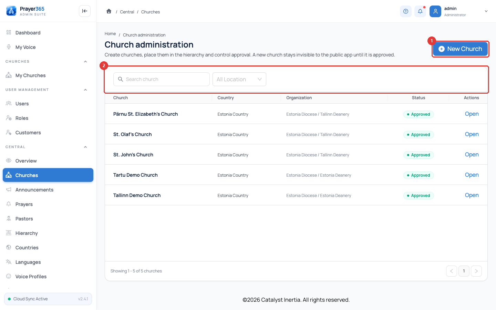
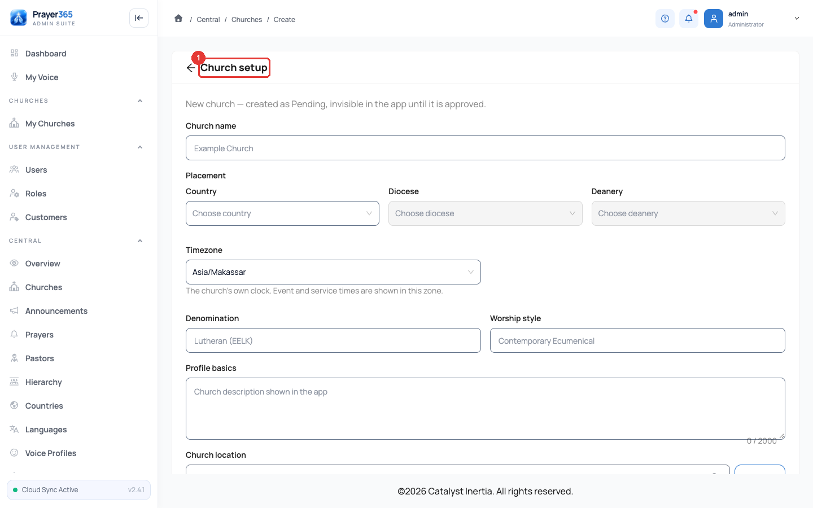
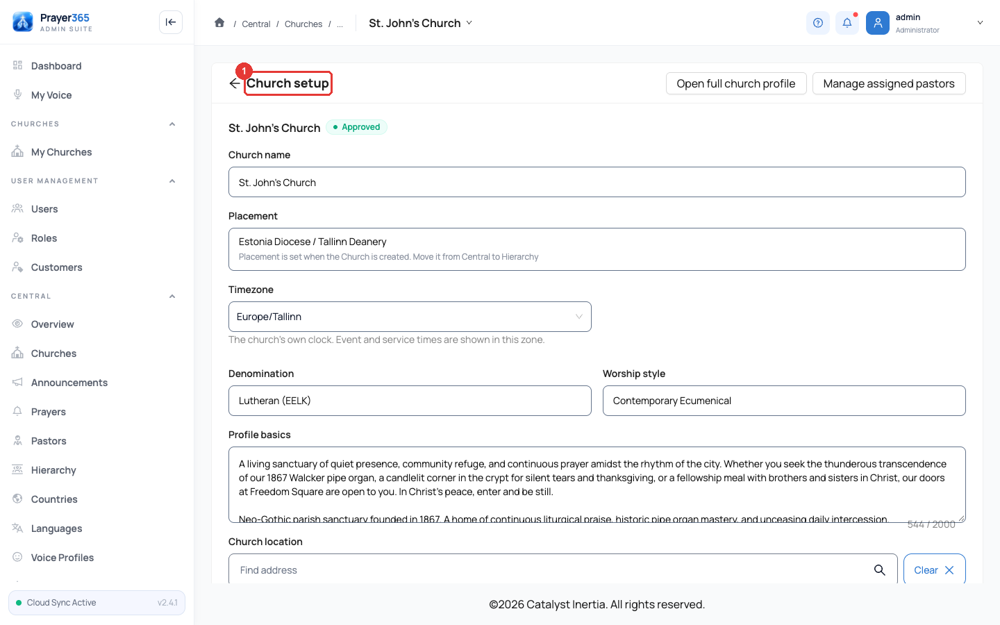

# 16. Central churches

> Part of: Admin Guidebook v1.0

## What this page is for

This is where churches are created and where their lifecycle is controlled. A church is created as **Pending** and stays invisible to the public until it is approved. Later it can be suspended or archived.

## Who can use it

| Role                              | Can do                                                       |
| --------------------------------- | ------------------------------------------------------------ |
| Super admin                       | Create, approve, suspend, archive any church                 |
| Country / diocese / deanery admin | Manage churches inside their scope                           |
| Church staff                      | Read only their own church from the church list (chapter 03) |

## Before you start

- The organization tree must already contain the country, diocese and deanery (chapter 20).
- Have the church name, city and time zone ready.
- **Warning:** **Archive** and **purge** are destructive. Archiving removes the church from public access; purging deletes records. Both are marked in the interface; read the confirmation before pressing.

## Step by step

### Step 1 — Open the church administration list

Go to **Central → Churches**.

1. The subtitle states the rule: _"A new church stays invisible to the public app until it is approved."_
2. Columns: **Church, Country, Organization, Status, Actions**.
3. **All Location** filters by country.
4. The footer counts the rows: _"Showing 1 - 5 of 5 churches"_.

### Step 2 — Create a church

Press **New Church**.

1. Type the **Church name**. It becomes the public name, so spell it as the parish writes it.
2. Set **Placement**: **Country**, **Diocese**, **Deanery**.
3. Check the **Timezone**. The form takes the browser default — change it to the church's own zone (for example `Europe/Tallinn`). Service and event times are shown in this zone.
4. Fill **Denomination** and **Worship style**.
5. Write **Profile basics** (up to 2000 characters).
6. Set **Church location** on the map.
7. Press **Save setup**. The church is created as **Pending**.

### Step 3 — Approve the church

1. Open the church from the list.
2. Confirm the details are correct.
3. Move the status to **Approved**. Only then does the church appear publicly.

### Step 4 — Work inside the church

| Control                   | What it does                                                |
| ------------------------- | ----------------------------------------------------------- |
| Open full church profile  | Jumps to the church profile editor (chapter 05)             |
| Manage assigned pastors   | Jumps to the pastor records (chapter 17)                    |
| Status badge (`Approved`) | Current lifecycle state                                     |
| **Suspend**               | Takes the church out of public view without deleting data   |
| **Archive**               | Removes the church from public access and keeps all records |
| **Save setup**            | Saves the setup fields                                      |

Read the note under the buttons: _"Archiving removes the church from public access while preserving all records."_

### Step 5 — Know the lifecycle states

| State     | Public visible | Typical reason                     |
| --------- | -------------- | ---------------------------------- |
| Pending   | No             | Just created, waiting for approval |
| Approved  | Yes            | Normal, live church                |
| Suspended | No             | Temporary stop, data kept          |
| Archived  | No             | Closed church, records kept        |

## Fields explained

| Field                       | What it means                             | Required |
| --------------------------- | ----------------------------------------- | -------- |
| Church name                 | Public parish name                        | Yes      |
| Country / Diocese / Deanery | Placement in the organization tree        | Yes      |
| Timezone                    | The church's own clock                    | Yes      |
| Denomination                | For example Lutheran (EELK)               | No       |
| Worship style               | For example Contemporary Ecumenical       | No       |
| Profile basics              | Public description, up to 2000 characters | No       |
| Church location             | Map pin and address                       | No       |

## What changes on the website

| Action                   | Public result                                                      |
| ------------------------ | ------------------------------------------------------------------ |
| Church created (Pending) | Nothing. No card, no page                                          |
| Church approved          | Card on `/churches`, page at `/churches/<slug>`                    |
| Setup fields saved       | Name, city, denomination and description update on the public page |
| Church suspended         | Card and page disappear from the public site                       |
| Church archived          | Card and page disappear; records stay in the dashboard             |

This is the single most important rule of the platform: **approval is publication** for a church.

## Common problems

| Symptom                                    | Cause                                       | Fix                                                           |
| ------------------------------------------ | ------------------------------------------- | ------------------------------------------------------------- |
| Church not visible publicly after creation | It is still Pending                         | Approve it                                                    |
| Wrong time zone on services                | The form kept the browser default           | Change the timezone and save, then re-check the service times |
| Cannot pick a deanery                      | The organization tree lacks that node       | Create it in chapter 20 first                                 |
| "Save setup" does nothing                  | A required field is empty (name, placement) | Fill the name and all three placement selects                 |

Next: [17. Pastors](17-central-pastors.md)
