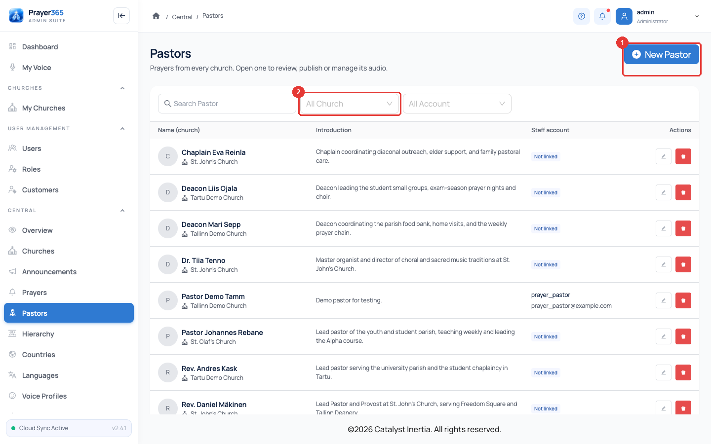

# 17. Pastors

> Part of: Admin Guidebook v1.0

## What this page is for

A pastor record links three things: a person, the church they serve, and (optionally) a staff login. Pastor records are what the church profile shows publicly, and what the prayer form offers when you choose the speaking voice.

## Who can use it

| Role          | Can do                                                         |
| ------------- | -------------------------------------------------------------- |
| Super admin   | Create and edit any pastor                                     |
| Central staff | Manage pastors inside their scope                              |
| Church admin  | Edit the pastors of their church from the profile (chapter 05) |

## Before you start

- The church must exist (chapter 16).
- If the pastor needs a dashboard login, create the staff account first (chapter 12), then link it here.

## Step by step

### Step 1 — Open the pastor list

Go to **Central → Pastors**.

1. Columns: **Name (church), Introduction, Staff account, Actions**.
2. The church name under each pastor is the link to the parish.
3. **Staff account** shows the login when linked (for example `prayer_pastor`) and **Not linked** when the pastor has no dashboard account.
4. Use **All Church** and **All Account** to filter.

### Step 2 — Create a pastor

Press **New Pastor**.

1. Type the name exactly as it should appear publicly.
2. Choose the **Church**.
3. Type the **Role** text, for example `Lead Pastor & Deanery Provost`. This text appears under the name on the public page.
4. Write the **Introduction** — one or two lines.
5. Link the **Staff account** if the pastor signs in to My Voice (chapter 11).
6. Save.

### Step 3 — Check the public result

Open the church page on the website and look at the **Pastoral Care Office** section. The card shows the name, the role text and the introduction you typed.

## Fields explained

| Field         | What it means                         | Required |
| ------------- | ------------------------------------- | -------- |
| Name          | Public pastor name                    | Yes      |
| Church        | The parish the pastor serves          | Yes      |
| Role (text)   | Job title shown under the name        | No       |
| Introduction  | Short public biography                | No       |
| Staff account | Optional dashboard login for My Voice | No       |

## What changes on the website

| Action                           | Public result                                              |
| -------------------------------- | ---------------------------------------------------------- |
| Pastor created with a church     | Card in **Pastoral Care Office** on `/churches/<slug>`     |
| Role text or introduction edited | The card text updates after a refresh                      |
| Staff account linked             | No public change; it only enables My Voice for that person |
| Pastor removed                   | Card disappears from the public page                       |

## Common problems

| Symptom                                 | Cause                                             | Fix                                                         |
| --------------------------------------- | ------------------------------------------------- | ----------------------------------------------------------- |
| Pastor missing from the church page     | No church assigned, or the church is not Approved | Assign the church and approve it (chapter 16)               |
| Pastor cannot open My Voice             | No staff account linked                           | Create the account (chapter 12) and link it here            |
| Name spelled differently on the website | Two records exist for the same person             | Keep one record per pastor; delete or correct the duplicate |

Next: [18. All prayers](18-central-prayers.md)
