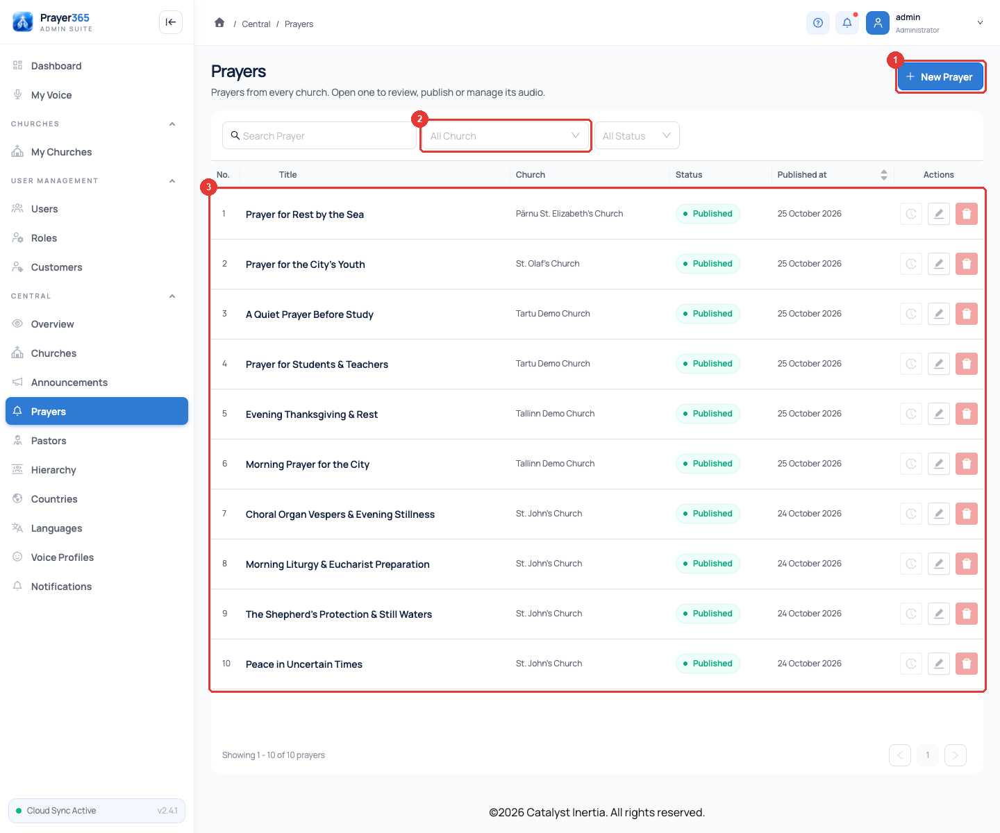

# 18. All prayers

> Part of: Admin Guidebook v1.0

## What this page is for

This is the cross-church prayer list. It answers "what is published across the platform, and what needs review". Writing a prayer works exactly as in chapter 06; this page only changes the scope.

## Who can use it

| Role          | Can do                                                |
| ------------- | ----------------------------------------------------- |
| Super admin   | Read and manage every prayer                          |
| Central staff | Same, inside their scope                              |
| Church admin  | Reads only the church list (chapter 06), not this one |

## Before you start

- Go to **Central → Prayers**.
- Know the difference: the church prayer page works inside one church; this page collects them all and adds a **Church** column.

## Step by step

### Step 1 — Open the list

1. The subtitle states the purpose: _"Prayers from every church. Open one to review, publish or manage its audio."_
2. Columns: **No., Title, Church, Status, Published at, Actions**.
3. Filter with **All Church** and **All Status**.
4. The footer counts all rows: _"Showing 1 - 10 of 10 prayers"_ in the demo data.

### Step 2 — Compare with the church list

| Church prayer list (chapter 06) | This page                         |
| ------------------------------- | --------------------------------- |
| One church only                 | Every church in your scope        |
| Tabs for current and archive    | Status filter `Published` / draft |
| No church column (implicit)     | **Church** column is explicit     |
| Reached from the church menu    | Reached from **Central**          |

### Step 3 — Review a prayer

Press the row action to open the prayer. The editor is the same as chapter 06:

1. **Text** tab — read and correct the text.
2. **Audio & Publication** tab — check the review state, generate or approve audio, then publish or schedule.

### Step 4 — Keep the queue empty

The counter **Prayers to review** on the central overview (chapter 15) counts what is waiting here. A prayer waits when:

| Waiting on                     | Fix                                         |
| ------------------------------ | ------------------------------------------- |
| Text review not approved       | Open the prayer, **Review text → Approved** |
| No audio yet                   | Generate the audio (voice must be READY)    |
| Audio not approved             | Listen, then approve                        |
| Publication date in the future | Nothing to do; wait for the date            |

## Fields explained

| Column       | What it means                                   |
| ------------ | ----------------------------------------------- |
| No.          | Row number in the current page                  |
| Title        | Prayer title                                    |
| Church       | The parish that owns the prayer                 |
| Status       | `Published` or draft                            |
| Published at | Publication date shown as a day, month and year |
| Actions      | Open the prayer editor                          |

## What changes on the website

Same rules as chapter 06, applied across all churches:

| Action here                     | Public result                                                          |
| ------------------------------- | ---------------------------------------------------------------------- |
| Publish a prayer                | Appears on that church's page, on `/prayers`, and on `/prayers/<slug>` |
| Approve audio                   | The player on the public page serves the approved audio                |
| Edit text of a published prayer | Nothing changes publicly until the new version is published            |
| Leave a prayer in draft         | Nothing public                                                         |

## Common problems

| Symptom                                           | Cause                                                  | Fix                                                      |
| ------------------------------------------------- | ------------------------------------------------------ | -------------------------------------------------------- |
| A prayer does not appear here                     | It belongs to a church outside your scope              | Filter by church; if absent, your role scope is narrower |
| Church column shows an unexpected parish          | The prayer was created from a different church context | Open it and check the breadcrumb                         |
| Publish button missing                            | Your role has no publication permission                | Chapter 13 explains the permission                       |
| Counter says "to review" but the list looks clean | The counter includes audio review, not only text       | Open the prayers whose audio is not approved             |

Next: [19. Voice profiles](19-central-voice-profiles.md)
