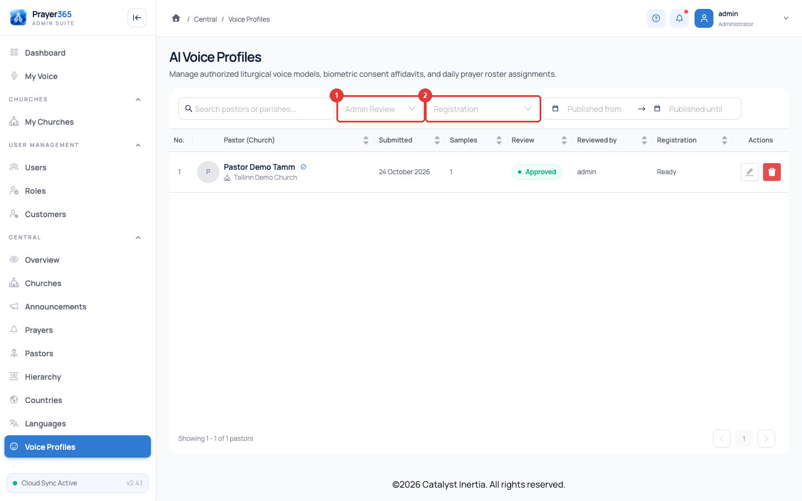
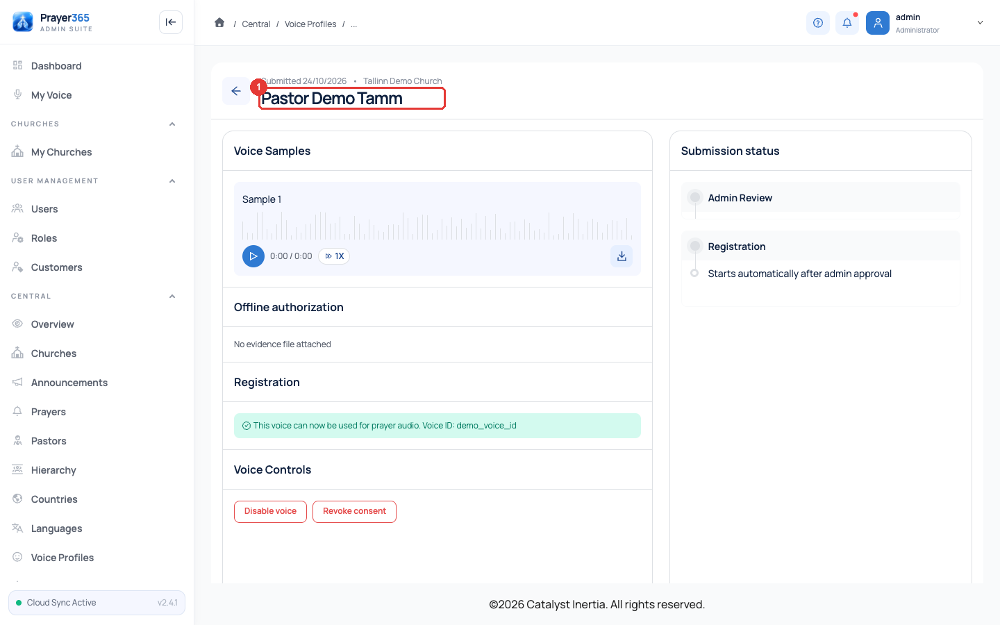

# 19. Voice profiles

> Part of: Admin Guidebook v1.0

## What this page is for

A voice profile is the model that speaks prayers in a pastor's voice. This page is the central review queue: it shows what was submitted, plays the samples, shows the consent evidence, and reports whether the voice is registered with the provider.

## Who can use it

| Role          | Can do                                           |
| ------------- | ------------------------------------------------ |
| Super admin   | Review, approve, reject, disable, revoke consent |
| Central staff | Review inside their scope                        |
| Pastor        | Sees only their own submission (chapter 11)      |

## Before you start

- A pastor must have submitted samples and a signed consent document (chapter 11).
- Listen to the samples in a quiet room; the decision is about quality and consent, not speed.

## Step by step

### Step 1 — Open the review queue

Go to **Central → Voice Profiles**.

1. The header explains the purpose: _"Manage authorized liturgical voice models, biometric consent affidavits, and daily prayer roster assignments."_
2. Two tabs: **Admin Review** and **Registration**.
3. Columns: **No., Pastor (Church), Submitted, Samples, Review, Reviewed by, Registration, Actions**.
4. One row per pastor who submitted.

### Step 2 — Open a submission

Press the row action.

Read the page top to bottom:

| Block                 | What it tells you                                      |
| --------------------- | ------------------------------------------------------ |
| Header                | Submitted date, church, pastor name                    |
| Voice Samples         | One or more audio players; listen to every sample      |
| Offline authorization | The consent document, or _"No evidence file attached"_ |
| Registration          | Provider state and the voice ID once registered        |
| Voice Controls        | **Disable voice**, **Revoke consent**                  |
| Submission status     | **Admin Review** and **Registration** steps            |

### Step 3 — Decide

| Decision       | What happens next                                                           |
| -------------- | --------------------------------------------------------------------------- |
| Approve        | Registration starts automatically with the provider                         |
| Reject         | The reason is shown to the pastor, who can submit a corrected sample        |
| Disable voice  | The voice stops being usable for new prayers                                |
| Revoke consent | The voice is withdrawn; prayers already published keep their existing audio |

### Step 4 — Know the registration states

| State                    | Meaning                                                 |
| ------------------------ | ------------------------------------------------------- |
| Pending review           | Waiting for an admin decision                           |
| Approved                 | Admin accepted samples and consent                      |
| Registering / processing | Provider is creating the model                          |
| Ready                    | Audio can now be generated (the demo row shows `Ready`) |
| Disabled                 | Voice exists but cannot be used                         |
| Revoked                  | Consent withdrawn                                       |

## Fields explained

| Field                 | What it means                            | Required  |
| --------------------- | ---------------------------------------- | --------- |
| Samples               | Audio files uploaded by the pastor       | Yes       |
| Offline authorization | Signed consent document (PDF, JPG, PNG)  | Yes       |
| Review                | Admin decision                           | Yes       |
| Reviewed by           | The admin who decided                    | Automatic |
| Registration          | Provider registration state and voice ID | Automatic |
| Voice Controls        | Disable and revoke actions               | —         |

## What changes on the website

Nothing directly; the effect appears through prayer audio.

| Action                           | Public result                                                |
| -------------------------------- | ------------------------------------------------------------ |
| Voice approved and Ready         | New prayers can be generated in this voice                   |
| Prayer published with that audio | Visitors hear the voice on `/prayers/<slug>`                 |
| Voice disabled                   | Existing published audio keeps playing; new generations stop |
| Consent revoked                  | Existing audio keeps playing; no new prayers are recorded    |

## Common problems

| Symptom                                        | Cause                                  | Fix                                                                          |
| ---------------------------------------------- | -------------------------------------- | ---------------------------------------------------------------------------- |
| `No evidence file attached` on an approved row | Consent was never uploaded (demo data) | Ask the pastor to upload it, or re-open the submission                       |
| Registration stuck                             | The provider call failed               | Retry the registration; check the provider key in the platform configuration |
| Prayers still cannot generate audio            | Voice state is not `Ready`             | Finish registration and confirm the state                                    |
| Pastor resubmitted and nothing changed         | A previous submission is still open    | Close the old one first                                                      |

Next: [20. Organization hierarchy](20-organization-hierarchy.md)
