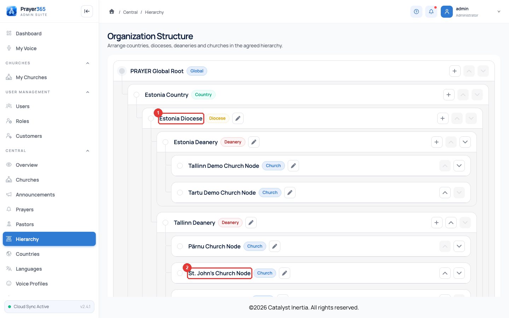

# 20. Organization hierarchy

> Part of: Admin Guidebook v1.0

## What this page is for

The hierarchy is the skeleton of the platform: every church sits inside a deanery, inside a diocese, inside a country, under the global root. Staff jurisdictions, regional reporting and church placement all read from this tree.

## Who can use it

| Role                              | Can do                                |
| --------------------------------- | ------------------------------------- |
| Super admin                       | Create and reorganize any node        |
| Country / diocese / deanery admin | Manage nodes inside their own branch  |
| Church staff                      | Read only; their church node is fixed |

## Before you start

- Understand the five levels before you touch anything: **Global → Country → Diocese → Deanery → Church**.
- A church's placement is set at creation (chapter 16) and moved here, not in the church profile.

## Step by step

### Step 1 — Read the tree

Go to **Central → Hierarchy**.

1. The subtitle explains the purpose: _"Arrange countries, dioceses, deaneries and churches in the agreed hierarchy."_
2. Each card shows the node name and its type: `Global`, `Country`, `Diocese`, `Deanery`, `Church`.
3. Indentation shows the parent. The demo tree is `PRAYER Global Root → Estonia Country → Estonia Diocese → Estonia Deanery / Tallinn Deanery → church nodes`.

### Step 2 — Open a node

1. Press a node card to see its details.
2. The detail shows the node type, its parent, and the children attached to it.

### Step 3 — Add or move a node

1. Add a child node under the correct parent.
2. Type the name exactly as the organization writes it; it appears in selectors across the dashboard.
3. To move a church to another deanery, move its church node, not the church profile.

### Step 4 — Keep the tree honest

| Rule                                                | Why                                        |
| --------------------------------------------------- | ------------------------------------------ |
| One node per real organization unit                 | Duplicates appear twice in every selector  |
| Never delete a node that has churches               | The churches lose their placement          |
| Do not rename a node to fix a typo in a church name | The church name lives in chapter 16 and 05 |

## Fields explained

| Field    | What it means                                  |
| -------- | ---------------------------------------------- |
| Name     | The organization unit name, shown in selectors |
| Type     | Global, Country, Diocese, Deanery or Church    |
| Parent   | The node above it                              |
| Children | Nodes below it (churches for a deanery)        |

## What changes on the website

The hierarchy itself is not public, but it decides who can publish:

| Change                          | Public effect                                                          |
| ------------------------------- | ---------------------------------------------------------------------- |
| Church moved to another deanery | No visible change; the church page stays the same                      |
| Country or diocese renamed      | No visible change in this release                                      |
| Church node removed             | The church loses its placement and may stop being manageable           |
| Staff jurisdiction changed      | Changes what that person can publish, which changes the site over time |

## Common problems

| Symptom                                        | Cause                                      | Fix                                                    |
| ---------------------------------------------- | ------------------------------------------ | ------------------------------------------------------ |
| A deanery is missing in the church create form | The node does not exist under that diocese | Create it here first                                   |
| A church appears under the wrong diocese       | Placement was set at creation              | Move the church node to the correct deanery            |
| A node cannot be deleted                       | It has children or churches attached       | Move or archive the children first                     |
| Two nodes with the same name                   | Duplicate created earlier                  | Keep the one with churches attached; archive the other |

Next: [21. Countries and languages](21-countries-and-languages.md)
