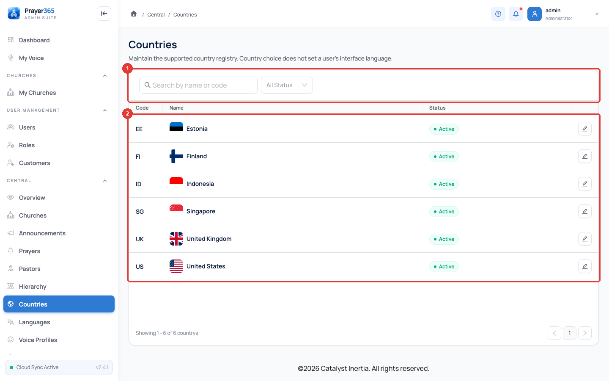
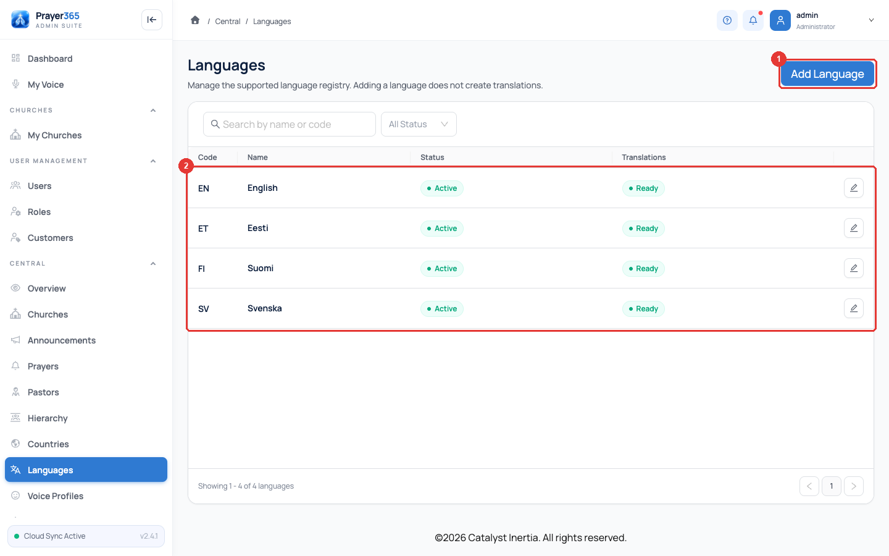

# 21. Countries and languages

> Part of: Admin Guidebook v1.0

## What this page is for

Two small registries that the rest of the platform reads: which countries exist, and which languages exist. Both pages say what they do **not** do — a country does not set a person's interface language, and a language row does not create translations.

## Who can use it

| Role          | Can do                               |
| ------------- | ------------------------------------ |
| Super admin   | Add and edit countries and languages |
| Central staff | Read both registries                 |
| Church staff  | No access                            |

## Before you start

- Read the two footnotes in the interface; they prevent the most common misunderstanding:
  - Countries: _"Country choice does not set a user's interface language."_
  - Languages: _"Adding a language does not create translations."_

## Step by step

### Step 1 — Open the country registry

Go to **Central → Countries**.

1. Columns: **Code, Name, Status**.
2. The demo registry has six countries: `EE` Estonia, `FI` Finland, `ID` Indonesia, `SG` Singapore, `UK` United Kingdom, `US` United States — all **Active**.
3. Use **All Status** to filter.

### Step 2 — Add a country

1. Add a row, type the two-letter **Code** and the **Name**.
2. Set the **Status**.
3. Save. The country now appears in the church create form (chapter 16).

### Step 3 — Open the language registry

Go to **Central → Languages**.

1. Columns: **Code, Name, Status, Translations**.
2. The demo registry: `EN` English, `ET` Eesti, `FI` Suomi, `SV` Svenska — all **Active**, all **Ready** for translations.
3. Press **Add Language** to add a code.

### Step 4 — Understand what "Translations: Ready" means

| Value     | Meaning                                                                                    |
| --------- | ------------------------------------------------------------------------------------------ |
| Ready     | The interface text for that language exists in the product, so the language can be offered |
| Not ready | The language row exists, but there is no interface text yet; do not offer it to users      |

Adding a language row is a registry change only. The public site offers a language switcher with the four languages above; a new code will not appear there until the product carries its texts.

## Fields explained

| Field        | What it means                                   | Required  |
| ------------ | ----------------------------------------------- | --------- |
| Code         | Two-letter ISO code (`EE`, `EN`, `ET` …)        | Yes       |
| Name         | Human readable name                             | Yes       |
| Status       | Active or inactive                              | Yes       |
| Translations | Whether interface text exists for that language | Automatic |
| Add Language | Creates a new language row                      | —         |

## What changes on the website

| Registry change              | Public effect                                                      |
| ---------------------------- | ------------------------------------------------------------------ |
| Country added or renamed     | No public page changes; it becomes selectable for church placement |
| Language activated and ready | The language appears in the public language switcher               |
| Language added but not ready | No public change                                                   |
| Language deactivated         | Removed from the switcher options                                  |

The public site currently serves English, Estonian, Finnish and Swedish policy texts under `src/i18n/policies` — the same four codes in the registry.

## Common problems

| Symptom                                     | Cause                        | Fix                                         |
| ------------------------------------------- | ---------------------------- | ------------------------------------------- |
| New language does not appear on the website | No translations exist for it | Add the texts first; keep the row for later |
| New country not in the church form          | Status inactive              | Set it Active                               |
| Duplicate country code refused              | The code must be unique      | Edit the existing row instead               |

Next: [22. Central announcements](22-central-announcements.md)
