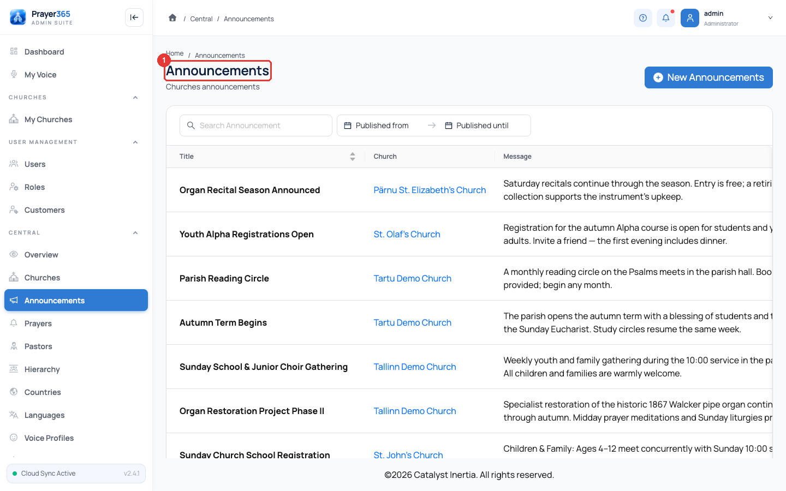
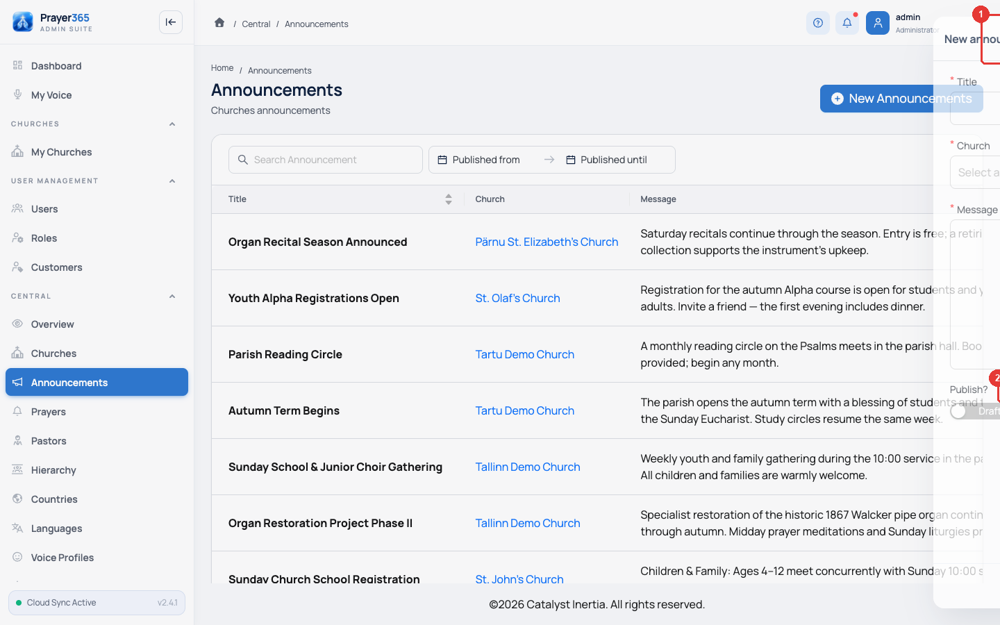

# 22. Central announcements

> Part of: Admin Guidebook v1.0

## What this page is for

This is the platform-wide announcement list. It collects announcements from every church in one table and adds a **Church** column, so a central admin can see what parishes are saying without opening each church.

## Who can use it

| Role          | Can do                                       |
| ------------- | -------------------------------------------- |
| Super admin   | Read and create announcements for any church |
| Central staff | Same, inside their scope                     |
| Church admin  | Uses the church page instead (chapter 08)    |

## Before you start

- Go to **Central → Announcements**.
- Know the difference: a church announcement is written inside one church (chapter 08); this page is the same records with a church selector.

## Step by step

### Step 1 — Open the list

1. The header reads **Announcements** with the subtitle **Churches announcements**.
2. Columns: **Title, Church, Message, Status, Published at, Created at, Actions**.
3. **Published from** and **Published until** filter by date range.
4. The footer counts the rows: _"Showing 1 - 8 of 8 announcements"_ in the demo data.

### Step 2 — Create an announcement for a church

Press **New Announcements**.

1. Type the **Title**.
2. Choose the **Church** from the selector. This is the field that does not exist on the church page — here you must state which parish the news belongs to.
3. Type the **Message** (up to 10000 characters).
4. Set **Publish?** to **Published** or **Draft**.
5. Press **Save Changes**.

### Step 3 — Check the row

1. The new row shows the church name in the **Church** column.
2. **Published at** fills when the row is published; **Created at** keeps the draft moment.
3. Use the row actions to edit or change the publish state.

## Fields explained

| Field                  | What it means                          | Required |
| ---------------------- | -------------------------------------- | -------- |
| Title                  | Headline                               | Yes      |
| Church                 | The parish the announcement belongs to | Yes      |
| Message                | Body text, up to 10000 characters      | Yes      |
| Publish?               | Published or Draft                     | Yes      |
| Published from / until | Date range filter for the list         | No       |

## What changes on the website

| Action                                | Public result                                                      |
| ------------------------------------- | ------------------------------------------------------------------ |
| Announcement published                | Visible to that church's followers in the mobile app               |
| Announcement saved as draft           | Nothing public                                                     |
| Public church page `/churches/<slug>` | No announcements block in this release (verified on the demo data) |
| Church overview in the dashboard      | Shows the latest announcements (staff screen only)                 |

## Common problems

| Symptom                                      | Cause                                         | Fix                                                 |
| -------------------------------------------- | --------------------------------------------- | --------------------------------------------------- |
| Announcement not visible to the congregation | Saved as draft, or the church is not approved | Publish it and check the church status (chapter 16) |
| Wrong church on the row                      | The selector defaulted to the first church    | Edit the row and set the right church               |
| Date filter hides everything                 | The range excludes today                      | Clear **Published from** / **Published until**      |
| Cannot create                                | Your role is read-only for announcements      | Ask for the announcement permission (chapter 13)    |

Next: [23. Notifications](23-central-notifications.md)
