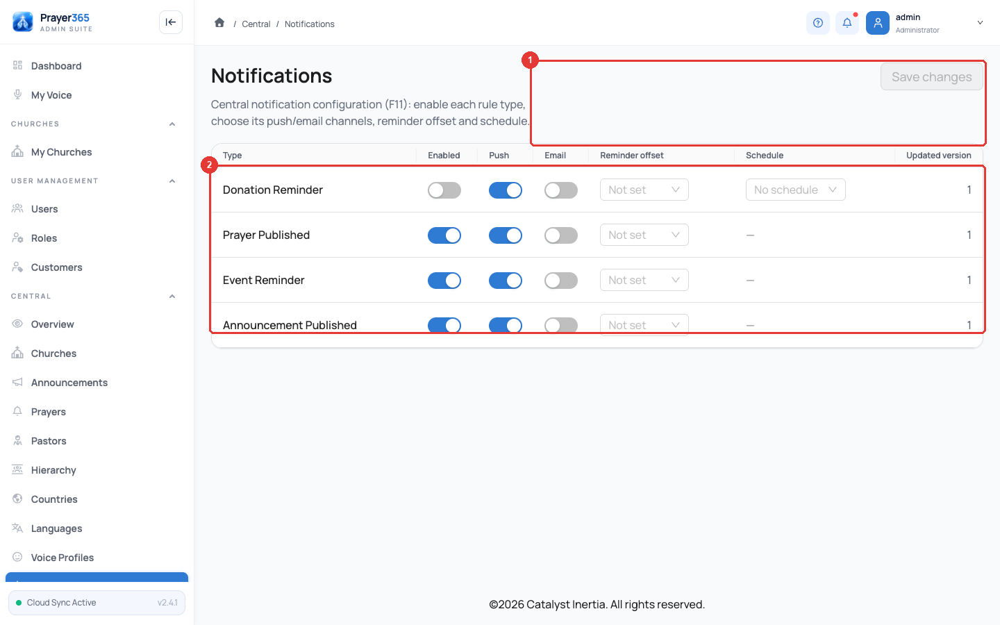

# 23. Notifications

> Part of: Admin Guidebook v1.0

## What this page is for

Notification rules decide which platform events produce a message, on which channel, and with what reminder timing. Four rule types exist: donation reminder, prayer published, event reminder and announcement published.

## Who can use it

| Role          | Can do                        |
| ------------- | ----------------------------- |
| Super admin   | Change the rule configuration |
| Central staff | Read it                       |
| Church staff  | No access                     |

## Before you start

- Go to **Central → Notifications**.
- Remember that a rule can be enabled while a person still receives nothing: personal preferences on the customer side are respected on top of these rules.

## Step by step

### Step 1 — Read the rule table

1. The subtitle explains the scope: _"Central notification configuration (F11): enable each rule type, choose its push/email channels, reminder offset and schedule."_
2. Columns: **Type, Enabled, Push, Email, Reminder offset, Schedule, Updated version**.
3. The four rows are **Donation Reminder**, **Prayer Published**, **Event Reminder** and **Announcement Published**.
4. `Not set` under **Reminder offset** and `No schedule` / `—` under **Schedule** mean defaults are used.

### Step 2 — Change a rule

1. Turn **Enabled** on or off for the rule type.
2. Choose the channels: **Push** and **Email** independently.
3. Set the **Reminder offset** for reminder-type rules (how long before the event or the giving moment).
4. Set a **Schedule** only when the rule must fire at a fixed local time.
5. Press **Save changes**. The **Updated version** counter increases.

### Step 3 — Verify the effect

1. Publish a prayer or an announcement on a test church.
2. Watch the delivery on the receiving side (a test customer account).
3. If nothing arrives, check in this order: rule enabled → channel on → customer preference on → provider keys configured.

## Fields explained

| Field           | What it means                                | Required  |
| --------------- | -------------------------------------------- | --------- |
| Type            | The event that triggers a notification       | —         |
| Enabled         | Master switch for the rule type              | Yes       |
| Push            | Send as a mobile push notification           | No        |
| Email           | Send as an email                             | No        |
| Reminder offset | How long before the event the reminder fires | No        |
| Schedule        | Fixed local send time                        | No        |
| Updated version | Increments on each save                      | Automatic |

## What changes on the website

Notifications are not published on the website. They are sent to app and mail recipients.

| Rule                   | What the recipient gets                                           |
| ---------------------- | ----------------------------------------------------------------- |
| Prayer Published       | A message when a new prayer is published for a church they follow |
| Announcement Published | A message when the church posts news                              |
| Event Reminder         | A reminder before an event they registered for                    |
| Donation Reminder      | A reminder about giving, only for people who opted in             |

A person who disabled a notification type in their own preferences receives nothing, even when the rule is enabled here.

The daily prayer is the one platform-wide message: it goes to **customers only** — never to pastors, administrators or other staff — and only to customers whose own **Daily Prayer** switch is on. Customers manage that switch themselves on the website at **Customer profile → Notifications** (`/customer/notifications`); the same six switches exist in the mobile app, and both write the same row. The daily-prayer email links to that page from its footer.

## Common problems

| Symptom                                | Cause                                       | Fix                                                                   |
| -------------------------------------- | ------------------------------------------- | --------------------------------------------------------------------- |
| Nothing is delivered                   | Rule disabled, or both channels off         | Enable the rule and at least one channel                              |
| Push works, email does not             | Mail worker or mail identity not configured | Check the mail configuration on the platform side                     |
| Reminder arrives too early or too late | Offset in the wrong unit                    | Set the offset and save, then test once                               |
| Counter does not change after save     | The save failed                             | Press **Save changes** again and confirm the version number increased |

Next: [24. Master data — brand and colour](24-master-data-brand.md)
