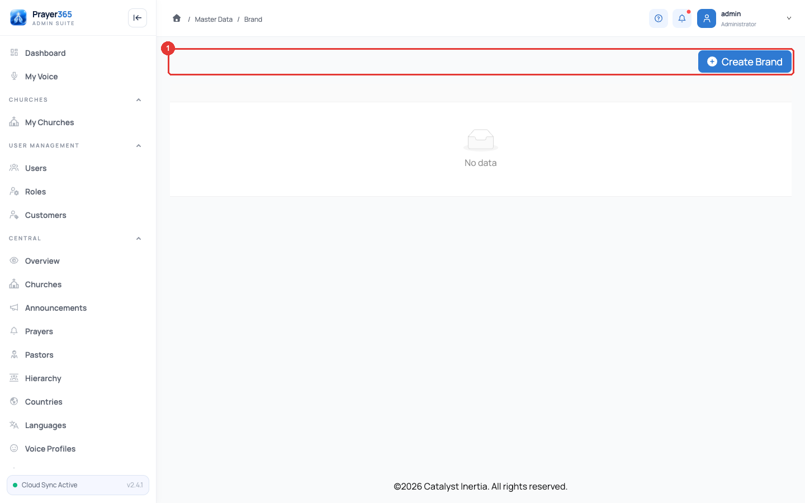
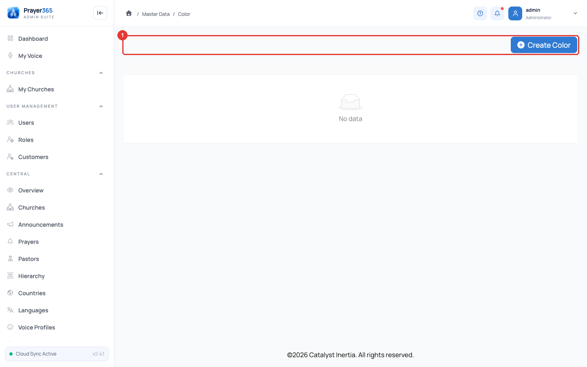

# 24. Master data — brand and colour

> Part of: Admin Guidebook v1.0

## What this page is for

Two registries that were built to hold brand identity and colour palettes: **Master Data → Brand** and **Master Data → Colour**. In this release both are empty, and the live colours and logo of the product come from build-time configuration instead. This chapter states exactly what each place does, so nobody edits the wrong one.

## Who can use it

| Role          | Can see the pages | Can change the live theme            |
| ------------- | ----------------- | ------------------------------------ |
| Super admin   | Yes               | Only through the build configuration |
| Central staff | Yes               | No                                   |
| Church staff  | No                | No                                   |

## Before you start

- Go to **Master Data → Brand** or **Master Data → Colour**.
- Read this before planning a rebrand: the theme in production is produced by the style step of the build (see _What changes on the website_ below). The two registries do not write into it yet.

## Step by step

### Step 1 — Open the brand registry

1. The page header is **Brand**.
2. A **Create Brand** button sits at the top.
3. The table is empty: the demo database contains no brand rows.

### Step 2 — Open the colour registry

1. The page header is **Color**.
2. A **Create Color** button sits at the top.
3. The table is empty for the same reason.

### Step 3 — Know where the live theme really comes from

At the start of every dev run and every build, the project regenerates `src/styles/_variables.scss` from these environment values:

| Variable                      | What it colours        |
| ----------------------------- | ---------------------- |
| `NEXT_PUBLIC_PRIMARY_COLOR`   | Primary brand colour   |
| `NEXT_PUBLIC_SECONDARY_COLOR` | Secondary colour       |
| `NEXT_PUBLIC_ACCENT_COLOR_1`  | First accent           |
| `NEXT_PUBLIC_ACCENT_COLOR_2`  | Second accent          |
| `NEXT_PUBLIC_BLACK_COLOR`     | Text and dark surfaces |
| `NEXT_PUBLIC_WHITE_COLOR`     | Light surfaces         |

The command is `bun run style-init`, and it runs automatically inside `bun run dev` and `bun run build`.

### Step 4 — Use the pages correctly today

| You want to…                     | Do this                                                                         |
| -------------------------------- | ------------------------------------------------------------------------------- |
| Change the product colour        | Change the environment variables, then rebuild (`bun run build`) or restart dev |
| Keep a record of a brand variant | Not possible in this release — the registries are empty and unwired             |
| Change a church's own colours    | Not supported; colours are platform-wide                                        |

## Fields explained

| Element      | What it means                                       |
| ------------ | --------------------------------------------------- |
| Create Brand | Opens the brand form; the registry has no rows yet  |
| Create Color | Opens the colour form; the registry has no rows yet |
| No data      | The registry is empty in this environment           |

## What changes on the website

| Action                                             | Public result                                                                               |
| -------------------------------------------------- | ------------------------------------------------------------------------------------------- |
| A brand or colour row created here                 | **No change on the website in this release** — the registry is not read by the public theme |
| Environment colour variables changed, then rebuilt | Every page of the dashboard and the website takes the new palette                           |
| Logo / favicon change                              | Applied through the project assets and a rebuild, not through these pages                   |

This is the honest state of the feature: the screens exist, the wiring to the public theme does not. Treat colour as a build configuration task, and tell the client the same thing.

## Common problems

| Symptom                                     | Cause                                                    | Fix                                                                          |
| ------------------------------------------- | -------------------------------------------------------- | ---------------------------------------------------------------------------- |
| Colour change does not appear               | Only the environment value was edited, without a rebuild | Rebuild or restart dev; the SCSS file is regenerated at start                |
| Brand page stays empty after creating a row | Not persisted in this release                            | Record the brand outside the platform and raise it with the development team |
| Two developers see different colours        | Different local `.env` values                            | Align the colour variables in both environments                              |

Next: [25. Screens not yet available](25-screens-not-yet-available.md)
