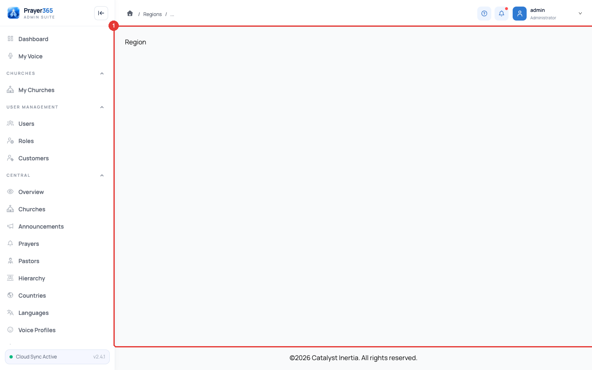
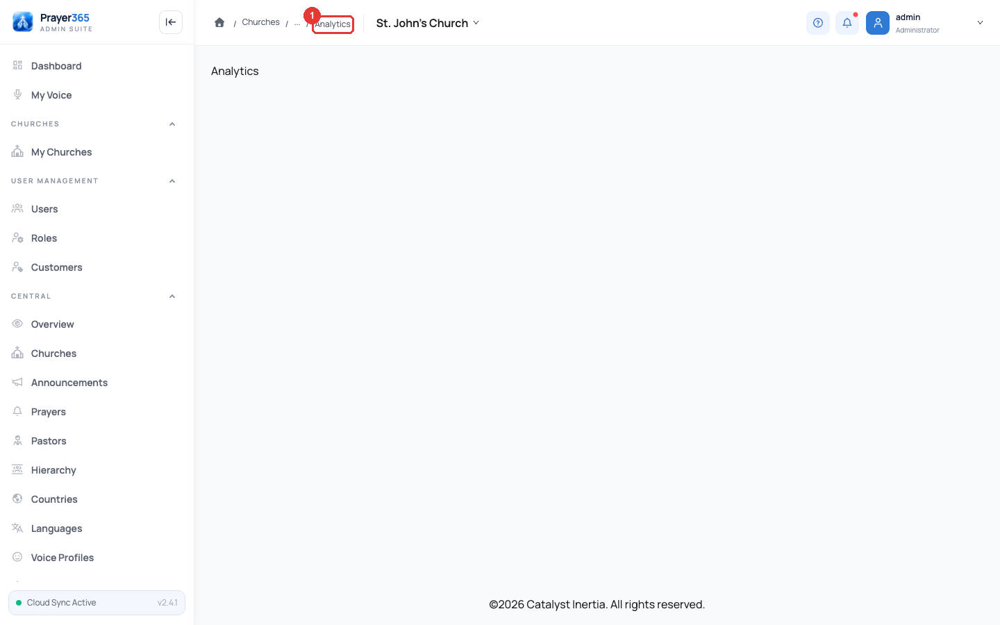

# 25. Screens not yet available

> Part of: Admin Guidebook v1.0

## What this page is for

Two screens are reachable in the navigation but not built in this release. This chapter names them, shows what they render today, and explains what to tell a user who asks for them. It exists so nobody has to guess whether a blank page is a bug or a missing feature.

## Who can use it

| Reader    | Use                                        |
| --------- | ------------------------------------------ |
| All staff | Recognise the two placeholder screens      |
| Trainers  | Answer "why is this page empty?" correctly |
| Client    | Know what is planned, not promised         |

## Before you start

- Both screens are reachable from the church workspace.
- The demo database has data for both areas; the pages still render a single word, because the screens themselves are not implemented.

## Step by step

### Step 1 — Regional dashboard

Open `/dashboard/regions/<regionId>`, for example from a regional account.

1. The page renders the single word **Region**.
2. There are no counters, filters or tables.
3. Nothing can be configured here.

### Step 2 — Church analytics

Open a church and choose **Analytics**.

1. The page renders the single word **Analytics**.
2. Attendance and engagement reporting is not available yet.

### Step 3 — Tell the user the right thing

| User asks                  | Correct answer                                                        |
| -------------------------- | --------------------------------------------------------------------- |
| "Why is the page empty?"   | The screen is a placeholder in this release; it is not a data problem |
| "How do I see attendance?" | Not available yet; use the church overview counters (chapter 04)      |
| "When will it work?"       | Ask the product owner; do not promise a date                          |

## What changes on the website

Nothing. Neither screen publishes anything, and neither has a public counterpart.

| Screen           | Public counterpart |
| ---------------- | ------------------ |
| Region dashboard | None               |
| Church analytics | None               |

## Common problems

| Symptom                              | Cause                                                              | Fix                                      |
| ------------------------------------ | ------------------------------------------------------------------ | ---------------------------------------- |
| Page shows only the word `Region`    | The regional dashboard is a placeholder                            | Expected; no action                      |
| Page shows only the word `Analytics` | The analytics screen is a placeholder                              | Expected; no action                      |
| Another menu item also looks blank   | Check it against the chapter list; if it has no chapter, report it | Report to the product owner with the URL |

Next: [26. Website impact map](26-website-impact-map.md)
