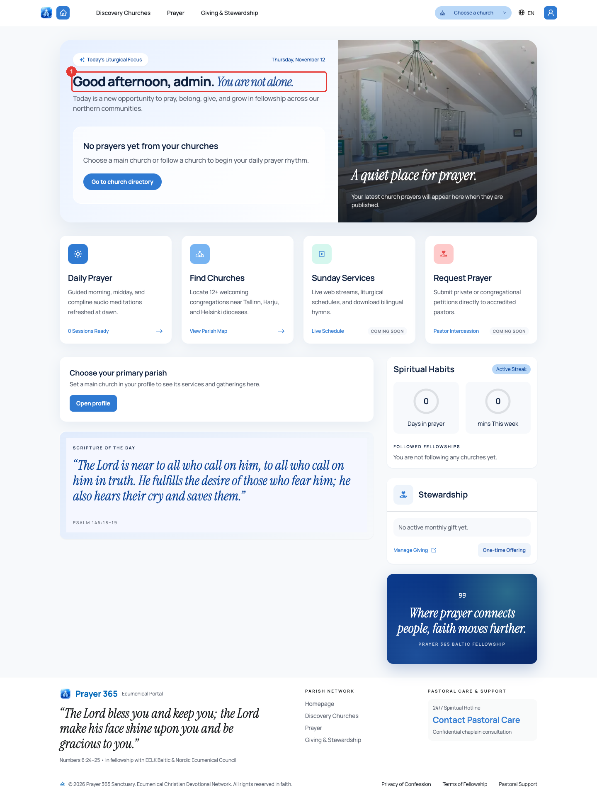
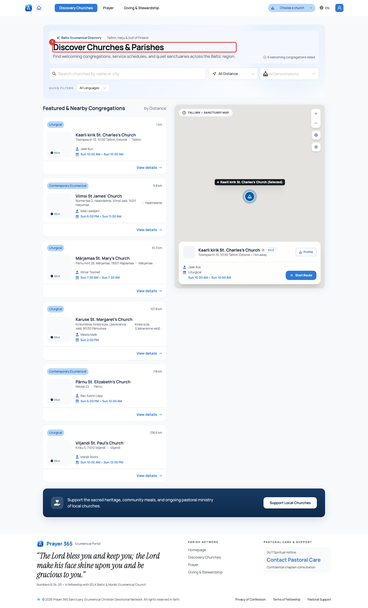
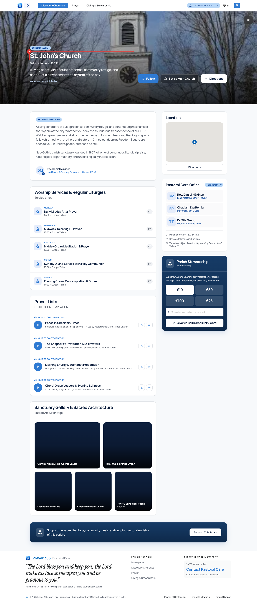
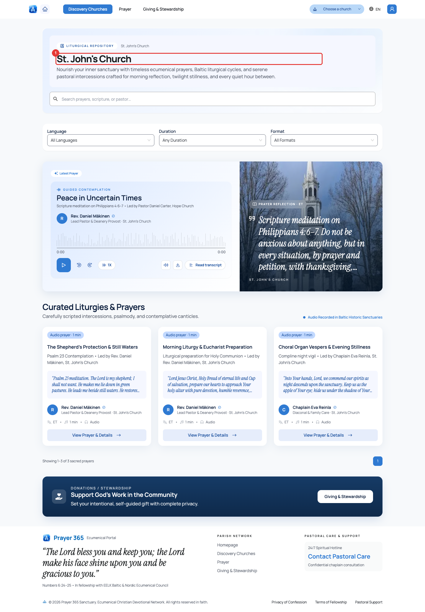
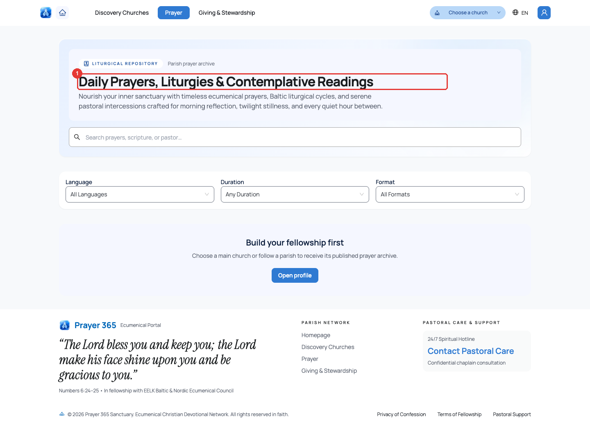
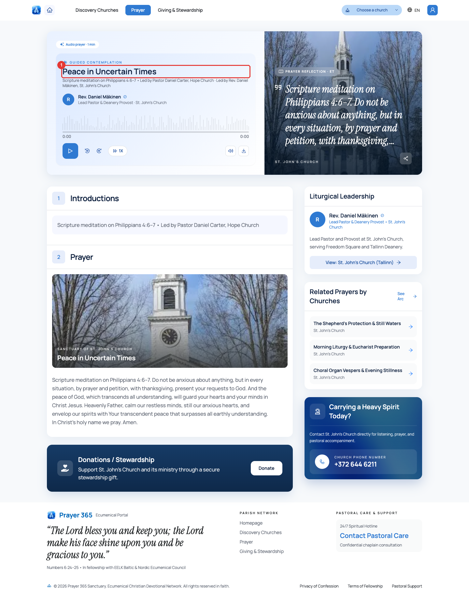
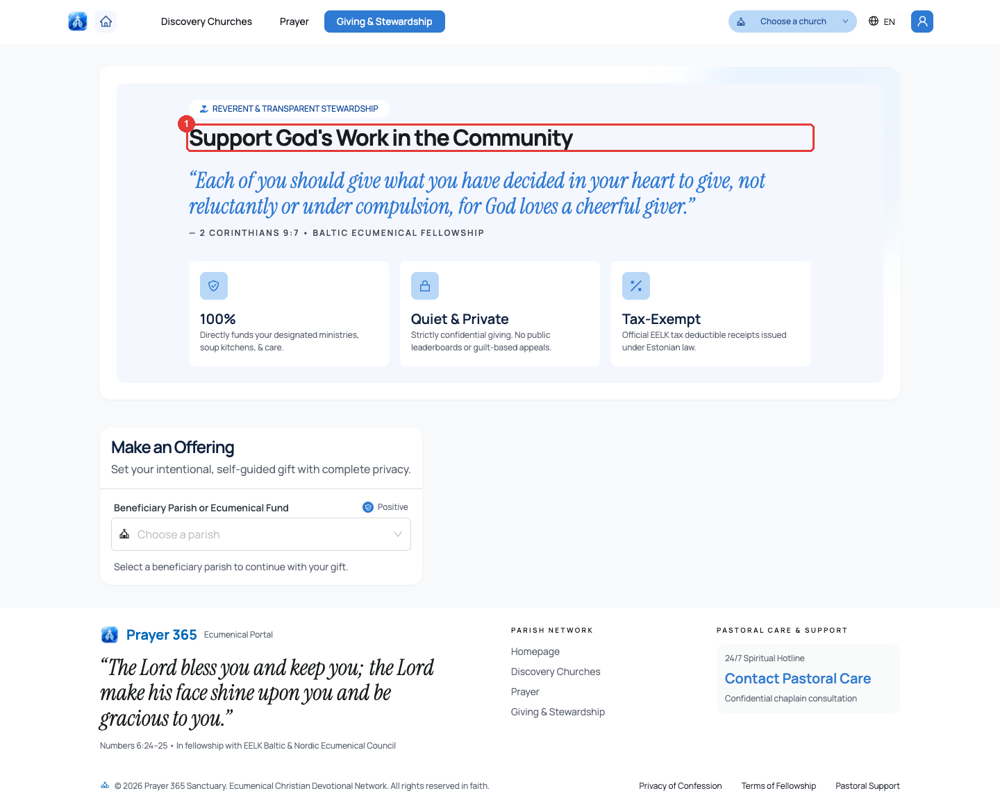

# 26. Website impact map

> Part of: Admin Guidebook v1.0

## What this page is for

One table that answers the question staff ask most: _"If I do this in the dashboard, what changes for the people on the website?"_ Each row is an admin action, the public page it touches, and what a visitor sees.

## Who can use it

| Reader    | Use                                                     |
| --------- | ------------------------------------------------------- |
| All staff | Check the public effect of an action before pressing it |
| Support   | Explain "why can't I see my change yet"                 |
| Client    | Agree what "published" means on each page               |

## Before you start

Know the seven public pages this map uses. All screenshots come from the same demo instance.

| #   | Public page        | Address                    |
| --- | ------------------ | -------------------------- |
| 1   | Home               | `/`                        |
| 2   | Church directory   | `/churches`                |
| 3   | Church profile     | `/churches/<slug>`         |
| 4   | Church prayer list | `/churches/<slug>/prayers` |
| 5   | All prayers        | `/prayers`                 |
| 6   | Prayer detail      | `/prayers/<slug>`          |
| 7   | Donate             | `/donate`                  |

## The map

| #   | Admin action (chapter)                               | Public page                                                                   | What the visitor sees                                    | Delay                   |
| --- | ---------------------------------------------------- | ----------------------------------------------------------------------------- | -------------------------------------------------------- | ----------------------- |
| 1   | Approve a church (16)                                | `/churches`, `/churches/<slug>`                                               | A new church card and a new church page                  | Refresh                 |
| 2   | Suspend or archive a church (16)                     | `/churches`, `/churches/<slug>`                                               | The card and page disappear                              | Refresh                 |
| 3   | Edit church name, description, denomination (05, 16) | `/churches/<slug>`                                                            | New heading, introduction and labels                     | Refresh                 |
| 4   | Edit address, phone, email, social links (05)        | `/churches/<slug>`                                                            | Updated **Location** and **Pastoral Care Office** blocks | Refresh                 |
| 5   | Add or change service times (05)                     | `/churches/<slug>`                                                            | Updated **Worship Services & Regular Liturgies** table   | Refresh                 |
| 6   | Add a pastor or change their role text (05, 17)      | `/churches/<slug>`                                                            | Updated staff cards                                      | Refresh                 |
| 7   | Upload gallery images with captions (05)             | `/churches/<slug>`                                                            | New images in the gallery section                        | Refresh                 |
| 8   | Upload cover or hero image (05)                      | `/churches`, `/churches/<slug>`                                               | New card and hero image                                  | Refresh                 |
| 9   | Publish a prayer (06, 18)                            | `/churches/<slug>`, `/churches/<slug>/prayers`, `/prayers`, `/prayers/<slug>` | New prayer entry with its own page                       | Immediate after publish |
| 10  | Approve the audio of a prayer (06, 18)               | `/prayers/<slug>`                                                             | The audio player plays the approved recording            | Immediate               |
| 11  | Edit the text of a published prayer (06)             | `/prayers/<slug>`                                                             | Nothing until the new version is published               | Publish required        |
| 12  | Create an event (07)                                 | Mobile app only                                                               | Event card with registration button                      | Immediate               |
| 13  | Publish an announcement (08, 22)                     | Mobile app only                                                               | News item for that church                                | Immediate               |
| 14  | Change brand colours (24)                            | Every page                                                                    | New palette after a rebuild                              | Rebuild                 |
| 15  | Activate a ready language (21)                       | Every page                                                                    | New option in the language switcher                      | Refresh                 |
| 16  | Add a country (21)                                   | No public page                                                                | Only selectable when creating a church                   | —                       |
| 17  | Change notification rules (23)                       | No public page                                                                | Push and email behaviour for followers                   | Immediate               |
| 18  | Revenue from a donation (10)                         | `/donate` records the payment; the dashboard shows the total                  | Nothing public; no donor list                            | Provider confirmation   |

## Screenshot walkthrough

### Home

The home page greets the visitor, shows today's liturgical focus and offers prayers and a church chooser. Content comes from published prayers and approved churches.

### Church directory

Every **approved** church appears here as a card. A pending, suspended or archived church never does.

### Church profile

Five public blocks, all fed by chapter 05: worship services, prayer lists, gallery, location, and pastoral care/stewardship. Note what is **not** here in this release: events and announcements.

### Church prayer list

Lists the published prayers of one church. A prayer appears after it is published (chapter 06).

### All prayers

The platform-wide prayer list, across approved churches.

### Prayer detail

One prayer with its audio player. The player serves the approved audio file; the demo file is publicly reachable.

### Donate

The giving page. Payments are confirmed by the provider and then visible in chapter 10 — nothing about a single donation is published.

## Fields explained

| Column                | What it means                                                                                                    |
| --------------------- | ---------------------------------------------------------------------------------------------------------------- |
| Admin action          | The action you take in the dashboard                                                                             |
| Public page           | The page a visitor sees the result on                                                                            |
| What the visitor sees | The visible change                                                                                               |
| Delay                 | `Refresh` = visible on next page load; `Publish required` = needs a second action; `Rebuild` = needs a new build |

## What changes on the website

This chapter _is_ the answer to that question. Two rules summarise it:

1. **Saving a profile field publishes it.** There is no publish button on the church profile.
2. **Content with a lifecycle needs its publish step.** Prayers have text review, audio approval and publication; announcements have draft and published; churches need approval.

## Common problems

| Symptom                                                | Cause                                                               | Fix                                                         |
| ------------------------------------------------------ | ------------------------------------------------------------------- | ----------------------------------------------------------- |
| Staff saved something and the site shows the old text  | Page cached in the browser                                          | Refresh, then hard refresh                                  |
| A prayer is published but missing from the church page | The prayer belongs to another church, or the church is not approved | Check the church of the prayer and the church status        |
| Events and announcements are not on the website        | By design in this release                                           | Use the mobile app; see chapters 07 and 08                  |
| Donation does not appear in the report                 | Payment not confirmed by the provider                               | Wait for confirmation, or test with a provider test payment |

Next: [27. Troubleshooting](27-troubleshooting.md)
