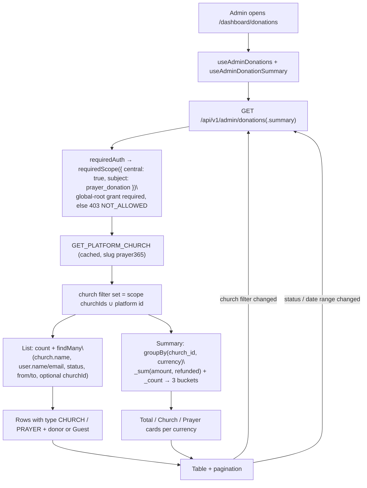

# Dashboard Donations Page (TASK)

| Field          | Value                                                                                                                                                                                           |
| -------------- | ----------------------------------------------------------------------------------------------------------------------------------------------------------------------------------------------- |
| Status         | Ready for implementation planning                                                                                                                                                               |
| Created        | 2026-11-12                                                                                                                                                                                      |
| Repo           | `prayer-365-dashboard` (Next.js 16 + Prisma 7, branch `release/v1.0.0`)                                                                                                                         |
| Owner          | Client (PRAYER 365)                                                                                                                                                                             |
| Source request | Client expectation, 12 Nov 2026: a Dashboard Donations page listing donations for all churches, filterable by church, showing Church Donation and Prayer Donation numbers from public donations |
| Source content | None (no PDF/doc supplied). Page copy is authored; admin UI is English-only (see §5).                                                                                                           |
| Related docs   | `docs/new-feature/public-donation.md` (defines Prayer Donation = gift to PRAYER 365), `docs/STRIPE.md`, `docs/admin/SPEC.md` §8.2 / §9.6, `docs/admin/FEATURE.md` §7                            |

This document is a **task breakdown only**. There is no separate SPEC, DESIGN or FEATURE doc for this
feature; every product rule and technical decision needed to write an implementation plan is inside this
file. Read §4 before planning: the visible numbers are new, but the ledger is not — no new table and no
new money field is introduced.

---

## 1. What is being built

- A new dashboard page at **`/dashboard/donations`**: one list of donations **across all churches**, with a
  **Church** column and a **Type** column (`Church` / `Prayer`).
- Three number blocks at the top, each per currency and per status semantics of the ledger:
  **Total donations**, **Church donations**, **Prayer donations**.
- Filters: **Church**, **date range** (default: this month), **status** (All / Confirmed / Failed / Refunded).
- Donor details on every row: registered donor's **name + email**; a guest/public gift shows **Guest**
  (no contact data is stored — see §12 R4).
- The **existing** per-church page `/dashboard/churches/[churchId]/donations` gets the same two additions:
  a **status filter** and a **donor column**.
- **Prayer Donation** here means exactly what `docs/new-feature/public-donation.md` defines: a gift to the
  PRAYER 365 platform beneficiary (the seeded system church `prayer365`), never a parish.

## 2. Confirmed decisions

Answered by the owner on 12 November 2026. Fixed input for the plan — do not re-open.

| Ref  | Question                                                  | Decision                                                                                                         | Consequence for the build                                                                                                                          |
| ---- | --------------------------------------------------------- | ---------------------------------------------------------------------------------------------------------------- | -------------------------------------------------------------------------------------------------------------------------------------------------- |
| D-01 | What is a "Prayer Donation", and how is it told apart?    | **Prayer Donation = Public Donation** as defined in `docs/new-feature/public-donation.md` — a gift to PRAYER 365 | The split is derived from the beneficiary church row (`prayer365`), **not** from a new type column on `donations`. No schema change to the ledger. |
| D-02 | Which donations are on the page?                          | **All donations across all churches** — including the platform beneficiary                                       | One unfiltered-by-church list; the church filter narrows it.                                                                                       |
| D-03 | What are the "specific numbers"?                          | **Three totals: Total donations, Church donations, Prayer donations**                                            | Summary endpoint returns three buckets; each bucket is per currency (EUR/USD never summed).                                                        |
| D-04 | Which filters?                                            | **Church**, **date range (default this month)**, **status**                                                      | Three query params on both list and summary; `status` affects the list, the money cards stay PAID-based (§2, T-05).                                |
| D-05 | Who may open the page?                                    | **Global Admin and Super Admin only** — no regional or church-level access                                       | Server check is `requiredScope({ central: true })`: a grant at the GLOBAL root only; country/diocese/deanery/church admins get `403 NOT_ALLOWED`.  |
| D-06 | Donor details on guest gifts                              | **Show "Guest"**; the payer's email stays in the Stripe dashboard (no email column)                              | No `donations.donor_email`, no payment-sync change. Registered donors show name + email.                                                           |
| D-07 | Page composition                                          | **Three number blocks + a paginated transaction list** with Church and Type columns                              | No chart, no recurring-subscription tab on this page.                                                                                              |
| D-08 | Should the existing per-church donations page change too? | **Yes** — same status filter and donor column                                                                    | Both pages share the provider/DTO/column work (§8 DD-UPD).                                                                                         |

Technical decisions taken while writing this TASK (recorded openly, not silently applied). Change any of
them only by updating this table.

| Ref  | Decision                                                                                                                                                                                     | Why                                                                                                                                                                                                                                                                                                                                      |
| ---- | -------------------------------------------------------------------------------------------------------------------------------------------------------------------------------------------- | ---------------------------------------------------------------------------------------------------------------------------------------------------------------------------------------------------------------------------------------------------------------------------------------------------------------------------------------- |
| T-01 | Do **not** add a `donation.type`/`purpose` column. Derive the type at read time: `church_id === platformChurchId` → `PRAYER`, else `CHURCH`.                                                 | The beneficiary is already carried by `donations.church_id` (`prisma/schema.prisma:755-775`). A second column would duplicate a fact that can drift; it also avoids a second new concept on top of `public-donation.md`.                                                                                                                 |
| T-02 | Resolve the platform church by slug through the existing/shared `GET_PLATFORM_CHURCH` provider (`PLATFORM_CHURCH_SLUG = 'prayer365'` from `src/config/platform-church.ts`), never an env id. | Row ids differ per environment (staging vs prod); the slug is stable and is already the lookup key chosen by D-15 of `public-donation.md`. A shared module keeps one literal.                                                                                                                                                            |
| T-03 | Do **not** rely on the org tree to include the platform church: the central query unions the platform church id into the church filter explicitly.                                           | `requiredScope` returns `churchIds` by walking **descendant CHURCH nodes of the GLOBAL root** (`src/utils/required-scope.ts:163-186`). The platform row's OrgNode is seeded without a parent country (`public-donation.md` §6.1); if it is not a descendant of the root, every Prayer Donation would vanish from the page with no error. |
| T-04 | New endpoints return **only what the page needs** and are separate from the per-church routes: `GET /api/v1/admin/donations` and `GET /api/v1/admin/donations/summary`.                      | The per-church routes already carry a required `:churchId` path param and a church-scope guard (`src/app/api/v1/admin/churches/[churchId]/donations/route.ts:37-84`); bending them into an all-church read would weaken that guard.                                                                                                      |
| T-05 | The three money cards always aggregate **PAID** rows by `paid_at` (the existing summary semantics); the `status` filter changes only the list.                                               | A "Failed donations" number next to "Total donations" would silently mix money received with money never received. `GET_DONATION_SUMMARY` already uses `paid_at` (`src/providers/donation.tsx:172-203`); the page keeps that meaning and labels the cards accordingly.                                                                   |
| T-06 | Aggregation is **one** `groupBy(['church_id','currency'])` query, bucketed in JS by platform id; no per-currency loop.                                                                       | Three separate queries would triple the round trips for a report that a single grouped query already answers.                                                                                                                                                                                                                            |
| T-07 | Per-currency always. A currency bucket is never summed with another.                                                                                                                         | Existing repo rule (`DonationSummaryRowSchema`, `src/models/donation.tsx:107-129`); public giving is EUR while church giving is not guaranteed to be.                                                                                                                                                                                    |
| T-08 | Donor data is added to the admin donation DTOs only: `donor: { name, email } \| null`. Nothing is added to mobile or site DTOs.                                                              | `DonationRowSchema` (`src/models/donation.tsx:71-89`) is shared with the mobile-facing read rules that forbid donor PII; the new field is admin-only and the mobile routes also never read `user` today.                                                                                                                                 |
| T-09 | The page lives under the existing sidebar **Central** group; no new role or permission subject is added.                                                                                     | `prayer_donation` read already exists and is granted to `prayer_global_admin` (`prisma/seeds/prayer-roles.ts:103-133`). Restrictions come from the central-scope guard, not from a new subject that would need catalogue + role + sidebar wiring in three places.                                                                        |
| T-10 | The church dropdown reuses `useCentralChurches` (`limit: 100`, `order_by: name`) instead of a new options endpoint.                                                                          | One less route. Ceiling is explicit in §12 R2 (more than 100 churches truncates the list).                                                                                                                                                                                                                                               |

## 3. Scope

In scope:

- `src/models/donation.tsx` — `DonationType`, `AdminDonationRow`, `AdminDonationSummary`, status enum, extended list query.
- `src/providers/donation.tsx` — donor + church name on rows, `status` filter, cross-church list, three-bucket summary, platform-church union.
- `src/controller/donation.tsx` — `listAllDonations`, `getDonationSummaryByType`, out-of-scope church rejection.
- `src/app/api/v1/admin/donations/route.ts`, `src/app/api/v1/admin/donations/summary/route.ts` (+ OpenAPI registration).
- `src/hooks/data/donation.tsx` — `useAdminDonations`, `useAdminDonationSummary`.
- `src/app/dashboard/donations/page.tsx`, `src/contents/dashboard/donations/{index.tsx,columns.tsx}`.
- `src/data/sidebar-data.tsx` — "Donations" item under Central.
- Existing per-church page: status filter + donor column (`src/contents/churches/donations/{index.tsx,columns.tsx}`, `src/app/api/v1/admin/churches/[churchId]/donations/route.ts`, hook).
- Tests for all of the above; `docs/STRIPE.md` + `docs/admin/SPEC.md` donor-PII note.

Out of scope (do not build):

- Any new table, any new column on `donations` / `donation_subscriptions`, any data migration.
- The `/give` public page, the system church seed, `churches.is_platform`, the public checkout routes — those belong to
  `docs/new-feature/public-donation.md`. This page only **reads** their result (§4).
- CSV / Excel export, scheduled email reports, charts, recurring-subscription tab, refund actions.
- Refund initiation or any write to the ledger. Read-only feature.
- Regional (country/diocese/deanery) or church-level access to this page.
- Donor email capture for guest gifts (D-06).
- Mobile DTO changes, mobile profile/delete flows, `role_assignments` changes.
- Admin UI translations — the admin surface is English-only today (§5).

## 4. Verified current state (read before planning)

| Area                       | Fact in the repo today                                                                                                                                                                                                                                                                                                                | Consequence for this feature                                                                                                                                                                                                        |
| -------------------------- | ------------------------------------------------------------------------------------------------------------------------------------------------------------------------------------------------------------------------------------------------------------------------------------------------------------------------------------- | ----------------------------------------------------------------------------------------------------------------------------------------------------------------------------------------------------------------------------------- |
| Donation ledger            | `model Donation` has `church_id` (required), `user_id?`, `subscription_id?`, `provider_payment_id` (unique), `amount_minor BigInt`, `currency Char(3)`, `status String`, `paid_at`, `refunded_minor` (`prisma/schema.prisma:755-775`).                                                                                                | Everything the page shows is already stored except the **type**, which is derived (T-01). No migration.                                                                                                                             |
| Donation statuses          | `payment-sync` writes string states `PAID` / `FAILED` / `REFUNDED` and never downgrades a PAID row on a stale failure (`src/providers/payment-sync.tsx:225-274`, `:336`).                                                                                                                                                             | The status filter is a closed 3-value set; the UI can tag every row without a new enum.                                                                                                                                             |
| Platform beneficiary       | Not implemented yet in this repo. It is specified by `docs/new-feature/public-donation.md` D-01/D-15: a seeded church with `slug = 'prayer365'`, `status = APPROVED`, `is_platform = true`, plus `src/config/platform-church.ts` and `GET_PLATFORM_CHURCH`.                                                                           | This feature **depends** on that seed + config module (§12 R1). Until it lands, Prayer Donations are 0 and everything reads as Church.                                                                                              |
| Existing per-church list   | `GET_DONATIONS({ churchIds, query })` filters both count and rows by `churchIds`, selects no donor and no church name (`src/providers/donation.tsx:34-97`).                                                                                                                                                                           | Must be extended (additive select + optional `status`), not duplicated. Existing callers keep working.                                                                                                                              |
| Existing summary           | `GET_DONATION_SUMMARY({ churchIds, month })` groups by currency only, sums gross + refunded (`src/providers/donation.tsx:172-203`); month bounds are UTC and the route requires `?month=YYYY-MM` (422 otherwise).                                                                                                                     | The new page needs a **date range**, not a month string, and a per-church breakdown — so a second provider function, not a widened signature that would break the per-church route.                                                 |
| Existing controller guards | `ensureChurchInScope` throws `404 RESOURCE_NOT_FOUND` when the church is outside the resolved set (`src/controller/donation.tsx:39-52`).                                                                                                                                                                                              | The Church filter reuses it so a stray church id can never widen the read.                                                                                                                                                          |
| Central scope guard        | `requiredScope({ central: true, subject, action })` resolves the GLOBAL root, requires a covering grant (else `403 NOT_ALLOWED`) and returns every descendant CHURCH id (`src/utils/required-scope.ts:46-136`, `:163-206`).                                                                                                           | One call gives "all churches" **and** implements D-05. `prayer_donation` read is granted to global/country/diocese/deanery/church admin roles (`prisma/seeds/prayer-roles.ts:103-176`) — the **node level** is what separates them. |
| Role names                 | Seeded roles are `prayer_global_admin`, `prayer_country_admin`, `prayer_diocese_admin`, `prayer_deanery_admin`, `prayer_church_admin`, `prayer_pastor`, reader roles, `prayer_user` (`prisma/seeds/prayer-roles.ts:103-202`). There is **no** role named "super admin"; admin-created roles pick their own grants in the Role editor. | "Super Admin" in D-05 maps to _any_ role granted at the GLOBAL root — the guard expresses the rule as scope, not as a role list. §12 R3 records the naming gap.                                                                     |
| Sidebar                    | `SidebarMenu()` renders static items with **no permission gating**; the Central group is `src/data/sidebar-data.tsx:68-154`.                                                                                                                                                                                                          | Adding an item needs no gate wiring, but a non-central admin will see the label and then get a 403 (§12 R5).                                                                                                                        |
| Existing church page UI    | `src/contents/churches/donations/index.tsx` has tabs Transactions / Recurring / Monthly summary, month picker, custom range and currency filter; columns live in `columns.tsx` with `PaymentStateTag` + `formatMinorToMajor` reused by the table.                                                                                     | The new page must import `PaymentStateTag` / `formatMinorToMajor` from there instead of re-implementing money formatting.                                                                                                           |
| Hooks                      | `useDonations` / `useDonationSubscriptions` / `useDonationSummary` all take a `churchId` and build `/api/v1/admin/churches/${churchId}/donations…` (`src/hooks/data/donation.tsx:1-120`).                                                                                                                                             | New hooks are needed for the all-church path; the church-scoped ones stay untouched except for the added `status` param.                                                                                                            |
| OpenAPI                    | Every admin route calls `registerPath` **and** is imported by `src/utils/openapi-registrations.ts` (donations at lines 50-52).                                                                                                                                                                                                        | Two new imports; forgetting them leaves the routes out of `/api/v1/openapi.json` with no test failing.                                                                                                                              |
| Church options hook        | `useCentralChurches()` requests `/api/v1/admin/central/churches` with `page: 1, limit: 100, order_by: 'name'` (`src/hooks/data/central.tsx:212-224`).                                                                                                                                                                                 | Usable for the dropdown as-is; ceiling recorded (T-10, R2).                                                                                                                                                                         |
| Admin locale               | Dashboard screens hardcode English labels ("Date", "Amount / currency", "Confirmed") — e.g. `src/contents/churches/donations/columns.tsx:56-95`.                                                                                                                                                                                      | No i18n work in this feature; matching the neighbours is the correct convention.                                                                                                                                                    |
| Money formatting           | `formatMinorToMajor` pads to 3 digits, prints `EUR 12.34` (`src/contents/churches/donations/columns.tsx:5-22`).                                                                                                                                                                                                                       | Reuse; do not use `Intl.NumberFormat` here, or the two pages will disagree on separators.                                                                                                                                           |

## 5. Content inventory

No client document exists. All labels are hardcoded English, matching the admin surface.

| Page element       | Text / key                                                      | Source                                                      |
| ------------------ | --------------------------------------------------------------- | ----------------------------------------------------------- |
| Page title         | "Donations"                                                     | Same word as the sidebar item (D-07)                        |
| Number block 1     | "Total donations"                                               | D-03                                                        |
| Number block 2     | "Church donations"                                              | D-03                                                        |
| Number block 3     | "Prayer donations"                                              | D-03 + `public-donation.md` wording                         |
| Block sub-line     | "{count} transactions"                                          | Count comes from the same groupBy (T-06)                    |
| Filter: church     | "All churches" placeholder                                      | D-04                                                        |
| Filter: date range | "This month" default, month picker + custom range               | Reuses `DatePicker.RangePicker` of the church page          |
| Filter: status     | "All statuses" / "Confirmed" / "Failed" / "Refunded"            | Uppercase values of `PaymentStateTag`                       |
| Table headers      | Date, Church, Type, Donor, Amount / currency, Status, Reference | Type = "Church" / "Prayer"; Donor = name + email or "Guest" |
| Empty state        | "No donations for this filter."                                 | New                                                         |
| Forbidden state    | "This page is only available for platform administrators."      | D-05, shown on the 403 branch (R5)                          |

Rules:

- No currency conversion and no cross-currency total anywhere.
- Never label a guest row with an invented donor; "Guest" is the whole value (D-06).

## 6. Target data model

No new table, no new column, no migration. The read model is a projection of the existing ledger:

```prisma
// prisma/schema.prisma — UNCHANGED. Shown for reference only.
model Donation {
  id                  String   @id @default(uuid(7))
  church_id           String
  church              Church   @relation(fields: [church_id], references: [id])
  user_id             String?
  user                User?    @relation(fields: [user_id], references: [id], onDelete: SetNull)
  provider_payment_id String   @unique
  amount_minor        BigInt
  currency            String   @db.Char(3)
  status              String
  paid_at             DateTime?
  refunded_minor      BigInt   @default(0)
  // …
}
```

Derivation rules:

| Concept      | How it is computed                                                                                          |
| ------------ | ----------------------------------------------------------------------------------------------------------- |
| `type`       | `row.church_id === platformChurchId ? 'PRAYER' : 'CHURCH'` (T-01)                                           |
| `churchName` | `church.name` of the row's church (platform row is named "Prayer 365")                                      |
| `donor`      | `user ? { name, email } : null` (D-06). `user_id` is `null` for guest gifts and is `SetNull` on user delete |
| Money        | `amount_minor` / `refunded_minor` stay `BigInt` in the provider, serialized as strings in the DTO           |
| Buckets      | Total = all rows; Church = rows where `type = CHURCH`; Prayer = rows where `type = PRAYER`                  |

DTO sketch (in `src/models/donation.tsx`):

```ts
export const DonationStatusSchema = z.enum(['PAID', 'FAILED', 'REFUNDED'])
export const DonationTypeSchema = z.enum(['CHURCH', 'PRAYER'])

export type AdminDonationRow = DonationRow & {
  churchId: string
  churchName: string
  type: DonationType
  refundedMinor: string
  donor: { name: string; email: string } | null
}

export type DonationBucket = {
  grossMinor: string
  refundedMinor: string
  netMinor: string
  count: number
}

export type AdminDonationSummary = {
  from: Date
  to: Date
  currencies: Array<{
    currency: string
    total: DonationBucket
    church: DonationBucket
    prayer: DonationBucket
  }>
}
```

## 7. Flow



## 8. Task breakdown

Legend: ✔ done · ☐ pending.

### DD-API — Models, providers, controllers, routes

| ID        | Task                                                                                                                                                                                                                                                                                                                                                                                                                               | Acceptance hint                                                                                                                                                                               | Done |
| --------- | ---------------------------------------------------------------------------------------------------------------------------------------------------------------------------------------------------------------------------------------------------------------------------------------------------------------------------------------------------------------------------------------------------------------------------------- | --------------------------------------------------------------------------------------------------------------------------------------------------------------------------------------------- | ---- |
| DD-API-01 | Add to `src/models/donation.tsx`: `DonationStatusSchema`, `DonationType`, `AdminDonationRow` (extends `DonationRow` with `churchId`, `churchName`, `type`, `refundedMinor`, `donor`), `DonationBucket`, `AdminDonationSummary`, and `AdminDonationListQuery` (existing `DonationListQuery` + `churchId?`, `status?`).                                                                                                              | Model test: a row with `type: 'PRAYER'` and `donor: null` parses; `status: 'pending'` is rejected by `DonationStatusSchema`; `DonationRowSchema` itself is unchanged (mobile contract).       | ☐    |
| DD-API-02 | Extend `GET_DONATIONS` in `src/providers/donation.tsx`: add optional `status` to the `where`, select `church: { id, name }` and `user: { name, email }` (PII admin-only, T-08), return the new fields; keep `churchIds` as the tenancy filter and keep `total` counting the same `where`.                                                                                                                                          | Provider test asserts the received `where` contains both `church_id: { in: [...] }` and `status: 'REFUNDED'` when asked, and that a row without `user` returns `donor: null`.                 | ☐    |
| DD-API-03 | Add `GET_DONATIONS_ALL_CHURCHES({ churchIds, platformChurchId, query })`: same filters as DD-API-02 but the church filter is `church_id: { in: [...churchIds, platformChurchId] }` (T-03); attach `type` and `churchName` per row.                                                                                                                                                                                                 | Provider test: a donation on the platform church appears even when the platform church id is **not** in `churchIds`; a row of a church outside the set is never returned.                     | ☐    |
| DD-API-04 | Add `GET_DONATION_SUMMARY_BY_TYPE({ churchIds, platformChurchId, from, to })`: one `db.donation.groupBy({ by: ['church_id','currency'], where: { church_id: { in: … }, paid_at: { gte: from, lt: to } }, _sum: { amount_minor, refunded_minor }, _count: true })`, bucketed in JS into `total` / `church` / `prayer` per currency, sorted by currency.                                                                             | Provider test with two currencies and two churches (one platform) asserts three buckets per currency, correct counts, and `netMinor = gross - refunded` with no cross-currency sum.           | ☐    |
| DD-API-05 | Reuse `GET_PLATFORM_CHURCH` in `src/providers/donation.tsx` (cached, throws `503 DONATIONS_NOT_READY` when the row is missing). If `docs/new-feature/public-donation.md` has not landed yet, create `src/config/platform-church.ts` + this function exactly as PD-DB-02/PD-DB-04 specify, and say so in the implementation plan.                                                                                                   | A DB without the seeded row makes the summary answer `503 DONATIONS_NOT_READY`, never a 500, and the page shows the not-ready state; a provider test asserts the received `where` is by slug. | ☐    |
| DD-API-06 | Add `listAllDonations({ churchIds, query })` and `getDonationSummaryByType({ churchIds, from, to })` to `src/controller/donation.tsx`; when `query.churchId` is set, call the existing `ensureChurchInScope` first (404 on a foreign church) and narrow the id set to that church.                                                                                                                                                 | Controller test: a `churchId` outside the set throws 404 `RESOURCE_NOT_FOUND`; an in-set `churchId` narrows the provider argument to exactly one id.                                          | ☐    |
| DD-API-07 | Create `src/app/api/v1/admin/donations/route.ts`: `GET`, `requiredAuth` → `requiredScope({ central: true, subject: 'prayer_donation', action: 'read' })`, `parseListQuery` with `allowOrderBy: ['paid_at','created_at','amount']`, validate `from`/`to` with `DateRangeSchema`, `status` via `DonationStatusSchema`, optional `churchId`/`currency`; respond `list(...)` + `Cache-Control: private, no-store`; add `registerPath`. | Route test: 401 without session; 403 for a country-admin fixture; 200 with `churchId=<platform>` returns only Prayer rows; 400 on `status=pending`; response header has `no-store`.           | ☐    |
| DD-API-08 | Create `src/app/api/v1/admin/donations/summary/route.ts`: `GET` with `from`/`to` (default: current month in UTC), optional `churchId`; returns `AdminDonationSummary`; `registerPath`; `no-store`.                                                                                                                                                                                                                                 | Route test: no params → this month's bucket; a reversed range answers 400 (reuse `DateRangeSchema`); platform-church rows land in `prayer`, not `church`.                                     | ☐    |
| DD-API-09 | Add both routes to `src/utils/openapi-registrations.ts` next to the existing donation imports (lines 50-52).                                                                                                                                                                                                                                                                                                                       | `/api/v1/openapi.json` contains `/admin/donations` and `/admin/donations/summary`.                                                                                                            | ☐    |

### DD-UI — Page, hooks, columns, sidebar

| ID       | Task                                                                                                                                                                                                                                                                                                                             | Acceptance hint                                                                                                                                                                                                 | Done |
| -------- | -------------------------------------------------------------------------------------------------------------------------------------------------------------------------------------------------------------------------------------------------------------------------------------------------------------------------------- | --------------------------------------------------------------------------------------------------------------------------------------------------------------------------------------------------------------- | ---- |
| DD-UI-01 | Add `useAdminDonations` and `useAdminDonationSummary` to `src/hooks/data/donation.tsx` with central query keys (`['donations','admin',userId,filters]`) and no `churchId` path segment; add `status` to `DonationListOptions` used by `useDonations`.                                                                            | Hook test: changing the status filter produces a new query key and a request URL containing `status=REFUNDED`; the church-scoped hook still targets `/api/v1/admin/churches/<id>/donations`.                    | ☐    |
| DD-UI-02 | Create `src/app/dashboard/donations/page.tsx` (thin server page) and `src/contents/dashboard/donations/index.tsx`: header, three stat blocks, filter row (church `Select` from `useCentralChurches`, `RangePicker` default this month, status `Select`), table, `useUrlPagination`, loading skeletons, empty state, 403 message. | Component test renders inside `renderWithProviders`; asserts three block titles, that the request carries `from`/`to` of the current month on first paint, and that picking a church refetches with `churchId`. | ☐    |
| DD-UI-03 | Create `src/contents/dashboard/donations/columns.tsx`: Date, Church, Type (`Tag`: Church = default, Prayer = blue), Donor (`name` + `email`, else "Guest"), Amount / currency, Status (`PaymentStateTag`), Reference. Import `PaymentStateTag` and `formatMinorToMajor` from `@/contents/churches/donations/columns`.            | Column test: a row with `donor: null` renders "Guest"; amounts render through `formatMinorToMajor` (e.g. `EUR 1,234.00`); a `REFUNDED` row shows the refunded tag.                                              | ☐    |
| DD-UI-04 | Add the sidebar item `{ key: '/dashboard/donations', label: 'Donations' }` to the **Central** group in `src/data/sidebar-data.tsx` (after "Overview").                                                                                                                                                                           | Navigating to the item highlights it (antd uses `pathname` as the selected key) and lands on the page.                                                                                                          | ☐    |
| DD-UI-05 | Wire the 403 branch: when either request answers 403, render the "platform administrators only" state instead of an error toast loop; other errors go through `useMainNotification`.                                                                                                                                             | Test: a mocked 403 renders the message and fires no retry storm (one request per query key).                                                                                                                    | ☐    |

### DD-UPD — Existing per-church donations page

| ID        | Task                                                                                                                                                                                                                                                         | Acceptance hint                                                                                                                                                             | Done |
| --------- | ------------------------------------------------------------------------------------------------------------------------------------------------------------------------------------------------------------------------------------------------------------ | --------------------------------------------------------------------------------------------------------------------------------------------------------------------------- | ---- |
| DD-UPD-01 | `src/app/api/v1/admin/churches/[churchId]/donations/route.ts`: read `status` from the query string and pass it into the list query (validate with `DonationStatusSchema`).                                                                                   | Route test: `?status=PAID` reaches the controller as `status: 'PAID'`; `?status=pending` answers 400.                                                                       | ☐    |
| DD-UPD-02 | `src/contents/churches/donations/columns.tsx`: add a Donor column (same rules as DD-UI-03) to `TransactionsColumns`, reusing one shared donor cell so both pages cannot drift.                                                                               | Column test asserts the donor cell for `donor: null` → "Guest" and for a user → name + email.                                                                               | ☐    |
| DD-UPD-03 | `src/contents/churches/donations/index.tsx`: add a status `Select` beside the existing month/currency filters and pass it to `useDonations`; keep the Monthly summary tab PAID-based (T-05) and label it so the filter visibly applies only to Transactions. | Component test: choosing "Failed" refetches the transactions URL with `status=FAILED` and the summary call is unchanged.                                                    | ☐    |
| DD-UPD-04 | Keep the existing provider signature backward compatible: `status` and the donor/church selects are additive; no existing caller (`useDonations`, mobile reads, analytics) changes behaviour.                                                                | `bun run test` green without touching any mobile or analytics test; `GET_DONATIONS` called without `status` produces the same `where` as before apart from the new selects. | ☐    |

### DD-QA — Verification and docs

| ID       | Task                                                                                                                                                                                                                                                                        | Acceptance hint                                                                                                                 | Done |
| -------- | --------------------------------------------------------------------------------------------------------------------------------------------------------------------------------------------------------------------------------------------------------------------------- | ------------------------------------------------------------------------------------------------------------------------------- | ---- |
| DD-QA-01 | Provider/controller tests for the where-clause and bucketing rules (DD-API-02…06), including the platform-church union without org-tree ancestry.                                                                                                                           | A test proves Prayer Donations appear when the platform church is absent from `churchIds` — the exact failure mode T-03 guards. | ☐    |
| DD-QA-02 | Route tests for both new routes: 401 / 403 (country admin) / 200, `no-store`, invalid status, invalid date range, foreign `churchId` → 404.                                                                                                                                 | One test per branch, named after the status code.                                                                               | ☐    |
| DD-QA-03 | Component tests for both pages (new + updated) as described in DD-UI-02/03/05 and DD-UPD-02/03.                                                                                                                                                                             | `bunx vitest run src/contents/dashboard/donations src/contents/churches/donations` green.                                       | ☐    |
| DD-QA-04 | Local smoke on the demo DB (`references/local-demo-run.md`): seed, open `/dashboard/donations` as the global admin demo login, check the three numbers against a direct SQL `groupBy`, filter one church, then one status.                                                  | Numbers match the SQL result; a country-admin demo login answers 403 on the new route.                                          | ☐    |
| DD-QA-05 | Docs: add a "Reporting: all-church view" section to `docs/STRIPE.md` (type derivation from the platform beneficiary, donor PII now visible to platform admins) and correct the "donor PII is never returned" note in `docs/admin/SPEC.md` §8.2 to name the admin exception. | Both docs mention the platform-church split and the PII exception; no doc still claims donor data is never returned anywhere.   | ☐    |

## 9. Verification

```
bun run lint
bun run typecheck
bun run test
bun run build
bunx prettier --check docs/new-feature/dashboard-donations-page.md
```

Local smoke:

1. `bun prisma migrate deploy && bun run seed` (needs the platform church row from `public-donation.md`;
   without it, the summary answers 503 and Prayer = 0 — that is the expected degraded state).
2. Open `http://localhost:3000/dashboard/donations` as a platform admin demo login
   (`references/local-demo-run.md`).
3. Compare the three numbers against
   `psql -c "select currency, count(*), sum(amount_minor) from donations where paid_at >= date_trunc('month', now()) group by currency"`.
4. Filter one church → the Church column shows only that church and Total == that bucket.
5. Filter status = Failed → the list changes, the three cards do not.
6. Open the old per-church page → Donor column present, status filter works, Monthly summary unchanged.
7. Log in as a country admin → `/api/v1/admin/donations` answers 403 and the page shows the restricted message.

## 10. Acceptance criteria

1. `/dashboard/donations` opens for a platform admin and lists donations of **all** churches, each row
   showing date, church, type, donor (or "Guest"), amount + currency, status and reference.
2. Three blocks — Total, Church, Prayer — are shown per currency, never summed across currencies, and
   each carries its transaction count.
3. A gift to the `prayer365` platform church is counted as **Prayer** and appears in the list even when the
   platform church is not a descendant of the GLOBAL org node.
4. Every gift to any other church is counted as **Church**.
5. Choosing a church in the filter narrows both the list and the three numbers; choosing a church the caller
   could not see answers 404 and never leaks its existence.
6. Date range defaults to the current month and changing it re-queries both endpoints.
7. The status filter changes only the list (PAID / FAILED / REFUNDED) and never the money cards.
8. A country, diocese, deanery or church admin calling either endpoint answers `403 NOT_ALLOWED`, and the page
   shows the restricted message instead of an error loop.
9. The existing per-church page shows a Donor column and a status filter, and its Monthly summary stays PAID-based.
10. No donation PII is added to any mobile or public/site response.
11. `bun run lint`, `bun run typecheck`, `bun run test`, `bun run build` all pass, and both docs name the new
    admin-only donor exception.

## 11. Build order

1. **DD-API-05** — platform-church resolution first; nothing else can classify Prayer correctly.
2. **DD-API-01 → DD-API-02 → DD-API-03 → DD-API-04** — DTOs, then the two read projections, proven by provider tests.
3. **DD-API-06 → DD-API-07 → DD-API-08 → DD-API-09** — controller guards, then the two routes, then OpenAPI.
4. **DD-UI-01** — hooks; a page cannot be tested before its data layer exists.
5. **DD-UI-03 → DD-UI-02 → DD-UI-05 → DD-UI-04** — columns, page, forbidden state, then the menu entry last.
6. **DD-UPD-01 → DD-UPD-02 → DD-UPD-03 → DD-UPD-04** — the existing page after the shared pieces exist.
7. **DD-QA-01 … DD-QA-05** — full suite, smoke against real rows, then the docs.

## 12. Risks and open items

| Ref | Risk / open item                                                                                                                                                                 | Impact                                                                 | Mitigation / owner                                                                                                                                                                                   |
| --- | -------------------------------------------------------------------------------------------------------------------------------------------------------------------------------- | ---------------------------------------------------------------------- | ---------------------------------------------------------------------------------------------------------------------------------------------------------------------------------------------------- |
| R1  | **Hard dependency** on `docs/new-feature/public-donation.md` (seed + `src/config/platform-church.ts`). Without it there is no platform church, so Prayer Donations cannot exist. | The page ships with Prayer = 0 and everything reads as Church.         | Build order puts DD-API-05 first and the task says to create the config module if absent. Ship after (or with) the public-donation DB tasks; confirm the order with the owner.                       |
| R2  | The church dropdown is `useCentralChurches` with `limit: 100` (hardcoded).                                                                                                       | With more than 100 churches the filter silently omits the rest.        | Accepted for v1. Upgrade path: a `?search=`-capable options endpoint or a paged dropdown when a seed/real DB exceeds 100 churches. Recorded in T-10.                                                 |
| R3  | The request says "Global Admin and Super Admin"; the seeder has `prayer_global_admin` and no role literally named super admin.                                                   | Risk of wiring a role-name check that never matches.                   | The guard is scope-based (`central: true`) and covers any root-granted role, including admin-created ones. Confirm with the owner that "Super Admin" = a root-level grant.                           |
| R4  | Guest / public gifts have `user_id = NULL` and we store no email (D-06), so their donor cell reads "Guest" forever.                                                              | The client may expect an email for every public gift.                  | Accepted (D-06). If the client later wants it, it becomes a `donations.donor_email` column filled from the Stripe payer in `payment-sync-job` — explicitly out of scope here.                        |
| R5  | The sidebar has no permission gating, so regional admins see the "Donations" label and land on a 403 page.                                                                       | Confusing dead entry for country/diocese/deanery/church admins.        | The page renders a clear restricted message (DD-UI-05). Hiding the item needs a scope read that the app does not have today (`GET /api/v1/admin/access` requires a churchId or regionId).            |
| R6  | This feature makes donor name + email readable by platform admins, contradicting the current `docs/admin/SPEC.md` §8.2 sentence that donor PII is never returned.                | Documented contract vs code drift; a later reviewer may "fix" it back. | DD-QA-05 updates both docs; T-08 keeps the change inside admin DTOs only. Owner should confirm that support staff seeing donor emails is acceptable under the current privacy policy (D-10 in SPEC). |
| R7  | Money cards aggregate by `paid_at`, so a donation paid on the last day of a month at 23:30 UTC falls into that UTC month, not the church's local month.                          | Borderline-day numbers can differ from a church's own report.          | Same behaviour as the existing summary (`src/providers/donation.tsx:155-166`, decision D6); the date range is explicit UTC. No church-timezone bucketing is introduced here.                         |
| R8  | `donations.status` is a free-text column. A provider state we have not seen (e.g. a new Stripe status) would make a row neither filterable nor taggable.                         | A rare row shows the default orange "Pending" tag.                     | Accepted: `payment-sync` writes only PAID/FAILED/REFUNDED today (`src/providers/payment-sync.tsx:225-274`, `:336`). The tag fallback already exists in `PaymentStateTag`.                            |

Open questions for the owner/client:

1. Confirm the build order against `public-donation.md` (R1) — the page is functionally empty until the
   platform beneficiary exists.
2. Confirm "Super Admin" means a role granted at the platform root (R3); no such role name exists in the seed.
3. Confirm that platform admins may see donor names and emails in reports (R6) — this is the one privacy change.
4. Should the menu item live under Central (as planned) or top-level next to Dashboard? (T-09; a one-line change.)

## Appendix A — Source content

No document was supplied. Verbatim expectations from the request (12 Nov 2026):

- "Will have specific page for 'Donation Page' on Dashboard"
- "Admin will be able to see the specific Donation for All Church"
- "Admin able to filter by specific Church"
- "Admin will able to see specific number for 'Church Donation' and 'Prayer Donation' from Public Donations"

Answers given in this session:

- "based on what we agreed from 'public donation' docs/new-feature/public-donation.md, Prayer Donation = Public Donation"
- "I think what I mean here is Total donations it self, 'Church specific' or 'Public'"
- "Three number blocks (Total donations / Church donations / Prayer donations) + a paginated transaction list below with Church and Type columns"
- "I think let's add status as well, oh ya we need to show the user details as well on donations, please also include church donation page update for this"
- "I believe this should be Global Admin and Super Admin only"
- Guest donor rows: "Show 'Guest' for those rows (no contact stored), and the payer's email stays only in the Stripe dashboard. Smallest change — no schema change."

## Appendix B — Inputs the implementation plan needs

| Input                                | Where it comes from                                                                                                                                                                                                                          |
| ------------------------------------ | -------------------------------------------------------------------------------------------------------------------------------------------------------------------------------------------------------------------------------------------- |
| Product decisions D-01…D-08          | §2                                                                                                                                                                                                                                           |
| Technical decisions T-01…T-10        | §2                                                                                                                                                                                                                                           |
| Derived type rule + bucket shape     | §6                                                                                                                                                                                                                                           |
| Files to create / touch, per task    | §8                                                                                                                                                                                                                                           |
| Labels and table columns             | §5                                                                                                                                                                                                                                           |
| Guard semantics that must not change | `requiredScope` central behaviour (§4), `ensureChurchInScope` 404 rule (§4)                                                                                                                                                                  |
| Definition of done                   | §9 + §10                                                                                                                                                                                                                                     |
| Must-not-change list                 | `donations` / `donation_subscriptions` schema, `DonationRowSchema` as consumed by mobile, all `src/app/api/v1/mobile/**` routes, `GET_DONATION_SUMMARY`'s `month` contract, the webhook / `payment-sync` writes, `/donate` and `/give` flows |
