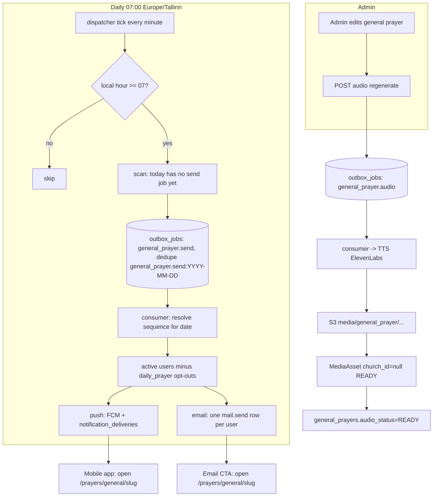

# General Prayer — 365-Day Daily Prayer (TASK)

| Field          | Value                                                                                                                                                         |
| -------------- | ------------------------------------------------------------------------------------------------------------------------------------------------------------- |
| Status         | Ready for implementation planning                                                                                                                             |
| Created        | 12 November 2026                                                                                                                                              |
| Repo           | `prayer-365-dashboard` (backend + admin + public site)                                                                                                        |
| Owner          | Client (PRAYER)                                                                                                                                               |
| Source request | Client expectation, 12 Nov 2026: send a prayer every day of the year to every registered user                                                                 |
| Source content | `docs/general-prayer-list.pdf` — Estonian "Päevapalved", 12.–21.11.2026, 5 pages, image-only (no text layer)                                                  |
| Related docs   | `docs/admin/TASK.md` (F3PR Prayers, F10NO Notifications), `docs/admin/SPEC.md` §9.3/§9.8, `.hermes/plans/031-f12-notification-backend.md`, `docs/FIREBASE.md` |

This document is a **task breakdown only**. There is no separate SPEC, DESIGN or FEATURE doc for this
feature; every product rule and technical decision needed to write an implementation plan is inside
this file. Read section 4 before planning: the existing prayer pipeline is church-locked and must not
be reused as-is.

---

## 1. What is being built

- A **General Prayer** collection: prayers that belong to the platform, **not to a church**.
- Each general prayer has an **AI-generated audio** (ElevenLabs text-to-speech), generated once and stored on S3.
- A **daily send at 07:00 Europe/Tallinn**: push notification **and** email to every active registered user.
- Both push and email point at the **specific prayer page** for that day, where the full text and audio are shown.
- Content starts from the 10 prayers delivered in `docs/general-prayer-list.pdf`; the 10 repeat in a cycle
  until the client supplies the remaining 355 days.

## 2. Confirmed decisions

Answered by the owner on 12 November 2026. These are fixed input for the plan — do not re-open them.

| Ref    | Question                       | Decision                                                                                     | Consequence for the build                                                                                     |
| ------ | ------------------------------ | -------------------------------------------------------------------------------------------- | ------------------------------------------------------------------------------------------------------------- |
| D-GP-1 | Who receives the daily prayer? | **All active app users**, including users with no church                                     | Audience is the `user` table (`status = 'active'`, `deleted_at = null`), not `user_churches`. No church join. |
| D-GP-2 | Send time?                     | **Fixed 07:00 Europe/Tallinn**, everyone at the same moment                                  | Sweep runs on the existing 1-minute dispatcher, gated on the local hour. One job per calendar date.           |
| D-GP-3 | Which AI voice?                | **One platform voice id from env**, the same voice every day                                 | No `VoiceProfile`, no consent record, no per-pastor clone. Voice id comes from configuration.                 |
| D-GP-4 | Missing 355 days of content?   | **Use the 10 delivered prayers now and repeat them every day**; client is asked for the rest | A cycle helper maps a date to a content position. Model must be cycle-length agnostic.                        |
| D-GP-5 | How does the user read it?     | **Push notification + email**, both opening the specific prayer page                         | Needs a public prayer page, a push data payload and a mail template.                                          |

Technical decisions taken while writing this TASK (recorded openly, not silently applied). Change any of
them only by updating this section.

| Ref    | Decision                                                                                                         | Why                                                                                                                                                                                           |
| ------ | ---------------------------------------------------------------------------------------------------------------- | --------------------------------------------------------------------------------------------------------------------------------------------------------------------------------------------- |
| D-GP-6 | **New tables** `general_prayers` (+ its own audio columns); `Prayer`/`PrayerVersion`/`PrayerAudio` are untouched | Those three tables require `church_id`, `pastor_id` and an approved church-scoped `VoiceProfile`. Making them nullable would weaken tenancy and disturb a working pipeline tested end to end. |
| D-GP-7 | The general prayer page is **public** (no login)                                                                 | Email and push land on devices/browsers without an admin or member session. Church prayers stay behind `requiredWebAuth`; general prayer is platform content.                                 |
| D-GP-8 | The daily send is a **new job kind**, not `notification.send`                                                    | `notification.send` requires a `churchId` in its payload and resolves recipients per church. Rewriting it risks the live church flow; a second job kind is additive.                          |
| D-GP-9 | Preference key reused: **`daily_prayer`**                                                                        | The mobile app already exposes that key (default ON). A new key would require a mobile settings release.                                                                                      |

## 3. Scope

In scope:

- Prisma models, migration, seed content (10 prayers from Appendix A), notification rule, permission subject.
- Admin screens to list / edit / regenerate audio for general prayers.
- ElevenLabs audio generation job, church-less media asset storage, public playback URL.
- Daily schedule sweep, send job (push + email), mail template, push payload.
- Public site page for one general prayer (text + audio) and an index of the cycle.
- Mobile read contract (`GET M/general-prayers/today` and by slug). Mobile **screens** are built in
  `prayer-365-mobile-app` — this repo only owns the contract and must announce it.
- Tests, seed verification, OpenAPI registrations, env plumbing.

Out of scope (do not build):

- Translating the 10 prayers into the other three site locales; content is Estonian only for now.
- Authoring/importing the missing 355 days (client deliverable; a CSV import script is _not_ required in this build).
- Per-user send-time preferences, timezone per user, weekly digests, "snooze".
- Push campaigns, audience targeting, analytics dashboards for the general prayer.
- Any change to church prayers, pastor voices, church notifications or `notification.send`.
- Church branding on the general prayer page (it is explicitly not a church prayer).

## 4. Verified current state (read before planning)

| Area               | Fact in the repo today                                                                                                                                                               | Consequence for this feature                                                                                                   |
| ------------------ | ------------------------------------------------------------------------------------------------------------------------------------------------------------------------------------ | ------------------------------------------------------------------------------------------------------------------------------ |
| Prayer model       | `Prayer.church_id` is required; `PrayerVersion.pastor_id` is required (`prisma/schema.prisma`)                                                                                       | Cannot hold a platform prayer → new tables (D-GP-6).                                                                           |
| Prayer audio       | `PrayerAudio.voice_profile_id` required; audio job re-proves consent + `review_state/registration_state` (`src/controller/audio-generate-job.tsx`)                                   | General prayer has no voice profile or consent → own generation path.                                                          |
| Media asset scope  | `MediaAsset.church_id` is already **nullable**; `CREATE_PENDING_ASSET({ churchId: null })` works; `GET_ASSET_BY_ID_CHURCH_LESS` exists (`src/providers/media.tsx`)                   | General audio can be stored church-less. `MARK_READY` takes a `Set<string>` of church ids → needs a small church-less variant. |
| Public audio URL   | `S3_PUBLIC_URL({ key })` (`src/providers/s3.tsx`); bucket is public-read and permanent (SPEC §10.4.1 / D13)                                                                          | No signing, no expiry. `assetUrl` works for audio.                                                                             |
| Daily push today   | `notification.send` reads `{ type, churchId }`, recipients = that church's followers (`src/controller/notification-send-job.tsx`, `GET_NOTIFICATION_RECIPIENTS`)                     | Cannot reach church-less users → new send job (D-GP-8).                                                                        |
| Preference keys    | `MOBILE_NOTIFICATION_TYPES` already contains `daily_prayer`, default ON (`src/models/mobile.tsx`, `src/providers/mobile.tsx`)                                                        | Reuse it (D-GP-9); no migration of user preferences.                                                                           |
| Notification rules | `notification_rules` rows seeded per trigger; admin toggles `push_enabled` / `email_enabled`; trigger names are allow-listed in `src/models/notification.tsx` (`ALLOWED_RULE_TYPES`) | Add a `general_prayer` rule row and allow-list entry, else the admin screen cannot show it.                                    |
| Mail pipeline      | One `mail.send` outbox row per recipient, Handlebars templates in `public/templates/mail/` (e.g. `notification-prayer.html`)                                                         | Add `notification-general-prayer.html`; reuse the pipeline and its dedupe.                                                     |
| Job dispatcher     | `src/controller/job-dispatch.ts` + EventBridge `rate(1 minute)` (`infra/config/environments/prayer-365.ts`)                                                                          | 07:00 gate can be computed per tick; no infra schedule change needed.                                                          |
| Consumer           | `src/lambda/consumer.ts` maps kind → processor; `src/lambda/kinds.test.tsx` guards "producer without processor"; local `workers/*.ts` + `package.json` scripts                       | Every new job kind needs all four registrations or the row stays PENDING forever.                                              |
| Consumer limits    | Lambda timeout 900 s, lease 900 s, memory 1024 MB, SQS batch 5 (`infra/lib/worker-stack.ts`)                                                                                         | A whole-audience fan-out must be chunked and resumable per recipient, not one all-or-nothing call.                             |
| Permissions        | Catalogue in `prisma/seeds/prayer-roles.ts` (`PRAYER_CATALOGUE`), expansion `ANY_CRUD(subject)`, wired per role in `prisma/seeds/role-permission.ts`                                 | New subject must be added there **and** granted to a role, or no one can open the screen.                                      |
| Site pages         | `src/app/(site)/prayers/page.tsx` and `/prayers/[slug]/page.tsx`; the detail page redirects to `/login` (`requiredWebAuth`)                                                          | General prayer page is a new public route (D-GP-7); reuse the audio player component.                                          |
| Site locales       | `SITE_LOCALES = ['en','et','sv','fi']` (`src/config/site-locale.ts`), UI strings in `src/i18n/messages.ts`                                                                           | Chrome text needs four locale entries; prayer content stays Estonian.                                                          |
| Admin nav          | `src/data/sidebar-data.tsx` + `useAccessPermission`; central screens live in `src/contents/central/*`                                                                                | New menu entry gated by the new permission subject.                                                                            |
| Seed order         | `prisma/seed.ts` runs phases in dependency order; demo media objects must exist before rows reference them                                                                           | General prayer seed must run after users/permissions and must not require demo media.                                          |

## 5. Content inventory from the PDF

`docs/general-prayer-list.pdf` is image-only: 5 pages, one date range (12.–21.11.2026), 2 prayers per page,
**10 prayers in total**, all Estonian. Each entry follows the same shape:

| PDF element                                                                   | Field in `general_prayers`  | Notes                                                              |
| ----------------------------------------------------------------------------- | --------------------------- | ------------------------------------------------------------------ |
| Header "Päevapalved" + date range                                             | — (document title only)     | Not stored.                                                        |
| Date line `12.11.2026 · Neljapäev`                                            | `weekday_label` (text)      | Kept for display/QA only; the send date is the real date.          |
| Day heading `12. Neljapäev`                                                   | `sequence` (1–10)           | Cycle position in document order.                                  |
| First bold quotation + reference                                              | `verse`, `verse_reference`  | HTML-free short text.                                              |
| Second bold quotation + reference                                             | `body` opening paragraph(s) | Some days have 1, some 2 quotations — keep both in `body` as HTML. |
| Regular prayer text                                                           | `body`                      | Rich text (sanitised) — the main reading.                          |
| Extra reference line `Lk 9,51–56; …`                                          | `references`                | Free text.                                                         |
| Sunday-only heading `EELVIIMANE PÜHAPÄEV KIRKUAIASTAS` / `Jutlus: 2Kr 5,1–10` | `liturgical_note`           | Shown above the body when present.                                 |
| Footer `Loosung`                                                              | —                           | Not populated in the source file; ignored.                         |

Content rules:

- **10-day cycle** (D-GP-4). `sequence` 1–10 in document order. When the client delivers 365 entries,
  only the number of rows changes; no code change is allowed to be needed.
- Some entries carry **no** extra reference line and some have no second quotation; all fields except
  `sequence`, `title`, `body`, `language_code` are optional.
- The source text is **weekday-specific**. On repeat the weekday will not match the actual day; keep
  `weekday_label` out of the default card view and show only the send date (see R2 in §12).
- Full transcribed content for the seed is in **Appendix A**. Treat it as a draft: a human must proofread
  against the PDF before the production seed (the PDF has no text layer, so the transcription came from
  page images).

## 6. Target data model

New model, new tables, no changes to `Prayer`, `PrayerVersion`, `PrayerAudio`.

```prisma
model GeneralPrayer {
  id                  String      @id @default(uuid(7))
  slug                String      @unique           // stable public URL key, e.g. "paivapalve-1"
  sequence            Int         @unique           // cycle position, 1..N (N = 10 today)
  title               String
  introduction        String?                       // optional lead-in
  body                String                        // sanitised HTML (sanitize-prayer-rich-text)
  verse               String?                       // first bold quotation, plain text
  verse_reference     String?                       // e.g. "Kg 4,17"
  liturgical_note     String?                       // Sunday heading, e.g. "EELVIIMANE PÜHAPÄEV KIRIKUAASTAS"
  references          String?                       // trailing reference line
  language_code       String      @default("et") @db.Char(5)
  audio_status        AudioStatus @default(QUEUED)   // QUEUED | GENERATING | READY | FAILED
  audio_asset_id      String?     @unique
  audio_asset         MediaAsset? @relation("GeneralPrayerAudio", fields: [audio_asset_id], references: [id])
  provider_request_id String?
  audio_generated_at  DateTime?
  is_active           Boolean     @default(true)
  created_by          String
  creator             User        @relation("GeneralPrayerCreator", fields: [created_by], references: [id])
  version             Int         @default(1)
  created_at          DateTime    @default(now())
  updated_at          DateTime?   @updatedAt

  @@index([is_active, sequence])
  @@map("general_prayers")
}
```

Back-relations to add: `MediaAsset.generalPrayerAudio GeneralPrayer[] @relation("GeneralPrayerAudio")`,
`User.generalPrayerCreations GeneralPrayer[] @relation("GeneralPrayerCreator")`.

Notes:

- `AudioStatus` enum is reused as-is; `APPROVED` is not used here (there is no human audio review — the
  platform voice is trusted, and the text has its own review inside the admin screen).
- No `day_of_year` and no `publish_at` column: the cycle is computed from a date, never stored per day.
  A single-row-per-date table would need 365 rows a year and would break the 10-item cycle.
- Dedupe and "sent once" live in `outbox_jobs.dedupe_key` and `notification_deliveries`, not in a new table.

## 7. Delivery flow



Cycle mapping (one helper, one implementation):

```
sequenceFor(date) = ((daysBetween(CYCLE_ANCHOR, date) mod N) + N) mod N + 1
CYCLE_ANCHOR = 2026-11-12  (first PDF date, Europe/Tallinn)
N            = count of active general prayers
```

`sequenceFor` must be pure and unit-tested: anchor day → 1, next day → 2, day N → N, day N+1 → 1,
dates before the anchor → wrap backwards, 29 February handled (leap year is just another day).

## 8. Task breakdown

Legend: ✔ done · ☐ pending. "Done" means the verify command passes **and** the acceptance hint holds.
Every task is one small verifiable unit; do not merge rows.

### GP-DB — Schema, seeds, permissions

| ID       | Task                                                                                                                                                                                                                             | Acceptance hint                                                                                                    | Done |
| -------- | -------------------------------------------------------------------------------------------------------------------------------------------------------------------------------------------------------------------------------- | ------------------------------------------------------------------------------------------------------------------ | ---- |
| GP-DB-01 | Add `GeneralPrayer` model + back-relations (`MediaAsset`, `User`) to `prisma/schema.prisma`; migration `general_prayers`; `bun prisma generate`. No change to existing prayer tables.                                            | Migration applies on a clean DB; `bun run typecheck` passes; `Prayer`/`PrayerAudio` schema diff is empty.          | ☐    |
| GP-DB-02 | Cycle helper `src/config/general-prayer.ts` (`CYCLE_ANCHOR`, `SEND_HOUR_LOCAL = 7`, timezone `Europe/Tallinn`) + `src/utils/general-prayer-cycle.ts` with `sequenceFor(dateISO, count)` and `todayInTallinn(now)`.               | Unit test: anchor → 1, +1 day → 2, +N days → 1, −1 day → N, 29 Feb; DST day still returns one sequence.            | ☐    |
| GP-DB-03 | Seed `prisma/seeds/general-prayer.ts` with the 10 entries from Appendix A (idempotent: upsert by `sequence`), registered in `prisma/seed.ts` after users/permissions.                                                            | `bun run seed:demo` on a clean DB creates exactly 10 rows, sequences 1–10, `body` non-empty, `language_code='et'`. | ☐    |
| GP-DB-04 | Permission: add `...ANY_CRUD('prayer_general_prayer', 'read,create,update')` to `PRAYER_CATALOGUE`; grant to `prayer_global_admin` in `prisma/seeds/role-permission.ts`; re-run permission seeds. No `delete` action (see note). | Admin role sees the menu; church/country roles do not; no `delete` row exists for the subject.                     | ☐    |
| GP-DB-05 | Add `general_prayer` to the notification-rule seed with `push_enabled: true, email_enabled: true` (D-GP-5), and to `ALLOWED_RULE_TYPES` in `src/models/notification.tsx`.                                                        | Seed is idempotent; the central notifications screen lists the type and both channel switches.                     | ☐    |
| GP-DB-06 | Refresh `prisma/dbml/schema.dbml` (`bun run update-dbdocs`) so the DB docs match.                                                                                                                                                | DBML contains `general_prayers`; no unrelated table churn.                                                         | ☐    |

Note GP-DB-04: no `delete` permission. A general prayer is content of a 365-day programme; removal is
`is_active = false`, which the cycle skips. Hard delete would silently shorten the cycle.

### GP-API — Admin API + providers

| ID        | Task                                                                                                                                                                                                                                                    | Acceptance hint                                                                                                    | Done |
| --------- | ------------------------------------------------------------------------------------------------------------------------------------------------------------------------------------------------------------------------------------------------------- | ------------------------------------------------------------------------------------------------------------------ | ---- |
| GP-API-01 | Provider `src/providers/general-prayer.tsx`: list (paginated, search, active filter), get by id, get by sequence, get by slug, create, update (with `version` guard), set audio status/asset, list active sequences, list active users.                 | Provider unit tests with a mocked `db`; no Prisma access outside the provider layer.                               | ☐    |
| GP-API-02 | Controller `src/controller/general-prayer.tsx`: list/detail/create/update + validation (title, body required; sequence 1–N unique; slug generated once as `paivapalve-<sequence>` and then immutable; HTML sanitised with `sanitize-prayer-rich-text`). | Stale `version` → 409; duplicate sequence → 409; unsafe HTML is stripped before save.                              | ☐    |
| GP-API-03 | Admin routes `src/app/api/v1/admin/central/general-prayers/route.ts` and `[generalPrayerId]/route.ts`: `GET` list, `POST` create, `GET` detail, `PATCH` update. Scope-protected with the new subject, `GeneralError` envelopes, paginated `total`.      | Unauthenticated → 401; missing scope → 403; response shape matches other central lists (`success/message/result`). | ☐    |
| GP-API-04 | Admin route `POST .../general-prayers/[generalPrayerId]/audio`: enqueue `general_prayer.audio`. Refuse with 409 while `GENERATING`; allow when `QUEUED`/`FAILED`/`READY` (regenerate replaces the asset).                                               | Double click creates one outbox row (`dedupe_key` on prayer id + version); 409 while generating.                   | ☐    |
| GP-API-05 | Register every new route in `src/utils/openapi-registrations.ts`; add schemas to `src/models/general-prayer.tsx`.                                                                                                                                       | `GET /api/v1/openapi.json` lists all five paths; `openapi.test.ts` passes.                                         | ☐    |
| GP-API-06 | Public read provider function for the site page (`getGeneralPrayerBySlug`, `getGeneralPrayerForDate`, `listGeneralPrayers`) returning text + `S3_PUBLIC_URL` audio; cache tags consistent with other public content (`site-public-cache`).              | Public page reads without a session; audio URL is an `S3_PUBLIC_URL`, never a signed URL.                          | ☐    |

### GP-JOB-A — ElevenLabs audio generation

| ID          | Task                                                                                                                                                                                                                                                                                                          | Acceptance hint                                                                                                | Done |
| ----------- | ------------------------------------------------------------------------------------------------------------------------------------------------------------------------------------------------------------------------------------------------------------------------------------------------------------- | -------------------------------------------------------------------------------------------------------------- | ---- |
| GP-JOB-A-01 | New job kind `general_prayer.audio` in `SUPPORTED_KINDS` (`src/controller/job-dispatch.ts`), `src/lambda/consumer.ts`, `src/lambda/kinds.test.tsx`, `workers/general-prayer-audio.ts`, `package.json` (`worker:general-prayer-audio`).                                                                        | `kinds.test.tsx` passes; `bun run worker:general-prayer-audio --once` exits 0 with no jobs.                    | ☐    |
| GP-JOB-A-02 | Processor `src/controller/general-prayer-audio-job.tsx`: re-read prayer, skip when `READY` (idempotent replay), guard `is_active`, `isElevenLabsEnabled()`, voice id from `ELEVENLABS_GENERAL_PRAYER_VOICE_ID`, text = `richTextToPlainText(body)` (+ `introduction` when present), language `language_code`. | Duplicate delivery → single asset; `ELEVENLABS_DISABLED` fails with a code, never crashes the tick.            | ☐    |
| GP-JOB-A-03 | Storage: `S3_PUT_OBJECT` key `media/general_prayer/generated_audio/<uuid>`, `CREATE_PENDING_ASSET({ churchId: null, purpose: 'GENERATED_AUDIO' })`, new provider `MARK_READY_CHURCH_LESS({ assetId, checksum })`, then set `audio_status = READY` + `audio_asset_id`.                                         | Asset row has `church_id = null`, `status = READY`, checksum equals hash of the uploaded bytes.                | ☐    |
| GP-JOB-A-04 | Failure handling: transient TTS/infra → `PENDING` with backoff, max attempts from env (`GENERAL_PRAYER_AUDIO_MAX_ATTEMPTS`, default 3); permanent → `FAILED` + `audio_status = FAILED`; provider request id stored.                                                                                           | Forced provider error → job `FAILED`, prayer `audio_status = FAILED`, error code saved; retry after fix works. | ☐    |
| GP-JOB-A-05 | Duration for the player: reuse `generatedAudioDurationSeconds` (`src/utils/prayer-duration.ts`) at read time.                                                                                                                                                                                                 | Public page shows a duration or hides it when unknown — never `NaN`.                                           | ☐    |

### GP-JOB-S — Daily send

| ID          | Task                                                                                                                                                                                                                                                                                                                                                                                            | Acceptance hint                                                                                                           | Done |
| ----------- | ----------------------------------------------------------------------------------------------------------------------------------------------------------------------------------------------------------------------------------------------------------------------------------------------------------------------------------------------------------------------------------------------- | ------------------------------------------------------------------------------------------------------------------------- | ---- |
| GP-JOB-S-01 | New job kind `general_prayer.send` registered in the same four places as GP-JOB-A-01 (+ `workers/general-prayer-send.ts`).                                                                                                                                                                                                                                                                      | `bun run worker:general-prayer-send --once` exits 0; `kinds.test.tsx` covers the new kind.                                | ☐    |
| GP-JOB-S-02 | Sweep `scanDueGeneralPrayer()` (in `src/controller/notification-schedule.ts` or a `general-prayer-schedule.ts` next to it), called from `runDispatcher` for this kind: computes `todayInTallinn()`, returns early before `SEND_HOUR_LOCAL`, resolves `sequenceFor(today, N)`, upserts one outbox row with `dedupe_key = general_prayer.send:${YYYY-MM-DD}` and `resource_id = generalPrayerId`. | Ticks at 06:59 create nothing; the first tick at 07:00 creates exactly one row; further ticks create none.                | ☐    |
| GP-JOB-S-03 | Processor `src/controller/general-prayer-send-job.tsx`: load job (`RUNNING` only), load rule `general_prayer` (missing/disabled → terminal state, no crash), resolve today's prayer by sequence (skip inactive with a clear code), build content (title, short body excerpt, slug) and the daily link `${BASE_URL}/prayers/general/${slug}`.                                                    | Missing rule → `FAILED` with `MISSING_RULE`; inactive prayer → `skipped` with a logged reason.                            | ☐    |
| GP-JOB-S-04 | Audience: provider `LIST_ACTIVE_USERS({ limit, cursor })` → `status='active'`, `deleted_at = null`; preference filter via `GET_PREFERENCE_MAP_FOR_USERS` keeping `daily_prayer !== false` (D-GP-9); users with no device are still email recipients.                                                                                                                                            | A user with `daily_prayer = false` receives neither push nor email; a user with no church and no device still gets email. | ☐    |
| GP-JOB-S-05 | Push leg: reuse `GET_ACTIVE_DEVICES_FOR_USERS` → `FILTER_UNDELIVERED_DEVICES` → `SEND_PUSH_BATCH` (chunks of 500) → `UPSERT_NOTIFICATION_DELIVERY` / `MARK_NOTIFICATION_DELIVERY` with `event_key = job.dedupe_key`, `rule_id` = the `general_prayer` rule, data `{ type: 'general_prayer', slug, date }`.                                                                                      | Replayed job sends no duplicate push (delivery unique key); invalid token is disabled, not retried forever.               | ☐    |
| GP-JOB-S-06 | Email leg: one `mail.send` outbox row per eligible recipient via `ENQUEUE_MAIL_SEND` with `dedupeKeySuffix = general_prayer:${YYYY-MM-DD}:${userId}`, `skipDuplicates: true`, template `notification-general-prayer`.                                                                                                                                                                           | Replayed job enqueues zero additional mails; one row per user per date.                                                   | ☐    |
| GP-JOB-S-07 | Scale + resumability: process the audience in bounded chunks per attempt (cursor or fixed page size from env `GENERAL_PRAYER_SEND_CHUNK`, default 500) and requeue with a cursor stored in the job payload when the time budget is short; the delivery unique keys make re-runs safe.                                                                                                           | Simulated 20k audience completes across ≤ 2 attempts with no duplicate sends; job never exceeds the consumer timeout.     | ☐    |
| GP-JOB-S-08 | Rule `enabled=false` → mark the job `SUCCEEDED` without sending (same semantics as `notification.send`).                                                                                                                                                                                                                                                                                        | Disabling the type in the central notification screen stops delivery immediately.                                         | ☐    |

Do **not** modify `notification.send`, `GET_NOTIFICATION_RECIPIENTS`, `GET_NOTIFICATION_CONTENT` or the
church broadcast path. If a change there looks necessary, stop and update this TASK first.

### GP-NOT — Email template, push payload, admin notification settings

| ID        | Task                                                                                                                                                                          | Acceptance hint                                                                                      | Done |
| --------- | ----------------------------------------------------------------------------------------------------------------------------------------------------------------------------- | ---------------------------------------------------------------------------------------------------- | ---- |
| GP-NOT-01 | `public/templates/mail/notification-general-prayer.html` based on `notification-prayer.html`: greeting, date, title, verse, prayer body, CTA button to the day's page.        | Preview render with sample payload shows the CTA URL and no church name/logo block.                  | ☐    |
| GP-NOT-02 | Mail payload `{ customerName, date, title, verse, body, ctaLink }`; `from` from `MAIL_FROM`; subject = prayer title with the date.                                            | Mail worker test asserts subject + CTA; no HTML injection from content (body is sanitised upstream). | ☐    |
| GP-NOT-03 | Central notifications screen: label + description for the `general_prayer` trigger (four locales in `src/i18n/messages.ts`), channel switches wired by the existing rule API. | Screen lists the trigger; toggling email off persists and the send job respects it.                  | ☐    |
| GP-NOT-04 | Mobile preference mapping stays `daily_prayer` for this trigger; confirm the mapping table used by the send job (`PREFERENCE_BY_TRIGGER` equivalent) documents it.            | Test: preference off → excluded; key missing → included (default ON).                                | ☐    |

### GP-UI — Admin screens

| ID       | Task                                                                                                                                                                                                                       | Acceptance hint                                                                                                | Done |
| -------- | -------------------------------------------------------------------------------------------------------------------------------------------------------------------------------------------------------------------------- | -------------------------------------------------------------------------------------------------------------- | ---- |
| GP-UI-01 | Hook `src/hooks/data/general-prayer.tsx`: list, detail, create, update, regenerate-audio; user-scoped cache keys + cross-invalidation (list ↔ detail).                                                                     | Cache keys carry the user id; after an edit the list shows the new title without a manual refresh.             | ☐    |
| GP-UI-02 | Screen `/dashboard/central/general-prayers` (`src/contents/central/general-prayers/index.tsx`): table with sequence, title, language, audio status, active flag, updated-at; search + pagination; "New prayer" action.     | Only visible with the new permission; page/limit/search survive reload; empty state explains the cycle.        | ☐    |
| GP-UI-03 | Screen `/dashboard/central/general-prayers/[generalPrayerId]` (editor): sequence (read-only after create), title, introduction, verse + reference, liturgical note, references, body (rich text), language, active toggle. | Save sends `version`; a stale save shows the conflict message; unsafe HTML cannot be pasted in.                | ☐    |
| GP-UI-04 | Audio panel in the editor: status (Queued / Generating / Ready / Failed + error code), inline player when ready, "Generate audio" / "Regenerate" button with disabled reasons, polls detail while `QUEUED`/`GENERATING`.   | Button disabled with a readable reason while generating or when text is empty; new audio plays without reload. | ☐    |
| GP-UI-05 | Sidebar entry under central content, permission-gated (`src/data/sidebar-data.tsx`); label in all four admin locales.                                                                                                      | Roles without the subject never see the menu item.                                                             | ☐    |
| GP-UI-06 | Schedule preview in the list header: "Today → sequence X (prayer title)" using the shared cycle helper, so staff can see what goes out tonight.                                                                            | Preview matches the send job's resolution for the same date (test with a fixed clock).                         | ☐    |

### GP-SITE — Public prayer page

| ID         | Task                                                                                                                                                                            | Acceptance hint                                                                  | Done |
| ---------- | ------------------------------------------------------------------------------------------------------------------------------------------------------------------------------- | -------------------------------------------------------------------------------- | ---- |
| GP-SITE-01 | Public route `src/app/(site)/prayers/general/[slug]/page.tsx` (no auth): date label, liturgical note, title, verse + reference, body, extra references, audio player, duration. | Opens in a private window; unknown/inactive slug → 404; no redirect to `/login`. | ☐    |
| GP-SITE-02 | Public index `src/app/(site)/prayers/general/page.tsx`: the cycle in sequence order with "today" highlighted, plus a short explanation that the cycle repeats.                  | Lists 10 entries; the "today" marker follows the shared helper.                  | ☐    |
| GP-SITE-03 | Reuse the existing player component from `src/contents/site/prayer-detail` (extract if needed); no church name, pastor or cover block.                                          | Page renders with audio when `audio_status = READY`, text-only when not.         | ☐    |
| GP-SITE-04 | i18n: add page strings to `src/i18n/messages.ts` for `en/et/sv/fi` (content itself stays Estonian); note the content language on the page.                                      | `bun run test` passes the i18n completeness tests; missing-key guard clean.      | ☐    |
| GP-SITE-05 | `src/app/sitemap.ts`: add the index and the 10 detail URLs.                                                                                                                     | Sitemap builds; entries use absolute site URLs.                                  | ☐    |

### GP-MOB — Mobile read contract (backend side only)

| ID        | Task                                                                                                                                                                                                                  | Acceptance hint                                                                         | Done |
| --------- | --------------------------------------------------------------------------------------------------------------------------------------------------------------------------------------------------------------------- | --------------------------------------------------------------------------------------- | ---- |
| GP-MOB-01 | `GET /api/v1/mobile/general-prayers/today` (bearer) → `{ date, sequence, slug, title, introduction, verse, verseReference, liturgicalNote, body, references, languageCode, audioUrl, durationSeconds, nextResetAt }`. | 401 without bearer; shape matches `MobileGeneralPrayerSchema`; `no-store` cache header. | ☐    |
| GP-MOB-02 | `GET /api/v1/mobile/general-prayers/:slug` (bearer) → same DTO for a deep link from an older push/email.                                                                                                              | Inactive or unknown slug → 404 with a generic envelope; no church fields leaked.        | ☐    |
| GP-MOB-03 | Register both routes in OpenAPI + tests; add the DTO to `src/models/mobile.tsx`; record the contract in `docs/admin/TASK.md` §X-MOB as a new row (MB-19) so the mobile team sees it.                                  | `bun run test` green; TASK.md §X-MOB lists the row with the wire shape.                 | ☐    |
| GP-MOB-04 | Push data contract documented for mobile: `data: { type: 'general_prayer', slug, date }`; app opens the general prayer screen, or the web page as fallback.                                                           | Documented in this file and in the MB row; no mobile code is written in this repo.      | ☐    |

### GP-OPS — Env, config, observability

| ID        | Task                                                                                                                                                                                                                                                              | Acceptance hint                                                                                                                  | Done |
| --------- | ----------------------------------------------------------------------------------------------------------------------------------------------------------------------------------------------------------------------------------------------------------------- | -------------------------------------------------------------------------------------------------------------------------------- | ---- |
| GP-OPS-01 | New env vars: `ELEVENLABS_GENERAL_PRAYER_VOICE_ID` (required for audio), `GENERAL_PRAYER_CYCLE_ANCHOR` (optional override, default `2026-11-12`), `GENERAL_PRAYER_SEND_CHUNK`, `GENERAL_PRAYER_AUDIO_MAX_ATTEMPTS`. Add to `.sample.env`, run `bun run env:sync`. | `bun run env:sync` reports the same key set across `.env*`; missing voice id surfaces as a clear job failure, not a silent skip. | ☐    |
| GP-OPS-02 | Verify the S3 object prefix `media/general_prayer/` is public-readable through `S3_PUBLIC_URL` on staging (bucket policy already public-read).                                                                                                                    | `curl -I` on a generated audio URL returns 200.                                                                                  | ☐    |
| GP-OPS-03 | Confirm the platform ElevenLabs voice id exists on the PRAYER account (voice library or cloned to the account) before seeding content.                                                                                                                            | `generateSpeech` with that id succeeds for a 10-word sample; result stored for QA.                                               | ☐    |
| GP-OPS-04 | CloudWatch: alarm on `general_prayer.send` / `general_prayer.audio` jobs in `FAILED` state and on "no send job today" (dispatcher gap), following the existing job-lag pattern in `infra/lib/worker-stack.ts`.                                                    | Alarm appears in the stack; a forced failure triggers it on staging.                                                             | ☐    |
| GP-OPS-05 | Measure the production audience size (`SELECT count(*) FROM "user" WHERE status='active' AND deleted_at IS NULL`) and record it in the implementation plan to size `GENERAL_PRAYER_SEND_CHUNK`.                                                                   | Number recorded; chunk size chosen with a stated cost/duration estimate.                                                         | ☐    |
| GP-OPS-06 | Cost check: 10 audio generations (one-time) plus one TTS re-generation per edit; emails = 1 per eligible user per day. Record the ElevenLabs character count for the 10 prayers.                                                                                  | Numbers recorded in the implementation plan; no surprise on the monthly invoice.                                                 | ☐    |

### GP-TST — Tests and acceptance

| ID        | Task                                                                                                                                                                                  | Acceptance hint                                                                             | Done |
| --------- | ------------------------------------------------------------------------------------------------------------------------------------------------------------------------------------- | ------------------------------------------------------------------------------------------- | ---- |
| GP-TST-01 | Unit: cycle helper (anchor, wrap, pre-anchor, leap day, DST).                                                                                                                         | Every branch asserted; helper has no `Date` dependency beyond its arguments.                | ☐    |
| GP-TST-02 | Unit: send sweep — before 07:00 nothing, at 07:00 exactly one row, repeated ticks no duplicates, next day a new key.                                                                  | Uses injected clock; asserts `dedupe_key` exactly.                                          | ☐    |
| GP-TST-03 | Unit: send job — pref opt-out excluded, church-less user included, staff user included (D-GP-1), rule disabled → no sends, replay → no duplicate delivery, inactive prayer → skipped. | Provider seams mocked; asserts push data payload and mail enqueue arguments.                | ☐    |
| GP-TST-04 | Unit: audio job — happy path creates church-less READY asset, replay is idempotent, ElevenLabs disabled → `FAILED`, transient → requeue, permanent → `FAILED`.                        | Mocked `ELEVENLABS`, `S3_PUT_OBJECT`, providers.                                            | ☐    |
| GP-TST-05 | API/permission: list/create/update require the new scope; body/sequence validation; stale `version` 409; audio regenerate 409 while generating.                                       | Route-level tests like the existing central-church ones.                                    | ☐    |
| GP-TST-06 | Site/mobile: public page 200 without session, 404 for inactive; `M/general-prayers/today` shape + 401; by-slug deep link.                                                             | Snapshot-free assertions on rendered fields and DTO keys.                                   | ☐    |
| GP-TST-07 | Seed verification: `bun run seed:verify` extended to assert 10 general prayers, unique sequences, every `body` non-empty, `audio_status` in a known set.                              | Fails loudly when a seed row loses its body (same spirit as the church prayer audio check). | ☐    |
| GP-TST-08 | Manual E2E on staging (script in §10).                                                                                                                                                | Owner signs off: push arrives, email arrives, both open the same prayer page, audio plays.  | ☐    |

## 9. Verification

Run after each change, and once before handover:

```
bun run typecheck && bun run lint && bun run test && bun run build
```

Feature-specific checks:

```
bun prisma generate
bun run seed:demo && bun run seed:verify
bun run worker:general-prayer-audio --once
bun run worker:general-prayer-send --once
```

Manual smoke on a local/demo DB:

1. Open `/dashboard/central/general-prayers` as global admin → 10 rows, sequences 1–10.
2. Generate audio for sequence 1 → status goes Queued → Generating → Ready; player plays.
3. Open `/prayers/general/paivapalve-1` in a private window → text + audio, no login redirect.
4. Force the send sweep with a temporary clock (test helper) → one `general_prayer.send` row, one job run.
5. Confirm the mobile route returns today's sequence and the same audio URL.

## 10. Acceptance criteria

The feature is accepted when all of these hold:

1. All 10 prayers exist with sequence 1–10, Estonian text, and an audio file reachable through `S3_PUBLIC_URL`.
2. A single run per calendar date, at or after 07:00 Europe/Tallinn, produces exactly one send job; no run
   produces two notifications for the same user and date (push or email).
3. Users with `daily_prayer = false` receive nothing; users with no church receive both push (if a device is
   registered) and email; staff accounts also receive it (D-GP-1).
4. Push and email both open `/prayers/general/<slug>` for the same sequence that the API reports for that date.
5. The page works without login, shows text + audio, and returns 404 for inactive content.
6. Admin can edit text, regenerate audio, and see the audio status progress without a reload.
7. A failed audio generation or a failed send is visible as a job with an error code (not a silent gap), and
   re-running after the fix completes the work without duplicating deliveries.
8. `bun run typecheck && bun run lint && bun run test && bun run build` pass; no changes to the church prayer
   push path or to existing `M/` response shapes.

## 11. Build order

1. **GP-DB-01/02** — schema + cycle helper (everything else depends on the shape and the date maths).
2. **GP-API-01/02/05** — provider, controller, routes (admin can create/edit; needed to test audio).
3. **GP-JOB-A-01…04 + GP-OPS-01/03** — audio generation behind the voice env; this proves the ElevenLabs
   account and the church-less media path before any sending exists.
4. **GP-UI-01…05** — admin screens so content can be managed by a human.
5. **GP-SITE-01/02/03/05** — the destination page must exist before push/email point at it.
6. **GP-NOT-01/02 + GP-JOB-S-01…06** — email template and the daily send.
7. **GP-MOB-01/02/03** — read contract for the app.
8. **GP-DB-03/06, GP-TST-\*, GP-OPS-04/05/06** — seed content, tests, alarms, cost numbers.

## 12. Risks and open items

| Ref | Risk / open item                                                                                   | Impact                                                                      | Mitigation / owner                                                                                                 |
| --- | -------------------------------------------------------------------------------------------------- | --------------------------------------------------------------------------- | ------------------------------------------------------------------------------------------------------------------ |
| R1  | Only 10 of 365 prayers exist                                                                       | The same 10 repeat; users notice repetition                                 | Accepted for now (D-GP-4). Client to deliver the remaining 355. Cycle code is count-agnostic.                      |
| R2  | PDF text is weekday-specific ("12. Neljapäev"), so a Thursday prayer will arrive on other weekdays | Visible inconsistency once the cycle wraps                                  | Hide `weekday_label` in default views; show the send date. Content fix arrives with the full list. Owner informed. |
| R3  | PDF is image-only; the seed text in Appendix A is a transcription                                  | A typo would be published and read aloud by TTS                             | Human proofread against the PDF before the production seed; keep the PDF page reference in the seed file comment.  |
| R4  | Daily email to every active user                                                                   | SES reputation + daily quota; unsubscribes land in the app, not in the mail | Owner also chose email (D-GP-5). Monitor bounce/complaint; if reputation drops, push-only is a one-switch change.  |
| R5  | Whole-audience fan-out inside one Lambda (900 s)                                                   | A big audience could time out mid-send                                      | Chunked, cursor-resumable job + delivery unique keys (GP-JOB-S-07). Size with GP-OPS-05.                           |
| R6  | 07:00 Europe/Tallinn across DST                                                                    | Wrong send hour twice a year                                                | Compute the local hour with `Intl` timezone `Europe/Tallinn`; never a fixed UTC offset. Test the DST days.         |
| R7  | One shared platform voice for all 10 prayers                                                       | Repetitive listening experience                                             | Accepted (D-GP-3). A per-language or rotating voice is a later change, not part of this build.                     |
| R8  | `notification_deliveries.rule_id` requires a rule row                                              | Send job cannot record deliveries without one                               | Rule seeded in GP-DB-05; a missing rule fails the job with `MISSING_RULE` instead of sending untracked.            |
| R9  | Staff accounts receive the daily prayer                                                            | Minor noise for admins                                                      | Accepted (D-GP-1). Revisit only if the owner asks.                                                                 |

Open questions for the owner/client (not blockers for planning):

1. Will the remaining 355 entries keep the same structure (verse, prayer, references, Sunday note)?
2. Which voice should be registered as the platform voice, and is Estonian the only language for now?
3. Should the page eventually show a short "why this prayer today" note, or stay purely devotional?

## Appendix A — Seed content from `docs/general-prayer-list.pdf`

Estonian, transcribed from page images (no text layer in the PDF). `sequence` = cycle position.
Fields `introduction` and `liturgical_note` are empty unless shown. Proofread against the PDF before the
production seed.

| Seq | weekday_label            | verse (first quotation)                                                                                                                                                                                                                                                                                                      | verse_reference       | body (prayer text)                                                                                                                                                                                                                                                                                             | references                    |
| --- | ------------------------ | ---------------------------------------------------------------------------------------------------------------------------------------------------------------------------------------------------------------------------------------------------------------------------------------------------------------------------- | --------------------- | -------------------------------------------------------------------------------------------------------------------------------------------------------------------------------------------------------------------------------------------------------------------------------------------------------------- | ----------------------------- |
| 1   | `12.11.2026 · Neljapäev` | Hoia oma jalga, kui sa lähed Jumala kotta. Kuulaminek on parem kui alpide ohvriand. Jäta oma and altari ette ja mine lepi esmalt ära oma vennaga ja alles siis tule ja too oma and!                                                                                                                                          | Kg 4,17; Mt 5,24      | Kes võib tulla Jumala ligi? See, kes on laitmatu. Mina ei ole laitmatu, kas ma ei tohi tulla? Issand, Sinu Sõna ütleb: tohin küll, kui ma tahan Sind kuulda võtta, kui ma igatsen paranemist.                                                                                                                  | Lk 9,51–56; Ilm 20,1–6        |
| 2   | `13.11.2026 · Reede`     | Et su silmad oleksid lahti ööd ja päevad selle koja kohal, selle paiga kohal, mille kohta sa oled öelnud: Seal peab olema minu nimi. Jeesus ütles oma vanemaile: Miks te siis olete mind otsinud? Kas te ei teadnud, et ma pean olema neis paigus, mis on mu Isa päralt?                                                     | 1Kn 8,29; Lk 2,49     | Armas Jumal, ma tänan Sind kiriku eest, eriti oma kodukiriku eest. Üks päev Sinu õuedes on parem kui muid tuhat. Igal pühapäeval võime tulla kirikusse kuulama Sinu Sõna ning saama osa Kristuse ihust ja verest. Siin meid õnnistatakse, siin oleme koos Jumala rahvaga. Siin oled Sina, Jeesus, meie keskel. | Jh 18,10.11; Ilm 20,7–10      |
| 3   | `14.11.2026 · Laupäev`   | Olgu Issand, meie Jumal, meiega, nõnda nagu ta on olnud meie vanematega. Paulus ütles: Me kuulutame teile selle hea sõnumi, tõotuse, mis anti meie esiisadele, et Jumal selle on täitnud meile, nende lastele, äratades üles Jeesuse.                                                                                        | 1Kn 8,57; Ap 13,32–33 | Mõtlen tänulikult eelnevatele sugupõlvedele. Nende hulgas on olnud Jumala lapsi, kelle palved õnnistavad järgnevaid sugupõlvi. Ehk on keegi neist minugi eest palunud, et Sina, Issand, oled minu kätte saanud. Mina palun järgnevate sugupõlvede eest. Issand, hoia ja õnnista neid!                          | 1Pt 3,8–17; Ilm 20,11–15      |
| 4   | `15.11.2026 · Pühapäev`  | Nad võivad elada julgelt, ilma et keegi neid peletaks. Põrgu väravad ei saa minu kogudusest võitu.                                                                                                                                                                                                                           | Hs 34,28; Mt 16,18    | Me vajame julgustuse sõnu. Eks ole see maailm nagu ohtlik ja tormine meri? Sina, Issand, julgustad meid ja tuletad meile meelde, et Sa oled meiega ja hoiad meid püsti, et me ei hukkuks. Sinuga koos me jääme ellu.                                                                                           | — (none in source)            |
| 5   | `16.11.2026 · Esmaspäev` | Kes ei peaks sind kartma, rahvaste kuningas? Tõesti, seda sa väärid. Hananias ütles Paulusele: Meie isade Jumal on su määranud tunnetama tema tahtmist ja nägema seda Õiget ning kuulma häält tema suust, sest sina saad tema tunnistajaks kõigile inimestele selles, mida sa oled näinud ja kuulnud.                        | Jr 10,7; Ap 22,14–15  | Me teame, et ei ole kedagi sellist nagu Sina, Issand, kõigeväeline. Aga kas me sellest kõneleme või hoiame selle kalli teadmise ainult endale? Siis on ju sellest vähe kasu. Issand, aita mind, et ma ei lukustaks Sind oma südamesse.                                                                         | Mt 25,14–20; Ilm 21,1–8       |
| 6   | `17.11.2026 · Teisipäev` | Tema aga kandis paljude pattu ja seisis üleastujate eest. Johannes näeb Jeesust tulevat tema juurde ja ta ütleb: "Vaata, see on Jumala Tall, kes võtab ära maailma patu!"                                                                                                                                                    | Js 53,12; Jh 1,29     | Jumala Tall, kes Sa kannad ära maailma patu, me täname Sind, et Sa võtsid kanda ka meie patud. Need rõhusid ja vaevasid Sind seal ristipuul. Sinu kannatus ja surm on meile priiuse toonud. Sina seisaid meie eest veelgi. Aitäh Sulle!                                                                        | Jr 8,4–9; Ilm 21,9–14         |
| 7   | `18.11.2026 · Kolmapäev` | Sind ma armastan südamest, Issand, mu vägi! Jeesus ütles patuse naise kohta: Temale on palju patte andeks antud, sest ta on palju armastanud. Aga kellele antakse andeks pisut, see armastab pisut.                                                                                                                          | Ps 18,2; Lk 7,47      | Issand, Jeesus, Sina oled minu ja kogu inimkonna heaks teinud enam kui keegi teine. Sinul on õigus meie armastusele. Aga armastada saab see, kes mõistab, kes on kuulnud, kes teab. Seepärast ma palun Sind, olgu Sõna uksed meile ikka valla, et me õpiksime Sind armastama.                                  | — (none in source)            |
| 8   | `19.11.2026 · Neljapäev` | Ma päästan nad kõigist nende asupaigust, kus nad on pattu teinud, ja puhastan nad, ja nad on mulle rahvaks. Jumal, kes on rikas halastuselt, on meid koos Kristusega teinud elavaks oma suure armastuse pärast, millega ta meid on armastanud.                                                                               | Hs 37,23; Ef 2,4–5    | Usurahvas on õppiv rahvas. Jumala Sõna on meie õpik, praktika meie igapäevane elu. Me oleme teelolijad, kes õppides ja Jumala rahva meelsust omandades on teel igavesele kodumaale. Issand, ära väsi meid õpetamast ja juhatamast.                                                                             | 2Ts 1,3–12; Ilm 22,1–5        |
| 9   | `20.11.2026 · Reede`     | Issand ütles Moosesele: Nüüd mine, ja mina olen abiks sinu suule ning õpetan sind, mida sa pead rääkima. Jeesus ütles Peetrusele: Mina olen sinu pärast Jumalat palunud, et su usk ei lõpeks. Ja kui sa ükskord pöördud, siis kinnita oma vendi.                                                                             | 2Ms 4,12; Lk 22,32    | Issand Jeesus, ole alati minuga, kui ma Sinust kõnelen! Ma ei taha rääkida Sinu kohta valet, seepärast ma palun Sind: ole abiks minu suule, et ma õigust räägiksin, et see oleks kinnituseks ja kosutuseks kuulajatele.                                                                                        | Hb 13,17–21; Ilm 22,6–15      |
| 10  | `21.11.2026 · Laupäev`   | Jumal ütleb: Minu sõna ei tule tagasi mu juurde tühjalt, vaid teeb, mis on mu meele järgi, ja saadab korda, milleks ma selle läkitasin. Jumala sõna on elav ja tõhus ja vahedam kui ükski kaheterane mõõk ning tungib läbi, kuni ta eraldab hinge ja vaimu, liigesed ja üdi, ning on südame meelsuse ja kaalutluste hindaja. | Js 55,11; Hb 4,12     | Jumala Sõna, tule minu juurde, tungi minusse, puuduta mind, et ma ei oleks üksnes Sõna kuulja, vaid ka selle järgi tegija.                                                                                                                                                                                     | 2Pt 3,(13)14–18; Ilm 22,16–21 |

Sequence 4 (Sunday) also carries `liturgical_note = "EELVIIMANE PÜHAPÄEV KIRIKUAASTAS"` and the source
prints `Me kõik peame saama avalikuks Kristuse kohtujärje ees. 2Kr 5,10a` with
`Mt 25,31–46; Jr 8,4–7; Ps 50` and `Jutlus: 2Kr 5,1–10` before its own day verse. Keep those lines at the
top of `body` as an italic lead-in, and store the sermon line in `references`.

Seed file shape (one entry shown):

```ts
{
  sequence: 1,
  slug: 'paivapalve-1',
  weekday_label: '12.11.2026 · Neljapäev',
  title: 'Hoia oma jalga, kui sa lähed Jumala kotta',
  verse: 'Hoia oma jalga, kui sa lähed Jumala kotta. Kuulaminek on parem kui alpide ohvriand. Jäta oma and altari ette ja mine lepi esmalt ära oma vennaga ja alles siis tule ja too oma and!',
  verse_reference: 'Kg 4,17; Mt 5,24',
  body: '<p>Kes võib tulla Jumala ligi? …</p>',
  references: 'Lk 9,51–56; Ilm 20,1–6',
  language_code: 'et',
  is_active: true,
}
```

## Appendix B — Inputs the implementation plan needs

Everything below is fixed by this document; the plan does not need another discovery pass.

| Input                             | Where it comes from                                                                             |
| --------------------------------- | ----------------------------------------------------------------------------------------------- |
| Product decisions                 | §2 D-GP-1…9                                                                                     |
| Content (10 prayers)              | Appendix A + `docs/general-prayer-list.pdf` for proofreading                                    |
| Target schema                     | §6                                                                                              |
| Date → prayer mapping             | §7 (helper `sequenceFor`)                                                                       |
| Job kinds and registration points | GP-JOB-A-01, GP-JOB-S-01 (dispatcher, consumer, kinds test, worker, package script)             |
| Delivery semantics                | GP-JOB-S-04…08, §10                                                                             |
| Permission subject + roles        | GP-DB-04                                                                                        |
| Env vars                          | GP-OPS-01                                                                                       |
| Existing code to reuse            | §4 table (media, S3 public URL, push providers, mail pipeline, admin patterns)                  |
| What must not change              | §4 note + GP-JOB-S closing note (`notification.send`, church prayer path, existing `M/` shapes) |
| Definition of done                | §9 verification + §10 acceptance criteria                                                       |
