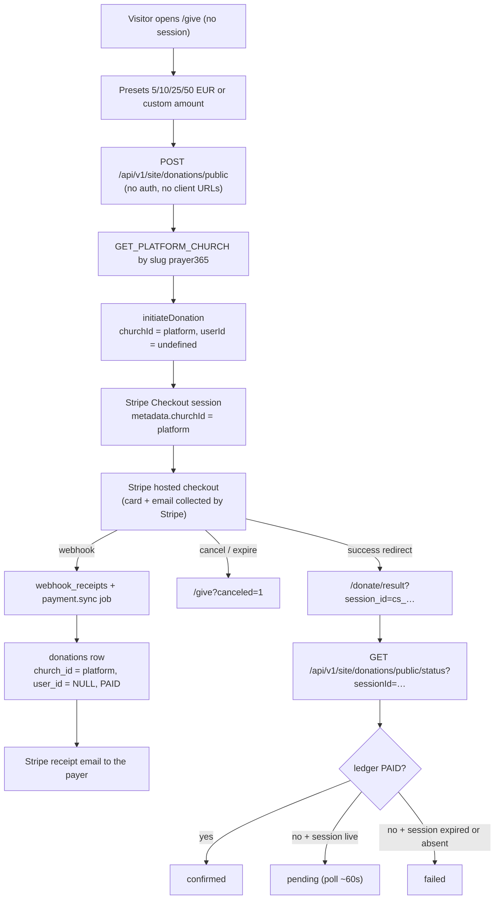

# Public Donations (TASK)

| Field          | Value                                                                                                                                                                                                               |
| -------------- | ------------------------------------------------------------------------------------------------------------------------------------------------------------------------------------------------------------------- |
| Status         | Implemented on `release/v1.0.0` — every code task ticked below against the tree; only the manual card test (PD-QA-01) and the live hidden-surface check (PD-QA-02) are still open                                   |
| Created        | 2026-11-12                                                                                                                                                                                                          |
| Repo           | `prayer-365-dashboard` (Next.js 16 + Prisma 7, branch `release/v1.0.0`)                                                                                                                                             |
| Owner          | Client (PRAYER 365)                                                                                                                                                                                                 |
| Source request | "We will have a Donations Page for NON LOGIN user on the website. Donation goes directly to PRAYER365, not to a church. A NON LOGIN user cannot donate to a specific church — it goes to Prayer 365 automatically." |
| Source content | None (no PDF/doc supplied). Copy is authored from the existing donate screen's tone; Estonian/Swedish/Finnish copy needs owner review.                                                                              |
| Related docs   | `docs/STRIPE.md` (single platform Stripe account, metadata contract), `docs/admin/SPEC.md` §9.6 (donations)                                                                                                         |

This document is a **task breakdown only**. Every product rule and technical decision needed to write an
implementation plan is inside this file.

## 1. What is being built

- A **public giving page at `/give`** that any visitor can open without signing in.
- The gift is addressed to **PRAYER 365 itself**, never to a parish. The visitor has no church selector; the
  beneficiary is resolved server-side on every request.
- Guest gifts are **one-time only** (no monthly pledge for a visitor without an account).
- Payment runs through the **existing Stripe platform account and checkout controller** — no new payment
  code, no payout/transfer code.
- Receipting is **Stripe's own receipt email**; the ledger row keeps `user_id = NULL`.
- A public thank-you page at `/donate/result` reads the outcome from our own ledger, never from the URL.

## 2. Confirmed decisions

| Ref  | Question                                                                                                                                                                                                                                                                   | Decision                                                                                                                                                                                                                                                                                                                                                                                                                                               | Consequence for the build                                                                                                                                                               |
| ---- | -------------------------------------------------------------------------------------------------------------------------------------------------------------------------------------------------------------------------------------------------------------------------- | ------------------------------------------------------------------------------------------------------------------------------------------------------------------------------------------------------------------------------------------------------------------------------------------------------------------------------------------------------------------------------------------------------------------------------------------------------ | --------------------------------------------------------------------------------------------------------------------------------------------------------------------------------------- |
| D-01 | How is a platform (Prayer 365) donation stored? Every donation today needs a church: `donations.church_id` is required and the payment-sync worker **skips any event without `metadata.churchId`** (`src/controller/payment-sync-job.tsx:207-214`).                        | Seed a **hidden system church row** named "Prayer 365" (`slug = prayer365`, `status = APPROVED`, `is_platform = true`) and reuse the whole existing flow unchanged.                                                                                                                                                                                                                                                                                    | No change to the webhook, the ledger shape, admin donation reports or the mobile contract. The row must be hidden from public directory surfaces and protected against deletion (§6.1). |
| D-02 | Which URL? The current giving page `/donate` lives inside the `(site)` route group, whose layout redirects a visitor without a session to `/welcome` (`src/app/(site)/layout.tsx:16-20`), and the page itself redirects to `/login` (`src/app/(site)/donate/page.tsx:47`). | New public page at **`/give`**, outside the `(site)` group. Logged-in `/donate` stays exactly as it is today.                                                                                                                                                                                                                                                                                                                                          | New `src/app/give/**` tree with its own `SiteI18nProvider` + `SiteShell`, like `src/app/donations/return/page.tsx`.                                                                     |
| D-03 | Guest identity and receipt? A guest has no `user_id` and no account.                                                                                                                                                                                                       | **Stripe Checkout collects the email and Stripe sends the receipt.** Our row keeps `user_id = NULL`. No email field on our form, no receipt mail from our mail worker.                                                                                                                                                                                                                                                                                 | The Stripe dashboard must have receipt emails enabled (R2). Our thank-you page must not promise an email we do not send.                                                                |
| D-04 | What can a guest give?                                                                                                                                                                                                                                                     | **One-time only.** Monthly giving stays a signed-in feature.                                                                                                                                                                                                                                                                                                                                                                                           | The public schema pins `frequency` to `'one_time'`; the UI shows no frequency switch.                                                                                                   |
| D-05 | Amount and purpose options?                                                                                                                                                                                                                                                | **Fixed presets 5 / 10 / 25 / 50 EUR plus a custom amount. No ministry-purpose grid.** Ministry purposes (pantry/organ/youth) are parish-specific.                                                                                                                                                                                                                                                                                                     | No read of `church.donation_options`; presets live in `src/config/platform-church.ts`. No `category` in the Stripe metadata.                                                            |
| D-06 | The site header/footer "Giving" link points at `/donate` today (`src/components/site/top-bar.tsx:104`, `src/components/site/footer.tsx:17`), which bounces a visitor to `/welcome`.                                                                                        | **Implemented as a proxy branch, not as link edits.** The header and footer keep `/donate` — a signed-in giver keeps the church portal — and `src/proxy.ts` sends a request with no session cookie on `/donate` to `/give`. Every `/donate?church=…` deep link is untouched. This supersedes the original "link public pages straight to `/give`" wording: the direct-link version would also have taken the parish portal away from signed-in givers. | No header/footer edit; one matcher-scoped redirect in `src/proxy.ts`.                                                                                                                   |

Technical decisions taken while writing this TASK (change only by updating this table):

| Ref  | Decision                                                                                                                                                                                 | Why                                                                                                                                                                                                                                                                                                                                            |
| ---- | ---------------------------------------------------------------------------------------------------------------------------------------------------------------------------------------- | ---------------------------------------------------------------------------------------------------------------------------------------------------------------------------------------------------------------------------------------------------------------------------------------------------------------------------------------------- |
| D-10 | Hide the system row with a boolean column `churches.is_platform` (not by comparing the slug).                                                                                            | The public directory has one shared `where` builder (`churchListWhere`, used by `LIST_PUBLIC_CHURCHES_UNCACHED` and therefore the sitemap and the donate neighbour spotlight) plus `activeChurchWhereAny` for the profile route. One flag keyed once closes the whole class; a magic slug string would have to be repeated in every call site. |
| D-11 | Protect the row with an application guard **and** rely on the existing FK restrict: `donations.church_id` has no `onDelete`, so Prisma/Postgres refuse deleting a church that owns rows. | The FK alone leaves a window where the row exists with zero donations. The guard closes that window before the first gift.                                                                                                                                                                                                                     |
| D-12 | The public route builds `successUrl` / `cancelUrl` **server-side** from `SITE_URL`; it never accepts them from the browser.                                                              | `DonationInputSchema` takes free-form URLs from the caller (`src/models/donation.tsx:20-21`) and the signed-in form posts them (`src/contents/site/donate/donor-form.tsx:119-120`). On an unauthenticated endpoint that is an open-redirect and a spoofed-return-URL hole.                                                                     |
| D-13 | **No idempotency record** on the public checkout start.                                                                                                                                  | `withExternalIdempotency` keys on an actor (`src/controller/donation.tsx:135`); a guest has no actor key, so a shared key would let one visitor replay another's session. A duplicate Checkout session is harmless: it expires unpaid and writes no ledger row.                                                                                |
| D-14 | The public status endpoint answers only for sessions whose `metadata.churchId` is the platform church.                                                                                   | Without that check an anonymous caller could probe another giver's church-scoped outcome by session id.                                                                                                                                                                                                                                        |
| D-15 | Resolve the platform church **by slug at runtime** (`src/config/platform-church.ts` + a cached provider call), never by an env-var id.                                                   | Staging and production have different row ids; a slug lookup keeps one deploy artefact valid in both, and a re-seed cannot desync it.                                                                                                                                                                                                          |
| D-16 | Public API routes live at `/api/v1/site/donations/public` and `…/public/status` and, like every existing `src/app/api/v1/site/**` route, do **not** call `registerPath()`.               | The whole `site` API family is absent from `src/utils/openapi-registrations.ts` today; the new routes follow that convention instead of half-registering one member. Registering the family is a separate change (R9).                                                                                                                         |

## 3. Scope

In scope:

- `/give` public page: hero, "your gift goes to Prayer 365, not to a church" notice, amount presets + custom
  amount, submit, disabled state when Stripe is off, legal/trust note, site header + footer.
- `POST /api/v1/site/donations/public` — unauthenticated checkout start for the platform beneficiary.
- `GET /api/v1/site/donations/public/status?sessionId=` — unauthenticated outcome read for one session.
- `/donate/result?session_id=` — the ONE outcome page, on its original URL. A guest and a signed-in giver
  share it; the session decides which ledger answers (public status vs the parish attempt read) and which
  existing outcome component renders. The public `/give/thank-you` page was removed; public gifts now land
  here too.
- System church row + `is_platform` flag + seed + hide-from-public + delete/edit protection.
- Copy for the new page in all four locales (`en` / `et` / `sv` / `fi`).
- Header and footer "Giving" link pointing public visitors at `/give`.

Out of scope (do not build):

- Monthly / recurring giving for guests (D-04).
- Any church selector, church search or church-scoped deep link on `/give` (the request forbids it).
- Per-church account setup, Stripe Connect, payouts, transfers, balances (`docs/STRIPE.md` — single platform
  account, manual payouts).
- A visitor account, login link, "my donations" page or donor history for guests.
- A separate platform donation report screen, CSV export or analytics dashboard (existing church-scoped
  reporting shows the platform row as one more beneficiary).
- Changes to `/donate`'s signed-in flow, the mobile donation routes or the mobile DTOs. `/donate/result` **is**
  touched: the guest outcome renders through that same route (see In scope).
- Refunds UI, tax-receipt documents, Gift Aid / tax-deductible receipts.
- Rate limiting infrastructure beyond what the platform already provides (see R3).

## 4. Verified current state (read before planning)

| Area                   | Fact in the repo today                                                                                                                                                                                                                                                                                                                            | Consequence for this feature                                                                                                                                                         |
| ---------------------- | ------------------------------------------------------------------------------------------------------------------------------------------------------------------------------------------------------------------------------------------------------------------------------------------------------------------------------------------------- | ------------------------------------------------------------------------------------------------------------------------------------------------------------------------------------ |
| Payment account        | One centralised PRAYER-owned Stripe platform account; Connect and per-church accounts are explicitly not used (`docs/STRIPE.md`, "Architecture").                                                                                                                                                                                                 | "The money already goes to Prayer 365" is true for every gift; this feature only changes the **attribution**, not the settlement.                                                    |
| Ledger shape           | `Donation.church_id` is required, `user_id` is optional, `provider_payment_id` unique (`prisma/schema.prisma:755-775`). `DonationSubscription.church_id` is required too.                                                                                                                                                                         | A guest one-time gift fits the schema as-is: `church_id = <platform>`, `user_id = NULL`, `subscription_id = NULL`.                                                                   |
| Checkout controller    | `initiateDonation({churchId, userId?, input, idempotencyKey?})` validates input, calls `ENSURE_CHURCH_DONATION_ELIGIBLE` (requires an APPROVED church) and opens the Stripe session (`src/controller/donation.tsx:89-186`).                                                                                                                       | Reusable unchanged. `userId` is already optional; only the church has to exist and be APPROVED.                                                                                      |
| Stripe session         | `createCheckoutSession` writes `metadata.churchId` (always) and `metadata.userId` / `metadata.category` when present; product name falls back to "Prayer 365 offering" when no church name (`src/providers/stripe.tsx:227-272`).                                                                                                                  | With the platform church, the metadata contract is satisfied without touching the provider.                                                                                          |
| Webhook worker         | `payment-sync-job` skips any event without a `churchId` (`src/controller/payment-sync-job.tsx:207-214`) and does not re-check APPROVED.                                                                                                                                                                                                           | This is why D-01 wins: a null church would be silently dropped, meaning no ledger row and no reconciliation.                                                                         |
| Approved-church guard  | `ENSURE_CHURCH_DONATION_ELIGIBLE` rejects a missing church (404 `CHURCH_NOT_FOUND`) or a non-APPROVED one (400 `CHURCH_NOT_ELIGIBLE`) (`src/providers/donation.tsx:205-236`).                                                                                                                                                                     | The system row must be seeded `APPROVED`; any other status turns `/give` into a 400.                                                                                                 |
| Public directory query | `LIST_PUBLIC_CHURCHES_UNCACHED` uses one `churchListWhere(query)` builder; the sitemap walks `listPublicChurches` (`src/app/sitemap.ts:22-37`) and the donate neighbour spotlight uses it too (`src/controller/site.tsx:40-59`).                                                                                                                  | One flag added in `churchListWhere` hides the system row from the directory, the sitemap and the spotlight together.                                                                 |
| Public profile route   | `GET_PUBLIC_CHURCH` matches `activeChurchWhereAny(id or slug)` = `{status: APPROVED, OR:[{id},{slug}]}` (`src/providers/mobile.tsx:78-81, 538-541`).                                                                                                                                                                                              | Without the flag, `/churches/prayer365` would render a fake parish profile. Add `is_platform: false` here too.                                                                       |
| Public page guard      | `(site)` layout redirects to `/welcome`; `(site)/donate` additionally redirects to `/login` (`src/app/(site)/layout.tsx:19`, `src/app/(site)/donate/page.tsx:47`).                                                                                                                                                                                | `/give` must live outside `(site)` and bring its own `SiteI18nProvider` + `SiteShell` (pattern: `src/app/donations/return/page.tsx`).                                                |
| Site API family        | `src/app/api/v1/site/donations/route.ts` requires a web session (`requiredWebAuth`) and is not imported by `src/utils/openapi-registrations.ts`; no `site/**` route calls `registerPath`.                                                                                                                                                         | The new routes copy the site route conventions (validate → controller → `ok`/`httpError`) and stay out of the OpenAPI registry (D-16).                                               |
| Maintenance proxy      | `src/proxy.ts` sends every non-open page to `/maintenance` while `NEXT_PUBLIC_IS_MAINTENANCE=true`; `/give` is not in `OPEN_PATHS`.                                                                                                                                                                                                               | Acceptable: when the website is paused, giving is paused with it. No change.                                                                                                         |
| Admin church delete    | `purgeChurch` allows deletion only for `PENDING` churches but also deletes the org node afterwards (`src/controller/central-church.tsx:430-470`). `updateChurch`, `approveChurch`, `suspendChurch`, `unsuspendChurch`, `archiveChurch`, `unarchiveChurch` all load the row through `GET_CHURCH_BY_ID` (full row, so any new column is available). | The system row is APPROVED, so `purgeChurch` already refuses — but a guard is still added so the refusal is explicit and so a status change that would break `/give` is refused too. |
| Admin church list      | `GET_CHURCHES` in `src/providers/central-church.tsx:12-31` lists every church with no platform filter.                                                                                                                                                                                                                                            | The system row will appear in the central church list as a beneficiary. Accepted (R1).                                                                                               |
| Locales                | Site copy is one flat catalogue, keys per locale in `src/i18n/messages.ts`; `donate*` parity is enforced by `src/i18n/messages.donation.test.ts`. `giveViaBanklink` already exists, so a `give*` prefix would collide.                                                                                                                            | New keys use the `publicGive*` prefix and their own parity test.                                                                                                                     |
| Env                    | `BASE_URL` (absolute site origin) and the `STRIPE_*` keys are in `.sample.env`; `isStripeEnabled()` gates the portal (`src/providers/stripe.tsx`).                                                                                                                                                                                                | No new env var. `SITE_URL` (`src/config/site-brand.ts`) is the origin used to build the Stripe return URLs.                                                                          |
| Ledger/status rules    | A live checkout session outranks a FAILED row; `isPaid` means `payment_status === 'paid'`; report `failed` only when the session is expired **and** the ledger row is FAILED (`references/donations-stripe-ledger.md`).                                                                                                                           | The public status endpoint must reuse exactly these rules, or a paid guest lands on a failure screen.                                                                                |

## 5. Content inventory

The page is new; no client document exists. Copy is derived from the signed-in donate screen's voice
(`src/i18n/messages.ts` `donate*` keys) and must be written in all four locales.

| Source element                               | Field / store                                                                                                                                                                                            | Notes                                                                                     |
| -------------------------------------------- | -------------------------------------------------------------------------------------------------------------------------------------------------------------------------------------------------------- | ----------------------------------------------------------------------------------------- |
| Page eyebrow + title                         | `publicGiveEyebrow`, `publicGiveTitle`                                                                                                                                                                   | "Support Prayer 365" — the platform, not a parish.                                        |
| Lede / what the money funds                  | `publicGiveLede`                                                                                                                                                                                         | Platform running costs: the daily prayer library, audio production, the church directory. |
| Beneficiary notice (required by the request) | `publicGiveBeneficiaryNotice`                                                                                                                                                                            | States plainly that the gift goes to Prayer 365 and cannot be directed to a church.       |
| Amount label                                 | `publicGiveAmountLabel`                                                                                                                                                                                  | Presets 5 / 10 / 25 / 50 EUR.                                                             |
| Preset captions                              | `publicGivePresetSupport` … (one per preset)                                                                                                                                                             | Short value phrases, mirroring `donatePreset*`.                                           |
| Custom amount                                | `publicGiveCustomAmount`                                                                                                                                                                                 | Numeric input, min 1 EUR, max 5,000 EUR.                                                  |
| Frequency note                               | `publicGiveOneTimeOnly`                                                                                                                                                                                  | Explains that monthly giving needs an account, with a link to `/register`.                |
| Submit                                       | `publicGiveCompleteGift` (`{amount}`)                                                                                                                                                                    | Reuses the `{amount}` interpolation pattern of `donateCompleteGift`.                      |
| Not-ready / error states                     | `publicGiveNotReady`, `publicGiveInitiateFailed`                                                                                                                                                         | Mirror `donateNotReady` / `donateInitiateFailed`.                                         |
| Trust strip                                  | `publicGiveTrustSecure`, `publicGiveTrustProvider`, `publicGiveTrustNoAccount`                                                                                                                           | Card handling stays inside Stripe.                                                        |
| Thank-you screen                             | `publicGiveThanksTitle`, `publicGiveThanksBody`, `publicGiveThanksEmailNotice`, `publicGivePendingTitle`, `publicGivePendingBody`, `publicGiveFailedTitle`, `publicGiveFailedBody`, `publicGiveBackHome` | Email notice must match D-03: Stripe sends it, we do not.                                 |

Content rules:

- 4 locales (`en`, `et`, `sv`, `fi`) in the same pass, flat keys, no nesting.
- No tax-deductible claim and no percentage claim ("100%") unless the owner confirms it — that copy exists on
  the parish page for a parish fund, not for the platform.
- Currency is fixed to EUR; amounts in minor units everywhere (`500` = 5.00 EUR).

## 6. Target data model

```prisma
model Church {
  // … existing columns unchanged …
  /**
   * Platform-owned beneficiary row (Prayer 365 itself). Hidden from public
   * directory surfaces and protected against delete/suspend by the central
   * admin guards. Never rendered as a parish.
   */
  is_platform Boolean @default(false)
}
```

New migration: `prisma/migrations/<timestamp>_church_is_platform/migration.sql`
(`ALTER TABLE "churches" ADD COLUMN "is_platform" BOOLEAN NOT NULL DEFAULT false;`).
No new tables, no nullable `church_id`, no change to `donations` / `donation_subscriptions`.

### 6.1 The seeded system row, and why it cannot be deleted

Seed (`prisma/seeds/platform-church.ts`, idempotent `upsert` on `slug`):

| Field                                 | Value                                                                                           | Reason                                                                                                                                            |
| ------------------------------------- | ----------------------------------------------------------------------------------------------- | ------------------------------------------------------------------------------------------------------------------------------------------------- |
| `name`                                | `Prayer 365`                                                                                    | Shown in Stripe's product line and in the ledger's church column.                                                                                 |
| `slug`                                | `prayer365` (`PLATFORM_CHURCH_SLUG`)                                                            | Stable lookup key (D-15). Slugs are already immutable after approval (`prisma/schema.prisma:321-324`).                                            |
| `status`                              | `APPROVED`                                                                                      | Required by `ENSURE_CHURCH_DONATION_ELIGIBLE`.                                                                                                    |
| `is_platform`                         | `true`                                                                                          | Drives hidden-from-public and the guards.                                                                                                         |
| `org_node_id`                         | dedicated `OrgNode` (`kind: CHURCH`, name "Prayer 365", no parent country, no role assignments) | `org_node_id` is required (`prisma/schema.prisma:318-319`). A node with no role assignment therefore never appears in a staff-scoped church list. |
| `timezone`                            | `Europe/Tallinn`                                                                                | Required column; only used for display/format of admin rows.                                                                                      |
| `address`, `contacts`, `social_links` | `{}` / `{email, phone: null}` / `[]`                                                            | All three are required JSON columns.                                                                                                              |
| `donation_options`                    | `{ "currency": "EUR", "presetsMinor": [500,1000,2500,5000], "monthlyEnabled": false }`          | Defensive: even if some screen resolves this row as a parish, monthly is off and the ladder matches `/give`.                                      |

Protection, in layers:

1. **Guard before the first gift.** `purgeChurch`, `updateChurch` (name/denomination/description fields),
   `suspendChurch`, `archiveChurch` and `unarchiveChurch` return
   `403 SYSTEM_RECORD_PROTECTED` when `is_platform` is true (`src/controller/central-church.tsx`). The
   central UI shows the row read-only.
2. **Database refuses deletion once money exists.** `donations.church_id` and
   `donation_subscriptions.church_id` have no `onDelete` clause, so the default `Restrict` makes a
   `DELETE FROM churches` fail while any row references it.
3. **Slug is immutable.** Renaming never changes the URL or the lookup key; the seed's `upsert` re-creates
   the row if an operator deleted it in a database where no donation existed yet.
4. Not built (optional hardening, only if the owner wants a database-level block): a `BEFORE DELETE` trigger
   raising on `is_platform = true`. Recorded as R6 rather than built, because layers 1–2 already cover the
   reachable paths.

## 7. Flow



## 8. Task breakdown

Legend: ✔ done · ☐ pending.

### PD-DB — Schema, seed, guards, platform config

| ID       | Task                                                                                                                                                                                                                                                                                                                                                 | Acceptance hint                                                                                                                                                                         | Done |
| -------- | ---------------------------------------------------------------------------------------------------------------------------------------------------------------------------------------------------------------------------------------------------------------------------------------------------------------------------------------------------- | --------------------------------------------------------------------------------------------------------------------------------------------------------------------------------------- | ---- |
| PD-DB-01 | Add `is_platform Boolean @default(false)` to `model Church` in `prisma/schema.prisma` plus migration `prisma/migrations/<ts>_church_is_platform/`; run `bun prisma generate`.                                                                                                                                                                        | `bun prisma migrate diff --from-schema-datasource prisma/schema.prisma --to-schema-datamodel prisma/schema.prisma --exit-code` reports no drift; generated client exposes `isPlatform`. | ✔    |
| PD-DB-02 | Create `src/config/platform-church.ts`: `PLATFORM_CHURCH_SLUG`, `PLATFORM_CHURCH_NAME`, `PLATFORM_DONATION_CURRENCY = 'EUR'`, `PLATFORM_DONATION_PRESETS_MINOR = [500,1000,2500,5000]`, `PLATFORM_DONATION_MIN_MINOR = 100`, `PLATFORM_DONATION_MAX_MINOR = 500000`, `PLATFORM_GIVE_PATH = '/give'`, `PLATFORM_GIVE_THANKS_PATH = '/donate/result'`. | One module; no env var, no duplicate literal in the page, the schema or the seed.                                                                                                       | ✔    |
| PD-DB-03 | Create `prisma/seeds/platform-church.ts`: idempotent `upsert` of the `OrgNode` (kind `CHURCH`, name "Prayer 365") then the `Church` row of §6.1, keyed on `slug`; wire it into `prisma/seed.ts` after `seedOrgNodes()` and before `seedChurches()`.                                                                                                  | Running `bun run seed` twice leaves exactly one row with `slug = 'prayer365'` and one org node.                                                                                         | ✔    |
| PD-DB-04 | Add `GET_PLATFORM_CHURCH` to `src/providers/donation.tsx`: `db.church.findFirst({ where: { slug: PLATFORM_CHURCH_SLUG, status: 'APPROVED' } , select: { id, name } )`, cached with `unstable_cache` (60 s, `SITE_PUBLIC_TAG`); throws `503 DONATIONS_NOT_READY` when missing.                                                                        | A DB without the seeded row makes the public route answer 503, not 500; a provider test asserts the received `where`.                                                                   | ✔    |
| PD-DB-05 | Hide the row: add `is_platform: false` to `churchListWhere()` and `activeChurchWhereAny()` in `src/providers/mobile.tsx`.                                                                                                                                                                                                                            | Provider tests assert both `where` objects contain `is_platform: false`; `GET /api/v1/mobile/churches` and `/churches/prayer365` no longer return the row.                              | ✔    |
| PD-DB-06 | Guard the row in `src/controller/central-church.tsx`: throw `403 SYSTEM_RECORD_PROTECTED` from `purgeChurch`, `updateChurch`, `suspendChurch`, `archiveChurch`, `unarchiveChurch` when the loaded church has `is_platform`; expose `isPlatform` in the central church list/detail DTO so the UI can disable the actions.                             | Controller tests cover one refused call per function (403 with the code) and one unaffected normal church; `bun run typecheck` clean.                                                   | ✔    |

### PD-API — Public checkout start and public status

| ID        | Task                                                                                                                                                                                                                                                                                                                                                                       | Acceptance hint                                                                                                                                                                   | Done |
| --------- | -------------------------------------------------------------------------------------------------------------------------------------------------------------------------------------------------------------------------------------------------------------------------------------------------------------------------------------------------------------------------- | --------------------------------------------------------------------------------------------------------------------------------------------------------------------------------- | ---- |
| PD-API-01 | Add to `src/models/donation.tsx`: `PublicDonationInitiateSchema` (`.strict()`, `amountMinor` int `PLATFORM_DONATION_MIN_MINOR`…`MAX`, `currency` literal `eur`, `frequency` literal `one_time`, **no** `successUrl`/`cancelUrl`/`category`/`churchId` fields) and `PublicDonationStatusQuerySchema` (`sessionId` `/^cs_[A-Za-z0-9_]+$/`).                                  | Schema test: an extra `churchId`, `successUrl` or `frequency: 'monthly'` is rejected; a 1 EUR and a 5,000 EUR amount pass.                                                        | ✔    |
| PD-API-02 | Add `initiatePublicDonation({ input })` to `src/controller/donation.tsx`: validate with `PublicDonationInitiateSchema`, resolve `GET_PLATFORM_CHURCH`, build `successUrl = ${SITE_URL}/donate/result?session_id={CHECKOUT_SESSION_ID}` and `cancelUrl = ${SITE_URL}/give?canceled=1`, then call `initiateDonation({ churchId: platform.id, userId: undefined, input })`.   | Controller test asserts `initiateDonation` is called with the platform id, no `userId`, and URLs built from `SITE_URL` regardless of client input.                                | ✔    |
| PD-API-03 | Create `src/app/api/v1/site/donations/public/route.ts` — `POST`, **no** `requiredWebAuth`, `assertNoRawCardData` via the controller, `ok(...)` on success, `503 DONATIONS_NOT_READY` when Stripe is disabled or the platform row is missing, no `registerPath` (D-16).                                                                                                     | Route test: 200 with `{url, sessionId}`; 422 on a bad amount; 503 when `isStripeEnabled()` is false; 401 is **not** returned.                                                     | ✔    |
| PD-API-04 | Add `GET_DONATION_BY_PAYMENT_ID({ providerPaymentId })` to `src/providers/donation.tsx` (`select: { id, status, amount_minor, currency, paid_at }`).                                                                                                                                                                                                                       | Provider test asserts the unique-key lookup by `provider_payment_id`.                                                                                                             | ✔    |
| PD-API-05 | Add `getPublicDonationStatus({ sessionId })` to `src/controller/donation.tsx`: retrieve the session read-only; 404 `RESOURCE_NOT_FOUND` when absent **or** `metadata.churchId !== platform.id`; then `payment_status === 'paid'` or a PAID ledger row → `confirmed`, live session (not paid, not expired) → `pending`, expired/absent session with no PAID row → `failed`. | Unit tests replay the three branches from `references/donations-stripe-ledger.md`, including a FAILED row that flips to PAID; a session belonging to a parish church answers 404. | ✔    |
| PD-API-06 | Create `src/app/api/v1/site/donations/public/status/route.ts` — `GET`, no auth, `noStore(ok(...))`, `httpError(e)` mapping.                                                                                                                                                                                                                                                | Route test asserts the no-store header, the 404 branch and the JSON body shape (`state`, `amountMinor`, `currency`).                                                              | ✔    |

### PD-UI — `/give`, thank-you page, copy, navigation

| ID       | Task                                                                                                                                                                                                                                                                                                                                                                                     | Acceptance hint                                                                                                                                                                                                               | Done |
| -------- | ---------------------------------------------------------------------------------------------------------------------------------------------------------------------------------------------------------------------------------------------------------------------------------------------------------------------------------------------------------------------------------------- | ----------------------------------------------------------------------------------------------------------------------------------------------------------------------------------------------------------------------------- | ---- |
| PD-UI-01 | Create `src/app/give/page.tsx` (public, **outside** `(site)`): `SiteI18nProvider` + `SiteShell footerVariant="full" headerVariant="auth"`, passes `stripeReady={isStripeEnabled()}` and the presets; `export const metadata` with title/description; no DB read, no session read.                                                                                                        | `curl -s -o /dev/null -w "%{http_code} %{url_effective}" localhost:3000/give` answers `200 /give`, not a redirect to `/welcome`.                                                                                              | ✔    |
| PD-UI-02 | Create `src/contents/site/give/index.tsx` + `form.tsx` (`'use client'`, `BoxContainer containerClassName="py-8"`): preset buttons, custom amount, one-time notice with a `/register` link, submit → `POST /api/v1/site/donations/public` → `window.location.assign(url)`; disabled state when `stripeReady` is false; error copy from `publicGiveNotReady` / `publicGiveInitiateFailed`. | Component test renders inside `SiteI18nProvider initialLocale="en"` and asserts presets, the beneficiary notice, and that the POST body carries `amountMinor` + `currency: 'eur'` + `frequency: 'one_time'` and nothing else. | ✔    |
| PD-UI-03 | Create `src/app/donate/result/page.tsx` + `src/contents/site/give/thank-you.tsx`: read `session_id` via `firstParam`, poll `/api/v1/site/donations/public/status` until `confirmed`/`failed` with a bounded grace (~60 s after `failed`, stop on a missing/short session id), render pending/confirmed/failed.                                                                           | Test drives the three states from mocked fetch responses; the poll stops after the grace window.                                                                                                                              | ✔    |
| PD-UI-04 | Add the `publicGive*` keys of §5 to **all four** locales in `src/i18n/messages.ts` and add `src/i18n/messages.public-give.test.ts` asserting key parity per locale and the required keys (`publicGiveBeneficiaryNotice`, `publicGiveThanksEmailNotice`, `publicGiveOneTimeOnly`).                                                                                                        | `bunx vitest run src/i18n` green; `SITE_MESSAGES` key counts per locale remain equal.                                                                                                                                         | ✔    |
| PD-UI-05 | Navigation (D-06 as revised): header and footer keep `/donate`; `src/proxy.ts` (`matcher: '/donate'`) redirects a request with no session cookie to `/give`, and `src/components/site/top-bar.tsx` `GIVING_PATHS = ['/donate', '/give']` keeps the active state on both. Leave every `/donate?church=…` deep link untouched.                                                             | Test asserts the no-session `/donate` request redirects to `/give` and the header/footer still point at `/donate`; church profile / prayer detail / result screens still point at `/donate?…`.                                | ✔    |

### PD-QA — Verification and documentation

| ID       | Task                                                                                                                                                                                                    | Acceptance Hint                                                                                                                                        |
| -------- | ------------------------------------------------------------------------------------------------------------------------------------------------------------------------------------------------------- | ------------------------------------------------------------------------------------------------------------------------------------------------------ |
| PD-QA-01 | Card-test the full guest path locally with `bun run stripe:listen` + `stripe trigger payment_intent.succeeded --override "payment_intent:metadata[churchId]=<platform id>"`.                            | A `donations` row appears with `church_id = platform`, `user_id = NULL`, `status = PAID`; `/donate/result` reaches `confirmed` within the poll window. |
| PD-QA-02 | Confirm the hidden-surface set with real requests: `/api/v1/mobile/churches`, `sitemap.xml`, `GET /api/v1/mobile/churches/prayer365`.                                                                   | The row is absent from the list and the sitemap, and the profile route answers 404.                                                                    |
| PD-QA-03 | Extend `docs/STRIPE.md` with a "Platform beneficiary" section: the `prayer365` system church, why `metadata.churchId` still carries it, what `/give` writes, and that guest rows have `user_id = NULL`. | Doc names the slug, the guard codes and the `/give` routes; no contradiction with the existing metadata contract.                                      |

## 9. Verification

```
bun run lint
bun run typecheck
bun run test
bun run build
bunx prettier --check docs/new-feature/public-donation.md
```

Local smoke:

1. `bun prisma migrate deploy && bun run seed` — the platform row exists once, `is_platform = true`.
2. `bun dev` (+ `bun run stripe:listen`), open `http://localhost:3000/give` in a private window (no session).
3. Choose 10 EUR → redirect to Stripe → pay with `4242 4242 4242 4242` → land on `/donate/result?session_id=cs_…`.
4. Watch the page move `pending` → `confirmed`; check `donations` for the PAID row (`user_id` NULL).
5. Re-open `/donate/result` with a parish checkout's session id → 404, not a leaked outcome.
6. Try to delete/suspend the platform row from `/admin` central churches → refused, `SYSTEM_RECORD_PROTECTED`.

## 10. Acceptance criteria

1. A visitor with no session opens `/give` and sees the giving form (no redirect to `/welcome` or `/login`).
2. The page offers 5 / 10 / 25 / 50 EUR presets and a custom amount, and no church selector anywhere.
3. Submitting a valid amount redirects to Stripe Checkout; the created session's metadata carries the platform
   church id and no `userId`, and its product line reads "Prayer 365 offering".
4. No request from the browser can name a different beneficiary: posting `churchId`, `successUrl`,
   `cancelUrl` or `frequency: 'monthly'` to the public route is rejected (422).
5. A paid guest gift produces exactly one `donations` row with `church_id = platform`, `user_id = NULL`,
   `status = PAID` — visible in the existing church-scoped donation report for that row.
6. `/donate/result` shows `confirmed` only when the ledger row is PAID; a live session shows `pending`; a
   FAILED-then-PAID retry still ends `confirmed`.
7. The status endpoint refuses any session whose `metadata.churchId` is a parish (404).
8. The platform row is absent from the public church directory, the mobile church list, the sitemap and the
   donate neighbour spotlight, and its profile URL answers 404.
9. Central admin cannot delete, suspend, archive or rename the platform row (`403 SYSTEM_RECORD_PROTECTED`),
   and the FK restrict blocks a raw delete once donations exist.
10. `bun run lint`, `bun run typecheck`, `bun run test`, `bun run build` all pass; `docs/STRIPE.md` documents
    the platform beneficiary.
11. Every new string exists in `en` / `et` / `sv` / `fi`; no screen renders English only.

## 11. Build order

1. **PD-DB-01 → PD-DB-02** — the column and the config module unblock everything else.
2. **PD-DB-03** — seed the row so the guard and the public route have a real beneficiary.
3. **PD-DB-04** — provider lookup; the API cannot answer without it.
4. **PD-API-01 → PD-API-03** — checkout start, proven with a route test before any UI exists.
5. **PD-DB-05 → PD-DB-06** — hide and protect before the row can leak into a public surface or an admin action.
6. **PD-UI-04 → PD-UI-02 → PD-UI-01** — copy first (the form reads keys), then the form, then the page shell.
7. **PD-API-04 → PD-API-05 → PD-API-06 → PD-UI-03** — the outcome path after money can be taken.
8. **PD-UI-05** — navigation last: it must not point at `/give` before the page exists.
9. **PD-QA-01 → PD-QA-02 → PD-QA-03** — live card test, hidden-surface proof, then the doc.

## 12. Risks and open items

| Ref | Risk / open item                                                                                                                               | Impact                                                                     | Mitigation / owner                                                                                                                                                       |
| --- | ---------------------------------------------------------------------------------------------------------------------------------------------- | -------------------------------------------------------------------------- | ------------------------------------------------------------------------------------------------------------------------------------------------------------------------ |
| R1  | The system row appears in the central admin church list and in church-scoped donation reports as a beneficiary named "Prayer 365".             | Staff may read it as a real parish; monthly totals include platform gifts. | Accepted (D-01). `is_platform` makes a later filter trivial; no filter is built now.                                                                                     |
| R2  | Stripe receipt emails are a **dashboard** setting, not code. If they are off, a guest gets no receipt at all (D-03).                           | Guests have no proof of payment from us.                                   | Owner: enable receipts in the Stripe dashboard for the platform account; PD-QA-01 checks the received email.                                                             |
| R3  | The public checkout route is unauthenticated and unlimited: a script can create Checkout sessions in a loop.                                   | Stripe API noise, not money loss (no charge without a card).               | Stripe Radar + platform-level rate limiting (Vercel/Cloudflare WAF). If abuse appears, add a per-IP limit before the route — recorded, not built (YAGNI until measured). |
| R4  | Estonian / Swedish / Finnish copy for a new page has no client-approved source text.                                                           | Wrong or awkward public copy in three markets.                             | Owner reviews the `publicGive*` strings before release; the English set is the reference.                                                                                |
| R5  | A guest who closes the browser after paying has no way back to the thank-you page and no account to check.                                     | Support requests "did my gift arrive?"                                     | Stripe receipt email (R2) plus an admin lookup by email in the Stripe dashboard. No donor portal is built (out of scope).                                                |
| R6  | Deletion protection is application-level for the window before the first donation (the FK covers everything after).                            | A deliberate raw SQL delete could remove an empty platform row.            | Accepted; re-seeding restores it. Add a `BEFORE DELETE` trigger on `is_platform = true` only if the owner wants DB-level enforcement (§6.1 layer 4).                     |
| R7  | Legal/tax positioning: a platform gift is not a parish donation, and the existing parish page carries tax-deductible copy that does not apply. | Compliance wording risk.                                                   | Owner/legal: confirm the trust strip copy in §5; no tax claim is written until confirmed.                                                                                |
| R8  | The whole `site` API family (including these two routes) is absent from `/api/v1/openapi.json`.                                                | External consumers cannot discover the route from the spec.                | Documented as D-16. Registering the family is a separate change; not done here.                                                                                          |
| R9  | `NEXT_PUBLIC_IS_MAINTENANCE=true` sends `/give` to `/maintenance`.                                                                             | Giving is unavailable while the site is paused.                            | Intended; no change to `src/proxy.ts`.                                                                                                                                   |

Open questions for the owner/client:

1. Approve the English copy of §5 (especially the beneficiary notice and the trust strip), and supply or
   approve the `et` / `sv` / `fi` translations.
2. Confirm Stripe dashboard receipt emails are enabled for the platform account (R2).
3. Confirm legal wording: no tax-deductible claim on the platform giving page until legal approves (R7).
4. Should the central church list hide `is_platform` rows by default in a later change? (Not built now — R1.)

## Appendix A — Source content

The source request contained no document. Verbatim expectations:

- "We will have Donations Page for NON LOGIN User on Website"
- "Donation will be go to directly PRAYER365, NOT to Church"
- "NON LOGIN User cannot doing donation for specific Church, AUTOMATICALLY go to Prayer365"

Decisions taken with the owner in this session (2026-11-12): D-01 option 1 _with_ the "cannot be deleted"
requirement (answered as "Option 1 but how can we make sure it will not deletable?" → §6.1), D-02 `/give`,
D-03 Stripe receipt, D-04 one-time only, D-05 fixed EUR presets without the ministry grid, D-06 public pages
link to `/give`.

## Appendix B — Inputs the implementation plan needs

| Input                                         | Where it comes from                                                                                                                                                                                                       |
| --------------------------------------------- | ------------------------------------------------------------------------------------------------------------------------------------------------------------------------------------------------------------------------- |
| Product decisions (D-01…D-06)                 | §2                                                                                                                                                                                                                        |
| Technical decisions (D-10…D-16)               | §2                                                                                                                                                                                                                        |
| Schema change + seeded row shape              | §6, §6.1                                                                                                                                                                                                                  |
| Files to create / touch, per task             | §8                                                                                                                                                                                                                        |
| Copy keys and page sections                   | §5                                                                                                                                                                                                                        |
| Status semantics that must be copied verbatim | §4 (last row) + `references/donations-stripe-ledger.md`                                                                                                                                                                   |
| Definition of done                            | §9 + §10                                                                                                                                                                                                                  |
| Must-not-change list                          | `donations` / `donation_subscriptions` schema, `initiateDonation` signature, `createCheckoutSession` metadata contract, `/donate` + `/donate/result`, all `src/app/api/v1/mobile/**` routes and DTOs, the webhook handler |
