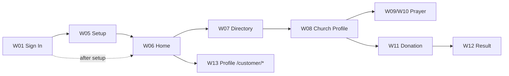

# PRAYER Customer-Facing Website — Low-Fidelity Design

Prepared: 12 October 2026.

This document describes the website screens in text. It follows
[FEATURE.md](FEATURE.md) and the route map in [SPEC.md](SPEC.md). These are
layout proposals, not final UI. Wireframe images are not yet produced; each
screen below lists its blocks so a designer can convert them to images. The
admin dashboard's `design-assets` folder holds image wireframes for the admin
screens only.

## How to read

- Screen ID prefix `W###` (website). Admin screens use `S##`, mobile `M##`.
- Each screen lists the page route, purpose, blocks, and states.
- All names/amounts/sample text are placeholders, not live data.

## Shared layout

Website pages in the `(site)` route group share a top navigation bar and footer.
The navigation bar shows the PRAYER brand, the primary navigation, the church
picker, a language selector, and the signed-in account menu. `/customer` uses the
same website chrome through its own `(profile)` layout (no admin sidebar); the
account pages (`/login`, `/register`, `/verify-*`, `/forgot-password`,
`/reset-password`, `/customer/setup`) use the shorter account-flow header.

| Element                 | Content                                                                                                                              |
| ----------------------- | ------------------------------------------------------------------------------------------------------------------------------------ |
| Top bar                 | PRAYER brand + home · primary nav · church picker · language switch (en/et/sv/fi) · search · notifications · account menu / sign out |
| Top bar (account pages) | PRAYER brand + home · Sign In · Begin Fellowship · Spiritual Walk · language · account menu                                          |
| Main area               | Page content per screen below                                                                                                        |
| Footer                  | Prayer 365 identity + verse · Parish Network · Pastoral Care & Support · legal links + copyright                                     |
| Footer (account pages)  | Legal row only                                                                                                                       |

Primary navigation links: `/churches`, `/events`, `/donate`, `/prayers`; the search
and notification icons point at `/search` and `/notifications`. The donation pages
(`/donate`, `/donate?church={slug}`, `/donate/result`) ship with WB4, so that link
resolves. `/events`, `/search`, `/notifications` and the footer
`/privacy`, `/terms`, `/support` links are still unbuilt (WB-23 ○) and return 404
until those pages ship — accepted, tracked in TASK.md.

Footer supports links: `/privacy`, `/terms`, `/support` (same status as above). The
Pastoral Care panel only shows a phone number once a real, verified number is set in
`src/components/site/support-hotline.ts`; until then it links to `/churches`.

Do not show admin menus to customers. Everything is behind sign-in; the
website never renders content pages to unauthenticated visitors (they go to
sign-in).

Design tokens (WB1): colours live as CSS variables in `src/styles/global.scss`
(`:root`) and are mapped in `tailwind.config.ts`; form sizes in
`siteFormTheme` (`src/config/antdTheme.tsx`). These files are shared with the
admin dashboard, and the admin impact (global `p` rule, `gray-100`, `blue-800`)
is accepted (REPORT R-10).

## Screen Index

| ID  | Screen                  | Purpose                                         | Feature |
| --- | ----------------------- | ----------------------------------------------- | ------- |
| W01 | Sign In                 | Customer login (email + password)               | WF1     |
| W02 | Register                | Create an account                               | WF1     |
| W03 | Verify email            | Confirm the email link result                   | WF1     |
| W04 | Forgot / Reset password | Recover access                                  | WF1     |
| W05 | Language + church setup | Choose language, main church, follow churches   | WF1     |
| W06 | Home (prayer feed)      | Published prayers from main + followed churches | WF3     |
| W07 | Church directory        | Search approved churches                        | WF2     |
| W08 | Church profile          | Church details + Donate entry point             | WF2     |
| W09 | Prayer list / archive   | List published prayers for a context            | WF3     |
| W10 | Prayer detail           | Full prayer text + audio player                 | WF3     |
| W11 | Donation                | Choose one-time/monthly, amount, checkout       | WF4     |
| W12 | Donation result         | Payment result                                  | WF4     |
| W13 | Profile                 | View / edit name, language, profile picture     | WF1     |

## Screens

### W01 — Sign In

**Route:** `/login` — the customer login page. The staff dashboard has its own
separate login at `/admin/login` (not shared; see SPEC §4 note).

- Block: brand + simple card form.
- Fields: email, password.
- Actions: Sign In, link to Register, link to Forgot password.
- On success: go to W05 if the customer has not completed setup, else W06.
- State: unverified email → message "verify your email first" with resend link.
- Built (WB1): image design `design/wb1/page-sign-in.png`. "Member ID",
  "Keep me signed in", ChurchID (EELK) and Magic Link are shown with no action
  (email + password only, R-04). W1 resolved: Option B (SPEC §3).

### W02 — Register

**Route:** `/register` (existing register content).

- Fields: full name, email, password (the image design has no confirm field;
  the request sends the password as confirmation).
- On submit: create account, send verification email.
- Success state: "Check your email" message (does not auto sign in).
- Built (WB1): image design `design/wb1/page-sign-up-step-1.png`. Language and
  main church are not asked here (onboarding, W05).

### W03 — Verify Email

**Routes:** `/verify-email`, `/verify-account`.

- Success: "Email verified — you can sign in now." → link to `/login`.
- Error: "Link invalid or expired" → resend verification link.

### W04 — Forgot / Reset Password

**Routes:** `/forgot-password`, `/reset-password`.

- Forgot: enter email → soft-success message (no account enumeration).
- Reset: token + new password + confirm → success → sign in.
- Built (WB1, decided 14 Oct 2026): the W01 sign-in card **without the
  aside**, same header and quote, title "Forgot Password" / "Reset Password".
  The result ("Check your email!", "Password changed", invalid link) replaces
  the form. Shared by customers and staff.

### W05 — Language and Church Setup

**Route:** `/customer/setup` (first-login onboarding; the optional parish step may be skipped).

- Built (WB1), from image designs `design/wb1/page-sign-up-step-2.png` and
  `-step-3.png`:
  - Step 1: parish connection — search approved churches + 4 frequent chips;
    optional ("Optional" pill).
  - Step 2: language (English / Eesti / Svenska / Suomi) + two notification
    checkboxes (UI only, R-03).
- Actions: "Skip for now" (step 1), Back (step 2), "Enter the Sanctuary"
  finish → Home (W06). Finishing or skipping is remembered per browser.
- Follows beyond the main church and later changes: Profile (W13).

### W06 — Home (Prayer Feed)

**Route:** `/`.

- Block 1: greeting + main church name.
- Block 2: "Today's prayers / latest prayers" cards — title, church, pastor,
  published date, audio button.
- Block 3: followed churches shortcut row.
- Actions: open a prayer (W10), open a church (W08).
- Empty state: "No prayers yet from your churches" + Go to directory (W07).

### W07 — Church Directory

**Route:** `/churches`.

- Search input (name/city) + result grid of church cards (cover, name, city,
  denomination).
- Card action: open church profile (W08).
- Empty: "No churches found" (approved churches only).

### W08 — Church Profile

**Route:** `/churches/:slug`.

- Header: cover, church name, denomination, city, service times (local wall
  clock).
- Blocks: description, address, contacts, website, languages.
- Primary action: **Donate** (W11) — the parish Stewardship card links to that church's live donate page
  (`/donate?church={slug}`, WB-41). The donate page itself disables the pay button with a not-ready note while
  `STRIPE_ENABLED !== 'true'`; there is no disabled CTA on the profile any more.
- Secondary: "View prayers" (W09) — not built as a link: the profile renders its prayer list inline in
  the "Prayer Lists" card with its own filter. The `/churches/:slug/prayers` archive route is reachable from
  the prayer-detail sidebar ("See Arc") and from the header church picker while on the archive (WB-23 ✔).
- Cross-reference: cover image uses the public `coverUrl` field.

### W09 — Prayer List / Archive

**Route:** `/churches/:slug/prayers` and `/prayers`.

- List rows: prayer title, church, pastor, published date, play button.
- Pagination per backend list contract.
- Opens prayer detail (W10).

### W10 — Prayer Detail

**Route:** `/prayers/:slug`.

- Blocks: title, church + pastor attribution, introduction, full body text,
  audio player (approved audio only, public URL).
- Text-only when no approved audio.
- Accessibility: text size control (AA; not color-only).

### W11 — Donation

**Route:** `/donate?church={slug}`.

- Beneficiary parish comes from the `church` query param, so the URL always names
  the church receiving the gift. A bare `/donate` redirects to the giver's Main
  Church; a giver with no Main Church gets the picker-only state below.
- No beneficiary known: only the Beneficiary Church select renders (with a notice);
  purpose, cadence, amounts and the pay button stay hidden until a parish is chosen.
  Choosing one rewrites the URL instead of pushing a new page.
- Right column:
  - "Pause or Modify Monthly Pledge": rendered only for a giver with an active pledge
    while `STRIPE_ENABLED === 'true'`. It hands off to Stripe's hosted billing portal
    (`POST /api/v1/site/donations/portal`). The tax-certificate row, sustaining goal dial,
    and annual report toggle are removed.
  - Neighbour spotlight: resolves the nearest other approved parish with published
    prayers, linking the thumbnail and parish title to that church's profile page,
    with an excerpt of its latest published prayer.
- Form body: the decorative payment-method card and trust badges row under the pay
  button are removed. The footnote financial transparency banner is removed.
- Step A: choose one-time or monthly (toggle).
- Step B: predefined amounts + custom amount; currency shown.
- Step C: confirm → Stripe Checkout (one-time) or subscription setup (monthly).
- Button disabled + "Donations not ready yet" note when
  `STRIPE_ENABLED !== 'true'` (provider stub).
- Redirect to Stripe; return to W12.

### W12 — Donation Result

**Route:** `/donate/result`.

- Success / pending / failure states per provider outcome.
- Summary: church, amount, currency, one-time/monthly.
- Never invent a success for an unconfirmed payment; rely on the webhook /
  confirmed outcome.

### W13 — Profile (routed, WB1-PROFILE)

**Route:** `/customer` (renamed from `/profile`, 14 Oct 2026). Built 20 Oct 2026 as a routed profile:
one shell + three screens.

| Screen              | Route                           | Content                                                                                                                                                                                                            |
| ------------------- | ------------------------------- | ------------------------------------------------------------------------------------------------------------------------------------------------------------------------------------------------------------------ |
| Shell               | all `/customer/*` profile pages | Identity block + five-menu navigation + daily quietude card + "Sign Out from Prayer 365"                                                                                                                           |
| Personal Profile    | `/customer`                     | Profile picture (upload / remove), read-only email + Verified badge, full legal or baptismal name, preferred liturgical language; Save / Cancel                                                                    |
| Church Affiliations | `/customer/church-affiliations` | Primary parish card (name, city, upcoming-events ticker, "Change Primary Parish"), followed-congregation rows (address, unfollow, notifications placeholder), church search (Follow / Make Primary), Save / Cancel |
| Sacramental Privacy | `/customer/privacy`             | Pastoral-privilege text, "Export Your Spiritual Archive" (disabled), "Account Suspension & Permanent Deletion" (disabled)                                                                                          |

- Identity block: photo, name, member number (derived from the customer id), member since, Verified
  badge when the email is verified, "Assigned Chaplain: Not assigned", "Primary Sanctuary" from the
  main church. Values come from `getMe`, `listMyChurches` and the session (`created_at`,
  `email_verified_at`).
- Menu: Personal Profile, Church Affiliations, Notifications, Giving & Stewardship, Sacramental
  Privacy. The last two are shown **disabled** (not built: WB1-P04/WB1-P05) — no route exists for them.
- Saving: the profile PATCH sends only the fields it owns (`name`, `locale`, `profilePicture`), and the
  affiliation save sends `mainChurchId` + follow changes, so one screen cannot clear another's values.
- Known gaps recorded 20 Oct 2026: the design folder for these screens
  (`docs/website/design/customer-profile/*`) is gitignored and not in the repository, so the built
  layout was not diffed against it (R-14 sign-off still open). Copy no longer hardcodes English: the
  five components read 82 `profile*` keys in en/et/sv/fi (added 20 Oct 2026); the et/sv/fi drafts still
  need the R-13 native-speaker pass.
- Identity badge: the header shows "Verified Parishioner" when the email is verified (it no longer claims
  EELK baptism, which email verification cannot prove).
- Server data: the layout and the pages under it share one `getMe` read per request
  (`(profile)/_data.ts` → `getMeOnce`, React request cache).

## Shared states and interactions

| State                    | What the user sees                                                    |
| ------------------------ | --------------------------------------------------------------------- |
| Loading                  | A loading placeholder; do not show fabricated totals or content.      |
| Empty                    | "No prayers yet" / "No churches found" with a relevant action.        |
| Invalid form             | Keep input and explain beside the affected field.                     |
| Saving                   | Disable repeat submit; confirm only after server acceptance.          |
| Network / provider error | Explain the failure and allow a safe retry.                           |
| Not signed in            | Redirect to sign in; clear sensitive page state.                      |
| Session expired          | Return to sign in.                                                    |
| Donations not ready      | Clear note + disabled checkout when the Stripe integration is a stub. |

Add visible labels and keyboard focus; do not rely on color alone. Show
currency on every donation value. Accessible text size on prayer reading.

## Customer journey (Mermaid)

## WB1 design sign-off checklist (R-14)

Built without a design or differing from it. Confirm as built or supply a
design, and record the outcome here. Escalate unclear screens to the Tech Lead.

| Item                                                                                                                                                                           | Status  |
| ------------------------------------------------------------------------------------------------------------------------------------------------------------------------------ | ------- |
| W02 "Check your email" success screen (card style, no design)                                                                                                                  | Pending |
| W02 is one step; the design's steps 2-3 became W05 `/customer/setup` (R-06)                                                                                                    | Pending |
| W05 copy: title, subtitle, "Skip for now", "Enter the Sanctuary", "Form n of 2"                                                                                                | Pending |
| W05 step 2 Back button (not in the design)                                                                                                                                     | Pending |
| Phones: secondary action centered on top, primary button full width, `md` size                                                                                                 | Pending |
| W03 verify, W13 profile: reuse the auth card style (W04 decided 14 Oct)                                                                                                        | Pending |
| W13 routed profile screens (shell, personal, affiliations, privacy): built 20 Oct 2026 from designs shared outside the repo — no design copy in the repository to diff against | Pending |
| Background shapes (sign-up dot, privacy-note glow): positions matched by eye                                                                                                   | Pending |

## Future — not designed here

Events, announcements, request forms, check-in, notifications, and exposed
website CMS screens are not part of these wireframes.

## Summary

The website is a light shell with 13 screens covering onboarding, directory,
prayer, donations, and profile. It shares the account flows with the admin and
reuses the public church/prayer content from the backend. Donation screens
need the Stripe integration to be ready before they are end-to-end usable.
