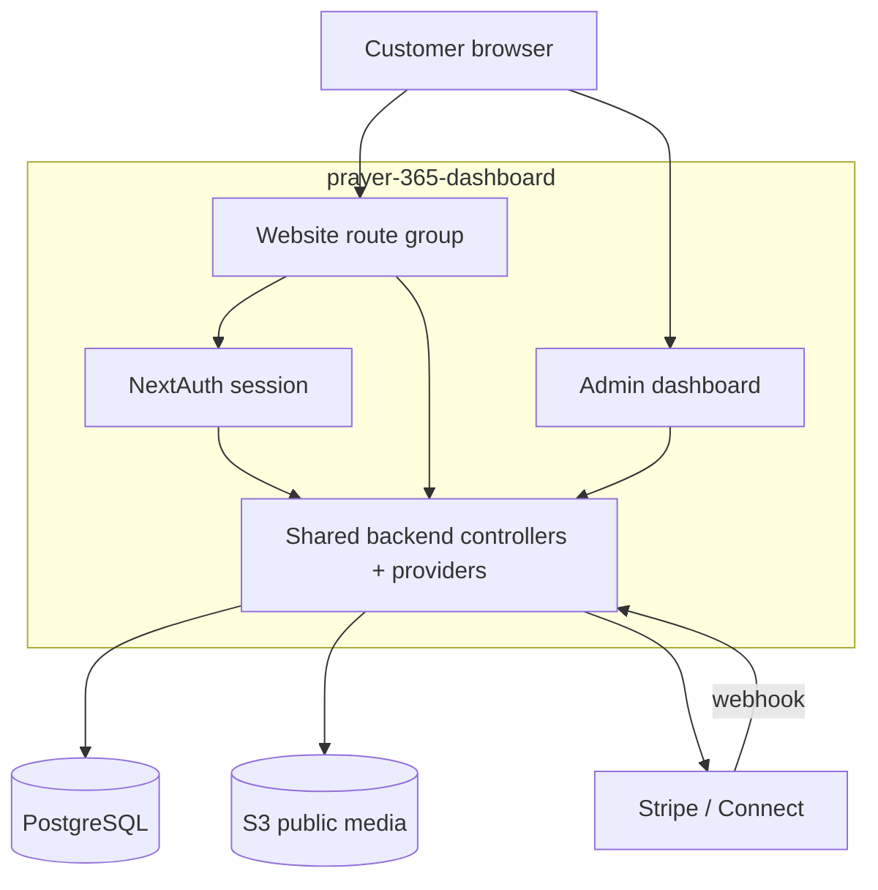
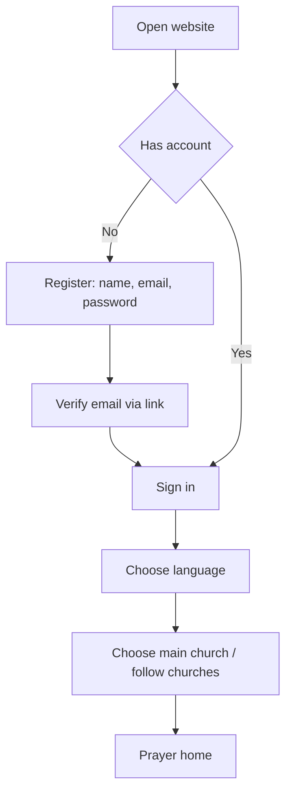
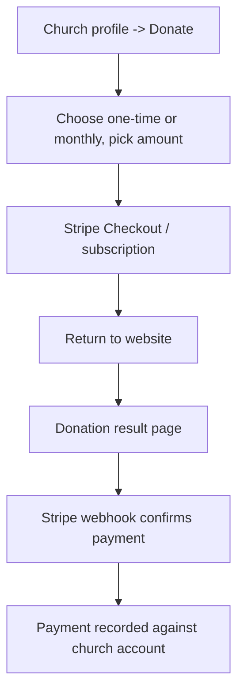

# PRAYER Customer-Facing Website — Overview

Prepared: 12 October 2026. Status: draft for client review.

## Purpose

A simplified, customer-facing website for the PRAYER platform. It is a web
version of the mobile app but with a smaller scope: it focuses on **Prayer**,
**Donations**, and **User Onboarding**. Customers browse and read prayers,
listen to prayer audio, give donations, and manage their own account — all
through a browser.

The website lives **inside this repository** (`prayer-365-dashboard`) as a new
public route group next to the admin dashboard. It shares the same Next.js
app, database, and backend code. It does NOT call the mobile bearer API over
HTTP; it reuses the same backend controllers and providers directly with a
browser session.

## How it relates to the other PRAYER products

| Product                                     | Repo / location                                       | Role                                          |
| ------------------------------------------- | ----------------------------------------------------- | --------------------------------------------- |
| Admin dashboard                             | this repo, `src/app/dashboard/*`                      | Church staff publish content, handle requests |
| Shared backend + API                        | this repo, `src/app/api/v1/*`                         | Business rules, data, permissions, payments   |
| Mobile app (iOS/Android)                    | sibling `prayer-365-mobile-app`                       | End-user app on phones                        |
| **Customer-facing website (this document)** | this repo, new `(site)` route group + `docs/website/` | End-user web experience (browser)             |

## Scope

Only these three areas are built now. Everything else in the mobile app is out
of scope for the website.

| #   | Area            | In scope                                                                  |
| --- | --------------- | ------------------------------------------------------------------------- |
| 1   | User Onboarding | Register, email verify, sign in, forgot/reset password, language, profile |
| 2   | Prayer          | Home prayer feed, prayer list / archive, prayer detail + text + audio     |
| 3   | Donations       | One-time and monthly donatiing to a church via Stripe, payment result     |

Supporting navigation (church directory and church profile) is included because
it is needed to find a church before reading a prayer or donating. Events,
announcements, requests, check-ins, and push notifications are intentionally
not part of the website scope.

## Out of scope (not built here)

- Events, services, announcements
- Prayer / pastoral / meeting request forms
- Voluntary check-in
- Push notifications, device registration, data exports, account deletion UI
- Admin / staff capabilities (already in the dashboard)
- Guest browsing — the site requires an account (see User Onboarding)

Deferred items remain available as future additions; they are not hidden to
save effort, they are simply outside this delivery.

## Who uses it and access rules

| Actor                | What they can do                                                            |
| -------------------- | --------------------------------------------------------------------------- |
| Visitor (no account) | Register or sign in. No content is shown before an account.                 |
| Customer (account)   | Set language, pick a main church, follow churches, read/listen to prayers,  |
|                      | donate one-time or monthly, manage own profile.                             |
| Church staff / admin | Use the admin dashboard (this repo). They can also sign into the website as |
|                      | a customer if they register a customer account.                             |

Accounts are end-user accounts (`User.role_id = null`, created by the existing
register flow). Staff roles are not required to use the website.

## Technology stack

| Component   | Direction (already in this repo)                                                                    |
| ----------- | --------------------------------------------------------------------------------------------------- |
| Framework   | Next.js App Router + TypeScript (same project)                                                      |
| UI          | Ant Design + Tailwind (same as admin)                                                               |
| Auth        | NextAuth v5 credentials session (cookie), same as admin                                             |
| Database    | PostgreSQL via Prisma (same DB)                                                                     |
| Data access | Same backend controllers/providers, called from website route handlers                              |
| Media       | S3 public-read URLs for images and approved prayer audio (D13)                                      |
| Donations   | Stripe / Stripe Connect (shared backend — already planned in the admin docs, reused by the website) |
| Languages   | English, Estonian, Swedish, Finnish (en/et/sv/fi), matching mobile                                  |

## Architecture

The website and the admin dashboard share the same Next.js process, backend
logic, and database. The website signs the customer into a NextAuth cookie
session and calls the shared controllers directly — it does not add a second
API gateway.

## Main workflows

### 1. User Onboarding (recommended flow)

Registration reuses the existing `register` screen and `/api/v1/auth/signup`,
`verify-email`, and `resend-verification` endpoints. Forgot / reset password
reuse the existing `forgot-password` and `reset-password` screens.

### 2. Prayer

A customer opens the home page and sees published prayers from their main and
followed churches. They open a prayer to read the full text and play the
approved prayer audio. Prayer content comes only from approved churches and
published prayer versions.

### 3. Donation

One-time and monthly donations both use Stripe. The payment reaches the
church's own connected Stripe account. The backend receives a verified webhook
to record the confirmed donation. This backend work is **already planned in the
admin docs** and is reused, not rebuilt — see `SPEC.md` section 6.2.

## Languages

The website ships in four interface languages, matching the mobile app:
English (`en`), Estonian (`et`), Swedish (`sv`), Finnish (`fi`). The customer
chooses their interface language independently of the church's country.

## Key decisions still open

| Ref | Decision                                                         |
| --- | ---------------------------------------------------------------- |
| W1  | Customer sign-in: allow role-less customer accounts in NextAuth  |
| W2  | Donation payment model, currencies, and monthly semantics (D6)   |
| W3  | Stripe Connect per-church account setup and fees                 |
| W4  | Which published prayers are shown at launch (language filtering) |
| W5  | Privacy notice text and legal content                            |

These are tracked in `SPEC.md` section 13 and `TASK.md` open decisions.

## References

- `docs/OVERVIEW.md` — admin platform overview (this repo).
- `docs/SPEC.md` — admin + shared backend technical spec (this repo).
- sibling `prayer-365-mobile-app/docs/*` — mobile app docs (source of the
  customer user journey and en/et/sv/fi languages).
- `docs/website/FEATURE.md`, `SPEC.md`, `DESIGN.md`, `TASK.md`, `BOM.md`.

## Summary

The customer-facing website is a simple browser version of the mobile app,
scoped to Prayer, Donations, and User Onboarding. It lives inside
`prayer-365-dashboard` and reuses the existing Next.js app, backend, and
database. The Stripe donation backend is already planned in the admin docs and
is reused, not rebuilt; everything else builds on existing controllers.
