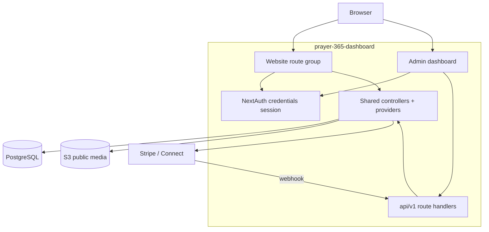

# PRAYER Customer-Facing Website — Technical Specification

Prepared: 12 October 2026. Status: draft.

## 1. Scope and Decision Status

This spec defines how the customer-facing website is built **inside**
`prayer-365-dashboard`. It shares the Next.js process, database, and backend
code with the admin dashboard. Website screen behavior is in
[DESIGN.md](DESIGN.md); feature scope is in [FEATURE.md](FEATURE.md).

The website is scoped to Character: Prayer, Donations, User Onboarding.
Reference points to the admin spec `docs/SPEC.md` (sections cited as
"admin SPEC §x").

Decision status (details in section 13):

| Ref | Decision                            | Status                         |
| --- | ----------------------------------- | ------------------------------ |
| W1  | Customer sign-in through NextAuth   | Open — needs a customer branch |
| W2  | Donation payment model / currencies | Open (inherits D6)             |
| W3  | Stripe Connect account setup + fees | Open                           |
| W4  | Prayer language filtering at launch | Open                           |
| W5  | Privacy notice / legal text         | Open                           |

## 2. Architecture

### 2.1 Overview



Key rule: **the website never calls the mobile bearer HTTP endpoints
(`/api/v1/mobile/*`).** Those are bearer-gated by `requiredAuth`. Instead the
website route handlers call the same backend controllers/providers directly
with a NextAuth cookie session. This avoids a second network hop and keeps
permission logic in one place.

### 2.2 Website access layer

- Add a website route group, e.g. `src/app/(site)/*`.
- Website route handlers / server components guard with the NextAuth session.
- Add a `requiredWebAuth` util (a `requiredAuth` variant) that:
  - returns the cookie session user (`user_id`, `email`, `name`), and
  - revalidates the live user (`status === 'active'`, current `auth_version`),
  - does **not** require a role/permission object (customers have no role).
- Reuse existing controllers: `listPublicChurches`, `getPublicChurch`,
  `getHome`, `listPublishedPrayers`, `getPublishedPrayer`, `getMe`, `patchMe`,
  `listMyChurches`, `setFollow` (`src/controller/mobile.tsx` section 7).

### 2.3 Project structure (additions)

```
src/app/(site)/            # website routes (thin pages)
src/contents/site/         # website feature screens (reuse existing content where possible)
src/hooks/data/site/       # website-only query/mutation hooks (TanStack Query)
src/controller/site/       # website-only orchestration if needed (thin; reuse shared ones)
src/utils/required-webauth.ts
src/app/api/v1/webhooks/stripe/route.ts   # NEW backend donation webhook
```

No parallel DB schema: the website reads the same Prisma models.

## 3. Identity and Authentication

- NextAuth v5 **credentials** strategy with JWT session (existing `src/auth.ts`).
- **Gap:** `authorize` returns `null` when the user has no role
  (`if (!userSession?.role) return null`), and the `jwt` callback also returns
  `null` without a role. Customers are created by `registerUser` with
  `role_id = null`. Therefore the website needs a **customer sign-in branch**:
  - Option A (recommended): allow role-less accounts to create a "customer"
    session (no permission object, `role` set to a sentinel like
    `{ id: '', name: 'customer' }`).
  - Option B: assign the `prayer_user` role on signup and keep role gating.
  - Verified decision is W1. Do not silently give customers staff permissions.
- Register / verify / resend use existing `src/app/api/v1/auth/signup`,
  `verify-email`, `resend-verification` and `src/controller/auth.tsx`.
- Forgot/reset reuse existing `/forgot-password`, `/reset-password` and
  `POST /api/v1/auth/reset-password`.
- Website guard util `requiredWebAuth` revalidates the live user on every
  protected read (active + `auth_version`), same rule as `required-auth`.

## 4. Page Route Map

| Route                         | Screen          | Auth   | Backend called (controller)         |
| ----------------------------- | --------------- | ------ | ----------------------------------- |
| `/`                           | Home (W06)      | Yes    | `getHome`                           |
| `/login`                      | Sign In (W01)   | Public | NextAuth credentials                |
| `/register`                   | Register (W02)  | Public | `registerUser`                      |
| `/verify-email`               | Verify (W03)    | Public | `verifyEmail`                       |
| `/forgot-password`            | Forgot (W04)    | Public | send reset email                    |
| `/reset-password`             | Reset (W04)     | Public | `resetPassword`                     |
| `/setup`                      | Setup (W05)     | Yes    | patch locale + main/follow          |
| `/churches`                   | Directory (W07) | Yes    | `listPublicChurches`                |
| `/churches/:churchId`         | Profile (W08)   | Yes    | `getPublicChurch`                   |
| `/churches/:churchId/prayers` | Prayers (W09)   | Yes    | `listPublishedPrayers`              |
| `/prayers/:prayerId`          | Prayer (W10)    | Yes    | `getPublishedPrayer`                |
| `/donate/:churchId`           | Donation (W11)  | Yes    | site donation controller → Stripe   |
| `/donate/result`              | Result (W12)    | Yes    | donor / attempt status              |
| `/profile`                    | Profile (W13)   | Yes    | `getMe` / `patchMe` / avatar upload |

Routing guard: any website page except the four public account pages requires
a session; unauthenticated visitors go to `/login`. Content is never rendered
to unauthenticated visitors (see FEATURE WF1).

## 5. Data and DTOs

No new tables are required for the website features. The website reuses the
models documented in admin SPEC §5 and the mobile DTOs in
`src/models/mobile.tsx`. Confirmed field sources:

| Data                  | Source / model                                                         | Notes                                            |
| --------------------- | ---------------------------------------------------------------------- | ------------------------------------------------ |
| Church (public)       | `MobilePublicChurchSchema` (`src/models/mobile.tsx`)                   | includes `coverUrl`, `serviceTimes` (local time) |
| Church summary        | `MobileChurchSummarySchema`                                            | includes `coverUrl` (MB-17 done)                 |
| Published prayer      | `MobilePublishedPrayerSchema`                                          | audio field today returns `assetId`/`assetKey`   |
| Home projection       | `MobileHomeSchema` (`mainChurch`, `followedChurches`, `latestPrayers`) | MB-10 done                                       |
| Profile / main church | `MobileMeSchema`, `MobileMePatchSchema`                                |                                                  |
| Follow relationships  | `listMyChurches` / `setFollow` controller                              |                                                  |
| Language              | `Language` table; add `sv` seed (below)                                |                                                  |
| Donation              | `Donation`, `DonationSubscription`, `PaymentAccount`                   | tables exist; flows not                          |
| Request (blocked)     | (out of website scope)                                                 |                                                  |

### 5.1 Language delta

- The mobile app ships `en/et/sv/fi`. The backend `Language` seed only has
  `en/et/fi` (`prisma/seeds/language.ts`) and content languages use `en/et`.
- Add a `sv` language seed (code `sv`, name `Svenska`) and expose it in the
  language contract used by the website language selector.
- Website UI strings ship in the four locales (reuse/extend the mobile
  translation keys at the website layer; mobile translations are not imported
  into this repo).

### 5.2 Prayer audio URL

- Approved audio is served from the public S3 bucket today (D13). The website
  audio player builds playback from the published prayer's audio asset key via
  `S3_PUBLIC_URL` (or a `url` field added later per MB-09). No auth header is
  attached (public bucket), matching the mobile behaviour.

## 6. API and Backend Contract

The website reads content through the shared controllers (section 2.2), so no
new read API is needed. Two write/backend surfaces are involved:

### 6.1 Existing (ready to reuse)

| Area         | Endpoint / controller                                          | Status   |
| ------------ | -------------------------------------------------------------- | -------- |
| Register     | `POST /api/v1/auth/signup`                                     | ✔ built |
| Verify email | `POST /api/v1/auth/verify-email` + resend                      | ✔ built |
| Password     | `POST /api/v1/auth/reset-password`, forgot                     | ✔ built |
| Discover     | `GET /api/v1/mobile/churches` (controller reuse)               | ✔ built |
| Home         | `GET /api/v1/mobile/home` (controller reuse)                   | ✔ built |
| Prayers      | `GET .../prayers`, `GET /prayers/:prayerId` (controller reuse) | ✔ built |
| Profile      | `GET/PATCH /me`, avatar                                        | ✔ built |

### 6.2 Donations — shared backend reuse (no duplicate work)

The Stripe backend is **already planned in the admin docs** (`docs/SPEC.md`
§8.5, §9.6 and `docs/TASK.md` F8DO + X-MOB). It is a shared backend capability;
the website does **not** re-plan or rebuild it. Current status: the Stripe
adapter in `src/providers/stripe.tsx` (`STRIPE.createCheckoutSession`,
`STRIPE.constructWebhookEvent`) is a stub and the webhook route is not yet
built, but those items are already tracked in the admin plan.

Website donation work references these admin task IDs instead of new ones:

| Admin task (docs/TASK.md) | Delivers for the website                                                   | Website consumes in           |
| ------------------------- | -------------------------------------------------------------------------- | ----------------------------- |
| DO-02 (F8DO)              | Stripe/donation providers + controllers + webhook route shell              | WB-40 (TASK)                  |
| DO-05 (F8DO)              | Stripe webhook: signature verify, durable receipt + outbox                 | donation confirmed state      |
| DO-06 (F8DO)              | `payment.sync`: dedupe/reconcile events, upsert donation + installments    | donation confirmed state      |
| DO-08 (F8DO)              | Backend Stripe tests (duplicates, out-of-order, installments)              | WB-44 (UI tests)              |
| MB-02 (X-MOB)             | `POST M/churches/:churchId/donations` + attempt status                     | website donation entry/result |
| MB-03 (X-MOB)             | `DonationOptions` on the public church (currencies, presets, monthly flag) | donate screen amounts         |

The website adds only a thin server-side integration (calls the shared donation
controller with the NextAuth session user — no new Stripe/provider code) plus
the donate/result screens and hooks. See `docs/website/TASK.md` WB-40..WB-44 and
the "Shared backend reuse" block.

Until the shared backend donation launch and webhook land (MB-02/03 and
DO-02/05/06), the donate button stays disabled with a "Donations not ready yet"
message. Do not claim success for an unconfirmed payment (no webhook = no
confirmed `Donation` row).

### 6.3 Response conventions

Website pages follow the shared envelope wherever data crosses a route handler:
`{ success, message, result, ..., request_id }` and `GeneralError` fields
(admin SPEC §6.1). Donation initiation uses `Idempotency-Key`.

## 7. Feature Flows

### WF1 — Onboarding

1. `/register` → `registerUser` → user with `role_id = null` + verification email.
2. Verify via link → `email_verified_at` set.
3. `/login` (NextAuth customer branch, W1) → session.
4. `/setup` → set `locale`, main church, follows.
5. `/profile` → view/edit name, locale, picture; change main church/follows.

### WF2 — Directory

Search/list approved churches and open a public church profile. Server-side
only approved churches are returned; no private fields.

### WF3 — Prayer

Home uses `getHome` projection (main + followed churches, latest published
prayers). Prayer list/detail use the published-prayer controllers. Audio plays
from the public S3 URL. Draft/unapproved content is never returned.

### WF4 — Donations

1. Church profile → Donate.
2. Donate screen: one-time/monthly + amount + currency (`DonationOptions`,
   from shared backend MB-03).
3. Website thin integration calls the shared donation controller (built by
   backend MB-02) with the NextAuth session user; the backend launches the
   Stripe Checkout/subscription and returns provider launch params →
   redirect to Stripe. No new Stripe/provider code in the website.
4. Customer completes on Stripe; the shared webhook (DO-05) confirms and
   `payment.sync` (DO-06) records `Donation`/`DonationSubscription` for the
   church account + customer.
5. Return to `/donate/result` showing the confirmed/pending/failed outcome
   derived from the recorded state (never from the URL alone).

## 8. Infrastructure Delta

| Item            | Proposal                                                                               |
| --------------- | -------------------------------------------------------------------------------------- |
| Hosting         | Same Next.js/Vercel app as the admin (shared process). Add the website routes.         |
| Domain          | A public customer domain (e.g. `www.` / a chosen brand domain) — confirm (shared BOM). |
| Database        | Same managed PostgreSQL; no new instance.                                              |
| Media           | Same S3 bucket, public-read for now (D13); approved audio/image URLs.                  |
| Payments        | Stripe + Stripe Connect; per-church connected account (`PaymentAccount`).              |
| Email           | Same SES/Nodemailer transactional path (verify/reset emails already use it).           |
| Background jobs | Same scheduler/worker path for `payment.sync` (admin SPEC §10.3).                      |

## 9. Security and Privacy

- Routes guard with the session; never render content to unauthenticated users.
- `requiredWebAuth` revalidates the live user on protected reads.
- No raw card data stored; donations go through Stripe to the church account.
- Do not log private content (donation amounts, account info).
- Shared backend verifies the Stripe webhook signature before recording
  payments (admin DO-05); the website itself holds no payment amount state
  beyond what the confirmed donation attempt reports.
- Interface language independent of church country.

## 10. Verification Matrix

| Check                          | Expected                                               |
| ------------------------------ | ------------------------------------------------------ |
| Customer sign-in (role-less)   | Role-less `User` can sign in (after W1).               |
| Register → verify → sign in    | End to end works; unverified cannot sign in.           |
| Approved-church-only directory | Suspended/archived churches never returned.            |
| Home + prayer feed             | `getHome` projection renders; draft content absent.    |
| Audio playback                 | Approved audio plays via public URL.                   |
| Donation webhook               | Signature verified, deduped, `Donation` row created.   |
| Language                       | en/et/sv/fi selectable; independent of church country. |
| Session expiry                 | Returns to `/login`; no stale content.                 |
| Permissions                    | Website users cannot reach admin routes/screens.       |

## 11. Not in this spec (explicitly deferred)

Events, announcements, request forms, check-in, notifications, guest
browsing, admin/staff screens, and in-site account deletion are out of the
website scope (see FEATURE "Out of scope / Future").

## 12. Out-of-scope guardrail

Do not expand the website beyond Prayer, Donations, and User Onboarding
without a separately agreed scope change. Deferred features stay deferred.

## 13. Decision Register (website)

| Ref | Question / decision                                                                       | Blocker                    |
| --- | ----------------------------------------------------------------------------------------- | -------------------------- |
| W1  | Customer NextAuth sign-in branch (role-less session vs `prayer_user` role).               | WF1 (all onboarding)       |
| W2  | Donation payment model: currencies, presets, monthly semantics, fees (links to admin D6). | WF4 (donate screen fields) |
| W3  | Stripe Connect: per-church account onboarding, payout/fee handling, success/cancel URLs.  | WF4 (checkout)             |
| W4  | Prayer language filtering and content-language availability at launch.                    | WF3 (prayer feed)          |
| W5  | Privacy notice and legal text for the website.                                            | WF1 (registration)         |

## 14. References

- `docs/website/OVERVIEW.md`, `FEATURE.md`, `DESIGN.md`, `TASK.md`, `BOM.md`.
- `docs/SPEC.md` (admin + shared backend), `docs/TASK.md` (admin tasks).
- sibling `prayer-365-mobile-app/docs/*` (mobile customer journey, en/et/sv/fi).

## Summary

The website is a new public route group inside `prayer-365-dashboard` that
signs customers in with NextAuth (a customer branch is needed for role-less
accounts), reuses the shared church/prayer/home controllers, and keeps
donations thin by reusing the Stripe backend already planned in the admin docs
(DO-02/05/06/08, MB-02/03) instead of rebuilding it. No new database tables are
needed.
