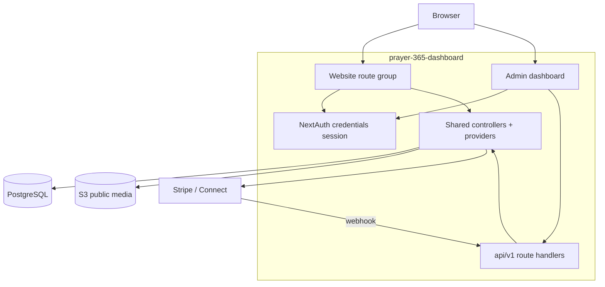

# PRAYER customer-facing website: technical specification

Prepared: 12 October 2026. Status: draft.

## 1. Scope and decision status

This specification defines how the customer-facing website runs inside `prayer-365-dashboard`. The site shares the Next.js process, PostgreSQL database, and backend handlers with the admin dashboard. UI screen behavior is documented in [DESIGN.md](DESIGN.md), and feature scope lives in [FEATURE.md](FEATURE.md).

The website scope covers prayer, donations, and user onboarding. Cross-references cite the admin specification `docs/SPEC.md` as "admin SPEC §x".

Decision status (details in section 13):

| Ref | Decision                              | Status                      |
| --- | ------------------------------------- | --------------------------- |
| W1  | Customer sign-in through NextAuth     | Open, needs customer branch |
| W2  | Donation payment model and currencies | Open, inherits D6           |
| W3  | Stripe Connect account setup and fees | Open                        |
| W4  | Prayer language filtering at launch   | Open                        |
| W5  | Privacy notice and legal text         | Open                        |

## 2. Architecture

### 2.1 Overview



The website never calls mobile bearer endpoints under `/api/v1/mobile/*`. Those endpoints require bearer tokens verified by `requiredAuth`. Instead, website route handlers call shared backend controllers and providers directly using a NextAuth cookie session. This avoids an extra network hop and keeps authorization checks in one place.

### 2.2 Website access layer

- Add a website route group at `src/app/(site)/*`.
- Website route handlers and server components guard routes with the NextAuth session.
- Add `requiredWebAuth`, a `requiredAuth` variant that:
  - returns the cookie session user (`user_id`, `email`, `name`),
  - revalidates live user status (`status === 'active'`, current `auth_version`), and
  - omits role and permission requirements, because customers have no role.
- Reuse existing controllers from `src/controller/mobile.tsx`: `listPublicChurches`, `getPublicChurch`, `getHome`, `listPublishedPrayers`, `getPublishedPrayer`, `getMe`, `patchMe`, `listMyChurches`, `setFollow`, `listPublicEvents`, and `listPublicAnnouncements`. The Primary Parish badge on the church profile resolves from `getHome` (`mainChurch.id`).

### 2.3 Project structure additions

```
src/app/(site)/                          # Website routes (thin pages)
src/contents/site/                       # Website feature screens
src/hooks/data/site/                     # Website query and mutation hooks (TanStack Query)
src/controller/site/                     # Website orchestration wrappers
src/utils/required-webauth.ts            # Web session guard
src/app/api/v1/webhooks/stripe/route.ts # Shared backend donation webhook
```

No parallel database schema is needed. The website reads the existing Prisma models.

## 3. Identity and authentication

- Authentication uses NextAuth v5 credentials with JWT sessions in `src/auth.ts`.
- Handling role-less users requires a customer sign-in branch. Currently, `authorize` returns `null` when a user lacks a role (`if (!userSession?.role) return null`), and the `jwt` callback drops users without roles. New customers register via `registerUser` with `role_id = null`.
  - Option A (recommended): allow accounts without roles to establish a customer session without a permission object, assigning a sentinel role like `{ id: '', name: 'customer' }`.
  - Option B: assign the `prayer_user` role on signup and preserve role gating.
  - Decision W1 tracks this choice. Customers must never receive staff permissions.
- Registration and verification reuse `POST /api/v1/auth/signup`, `verify-email`, `resend-verification`, and `src/controller/auth.tsx`.
- Password reset flows reuse `/forgot-password`, `/reset-password`, and `POST /api/v1/auth/reset-password`.
- The `requiredWebAuth` guard revalidates active status and `auth_version` on every protected read, matching `requiredAuth`.

## 4. Page route map

| Route                         | Screen          | Auth   | Controller called                                                                            |
| ----------------------------- | --------------- | ------ | -------------------------------------------------------------------------------------------- |
| `/`                           | Home (W06)      | Yes    | `getHome`                                                                                    |
| `/login`                      | Sign In (W01)   | Public | NextAuth credentials                                                                         |
| `/register`                   | Register (W02)  | Public | `registerUser`                                                                               |
| `/verify-email`               | Verify (W03)    | Public | `verifyEmail`                                                                                |
| `/forgot-password`            | Forgot (W04)    | Public | Send reset email                                                                             |
| `/reset-password`             | Reset (W04)     | Public | `resetPassword`                                                                              |
| `/setup`                      | Setup (W05)     | Yes    | Patch locale, main church, follows                                                           |
| `/churches`                   | Directory (W07) | Yes    | `listPublicChurches` (search, radius, denomination, language, quick filters)                 |
| `/churches/:churchId`         | Profile (W08)   | Yes    | `getPublicChurch` (gallery, staff), `listPublicEvents`, `listPublicAnnouncements`, `getHome` |
| `/churches/:churchId/prayers` | Prayers (W09)   | Yes    | `listPublishedPrayers`                                                                       |
| `/prayers/:prayerId`          | Prayer (W10)    | Yes    | `getPublishedPrayer`                                                                         |
| `/donate/:churchId`           | Donation (W11)  | Yes    | Site donation controller to Stripe                                                           |
| `/donate/result`              | Result (W12)    | Yes    | Donor and attempt status                                                                     |
| `/profile`                    | Profile (W13)   | Yes    | `getMe`, `patchMe`, avatar upload                                                            |

Every website page except the four public account routes requires a session. Unauthenticated visitors redirect to `/login`. Content never renders for unauthenticated visitors per feature WF1.

The customer site and staff dashboard use separate sign-in pages. Customers sign in at `/login`. Staff use `/admin/login`. Both share the NextAuth credentials flow in `src/auth.ts` and the sign-in form component.

## 5. Data and DTOs

Four schema additions support website features: the `church_gallery_items` table (decision W6), the `sanctuary_hours` column on `churches` (decision W9), the `diaconal_programs` JSON column on `churches` (decision W11), and the `cta_label` column on `events` (decision W15). All other features reuse existing models from admin SPEC §5 and mobile DTOs in `src/models/mobile.tsx`.

| Data                     | Source / model                                       | Notes                                                                                                                                                                                                                |
| ------------------------ | ---------------------------------------------------- | -------------------------------------------------------------------------------------------------------------------------------------------------------------------------------------------------------------------- |
| Church (public)          | `MobilePublicChurchSchema`                           | Includes `coverUrl`, `serviceTimes`, `sanctuaryHours`, `deaneryName`, `gallery`, `staff`, `diaconalPrograms`, `contacts`, and `accessibility`.                                                                       |
| Church summary           | `MobileChurchSummarySchema`                          | Includes `coverUrl`, `addressLine1`, `description`, `pastorName`, `serviceTimes`, `sanctuaryHours`, and `accessibility`.                                                                                             |
| Church list query        | `MobileChurchListQuerySchema`                        | `search`, `radius_km`, `latitude`, `longitude`, `denomination`, `language`, and quick-filter flags.                                                                                                                  |
| Published prayer         | `MobilePublishedPrayerSchema`                        | Audio field returns `assetId` and `assetKey`.                                                                                                                                                                        |
| Church prayers (public)  | `GET /api/v1/site/churches/:churchId/prayers`        | Feeds the worship playlist on W08 using `listPublishedPrayers` with category filters and isolated HTML5 audio playback.                                                                                              |
| Home projection          | `MobileHomeSchema`                                   | Returns `mainChurch`, `followedChurches`, and `latestPrayers`.                                                                                                                                                       |
| Profile / main church    | `MobileMeSchema`, `MobileMePatchSchema`              | Updates user details and primary parish selection.                                                                                                                                                                   |
| Follow relationships     | `listMyChurches` / `setFollow`                       | Reads and updates followed church IDs.                                                                                                                                                                               |
| Language                 | `Language` table                                     | Needs `sv` seed.                                                                                                                                                                                                     |
| Donation                 | `Donation`, `DonationSubscription`, `PaymentAccount` | Schema models exist; flows handled in shared backend.                                                                                                                                                                |
| Prayer petitions         | `POST /api/v1/site/churches/:churchId/requests`      | Submits petitions via `submitRequest` (`MobileRequestInputSchema`) into PostgreSQL `requests` table with rate limits and idempotency keys.                                                                           |
| Diaconal programs        | `Church.diaconal_programs`                           | JSON column added in migration `20261015140000_add_church_diaconal_programs`. Exposed as `diaconalPrograms` on `MobilePublicChurchSchema` and `ChurchProfileOutputSchema`. Feeds the diaconal care card grid on W08. |
| Church gallery           | `ChurchGalleryItem` table                            | Table added in migration `20261015120000_add_church_gallery_items_and_sanctuary_hours`. Exposed as `gallery` on `MobilePublicChurch`. Returns `READY` image assets ordered by `order_index`.                         |
| Church staff (public)    | `ChurchPastor` + `Pastor`                            | Exposed as `staff` on `MobilePublicChurch` with name, role, and avatar.                                                                                                                                              |
| Upcoming events          | `Event` via `listPublicEvents`                       | Approved churches with `starts_at >= now`. Action button label uses `Event.cta_label` with fallback to localized default.                                                                                            |
| Announcements            | `Announcement` via `listPublicAnnouncements`         | Published non-deleted records, newest first, limit 2. Category tags parse from title or body prefix.                                                                                                                 |
| Primary Parish badge     | `getHome` -> `mainChurch.id`                         | Badge renders when `mainChurch.id === churchId`.                                                                                                                                                                     |
| Sanctuary devotion hours | `Church.sanctuary_hours`                             | Column added in migration `20261015120000_add_church_gallery_items_and_sanctuary_hours`. Parses multi-segment schedules delimited by `•` into schedule cards on W08 and powers the `open_now` filter.                |
| Sanctuary facilities     | `Church.accessibility`                               | Text parsed by `•` or newlines into discrete rows with icons on W08.                                                                                                                                                 |
| Deanery (public)         | `Church.org_node.parent`                             | Resolved from parent org node where `kind = 'DEANERY'`. Exposed as `deaneryName`.                                                                                                                                    |

### 5.1 Language delta

- The mobile app ships translations for `en`, `et`, `sv`, and `fi`. The database seed currently includes `en`, `et`, and `fi` in `prisma/seeds/language.ts`.
- Add an `sv` language seed (`sv`, `Svenska`) so the website language selector can query it.
- Website UI strings support all four locales, using translation keys aligned with mobile.

### 5.2 Prayer audio URL

Approved audio files reside in the public S3 bucket per decision D13. The website audio player constructs playback URLs from the prayer asset key using `S3_PUBLIC_URL`. The client sends no authorization header because the bucket is public, matching mobile client behavior.

### 5.3 Church directory query and filter schema

The directory panel supports structured queries:

- **Free-text search.** The `search` string matches church names and cities.
- **Distance radius.** The `radius_km` number (5, 10, 25, or 50 km) filters relative to reference coordinates `latitude` and `longitude`.
- **Denomination.** The `denomination` string matches the denomination value, such as Lutheran / EELK, Baptist, Orthodox, or Catholic.
- **Language.** The `language` string uses an ISO 639-1 code (`et`, `en`, `sv`, `fi`) matching service languages in `churchLanguages`.
- **Quick filters.**
  - `sunday_live_stream` filters congregations broadcasting Sunday services online.
  - `open_now` filters sanctuaries open for prayer or contemplation at request time.
  - `taize_chants` filters churches with Taizé chant services.
  - `youth_ministry` filters churches with active youth ministry programs.

```ts
export const MobileChurchListQuerySchema = z.object({
  page: z.coerce.number().int().positive().default(1),
  limit: z.coerce.number().int().positive().max(100).default(25),
  search: z.string().trim().max(200).optional(),
  latitude: z.coerce.number().min(-90).max(90).optional(),
  longitude: z.coerce.number().min(-180).max(180).optional(),
  radius_km: z.coerce.number().positive().optional(),
  denomination: z.string().trim().max(100).optional(),
  language: z.string().trim().min(2).max(10).optional(),
  sunday_live_stream: z.coerce.boolean().optional(),
  open_now: z.coerce.boolean().optional(),
  taize_chants: z.coerce.boolean().optional(),
  youth_ministry: z.coerce.boolean().optional(),
})
```

## 6. API and backend contract

Website reads use shared controllers directly per section 2.2, so no separate read endpoints exist. Writes touch two areas:

### 6.1 Existing endpoints ready to reuse

| Area                    | Endpoint / controller                                                                      | Status |
| ----------------------- | ------------------------------------------------------------------------------------------ | ------ |
| Register                | `POST /api/v1/auth/signup`                                                                 | Built  |
| Verify email            | `POST /api/v1/auth/verify-email` + resend                                                  | Built  |
| Password                | `POST /api/v1/auth/reset-password`, forgot                                                 | Built  |
| Discover                | `GET /api/v1/site/churches` (controller `listPublicChurches`)                              | Built  |
| Home                    | `GET /api/v1/mobile/home` (shared controller)                                              | Built  |
| Prayers                 | `GET .../prayers`, `GET /prayers/:prayerId`                                                | Built  |
| Profile                 | `GET/PATCH /me`, avatar upload                                                             | Built  |
| Church events           | `GET /api/v1/site/churches/:churchId/events` (controller `listPublicEvents`)               | Built  |
| Church announcements    | `GET /api/v1/site/churches/:churchId/announcements` (controller `listPublicAnnouncements`) | Built  |
| Church prayers          | `GET /api/v1/site/churches/:churchId/prayers` (controller `listPublishedPrayers`)          | Built  |
| Church prayer petitions | `POST /api/v1/site/churches/:churchId/requests` (controller `submitRequest`)               | Built  |
| Site home               | `GET /api/v1/site/home` (controller `getHome` with `requiredWebAuth`)                      | Built  |

### 6.2 Directory search and filter API contract (W07)

`GET /api/v1/site/churches` calls `listPublicChurches` using these evaluation rules:

1. **Status invariant.** Only approved churches (`status = APPROVED`) return. Suspended, unapproved, and archived records stay excluded.
2. **Text search.** The `search` parameter runs a case-insensitive substring search across `name` and `address->>'city'`.
3. **Distance radius.** Given `latitude` and `longitude`, distance calculates via the haversine formula against `church.latitude` and `church.longitude`. Rows farther than `radius_km` drop out. Coordinates without `radius_km` sort results by ascending distance.
4. **Denomination.** Matches `church.denomination` case-insensitively.
5. **Language.** Matches associated `churchLanguages` records where `language_code = language`.
6. **Quick filters.**
   - `sunday_live_stream` matches churches with live stream metadata.
   - `open_now` evaluates wall-clock time against meditation and sanctuary opening hours.
   - `taize_chants` matches services or tags mentioning Taizé prayer.
   - `youth_ministry` matches services or tags for youth ministry programs.
7. **Pagination.** `page` and `limit` adhere to the standard envelope (`result`, `total`, `page`, `limit`).

### 6.3 Shared donation backend

Admin specifications define the Stripe backend in `docs/SPEC.md` §8.5, §9.6 and `docs/TASK.md` under F8DO and X-MOB. The website reuses this shared capability without rebuilding it. Currently, the Stripe adapter in `src/providers/stripe.tsx` contains stubs, and the webhook handler remains in progress.

Website donation work relies on these admin tasks:

| Admin task (docs/TASK.md) | Deliverable                                              | Website consumer               |
| ------------------------- | -------------------------------------------------------- | ------------------------------ |
| DO-02 (F8DO)              | Stripe providers, controllers, webhook shell             | WB-40 (TASK)                   |
| DO-05 (F8DO)              | Stripe webhook verification, receipt storage, outbox     | Donation confirmation state    |
| DO-06 (F8DO)              | `payment.sync`: deduplication, donation upserts          | Donation confirmation state    |
| DO-08 (F8DO)              | Backend Stripe tests (idempotency, out-of-order events)  | WB-44 (UI tests)               |
| MB-02 (X-MOB)             | `POST M/churches/:churchId/donations` and attempt status | Donation entry and result      |
| MB-03 (X-MOB)             | `DonationOptions` on public church payload               | Donation screen amount choices |

The website layer adds only a thin server integration calling the shared donation controller with the NextAuth session user, plus the donation screens and hooks. See `docs/website/TASK.md` WB-40 through WB-44.

Until the backend webhook and checkout flows land, the donation CTA stays disabled with a status notice. The website never reports a donation as confirmed without a verified `Donation` record created by the webhook.

### 6.4 Response conventions

Route handlers return standard API envelopes: `{ success, message, result, ..., request_id }` and `GeneralError` structures per admin SPEC §6.1. Donation creation requires an `Idempotency-Key` header.

### 6.5 Church profile read and interaction contract (W08)

All profile interactions run through shared controllers guarded by `requiredWebAuth`. Non-approved churches return a 404 error.

- `gallery`: Array of `{ assetId, url, caption, orderIndex }` sorted by `order_index` ascending. Returns only `READY` assets with purpose `IMAGE`. URLs resolve through public S3.
- `staff`: Active pastoral staff exposed as `{ name, pastoralRole, imageUrl }`. Direct contacts appear only when populated in church contact fields.
- `diaconalPrograms`: Program list loaded from the `diaconal_programs` JSON column, exposing `{ title, description, badgeText, metaText, icon }`.
- `prayers`: Public prayers fetched via `GET /api/v1/site/churches/:churchId/prayers`, providing liturgical audio, transcripts, and category filtering.
- `requests`: Petitions submitted via `POST /api/v1/site/churches/:churchId/requests` through `submitRequest`, writing to the PostgreSQL `requests` table with rate limits and idempotency keys.
- `events`: Upcoming events where `starts_at >= now`, sorted ascending, limited to 3 items. Action button text reads from `cta_label` with a localized fallback.
- `announcements`: Published announcements where `deleted_at` is null, sorted newest first, limited to 2 items. Title and body prefixes provide category badges.
- `sanctuaryHours`: Nullable schedule string from `church.sanctuary_hours`. Multi-segment schedules separate by `•` into discrete cards and feed `open_now` filtering.
- `accessibility`: Nullable feature list separated by `•` or newlines, mapped to icon rows on the profile.
- `deaneryName`: Nullable deanery name resolved from parent org nodes with `kind = 'DEANERY'`.
- `stewardship`: Preset donation amounts with custom entry and denomination tax-deductibility notices.

## 7. Feature flows

### 7.1 WF1: Onboarding

1. `/register` calls `registerUser`, creating a user row with `role_id = null` and sending a verification email.
2. The user opens the verification link, setting `email_verified_at`.
3. `/login` authenticates via NextAuth customer branch (W1) and issues a session.
4. `/setup` sets user `locale`, primary church, and followed churches.
5. `/profile` allows updating name, locale, profile image, primary church, and follows.

### 7.2 WF2: Directory

Directory flows filter approved congregations across the region:

1. Enter search terms for church name or city (`search`).
2. Pick distance radius (`radius_km`) with client coordinates (`latitude`, `longitude`).
3. Select denomination (`denomination`) or service language (`language`).
4. Apply quick filters for Sunday live stream, open sanctuaries, Taizé chants, or youth ministry.
5. Directory displays split layout:
   - Left: Congregation cards with service times, contact links, and accessibility details.
   - Right: Interactive map synchronized with filtered pins and selection state.
6. Opening `/churches/:churchId` loads public profile details, gallery items, upcoming events, published announcements, pastoral staff, and the primary parish badge when matching `mainChurch.id`.

### 7.3 WF3: Prayer

Home loads the `getHome` projection for primary church, followed churches, and recent published prayers. Prayer lists and detail views use published prayer controllers. Audio streams from public S3 URLs. Unapproved or draft content stays hidden.

### 7.4 WF4: Donations

1. The user clicks Donate on a church profile.
2. The donation screen loads payment options, frequencies, and amounts from `DonationOptions` (backend task MB-03).
3. The website calls the shared donation controller with the NextAuth session. The controller launches Stripe Checkout and returns checkout URLs.
4. The user completes payment in Stripe. The backend webhook (DO-05) verifies signatures and `payment.sync` (DO-06) writes `Donation` or `DonationSubscription` rows.
5. The user returns to `/donate/result`, which verifies recorded payment state rather than trusting query parameters alone.

## 8. Infrastructure delta

| Component       | Architecture                                                                     |
| --------------- | -------------------------------------------------------------------------------- |
| Hosting         | Shared Next.js deployment with admin dashboard.                                  |
| Domain          | Dedicated customer domain or subdomain, pending BOM confirmation.                |
| Database        | Shared managed PostgreSQL instance.                                              |
| Media           | Shared S3 bucket with public read access (D13).                                  |
| Payments        | Stripe and Stripe Connect with per-church connected accounts (`PaymentAccount`). |
| Email           | Shared SES/Nodemailer pipeline for transactional emails.                         |
| Background jobs | Shared scheduler and worker pool for `payment.sync` (admin SPEC §10.3).          |

## 9. Security and privacy

- Routes require an active session. Protected pages never render content for unauthenticated users.
- `requiredWebAuth` revalidates live account status on every read.
- The application stores no raw payment details. Donations route through Stripe to church connected accounts.
- Logs exclude private financial amounts and sensitive profile data.
- Shared backend routes verify Stripe webhook signatures before persisting payment status.
- Interface language selection operates independently from church country location.
- Public staff listings expose only name, role, and photo per decision W7. Internal contact channels remain private.
- Gallery media uses public S3 assets (D13) without requiring signed URLs.

## 10. Verification matrix

| Check                         | Expected outcome                                                                                       |
| ----------------------------- | ------------------------------------------------------------------------------------------------------ |
| Customer sign-in              | Role-less user signs in successfully after decision W1.                                                |
| Registration and verification | User completes registration and verification; unverified users cannot sign in.                         |
| Directory approvals           | Suspended and archived churches never appear in directory results.                                     |
| Directory filters             | Text search, radius, denomination, language, and quick filters return matching approved churches only. |
| Home feed                     | `getHome` returns primary church and published prayers; drafts stay hidden.                            |
| Audio playback                | Player streams approved audio from public S3 bucket.                                                   |
| Donation webhook              | Webhook verifies signature, eliminates duplicates, and writes `Donation` rows.                         |
| Language selector             | Locales `en`, `et`, `sv`, and `fi` switch UI language cleanly.                                         |
| Session expiration            | Expired sessions redirect to `/login` without exposing stale data.                                     |
| Access control                | Customer accounts cannot access admin routes or dashboard screens.                                     |

## 11. Deferred features

Pastoral meeting intake, check-in, push notifications, guest browsing, admin screens, full event registration, announcement authoring, and in-site account deletion remain deferred per `FEATURE.md`. Events and announcements appear strictly as read-only profile cards per decisions W6 through W8. Prayer petition intake runs on the profile per decision W13.

## 12. Scope guardrail

Keep website scope limited to prayer, donations, and customer onboarding. Any additions require a separate written scope change.

## 13. Decision register

| Ref | Decision                                                                                                                                                   | Blocker                                        |
| --- | ---------------------------------------------------------------------------------------------------------------------------------------------------------- | ---------------------------------------------- |
| W1  | Customer NextAuth sign-in branch for role-less accounts.                                                                                                   | WF1 (onboarding)                               |
| W2  | Donation payment model, currency list, preset amounts, and recurring fees.                                                                                 | WF4 (donation inputs)                          |
| W3  | Stripe Connect onboarding flow, payout schedules, and redirect URLs.                                                                                       | WF4 (checkout flow)                            |
| W4  | Prayer language filtering and launch translations.                                                                                                         | WF3 (prayer feed)                              |
| W5  | Privacy policy and legal notices for customer accounts.                                                                                                    | WF1 (registration)                             |
| W6  | Add `church_gallery_items` table for gallery storage. Admin management UI remains deferred; content populates through seeds or direct media asset linking. | Resolves gallery storage                       |
| W7  | Limit public staff listings to name, pastoral role, and photo.                                                                                             | Resolves profile staff display                 |
| W8  | Omit announcement category columns; notice board cards render title, body, and publish date.                                                               | Resolves announcement badges                   |
| W9  | Add nullable `sanctuary_hours` text column to `churches` table; exposed as `sanctuaryHours` on public schemas.                                             | Resolves sanctuary hours and `open_now` filter |
| W10 | Expose parent deanery name as `deaneryName` from parent org nodes with `kind = 'DEANERY'`.                                                                 | Resolves deanery badge                         |
| W11 | Add `diaconal_programs` JSON column to `churches` table; exposed as `diaconalPrograms` on public schemas.                                                  | Resolves diaconal ministry cards               |
| W12 | Add `GET /api/v1/site/churches/:churchId/prayers` using `listPublishedPrayers` for liturgy playlists and audio filters.                                    | Resolves liturgy audio player                  |
| W13 | Add `POST /api/v1/site/churches/:churchId/requests` using `submitRequest` with session authentication to persist petitions in `requests` table.            | Resolves prayer request submission             |
| W14 | Delimit multi-segment schedule strings and accessibility features with `•` for structured client display.                                                  | Resolves schedule and facility cards           |
| W15 | Add `cta_label` text column to `events` table; exposed as `ctaLabel` on public event models and editable in admin EventForm.                               | Resolves event card button customization       |

## 14. References

- `docs/website/OVERVIEW.md`, `FEATURE.md`, `DESIGN.md`, `TASK.md`, and `BOM.md`.
- `docs/SPEC.md` (admin and shared backend) and `docs/TASK.md` (admin tasks).
- `prayer-365-mobile-app/docs/*` (mobile customer journey and locale definitions).

## Summary

The website runs as a route group inside `prayer-365-dashboard`. It authenticates customers using NextAuth credentials with a role-less customer session branch, reuses shared controllers for church profiles, prayers, and home feeds, and relies on the shared Stripe backend (tasks DO-02, DO-05, DO-06, DO-08, and MB-02/03) for payment processing. Four database migrations support customer features: `church_gallery_items` (decision W6), `churches.sanctuary_hours` (decision W9), `churches.diaconal_programs` (decision W11), and `events.cta_label` (decision W15).
