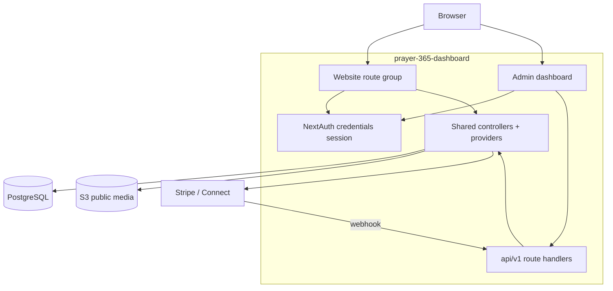

# Customer website specification

Prepared: 12 October 2026. Status: draft.

## 1. Scope and decisions

The customer website runs inside `prayer-365-dashboard`, sharing the Next.js process, PostgreSQL database, and backend logic with the admin dashboard. [DESIGN.md](DESIGN.md) details screen layouts and UI behavior; [FEATURE.md](FEATURE.md) outlines feature scope. Website functionality focuses on prayer feeds, donations, and customer onboarding. Cross-references cite `docs/SPEC.md` as "admin SPEC §x".

Open decisions (details in section 13):

Decision status (details in section 13):

| Ref | Decision                            | Status                            |
| --- | ----------------------------------- | --------------------------------- |
| W1  | Customer sign-in through NextAuth   | Resolved — Option B (14 Oct 2026) |
| W2  | Donation payment model / currencies | Open (inherits D6)                |
| W3  | Stripe Connect account setup + fees | Open                              |
| W4  | Prayer language filtering at launch | Open                              |
| W5  | Privacy notice / legal text         | Open                              |

## 2. Architecture

### 2.1 Overview



The website never calls mobile bearer endpoints under `/api/v1/mobile/*`. Those routes require bearer tokens verified by `requiredAuth`. Instead, website routes call shared backend controllers and providers directly using a NextAuth cookie session. This eliminates a network hop and keeps session checks centralized.

### 2.2 Website access layer

- Add route group at `src/app/(site)/*`.
- Protect routes and server components using NextAuth cookie sessions.
- Use `requiredWebAuth` (a `requiredAuth` variant) to:
  - extract the session user (`user_id`, `email`, `name`),
  - verify active account status (`status === 'active'` and current `auth_version`),
  - skip role and permission checks, since customers have no staff role.
- Reuse shared controllers from `src/controller/mobile.tsx`: `listPublicChurches`, `getPublicChurch`, `getHome`, `listPublishedPrayers`, `getPublishedPrayer`, `getMe`, `patchMe`, `listMyChurches`, `setFollow`, `listPublicEvents`, and `listPublicAnnouncements`. The Primary Parish badge on the church profile resolves from `getHome` (`mainChurch.id`).

### 2.3 File layout

```
src/app/(site)/                          # Route pages
src/contents/site/                       # Screen components
src/hooks/data/site/                     # TanStack Query hooks (site routes call src/controller/mobile directly)
src/utils/required-webauth.ts            # Web session guard
src/app/api/v1/webhooks/stripe/route.ts # Shared Stripe webhook
```

No separate database schema needed. The website reads existing Prisma models.

## 3. Identity and authentication

- NextAuth v5 **credentials** strategy with JWT session (existing `src/auth.ts`).
- **W1 resolved (14 Oct 2026): Option B.** `registerUser` creates customers
  with the `prayer_user` role (no admin grants). NextAuth `authorize` / `jwt`
  also accept role-less accounts, which remain only as legacy customers.
- Customer vs staff is one rule (`src/utils/customer-role.ts`): no role or
  `prayer_user` = customer. The admin dashboard and the token login
  `POST /api/v1/auth/login` are **staff-only**; customers are redirected to `/`.
  One email = one role: a church/region assignment is refused for a customer
  (`USER_IS_CUSTOMER`); staff are created or promoted in user management.
- Signup collects name, email and password only. `locale` is optional at
  signup and remains `null` until onboarding; `main_church_id` is optional (must be APPROVED
  when sent). Both are set during onboarding (`/customer/setup`).
- Register / verify / resend use existing `src/app/api/v1/auth/signup`,
  `verify-email`, `resend-verification` and `src/controller/auth.tsx`.
- Forgot/reset reuse existing `/forgot-password`, `/reset-password` and
  `POST /api/v1/auth/reset-password`.
- Website guard util `requiredWebAuth` revalidates the live user on every
  protected read (active + `auth_version`), same rule as `required-auth`.

## 4. Page route map

| Route                     | Screen          | Auth   | Backend called (controller)                                                                                              |
| ------------------------- | --------------- | ------ | ------------------------------------------------------------------------------------------------------------------------ |
| `/`                       | Home (W06)      | Yes    | `getHome`                                                                                                                |
| `/login`                  | Sign In (W01)   | Public | NextAuth credentials                                                                                                     |
| `/register`               | Register (W02)  | Public | `registerUser`                                                                                                           |
| `/verify-email`           | Verify (W03)    | Public | `verifyEmail`                                                                                                            |
| `/forgot-password`        | Forgot (W04)    | Public | Send reset email                                                                                                         |
| `/reset-password`         | Reset (W04)     | Public | `resetPassword`                                                                                                          |
| `/customer/setup`         | Setup (W05)     | Yes    | Patch locale + main/follow                                                                                               |
| `/churches`               | Directory (W07) | Yes    | `listPublicChurches` (search, radius, denomination, language, quick filters)                                             |
| `/churches/:slug`         | Profile (W08)   | Yes    | `getPublicChurch` (gallery, staff), `listPublicEvents`, `listPublicAnnouncements`, `getHome`                             |
| `/churches/:slug/prayers` | Prayers (W09)   | Yes    | `listPublishedPrayers`                                                                                                   |
| `/prayers/:slug`          | Prayer (W10)    | Yes    | `getPublishedPrayer`                                                                                                     |
| `/donate`                 | Donation (W11)  | Yes    | `?church={slug}` names the beneficiary; bare `/donate` resolves the Main Church, else a gated beneficiary picker (WB-41) |
| `/donate/result`          | Result (W12)    | Yes    | Donor / attempt status                                                                                                   |
| `/customer`               | Profile (W13)   | Yes    | `getMe` / `patchMe` / avatar upload                                                                                      |

Routing guard: any website page except the four public account pages requires
a session; unauthenticated visitors go to `/login`. Content is never rendered
to unauthenticated visitors (see FEATURE WF1).
`/login` and `/register` are guest-only for customers: a live authenticated
customer session is redirected to `/` before either form is rendered.

Customers and staff use separate sign-in paths. Customers sign in at `/login`. Staff use `/admin/login`. Both share NextAuth credentials handling in `src/auth.ts` and the sign-in form component.

## 5. Data and DTOs

Four schema additions support website features: the `church_gallery_items` table (decision W6), the `cta_label` column on `events` (decision W15), the `church_style` column on `churches` (decision W16) and the three quick-filter booleans on `churches` (decision W17). All other features reuse existing models from admin SPEC §5 and mobile DTOs in `src/models/mobile.tsx`.

| Data                    | Source / model                                                | Notes                                                                                                                                                                  |
| ----------------------- | ------------------------------------------------------------- | ---------------------------------------------------------------------------------------------------------------------------------------------------------------------- |
| Church (public)         | `MobilePublicChurchSchema`                                    | Includes `coverUrl`, `serviceTimes`, `deaneryName`, `gallery`, `staff`, and `contacts`.                                                                                |
| Church summary          | `MobileChurchSummarySchema`                                   | Summary for cards: cover, address, description, pastor, and service times.                                                                                             |
| Church style pill       | `Church.church_style`                                         | Free-text worship style shown as the directory card pill (migration `20261016120000_add_church_style`); `null` hides the pill.                                         |
| Directory quick flags   | `Church.sunday_live_stream`, `taize_chants`, `youth_ministry` | Nullable booleans backing the three quick filters (migration `20261013153502_add_church_quick_filters`).                                                               |
| Church list query       | `MobileChurchListQuerySchema`                                 | Query parameters: search, radius, coordinates, denomination, language, and quick-filter flags.                                                                         |
| Published prayer        | `MobilePublishedPrayerSchema`                                 | Prayer audio returns `assetId`, `assetKey` (mobile) and `assetUrl` (public read URL built with `S3_PUBLIC_URL`).                                                       |
| Church prayers (public) | `GET /api/v1/site/churches/:churchId/prayers`                 | Feeds church playlist on W08 using `listPublishedPrayers` with category filters and isolated HTML5 audio playback.                                                     |
| Home projection         | `MobileHomeSchema`                                            | Returns `mainChurch`, `followedChurches`, and `latestPrayers`.                                                                                                         |
| Profile / main church   | `MobileMeSchema`, `MobileMePatchSchema`                       | Updates user details and primary parish selection.                                                                                                                     |
| Follow relationships    | `listMyChurches` / `setFollow`                                | Reads and updates followed church IDs.                                                                                                                                 |
| Language                | `Language` table                                              | Needs `sv` seed.                                                                                                                                                       |
| Donation                | `Donation`, `DonationSubscription`, `PaymentAccount`          | Shared backend models for donations and connected accounts.                                                                                                            |
| Prayer petitions        | `POST /api/v1/site/churches/:churchId/requests`               | Calls `submitRequest` (`MobileRequestInputSchema`) to insert into `requests` with rate limits and idempotency keys.                                                    |
| Church gallery          | `ChurchGalleryItem` table                                     | Stores church photos (migration `20261015120000_add_church_gallery_items_and_sanctuary_hours`). Exposed as `gallery` on `MobilePublicChurch`, sorted by `order_index`. |
| Church staff (public)   | `ChurchPastor` + `Pastor`                                     | Public staff list (`staff`) with name, pastoral role, and avatar.                                                                                                      |
| Upcoming events         | `Event` via `listPublicEvents`                                | Active events (`starts_at >= now`). Action button uses `Event.cta_label`, falling back to localized default.                                                           |
| Announcements           | `Announcement` via `listPublicAnnouncements`                  | Published records (`deleted_at is null`), newest first, limit 2. Prefixes in square brackets supply category badges.                                                   |
| Primary Parish badge    | `getHome` -> `mainChurch.id`                                  | Renders on church profile when `mainChurch.id === churchId`.                                                                                                           |
| Deanery (public)        | `Church.org_node.parent`                                      | Parent org node where `kind = 'DEANERY'`. Exposed as `deaneryName`.                                                                                                    |

### 5.1 Language seed

- The mobile app ships `en/et/sv/fi`. The backend `Language` seed only has
  `en/et/fi` (`prisma/seeds/language.ts`) and content languages use `en/et`.
- Add a `sv` language seed (code `sv`, name `Svenska`) and expose it in the
  language contract used by the website language selector.
- Website UI strings ship in the four locales (reuse/extend the mobile
  translation keys at the website layer; mobile translations are not imported
  into this repo). et/sv/fi are drafts until a native-speaker review.
- The user's language is chosen after signup at `/customer/setup` (the selector starts at `en`) and
  saved with `PATCH /api/v1/site/me`; it must be a site locale and cannot be
  cleared. The main church is optional and **can be cleared** with
  `mainChurchId: null` (same as mobile `PATCH M/me`).

### 5.2 Prayer audio playback

Audio files live in the public S3 bucket (decision D13). The player builds playback URLs from the prayer asset key using `S3_PUBLIC_URL`. Requests send no authorization header, matching mobile client behavior.

### 5.3 Church directory query parameters

The directory panel accepts these query parameters:

- `search`: Substring match on church name and city.
- `radius_km`: Distance filter (5, 10, 25, or 50 km) relative to `latitude` and `longitude`.
- `denomination`: Case-insensitive match on denomination (e.g. Lutheran / EELK, Baptist, Orthodox, Catholic).
- `language`: Two-letter ISO code (`et`, `en`, `sv`, `fi`) matched against `churchLanguages`.
- Quick filter flags:
  - `sunday_live_stream`: Congregations broadcasting services online.
  - `taize_chants`: Churches offering Taizé chant services.
  - `youth_ministry`: Churches with active youth programs.

```ts
const booleanish = z.preprocess(
  (v) =>
    v === true || v === 'true' || v === '1'
      ? true
      : v === false || v === 'false' || v === '0'
        ? false
        : undefined,
  z.boolean().optional(),
)

export const MobileChurchListQuerySchema = z.object({
  page: z.coerce.number().int().positive().default(1),
  limit: z.coerce.number().int().positive().max(100).default(25),
  search: z.string().trim().max(200).optional(),
  latitude: z.coerce.number().min(-90).max(90).optional(),
  longitude: z.coerce.number().min(-180).max(180).optional(),
  radius_km: z.coerce.number().positive().optional(),
  denomination: z.string().trim().max(100).optional(),
  language: z.string().trim().min(2).max(10).optional(),
  // `z.coerce.boolean()` turns "false" into true; these flags accept only
  // true/1/"true" and false/0/"false", anything else is ignored.
  sunday_live_stream: booleanish.optional(),
  taize_chants: booleanish.optional(),
  youth_ministry: booleanish.optional(),
})
```

## 6. API and backend contract

Website reads call shared controllers directly (section 2.2). No separate read endpoints exist.

### 6.1 Reused endpoints

| Area                    | Endpoint / controller                                                                      | Status |
| ----------------------- | ------------------------------------------------------------------------------------------ | ------ |
| Register                | `POST /api/v1/auth/signup`                                                                 | Built  |
| Verify email            | `POST /api/v1/auth/verify-email` + resend                                                  | Built  |
| Password                | `POST /api/v1/auth/reset-password`, forgot                                                 | Built  |
| Discover                | `GET /api/v1/site/churches` (controller `listPublicChurches`)                              | Built  |
| Home                    | `GET /api/v1/mobile/home` (shared controller)                                              | Built  |
| Prayers                 | `GET .../prayers`, `GET /prayers/:slug`                                                    | Built  |
| Profile                 | `GET/PATCH /me`, avatar upload                                                             | Built  |
| Church events           | `GET /api/v1/site/churches/:churchId/events` (controller `listPublicEvents`)               | Built  |
| Church announcements    | `GET /api/v1/site/churches/:churchId/announcements` (controller `listPublicAnnouncements`) | Built  |
| Church prayers          | `GET /api/v1/site/churches/:churchId/prayers` (controller `listPublishedPrayers`)          | Built  |
| Church prayer petitions | `POST /api/v1/site/churches/:churchId/requests` (controller `submitRequest`)               | Built  |
| Site home               | `GET /api/v1/site/home` (controller `getHome` with `requiredWebAuth`)                      | Built  |

### 6.2 Directory search evaluation (W07)

`GET /api/v1/site/churches` calls `listPublicChurches` and evaluates filters in order:

1. Status: Returns only approved churches (`status = APPROVED`). Suspended, unapproved, and archived records drop out.
2. Text: Case-insensitive substring search across `name` and `address->>'city'`.
3. Radius: Computes distance using the haversine formula against `church.latitude` and `church.longitude`. Drops records beyond `radius_km`. When coordinates are provided without `radius_km`, sorts nearest first.
4. Denomination: Case-insensitive match on `church.denomination`.
5. Language: Matches linked `churchLanguages` records where `language_code = language`.
6. Quick filters:
   - `sunday_live_stream`: Churches with stream metadata.
   - `taize_chants`: Matches services or tags mentioning Taizé prayer.
   - `youth_ministry`: Matches services or tags for youth programs.
7. Pagination: Standard envelope (`result`, `total`, `page`, `limit`).

### 6.3 Shared donation backend

Stripe processing uses the shared backend (`docs/SPEC.md` §8.5, §9.6 and `docs/TASK.md` under F8DO and X-MOB). The website calls the shared donation controller using the customer session instead of building separate payment logic. Checkout creation and checkout session retrieval are wired to the Stripe SDK in `src/providers/stripe.tsx`, and the webhook → `payment.sync` worker pipeline writes `Donation` and `DonationSubscription` rows.

Website donation tasks depend on these admin deliverables:

| Admin task (docs/TASK.md) | Deliverable                                              | Website consumer               |
| ------------------------- | -------------------------------------------------------- | ------------------------------ |
| DO-02 (F8DO)              | Stripe providers, controllers, webhook shell             | WB-40 (TASK)                   |
| DO-05 (F8DO)              | Stripe webhook verification, receipt storage, outbox     | Donation confirmation state    |
| DO-06 (F8DO)              | `payment.sync`: deduplication, donation upserts          | Donation confirmation state    |
| DO-08 (F8DO)              | Backend Stripe tests (idempotency, out-of-order events)  | WB-44 (UI tests)               |
| MB-02 (X-MOB)             | `POST M/churches/:churchId/donations` and attempt status | Donation entry and result      |
| MB-03 (X-MOB)             | `DonationOptions` on public church payload               | Donation screen amount choices |

The website layer provides only thin server actions calling the shared donation controller, plus donation screens and hooks (`docs/website/TASK.md` WB-40 through WB-44).

When the backend Stripe integration is disabled (`STRIPE_ENABLED !== 'true'`), the donation button stays disabled with an explanatory notice (`DONATIONS_NOT_READY`). The UI never reports a payment as confirmed without a verified `Donation` row written by the webhook.

### 6.4 Response conventions

Route handlers return standard API envelopes: `{ success, message, result, ..., request_id }` and `GeneralError` structures (admin SPEC §6.1). Donation requests require an `Idempotency-Key` header.

### 6.5 Church profile payload and actions (W08)

All profile interactions run through shared controllers guarded by `requiredWebAuth`. Unapproved churches return 404.

- `gallery`: Returns `READY` image assets from `church_gallery_items`, sorted by `order_index` ascending. URLs resolve via public S3.
- `staff`: Active pastoral staff (`name`, `pastoralRole`, `imageUrl`). Direct contacts show only when present in church contact fields.
- `prayers`: Liturgical audio entries from `GET /api/v1/site/churches/:churchId/prayers`. Supports category filtering and inline transcripts.
- `requests`: Petitions submitted via `POST /api/v1/site/churches/:churchId/requests` through `submitRequest`. Writes to `requests` with rate limits and idempotency keys.
- `events`: Up to 3 upcoming events (`starts_at >= now`), sorted chronologically. Button text uses `cta_label`, falling back to localized defaults.
- `announcements`: Up to 2 active announcements (`deleted_at is null`), newest first. Title or body prefixes provide category badges.
- `deaneryName`: Name of the parent org node where `kind = 'DEANERY'`.
- `stewardship`: Preset donation amounts with custom entry and tax-deductibility notices.

## 7. Feature flows

### 7.1 WF1: Onboarding

1. `/register` (name, email, password) → `registerUser` → user with the `prayer_user` role, locale `null` until onboarding + verification email.
2. User clicks verification link, setting `email_verified_at`.
3. `/login` (NextAuth credentials, W1 Option B) → session.
4. First visit to a website page without completed onboarding → `/customer/setup`: parish (optional) then language. Step 1 immediately saves the selected parish (or `null` when skipped); step 2 immediately saves the selected locale, or English when skipped, and completes onboarding.
5. `/customer` (profile) → view/edit name, locale, picture; set, change or clear the main church; follows.

### 7.2 WF2: Directory

Directory flows filter approved congregations across the region:

1. Search by name or city (`search`).
2. Filter by radius (`radius_km`) from coordinates (`latitude`, `longitude`).
3. Filter by denomination (`denomination`) or service language (`language`).
4. Apply quick filters for Sunday live stream, Taizé chants, or youth ministry.
5. Directory displays a split layout:
   - Left: cards with service times and contact links.
   - Right: interactive map synchronized with filtered pins and selection state.
6. Opening `/churches/:slug` (church slug, migration `20261022120000_add_church_slug`) loads public profile details, gallery items, upcoming events, published announcements, pastoral staff, and the primary parish badge when matching `mainChurch.id`.

### 7.3 WF3: Prayer

Home loads the `getHome` projection for primary church, followed churches, and recent published prayers. Prayer lists and detail views use published prayer controllers. Audio streams from public S3 URLs. Unapproved or draft content stays hidden.

### 7.4 WF4: Donations

1. User clicks Donate on a church profile.
2. Donation screen loads payment options, frequencies, and amounts from `DonationOptions` (task MB-03).
3. Website calls the shared donation controller with the customer session. The controller creates a Stripe Checkout session and returns the checkout URL.
4. User completes payment in Stripe. The backend webhook (DO-05) verifies signatures and `payment.sync` (DO-06) writes `Donation` or `DonationSubscription` rows.
5. User returns to `/donate/result`, which verifies recorded payment state against the database rather than trusting query parameters alone.

## 8. Infrastructure

| Component       | Details                                                                                                                                                                                                                                                                                                                         |
| --------------- | ------------------------------------------------------------------------------------------------------------------------------------------------------------------------------------------------------------------------------------------------------------------------------------------------------------------------------- |
| Hosting         | Shared Next.js deployment with admin dashboard.                                                                                                                                                                                                                                                                                 |
| Domain          | Dedicated customer domain or subdomain.                                                                                                                                                                                                                                                                                         |
| Database        | Shared managed PostgreSQL instance.                                                                                                                                                                                                                                                                                             |
| Media           | Shared S3 bucket with public read access (D13).                                                                                                                                                                                                                                                                                 |
| Maps            | Google Maps JS API via `@vis.gl/react-google-maps`. Key in `GOOGLE_MAPS_API`, exposed as `NEXT_PUBLIC_GOOGLE_MAPS_API`; must be HTTP-referrer restricted per environment. Without a key the map renders a placeholder. Markers use AdvancedMarkerElement; mapId via NEXT_PUBLIC_GOOGLE_MAPS_MAP_ID (falls back to DEMO_MAP_ID). |
| Payments        | Stripe. Per-church connected accounts (`PaymentAccount`) are NOT implemented yet (decision W3): checkout today uses one platform account (`STRIPE_PLATFORM_ACCOUNT_ID`) and attributes the donation through `churchId` metadata.                                                                                                |
| Email           | Shared SES/Nodemailer pipeline for transactional emails.                                                                                                                                                                                                                                                                        |
| Background jobs | Shared scheduler and worker pool for `payment.sync` (admin SPEC §10.3).                                                                                                                                                                                                                                                         |

## 9. Security and privacy

- Protected pages require an active session and never render content for unauthenticated users.
- `requiredWebAuth` revalidates live account status and token version on every read.
- The app stores no raw payment details. Donations route through Stripe; per-church connected accounts are decision W3 and not implemented yet (today: one platform account + `churchId` metadata).
- Logs exclude payment amounts and sensitive profile data.
- Shared backend routes verify Stripe webhook signatures before persisting payment status.
- Interface language operates independently from church location.
- Public staff listings show only name, role, and photo (decision W7). Internal contact channels stay private.
- Gallery media uses public S3 assets (D13) without signed URLs.

## 10. Verification matrix

| Check                         | Expected outcome                                                                   |
| ----------------------------- | ---------------------------------------------------------------------------------- |
| Customer sign-in              | Role-less user signs in successfully after decision W1.                            |
| Registration and verification | User completes signup and verification; unverified users cannot sign in.           |
| Directory approvals           | Suspended and archived churches never appear in directory results.                 |
| Directory filters             | Text search, radius, denomination, and language return matching approved churches. |
| Home feed                     | `getHome` returns primary church and published prayers; drafts stay hidden.        |
| Audio playback                | Player streams audio from public S3.                                               |
| Donation webhook              | Webhook verifies signature, deduplicates events, and writes `Donation` rows.       |
| Language selector             | Switching between `en`, `et`, `sv`, and `fi` updates UI text cleanly.              |
| Session expiration            | Expired sessions redirect to `/login` without exposing stale data.                 |
| Access control                | Customer accounts cannot access admin routes or dashboard screens.                 |

## 11. Deferred features

Pastoral meeting booking, check-in, push notifications, guest browsing, admin management screens, full event registration, announcement authoring, and in-site account deletion remain deferred per `FEATURE.md`. Events and announcements appear strictly as read-only cards on church profiles. Prayer petitions submit directly through the church profile.

## 12. Scope boundaries

Keep website scope limited to prayer, donations, and customer onboarding. New features require written scope changes.

## 13. Decision register

| Ref | Decision                                                                                                                                                                             | Status / Impact                                                                                                                                                                                   |
| --- | ------------------------------------------------------------------------------------------------------------------------------------------------------------------------------------ | ------------------------------------------------------------------------------------------------------------------------------------------------------------------------------------------------- |
| W1  | Customer NextAuth sign-in branch for role-less accounts.                                                                                                                             | Resolved (Option B) — prayer_user on signup; admin is staff-only.                                                                                                                                 |
| W2  | Donation payment model, currency list, preset amounts, and recurring fees.                                                                                                           | Open (no longer blocks WF4 UI). MB-03 `donationOptions` ships with per-church currency/presets/monthly flag plus an EUR fallback; the agreed currency list and fee treatment are still undecided. |
| W3  | Stripe Connect onboarding flow, payout schedules, and redirect URLs.                                                                                                                 | Open. Blocks per-church payouts only — checkout runs on one platform account today.                                                                                                               |
| W4  | Prayer language filtering and launch translations.                                                                                                                                   | Open. Blocks WF3 (prayer feed)                                                                                                                                                                    |
| W5  | Privacy policy and legal notices for customer accounts.                                                                                                                              | Open. Blocks WF1 (registration)                                                                                                                                                                   |
| W6  | Store church photos in `church_gallery_items`. Admin gallery tab (upload, caption, reorder, remove) is implemented in this branch — supersedes the earlier "admin UI deferred" note. | Implemented (migration 20261015120000)                                                                                                                                                            |
| W7  | Limit public staff listings to name, pastoral role, and photo.                                                                                                                       | Implemented                                                                                                                                                                                       |
| W8  | Omit announcement category columns; notice cards render title, body, and publish date with category badges from title prefixes.                                                      | Implemented                                                                                                                                                                                       |
| W15 | Add `cta_label` text column to `events`; exposed as `ctaLabel` on public event models and editable in admin EventForm.                                                               | Implemented (migration 20261015150000)                                                                                                                                                            |
| W16 | Add nullable `church_style` text column to `churches`; exposed as `churchStyle` on `MobileChurchSummary` and rendered as the directory card pill.                                    | Implemented (migration 20261016120000)                                                                                                                                                            |
| W17 | Add nullable `sunday_live_stream`, `taize_chants`, `youth_ministry` booleans to `churches` to back the directory quick filters.                                                      | Implemented (migration 20261013153502)                                                                                                                                                            |

## 14. References

- `docs/website/OVERVIEW.md`, `FEATURE.md`, `DESIGN.md`, `TASK.md`, and `BOM.md`.
- `docs/SPEC.md` (admin and shared backend) and `docs/TASK.md` (admin tasks).
- `prayer-365-mobile-app/docs/*` (mobile customer journey and locale definitions).
