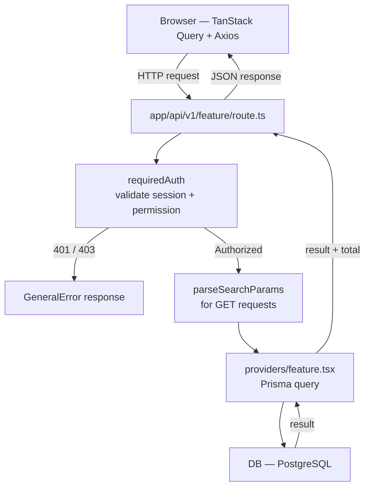
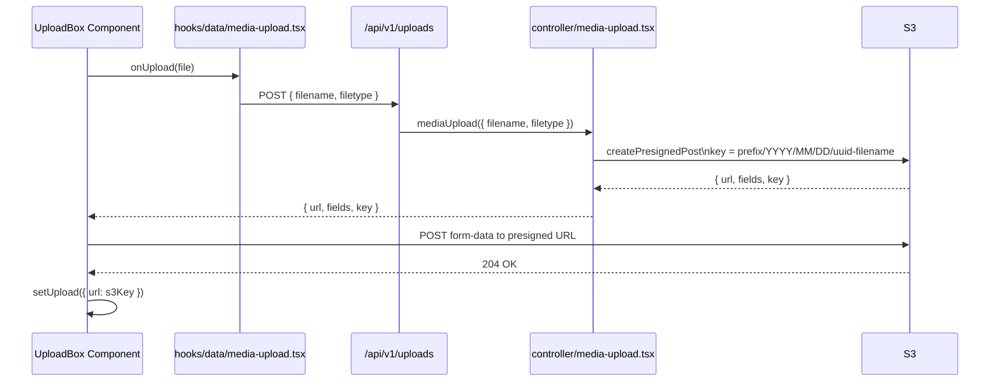
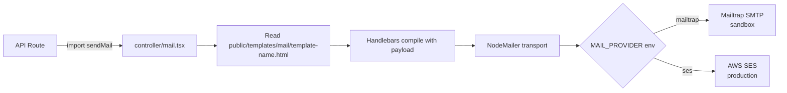
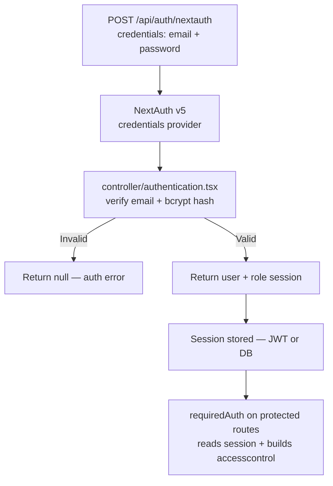

# Catatia — Next.js Dashboard Template Spec

> **Template Repo:** `git@github.com:Catalyst-Inertia/template-dashboard-nextjs.git`
> **Last Updated:** April 2026
>
> This document is the **single source of truth** for all Next.js projects built on the Catatia dashboard template. Every new project must follow the conventions, structure, and patterns defined here.

---

## 0. Pre-requirements

| Category               | Technology                                               |
| :--------------------- | :------------------------------------------------------- |
| **Framework**          | Next.js 15+ (App Router)                                 |
| **Language**           | TypeScript                                               |
| **ORM**                | Prisma 6 (PostgreSQL)                                    |
| **Data Fetching**      | TanStack Query v5 (React Query) + Axios                  |
| **UI Library**         | Ant Design 5 (Antd)                                      |
| **Styling**            | Tailwind CSS + SCSS modules                              |
| **Auth**               | NextAuth.js v5 — Credentials Provider only               |
| **File Storage**       | AWS S3 — presigned POST via `@aws-sdk/s3-presigned-post` |
| **Email**              | NodeMailer + Handlebars HTML templates                   |
| **Email — Staging**    | Mailtrap (`MAIL_PROVIDER=mailtrap`)                      |
| **Email — Production** | AWS SES (`MAIL_PROVIDER=ses`)                            |
| **Permission**         | `accesscontrol` library                                  |
| **Error Handling**     | `GeneralError` class (built into template)               |
| **Deployment**         | Vercel                                                   |
| **Logging**            | Winston — Vercel console output only, not persisted      |

---

## 1. Folder Structure

Every project follows this exact `src/` layout. Only the feature folders inside each layer change per project.

```
src/
├── app/                          ← Next.js App Router
│   ├── (page)/                   ← Public-facing pages group
│   │   ├── layout.tsx
│   │   └── page.tsx
│   ├── dashboard/                ← Admin panel pages
│   │   ├── layout.tsx
│   │   ├── page.tsx              ← Dashboard overview / stats
│   │   └── user-management/      ← Always present (from template)
│   │       ├── user/
│   │       └── role/
│   ├── login/
│   │   └── page.tsx
│   └── api/
│       ├── [...nextauth]/
│       │   └── route.ts
│       └── v1/                   ← All API routes under /api/v1/
│           ├── uploads/          ← S3 presigned POST (template)
│           ├── mail/             ← NodeMailer send (template)
│           ├── permissions/      ← Permission list (template)
│           ├── roles/            ← Role CRUD (template)
│           ├── users/            ← User CRUD (template)
│           └── <feature>/        ← Project-specific routes
│
├── components/
│   ├── common/                   ← Reusable UI atoms/molecules
│   │   ├── upload-box/           ← S3 upload component (template)
│   │   ├── password-input/
│   │   ├── search-input/
│   │   ├── select/
│   │   └── ...
│   └── container/                ← Layout wrappers
│       ├── dashboard/            ← Admin shell (sidebar, header, footer)
│       ├── page/                 ← Public shell (header, footer)
│       └── global-provider/      ← TanStack Query + Antd providers
│
├── contents/                     ← Page-level UI logic
│   │                               Keeps app/ thin — all JSX lives here
│   ├── user-management/          ← Template provided
│   │   ├── user/
│   │   └── role/
│   └── <feature>/                ← One folder per feature
│
├── controller/                   ← Server-side business logic
│   ├── authentication.tsx        ← Template provided
│   ├── mail.tsx                  ← Template provided
│   ├── media-upload.tsx          ← Template provided
│   ├── generate-pdf.tsx          ← Template provided
│   └── <feature>.tsx             ← Project-specific logic
│
├── providers/                    ← Prisma DB operations (CRUD per entity)
│   ├── _example.tsx              ← Reference: basic CRUD
│   ├── _example-with-pagination.tsx ← Reference: paginated CRUD
│   ├── permission.tsx            ← Template provided
│   ├── role.tsx                  ← Template provided
│   ├── user.tsx                  ← Template provided
│   └── <feature>.tsx             ← Project-specific DB queries
│
├── hooks/
│   ├── data/                     ← TanStack Query hooks per entity
│   │   ├── _example.tsx          ← Reference hook pattern
│   │   ├── media-upload.tsx      ← Template provided
│   │   ├── permission.tsx        ← Template provided
│   │   ├── role.tsx              ← Template provided
│   │   ├── user.tsx              ← Template provided
│   │   └── <feature>.tsx
│   └── ui/                       ← UI state hooks
│       ├── confirm-modal.tsx
│       ├── notification.tsx
│       ├── screen-size.tsx
│       └── scroll-detection.tsx
│
├── models/                       ← TypeScript interfaces & types
│   ├── general-query-params.tsx  ← Template provided
│   ├── general-hook.tsx          ← Template provided
│   ├── general-db-transaction.tsx
│   ├── send-mail.tsx             ← Template provided
│   ├── media-upload.tsx          ← Template provided
│   └── <feature>.tsx
│
├── utils/                        ← Pure utility functions
│   ├── general-error.ts          ← GeneralError class
│   ├── required-auth.ts          ← Auth + permission guard
│   ├── access-permission.ts      ← accesscontrol builder
│   ├── role-to-access-control.ts ← Role → AC transform
│   ├── parse-search-params.ts    ← Query param parser
│   ├── db-connection.ts          ← Prisma client singleton
│   ├── db-transaction.ts
│   ├── keyword-search.ts
│   ├── hash.ts
│   ├── form-rule.ts
│   └── ...
│
├── data/                         ← Static config / data
│   ├── sidebar-data.tsx          ← Admin sidebar nav items
│   ├── page-navigation.tsx
│   └── ...
│
├── config/
│   └── antdTheme.tsx             ← Antd theme tokens
│
├── styles/
│   ├── global.scss
│   └── _variables.scss
│
└── auth.ts                       ← NextAuth v5 config
```

---

## 2. Data Flow

### 2.1 Request → Response (Admin API)



### 2.2 File Upload (S3 Presigned POST)



### 2.3 Email Send



### 2.4 Auth Flow



---

## 3. Main Components (Template Provided)

These exist in the template and must be **reused, not rebuilt** in every project.

### 3.1 `components/common/upload-box`

Ant Design Upload wrapper with S3 presigned POST built in.

```tsx
<UploadBox
  formName="cv"
  label="Upload CV"
  upload={upload} // { url: string | null }
  setUpload={setUpload} // useState setter
  width="200px"
  height="200px"
  rules={[{ required: true }]}
/>
```

- Calls `hooks/data/media-upload.tsx` → `POST /api/v1/uploads` internally
- Handles image preview, video preview, and file remove
- Returns S3 key/URL via `upload.url`

---

### 3.2 `controller/mail.tsx`

NodeMailer + Handlebars email sender. Env-switched between Mailtrap and SES.

```ts
await sendMail({
  from: process.env.MAIL_FROM!,
  to: 'recipient@example.com',
  subject: 'Subject here',
  template_name: 'your-template', // → public/templates/mail/your-template.html
  payload: { name: 'John', someVar: 'value' }, // injected into Handlebars
  baseUrl: process.env.BASE_URL,
})
```

- Templates live in `public/templates/mail/*.html`
- Handlebars variables: `{{ name }}`, `{{ currentDate }}`, `{{ host }}`, + any custom `payload` fields

---

### 3.3 `controller/media-upload.tsx`

S3 presigned POST generator.

```ts
const result = await mediaUpload({ filename: 'cv.pdf', filetype: 'application/pdf' })
// result: { url, fields, key }
// key pattern: prefix/YYYY/MM/DD/uuid-filename
```

Env vars required: `AWS_REGION`, `AWS_BUCKET_NAME`, `AWS_PREFIX` (optional)

---

### 3.4 `utils/required-auth.ts`

Auth guard for API routes. Throws `GeneralError(401)` if no session.

```ts
const { session, permission } = await requiredAuth()
// session.user.role.name — current user's role
// permission.readAny('subject').granted — permission check
```

---

### 3.5 `utils/general-error.ts`

Standardised error class used across all API routes.

```ts
throw new GeneralError({
  code: 403,
  error: 'UNAUTHORIZED',
  error_code: 'NOT_ALLOWED',
  details: 'This account is not allowed for this action',
})
```

Response shape: `{ code, error, error_code, details }`

---

### 3.6 `utils/parse-search-params.ts`

Parses URL query params for list endpoints.

```ts
const { search, page, limit, order_by, order_direction } = parseSearchParams(
  req.nextUrl.searchParams,
)
```

Supports: `search`, `page`, `limit`, `order_by`, `order_direction` — all optional, typed.

---

### 3.7 `hooks/ui/notification.tsx`

Antd notification helper. Use instead of calling Antd directly.

```ts
const notification = useMainNotification()
notification({ type: 'success', entity: 'job', action: 'created' })
notification({ type: 'error', entity: 'application', action: 'updated' })
```

---

## 4. Conventions

### API Routes

- All under `/api/v1/`
- One file per HTTP method group: `route.ts` for collection, `[id]/route.ts` for single item
- Always use `try/catch` with `GeneralError` + generic `Error` fallback
- Always call `requiredAuth()` on protected routes
- Response shape for lists: `{ success, message, result[], total }`
- Response shape for single: `{ success, message, result }`

### Providers (DB layer)

- One file per Prisma model: `providers/<model>.tsx`
- Function naming: `GET_<MODEL>S`, `GET_<MODEL>_BY_ID`, `CREATE_<MODEL>`, `UPDATE_<MODEL>`, `DELETE_<MODEL>`
- Always use `db.$transaction([count, findMany])` for paginated list queries
- Use `keywordSearch()` util for search filter building

### Hooks (TanStack Query)

- One file per entity: `hooks/data/<feature>.tsx`
- Two exports per file: `use<Features>` (list) and `use<Feature>` (single)
- Always call `queryClient.invalidateQueries` on mutation success
- Always use `useMainNotification()` for success/error feedback
- Query key pattern: `[queryKey, paginationQuery, searchQuery]`

### Contents (Page UI)

- All page JSX lives in `contents/<feature>/` — `app/` pages import and render them
- Keeps `app/` pages thin (just imports the content component)

### Models (Types)

- One file per entity: `models/<feature>.tsx`
- Export: `<Feature>DataModel`, `<Feature>PayloadCreateModel`, `<Feature>PayloadUpdateModel`

### Naming

- Files: `kebab-case`
- Components: `PascalCase`
- Functions/hooks: `camelCase`
- DB provider functions: `UPPER_SNAKE_CASE`
- Prisma model fields: `snake_case` (matches DB column names)

### Environment Variables

| Variable                | Required | Description                            |
| ----------------------- | -------- | -------------------------------------- |
| `DATABASE_URL`          | ✅       | PostgreSQL connection string           |
| `NEXTAUTH_SECRET`       | ✅       | NextAuth session secret                |
| `NEXTAUTH_URL`          | ✅       | App base URL                           |
| `AWS_REGION`            | ✅       | S3 region                              |
| `AWS_BUCKET_NAME`       | ✅       | S3 bucket                              |
| `AWS_ACCESS_KEY_ID`     | ✅       | AWS credentials                        |
| `AWS_SECRET_ACCESS_KEY` | ✅       | AWS credentials                        |
| `AWS_PREFIX`            | ❌       | S3 key prefix (optional)               |
| `MAIL_PROVIDER`         | ✅       | `mailtrap` or `ses`                    |
| `MAILTRAP_USER`         | staging  | Mailtrap SMTP user                     |
| `MAILTRAP_PASSWORD`     | staging  | Mailtrap SMTP password                 |
| `MAIL_FROM`             | ✅       | Sender email address                   |
| `BASE_URL`              | ✅       | App base URL (used in email templates) |

---

## 5. Permission Model

### How It Works

Permissions are stored in the `Permission` table with three fields:

| Field     | Type     | Description                                  |
| --------- | -------- | -------------------------------------------- |
| `subject` | `string` | Resource name — passed to `readAny(subject)` |
| `actions` | `string` | `read` \| `create` \| `update` \| `delete`   |
| `scope`   | `enum`   | `ANY` \| `OWN`                               |

`TransformRolesToAccessControl` in `utils/role-to-access-control.ts` builds an `accesscontrol` grant object:

```
{ [roleName]: { [subject]: { "[actions]:[scope]": ["*"] } } }
```

The `accesscontrol` library then exposes:

```ts
permission.readAny('subject').granted // actions=read, scope=ANY
permission.createAny('subject').granted // actions=create, scope=ANY
permission.updateAny('subject').granted // actions=update, scope=ANY
permission.deleteAny('subject').granted // actions=delete, scope=ANY
```

### Naming Convention for Subjects

```
<project_prefix>_<resource>
```

Examples:

- `user_management_user` — template default
- `user_management_role` — template default
- `career_application` — outlet23-career
- `career_job` — outlet23-career

### Usage in API Route

```ts
const { permission } = await requiredAuth()

// Read guard
if (!permission.readAny('career_application').granted) {
  throw new GeneralError({
    code: 403,
    error: 'UNAUTHORIZED',
    error_code: 'NOT_ALLOWED',
    details: 'Not allowed',
  })
}

// Create guard
if (!permission.createAny('career_job').granted) {
  throw new GeneralError({
    code: 403,
    error: 'UNAUTHORIZED',
    error_code: 'NOT_ALLOWED',
    details: 'Not allowed',
  })
}
```

### Seeding Permissions

When adding a new project's permissions, add records to the `Permission` table:

```ts
// prisma/seed.ts example
await db.permission.createMany({
  data: [
    { subject: 'career_application', actions: 'read', scope: 'ANY' },
    { subject: 'career_application', actions: 'update', scope: 'ANY' },
    { subject: 'career_job', actions: 'read', scope: 'ANY' },
    { subject: 'career_job', actions: 'create', scope: 'ANY' },
    { subject: 'career_job', actions: 'update', scope: 'ANY' },
    { subject: 'career_job', actions: 'delete', scope: 'ANY' },
  ],
})
```

---

## 6. Code Patterns

### 6.1 API Route — List with Pagination

```ts
// src/app/api/v1/<feature>/route.ts
import { GET_ITEMS } from '@/providers/<feature>'
import { GeneralError } from '@/utils/general-error'
import { parseSearchParams } from '@/utils/parse-search-params'
import requiredAuth from '@/utils/required-auth'
import { NextRequest, NextResponse } from 'next/server'

export async function GET(req: NextRequest) {
  const { limit, page, order_by, order_direction, search } = parseSearchParams(
    req.nextUrl.searchParams,
  )
  try {
    const { permission } = await requiredAuth()
    if (!permission.readAny('<project>_<resource>').granted) {
      throw new GeneralError({
        code: 403,
        error: 'UNAUTHORIZED',
        error_code: 'NOT_ALLOWED',
        details: 'Not allowed',
      })
    }
    const result = await GET_ITEMS({ limit, page, order_by, order_direction, search })
    return NextResponse.json(
      { success: true, message: 'OK', result: result.result, total: result.total },
      { status: 200 },
    )
  } catch (error) {
    if (error instanceof GeneralError) return NextResponse.json(error, { status: error.code })
    if (error instanceof Error) return NextResponse.json({ error: error.message }, { status: 500 })
  }
}

export async function POST(req: NextRequest) {
  const body = await req.json()
  try {
    const { permission } = await requiredAuth()
    if (!permission.createAny('<project>_<resource>').granted) {
      throw new GeneralError({
        code: 403,
        error: 'UNAUTHORIZED',
        error_code: 'NOT_ALLOWED',
        details: 'Not allowed',
      })
    }
    const result = await CREATE_ITEM(body)
    return NextResponse.json(
      { success: true, message: 'Created successfully', result },
      { status: 200 },
    )
  } catch (error) {
    if (error instanceof GeneralError) return NextResponse.json(error, { status: error.code })
    if (error instanceof Error) return NextResponse.json({ error: error.message }, { status: 500 })
  }
}
```

### 6.2 Provider — Paginated CRUD

```ts
// src/providers/<feature>.ts
import { GeneralQueryParams } from '@/models/general-query-params'
import { db } from '@/utils/db-connection'
import keywordSearch from '@/utils/keyword-search'
import { Prisma } from '@prisma/client'

export const GET_ITEMS = async ({ limit, page, order_by, order_direction, search }: GeneralQueryParams) => {
  const offset = page && limit ? (page - 1) * limit : undefined
  const filter: Prisma.<Model>WhereInput = {
    ...(search && { OR: [...keywordSearch({ keyword: search, name: 'title' })] }),
  }
  const [total, result] = await db.$transaction([
    db.<model>.count({ where: filter }),
    db.<model>.findMany({
      take: limit, skip: offset, where: filter,
      orderBy: order_by && order_direction
        ? { [order_by]: order_direction }
        : { created_at: 'desc' },
    }),
  ])
  return { result, total }
}

export const GET_ITEM_BY_ID = async ({ id }: { id: string }) => {
  return db.<model>.findUnique({ where: { id } })
}

export const CREATE_ITEM = async (payload: <Model>PayloadCreateModel) => {
  return db.<model>.create({ data: payload })
}

export const UPDATE_ITEM = async ({ id, payload }: { id: string; payload: <Model>PayloadUpdateModel }) => {
  return db.<model>.update({ where: { id }, data: payload })
}

export const DELETE_ITEM = async ({ id }: { id: string }) => {
  return db.<model>.delete({ where: { id } })
}
```

### 6.3 TanStack Query Hook

```ts
// src/hooks/data/<feature>.tsx
import { useMutation, useQuery, useQueryClient } from '@tanstack/react-query'
import axios from 'axios'
import { useCallback } from 'react'
import { useMainNotification } from '@/hooks/ui/notification'
import { GeneralHooks } from '@/models/general-hook'

const baseUrl = '/api/v1/<feature>'
const entity = '<feature>'
const queryKey = '<features>'

export const use<Features> = ({ limit, page, orderBy, orderDirection, search = '' }: GeneralHooks) => {
  const queryClient = useQueryClient()
  const notification = useMainNotification()
  const paginationQuery = `limit=${limit}&page=${page}&order_by=${orderBy}&order_direction=${orderDirection}`

  const { data, isLoading: fetchLoading } = useQuery({
    queryKey: [queryKey, paginationQuery, search],
    queryFn: async () => {
      const res = await axios.get(`${baseUrl}?${paginationQuery}&search=${search}`)
      return { result: res.data.result, total: res.data.total }
    },
  })

  const { mutateAsync: onCreate, isPending: onCreateLoading } = useMutation({
    mutationFn: useCallback(async (payload: any) => axios.post(baseUrl, payload), []),
    onSuccess: () => {
      queryClient.invalidateQueries({ queryKey: [queryKey] })
      notification({ type: 'success', entity, action: 'created' })
    },
    onError: () => notification({ type: 'error', entity, action: 'created' }),
  })

  const { mutateAsync: onDelete, isPending: onDeleteLoading } = useMutation({
    mutationFn: useCallback(async (id: string) => axios.delete(`${baseUrl}/${id}`), []),
    onSuccess: () => {
      queryClient.invalidateQueries({ queryKey: [queryKey] })
      notification({ type: 'success', entity, action: 'deleted' })
    },
    onError: () => notification({ type: 'error', entity, action: 'deleted' }),
  })

  return {
    data: data?.result,
    total: data?.total,
    loading: fetchLoading || onCreateLoading || onDeleteLoading,
    onCreate,
    onDelete,
  }
}

export const use<Feature> = (id: string) => {
  const queryClient = useQueryClient()
  const notification = useMainNotification()

  const { data, isLoading: fetchLoading } = useQuery({
    queryKey: [entity, id],
    queryFn: async () => {
      const res = await axios.get(`${baseUrl}/${id}`)
      return res.data.result
    },
  })

  const { mutateAsync: onUpdate, isPending: onUpdateLoading } = useMutation({
    mutationFn: useCallback(async (payload: any) => axios.put(`${baseUrl}/${id}`, payload), [id]),
    onSuccess: () => {
      queryClient.invalidateQueries({ queryKey: [queryKey] })
      queryClient.invalidateQueries({ queryKey: [entity, id] })
      notification({ type: 'success', entity, action: 'updated' })
    },
    onError: () => notification({ type: 'error', entity, action: 'updated' }),
  })

  return { data, loading: fetchLoading || onUpdateLoading, onUpdate }
}
```

### 6.4 Model Types

```ts
// src/models/<feature>.tsx
import { <Model> } from '@prisma/client'

export interface <Feature>DataModel extends <Model> {}

export interface <Feature>PayloadCreateModel {
  title: string
  // ... required fields only
}

export interface <Feature>PayloadUpdateModel {
  title?: string
  // ... all optional
}
```

### 6.5 Send Email in API Route

```ts
import sendMail from '@/controller/mail'

await sendMail({
  from: process.env.MAIL_FROM!,
  to: user.email,
  subject: 'Welcome',
  template_name: 'welcome', // → public/templates/mail/welcome.html
  payload: { name: user.name }, // injected as {{ name }} in template
  baseUrl: process.env.BASE_URL,
})
```

### 6.6 Upload in Form (use existing component)

```tsx
import UploadBox from '@/components/common/upload-box'

const [upload, setUpload] = useState<{ url: string | null }>({ url: null })

<UploadBox
  formName="image"
  label="Upload Image"
  upload={upload}
  setUpload={setUpload}
/>

// On submit: use upload.url as the stored S3 key
```

---

## Starting a New Project

1. Clone the template: `git clone git@github.com:Catalyst-Inertia/template-dashboard-nextjs.git <project-name>`
2. Update `package.json` name
3. Copy `.env.example` → `.env.local`, fill in all required vars
4. Extend Prisma schema with project models
5. Run `npx prisma migrate dev --name init`
6. Seed system roles + project-specific permissions
7. Add project feature folders following the structure in Section 1
8. Reference this document for all patterns — do not invent new conventions

---

_Maintained by: Catatia / Bowie_
_Update this doc whenever the template is updated_
